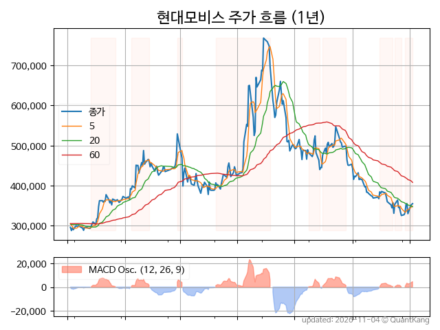
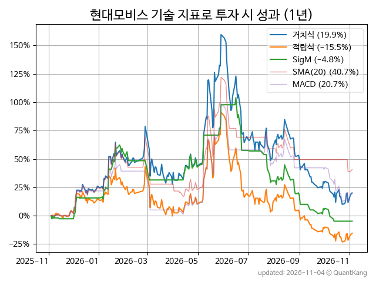
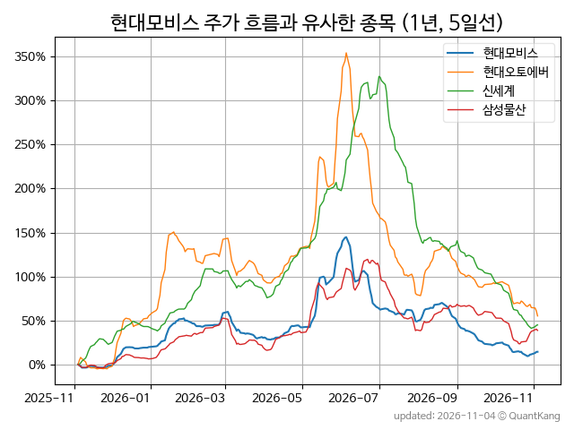
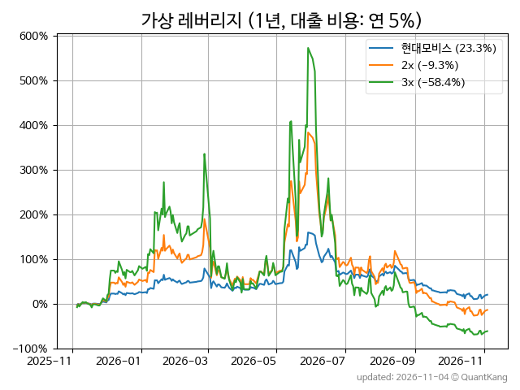

| **종가** | **전일대비** | **업종** | **PER** | **PBR** | **DIV** |
| -------: | -----------: | -------: | ------: | ------: | ------: |
| 355,000 | 0.6<small>%</small> | P:운송장비부품 | 8.7 | 0.6 | 1.8<small>%</small> |

<!-- more -->

> **기업 개요**

| **섹터** | P:운송장비부품 / nan |
| **산업** | 자동차 신품 부품 제조업 |
| **상장** | KOSPI / 1989년 9월 5일 상장 / 12월 결산 |
| **대표자** | 정의선, 이규석 |
| **홈페이지** | [http://www.mobis.com](http://www.mobis.com){:target="_blank"} |

> **최근 7일 DART 신규 공시**

| **일자** |      | **보고서명** |
| :------- | :--- | :----------- |
| 11&#x2011;03 | | [기업설명회(IR)개최(안내공시)              ](https://dart.fss.or.kr/dsaf001/main.do?rcpNo=20261103800425){:target="_blank"} |
| 10&#x2011;30 | | [주요사항보고서(자기주식처분결정)](https://dart.fss.or.kr/dsaf001/main.do?rcpNo=20261030000571){:target="_blank"} |
|  | | [기업설명회(IR)개최(안내공시)              ](https://dart.fss.or.kr/dsaf001/main.do?rcpNo=20261030800645){:target="_blank"} |
|  | | [기업설명회(IR)개최(안내공시)              ](https://dart.fss.or.kr/dsaf001/main.do?rcpNo=20261030800253){:target="_blank"} |
|  | | [연결재무제표기준영업(잠정)실적(공정공시)              ](https://dart.fss.or.kr/dsaf001/main.do?rcpNo=20261030800221){:target="_blank"} |
| 10&#x2011;29 | | [약관에의한금융거래시계열금융회사의거래상대방의공시](https://dart.fss.or.kr/dsaf001/main.do?rcpNo=20261029000561){:target="_blank"} |
|  | | [약관에의한금융거래시계열금융회사의거래상대방의공시](https://dart.fss.or.kr/dsaf001/main.do?rcpNo=20261029000538){:target="_blank"} |
| 10&#x2011;28 | | [의결권대리행사권유참고서류](https://dart.fss.or.kr/dsaf001/main.do?rcpNo=20261028000162){:target="_blank"} |
|  | | [주주총회소집공고](https://dart.fss.or.kr/dsaf001/main.do?rcpNo=20261028000161){:target="_blank"} |
|  | | [[기재정정]주요사항보고서(회사분할결정)](https://dart.fss.or.kr/dsaf001/main.do?rcpNo=20261028000138){:target="_blank"} |

> **주가 흐름**

{: .align-center}

> **주요 가격 변동 지표**<small>[^fn_price_metric]</small>

| **종가** | **전일대비** | **5일** | **20일** | **60일** | **120일** |
| -------: | -----------: | ------: | -------: | -------: | --------: |
| 355,000 | 0.6<small>%</small> | 0.6<small>%</small> | -6.9<small>%</small> | -29.4<small>%</small> | -30.3<small>%</small> |
| **1년** | **편차** | **샤프** | **MDD** | **AvDD** | **MARr** |
| 19.9<small>%</small> | 71.4<small>%</small> | 0.28 | -57.6<small>%</small> | -22.5<small>%</small> | -0.3 |

> **주요 재무 지표**<small>[^fn_finance_metric]</small>

| **업종**<small>[^fn_sector_abbr]</small> | **PER** | **PBR** | **DIV** | **평가**<small>[^fn_finance_basic_tags]</small> |
| :--------------------------------------- | ------: | ------: | ------: | ----------------------------------------------: |
| P:운송장비부품 | 8.7 | 0.6 | 1.8<small>%</small> | - |



> **세부 재무/투자 정보 제공 사이트**

| [네이버](https://m.stock.naver.com/domestic/stock/012330/finance/summary){:target="_blank"}<small>모바일</small> | [네이버](https://finance.naver.com/item/coinfo.naver?code=012330){:target="_blank"} | [FnGuide](https://comp.fnguide.com/SVO2/ASP/SVD_Invest.asp?gicode=A012330&MenuYn=Y){:target="_blank"} |
| :---: | :---: | :---: |
| [와이즈리포트](https://comp.wisereport.co.kr/company/c1040001.aspx?cmp_cd=012330){:target="_blank"} | [밸류라인](https://www.valueline.co.kr/finance/summary/012330){:target="_blank"} | [한국경제](https://markets.hankyung.com/stock/012330/financial-summary){:target="_blank"} |

> **주요 기술 지표**<small>[^fn_tech_metric]</small>

{: .align-center}

| **기술 지표** | **1년** | **편차** | **샤프** | **MDD** | **AvDD** |
| :------------ | ------: | -----------: | -------: | ------: | -------: |
| 거치식 | 19.9<small>%</small> | 71.4<small>%</small> | 0.28 | -57.6<small>%</small> | -22.5<small>%</small> |
| 적립식[^fn_tech_metric_dca] | -15.5<small>%</small> | 70.6<small>%</small> | -0.22 | -59.7<small>%</small> | -24.7<small>%</small> |
| Sig. M[^fn_tech_metric_sigm] | -4.8<small>%</small> | 43.1<small>%</small> | -0.11 | -53.3<small>%</small> | -18.6<small>%</small> |
| SMA<small>(5)</small>[^fn_tech_metric_sma_i] | 5.7<small>%</small> | 50.6<small>%</small> | 0.11 | -34.4<small>%</small> | -12.2<small>%</small> |
| SMA<small>(20)</small>[^fn_tech_metric_sma_i] | 40.7<small>%</small> | 59.8<small>%</small> | 0.68 | -37.4<small>%</small> | -18.3<small>%</small> |
| SMA<small>(60)</small>[^fn_tech_metric_sma_i] | 22.6<small>%</small> | 59.6<small>%</small> | 0.38 | -37.6<small>%</small> | -21.1<small>%</small> |
| SMA<small>(120)</small>[^fn_tech_metric_sma_i] | 18.6<small>%</small> | 65.8<small>%</small> | 0.28 | -49.8<small>%</small> | -23.6<small>%</small> |
| SMA<small>(240)</small>[^fn_tech_metric_sma_i] | 34.9<small>%</small> | 68.4<small>%</small> | 0.51 | -48.0<small>%</small> | -21.9<small>%</small> |
| MACD[^fn_tech_metric_macd] | 20.7<small>%</small> | 60.1<small>%</small> | 0.34 | -43.4<small>%</small> | -18.0<small>%</small> |

> **주가 흐름 유사 종목**<small>[^fn_corr_long]</small>

{: .align-center}

|       | [현대오토에버](/307950/) | [신세계](/004170/) | [삼성물산](/028260/) |
| :---: | :------------------------------------: | :------------------------------------: | :------------------------------------: |
|       | [현대차](/005380/) | [삼성증권](/016360/) | [에스엘](/005850/) |

> **가상 레버리지 상품에 투자했다면**<small>[^fn_lev]</small>

{: .align-center}

> **관련 정보**

- [P:운송장비부품 업종 목록](/stats/sector/kospi_업종_운송장비부품_종목/){: .btn .btn--info}

> **참고 도서** [오렌지사과의 출간 책 소개와 샘플북 목록](https://kongdori.tistory.com/691)

- [왜 위험한 주식에 투자하라는 걸까? - 장기 투자와 분산 투자에 대한 통계학적 시각](https://kongdori.tistory.com/421)
- [파이썬으로 그려보는 투자 포트폴리오 분석  - 정량적 투자 분석을 위한 입문서](https://kongdori.tistory.com/643)
- [구글 시트로 시작하는 투자 포트폴리오 분석 - 오렌지사과의 불친절한 워크북](https://kongdori.tistory.com/449)

