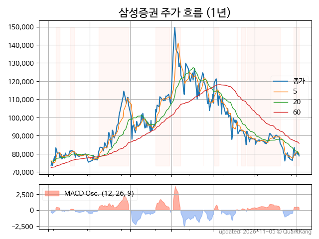
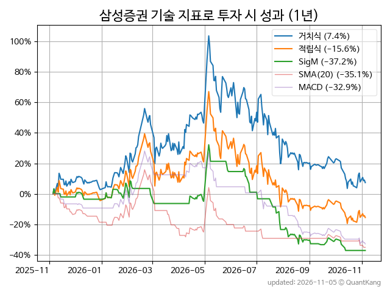
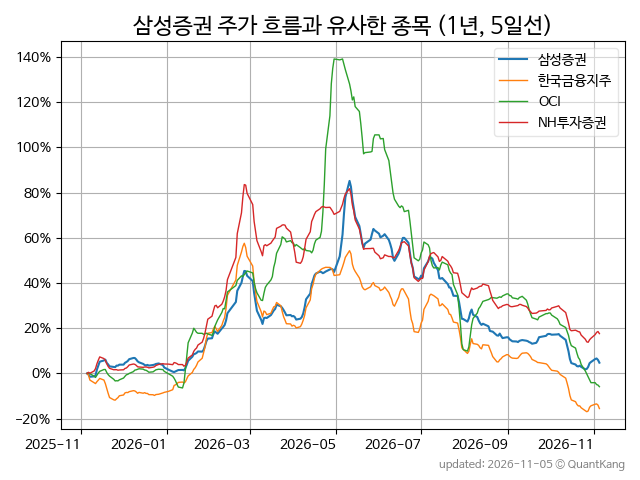
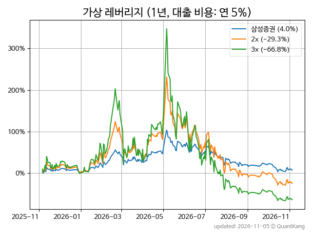

| **종가** | **전일대비** | **업종** | **PER** | **PBR** | **DIV** |
| -------: | -----------: | -------: | ------: | ------: | ------: |
| 78,800 | -1.5<small>%</small> | P:증권 | 7.0 | 0.9 | 5.1<small>%</small> |

<!-- more -->

> **기업 개요**

| **섹터** | P:증권 / nan |
| **산업** | 금융 지원 서비스업 |
| **상장** | KOSPI / 1988년 3월 28일 상장 / 12월 결산 |
| **대표자** | 박종문 |
| **홈페이지** | [http://www.samsungpop.com](http://www.samsungpop.com){:target="_blank"} |

> **최근 7일 DART 신규 공시**

| **일자** |      | **보고서명** |
| :------- | :--- | :----------- |
| 11&#x2011;05 | | [투자설명서(일괄신고)](https://dart.fss.or.kr/dsaf001/main.do?rcpNo=20261105000370){:target="_blank"} |
|  | | [일괄신고추가서류(파생결합증권-상장지수증권)](https://dart.fss.or.kr/dsaf001/main.do?rcpNo=20261105000303){:target="_blank"} |
|  | | [기업설명회(IR)개최(안내공시)              ](https://dart.fss.or.kr/dsaf001/main.do?rcpNo=20261105800479){:target="_blank"} |
|  | | [기업설명회(IR)개최(안내공시)              ](https://dart.fss.or.kr/dsaf001/main.do?rcpNo=20261105800459){:target="_blank"} |
| 11&#x2011;04 | | [증권발행실적보고서](https://dart.fss.or.kr/dsaf001/main.do?rcpNo=20261104000073){:target="_blank"} |
|  | | [투자설명서(일괄신고)](https://dart.fss.or.kr/dsaf001/main.do?rcpNo=20261104000070){:target="_blank"} |
|  | | [투자설명서(일괄신고)](https://dart.fss.or.kr/dsaf001/main.do?rcpNo=20261104000064){:target="_blank"} |
|  | | [일괄신고추가서류(파생결합증권-주가연계증권)](https://dart.fss.or.kr/dsaf001/main.do?rcpNo=20261104000058){:target="_blank"} |
|  | | [일괄신고추가서류(파생결합사채-주가연계파생결합사채)](https://dart.fss.or.kr/dsaf001/main.do?rcpNo=20261104000046){:target="_blank"} |
| 10&#x2011;30 | | [증권발행실적보고서](https://dart.fss.or.kr/dsaf001/main.do?rcpNo=20261030000605){:target="_blank"} |
|  | | [투자설명서(일괄신고)](https://dart.fss.or.kr/dsaf001/main.do?rcpNo=20261030000580){:target="_blank"} |
|  | | [일괄신고추가서류(파생결합증권-상장지수증권)](https://dart.fss.or.kr/dsaf001/main.do?rcpNo=20261030000522){:target="_blank"} |
|  | | [증권발행실적보고서](https://dart.fss.or.kr/dsaf001/main.do?rcpNo=20261030000340){:target="_blank"} |
|  | | [증권발행실적보고서](https://dart.fss.or.kr/dsaf001/main.do?rcpNo=20261030000332){:target="_blank"} |
|  | | [투자설명서(일괄신고)](https://dart.fss.or.kr/dsaf001/main.do?rcpNo=20261030000313){:target="_blank"} |
|  | | [일괄신고추가서류(파생결합사채-주가연계파생결합사채)](https://dart.fss.or.kr/dsaf001/main.do?rcpNo=20261030000304){:target="_blank"} |
|  | | [지속가능경영보고서등관련사항(자율공시)              ](https://dart.fss.or.kr/dsaf001/main.do?rcpNo=20261030800346){:target="_blank"} |

> **주가 흐름**

{: .align-center}

> **주요 가격 변동 지표**<small>[^fn_price_metric]</small>

| **종가** | **전일대비** | **5일** | **20일** | **60일** | **120일** |
| -------: | -----------: | ------: | -------: | -------: | --------: |
| 78,800 | -1.5<small>%</small> | -5.5<small>%</small> | -11.4<small>%</small> | -17.4<small>%</small> | -41.7<small>%</small> |
| **1년** | **편차** | **샤프** | **MDD** | **AvDD** | **MARr** |
| 7.4<small>%</small> | 64.9<small>%</small> | 0.11 | -49.2<small>%</small> | -19.8<small>%</small> | -0.1 |

> **주요 재무 지표**<small>[^fn_finance_metric]</small>

| **업종**<small>[^fn_sector_abbr]</small> | **PER** | **PBR** | **DIV** | **평가**<small>[^fn_finance_basic_tags]</small> |
| :--------------------------------------- | ------: | ------: | ------: | ----------------------------------------------: |
| P:증권 | 7.0 | 0.9 | 5.1<small>%</small> | 고배당 |



> **세부 재무/투자 정보 제공 사이트**

| [네이버](https://m.stock.naver.com/domestic/stock/016360/finance/summary){:target="_blank"}<small>모바일</small> | [네이버](https://finance.naver.com/item/coinfo.naver?code=016360){:target="_blank"} | [FnGuide](https://comp.fnguide.com/SVO2/ASP/SVD_Invest.asp?gicode=A016360&MenuYn=Y){:target="_blank"} |
| :---: | :---: | :---: |
| [와이즈리포트](https://comp.wisereport.co.kr/company/c1040001.aspx?cmp_cd=016360){:target="_blank"} | [밸류라인](https://www.valueline.co.kr/finance/summary/016360){:target="_blank"} | [한국경제](https://markets.hankyung.com/stock/016360/financial-summary){:target="_blank"} |

> **주요 기술 지표**<small>[^fn_tech_metric]</small>

{: .align-center}

| **기술 지표** | **1년** | **편차** | **샤프** | **MDD** | **AvDD** |
| :------------ | ------: | -----------: | -------: | ------: | -------: |
| 거치식 | 7.4<small>%</small> | 64.9<small>%</small> | 0.11 | -49.2<small>%</small> | -19.8<small>%</small> |
| 적립식[^fn_tech_metric_dca] | -15.6<small>%</small> | 64.0<small>%</small> | -0.24 | -51.8<small>%</small> | -22.7<small>%</small> |
| Sig. M[^fn_tech_metric_sigm] | -37.2<small>%</small> | 43.2<small>%</small> | -0.86 | -52.5<small>%</small> | -21.0<small>%</small> |
| SMA<small>(5)</small>[^fn_tech_metric_sma_i] | -46.9<small>%</small> | 37.5<small>%</small> | -1.25 | -50.6<small>%</small> | -22.4<small>%</small> |
| SMA<small>(20)</small>[^fn_tech_metric_sma_i] | -35.1<small>%</small> | 45.7<small>%</small> | -0.77 | -44.0<small>%</small> | -27.1<small>%</small> |
| SMA<small>(60)</small>[^fn_tech_metric_sma_i] | 26.0<small>%</small> | 54.0<small>%</small> | 0.48 | -34.7<small>%</small> | -19.0<small>%</small> |
| SMA<small>(120)</small>[^fn_tech_metric_sma_i] | 27.1<small>%</small> | 58.6<small>%</small> | 0.46 | -37.6<small>%</small> | -18.8<small>%</small> |
| SMA<small>(240)</small>[^fn_tech_metric_sma_i] | 8.6<small>%</small> | 60.8<small>%</small> | 0.14 | -46.7<small>%</small> | -20.9<small>%</small> |
| MACD[^fn_tech_metric_macd] | -32.9<small>%</small> | 33.2<small>%</small> | -0.99 | -47.7<small>%</small> | -19.5<small>%</small> |

> **주가 흐름 유사 종목**<small>[^fn_corr_long]</small>

{: .align-center}

|       | [한국금융지주](/071050/) | [OCI](/456040/) | [NH투자증권](/005940/) |
| :---: | :------------------------------------: | :------------------------------------: | :------------------------------------: |
|       | [롯데쇼핑](/023530/) | [서진시스템](/178320/) | [에스엘](/005850/) |

> **가상 레버리지 상품에 투자했다면**<small>[^fn_lev]</small>

{: .align-center}

> **관련 정보**

- [P:증권 업종 목록](/stats/sector/kospi_업종_증권_종목/){: .btn .btn--info} [고배당 목록](/fn/fn_high_div/){: .btn .btn--info}

> **참고 도서** [오렌지사과의 출간 책 소개와 샘플북 목록](https://kongdori.tistory.com/691)

- [왜 위험한 주식에 투자하라는 걸까? - 장기 투자와 분산 투자에 대한 통계학적 시각](https://kongdori.tistory.com/421)
- [파이썬으로 그려보는 투자 포트폴리오 분석  - 정량적 투자 분석을 위한 입문서](https://kongdori.tistory.com/643)
- [구글 시트로 시작하는 투자 포트폴리오 분석 - 오렌지사과의 불친절한 워크북](https://kongdori.tistory.com/449)

