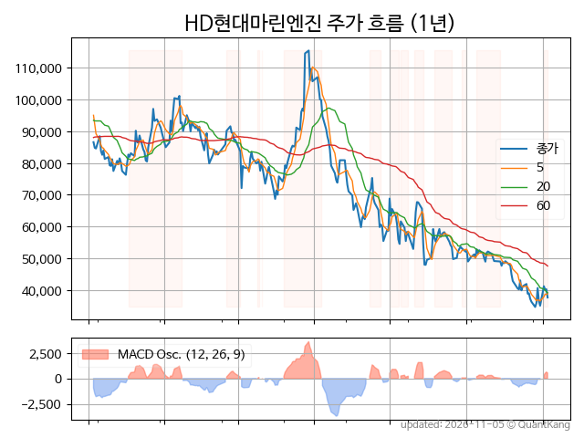
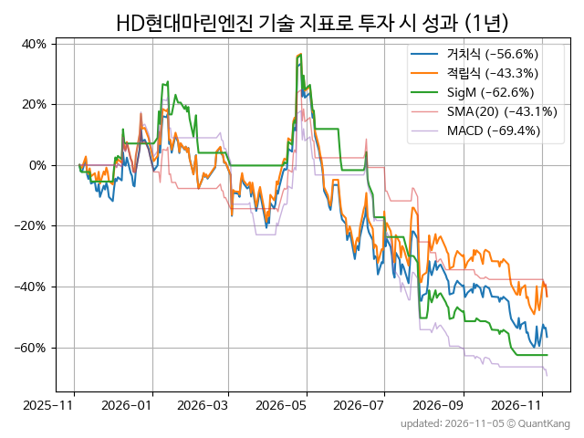
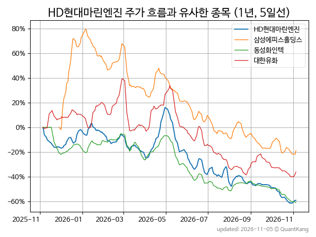
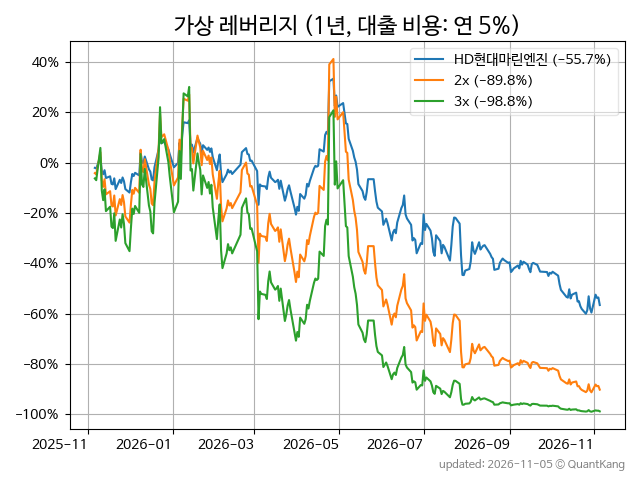

| **종가** | **전일대비** | **업종** | **PER** | **PBR** | **DIV** |
| -------: | -----------: | -------: | ------: | ------: | ------: |
| 37,600 | -6.5<small>%</small> | P:기계장비 | 7.7 | 2.6 | - |

<!-- more -->

> **기업 개요**

| **섹터** | P:기계장비 / nan |
| **산업** | 일반 목적용 기계 제조업 |
| **상장** | KOSPI / 2009년 5월 15일 상장 / 12월 결산 |
| **대표자** | 유정대 |
| **홈페이지** | [http://www.hd-marineengine.com](http://www.hd-marineengine.com){:target="_blank"} |

> **최근 7일 DART 신규 공시**

기간 내 신규 공시가 없습니다.

> **주가 흐름**

{: .align-center}

> **주요 가격 변동 지표**<small>[^fn_price_metric]</small>

| **종가** | **전일대비** | **5일** | **20일** | **60일** | **120일** |
| -------: | -----------: | ------: | -------: | -------: | --------: |
| 37,600 | -6.5<small>%</small> | 3.2<small>%</small> | -16.1<small>%</small> | -33.3<small>%</small> | -58.5<small>%</small> |
| **1년** | **편차** | **샤프** | **MDD** | **AvDD** | **MARr** |
| -56.6<small>%</small> | 79.0<small>%</small> | -0.72 | -70.0<small>%</small> | -31.4<small>%</small> | 0.8 |

> **주요 재무 지표**<small>[^fn_finance_metric]</small>

| **업종**<small>[^fn_sector_abbr]</small> | **PER** | **PBR** | **DIV** | **평가**<small>[^fn_finance_basic_tags]</small> |
| :--------------------------------------- | ------: | ------: | ------: | ----------------------------------------------: |
| P:기계장비 | 7.7 | 2.6 | - | - |



> **세부 재무/투자 정보 제공 사이트**

| [네이버](https://m.stock.naver.com/domestic/stock/071970/finance/summary){:target="_blank"}<small>모바일</small> | [네이버](https://finance.naver.com/item/coinfo.naver?code=071970){:target="_blank"} | [FnGuide](https://comp.fnguide.com/SVO2/ASP/SVD_Invest.asp?gicode=A071970&MenuYn=Y){:target="_blank"} |
| :---: | :---: | :---: |
| [와이즈리포트](https://comp.wisereport.co.kr/company/c1040001.aspx?cmp_cd=071970){:target="_blank"} | [밸류라인](https://www.valueline.co.kr/finance/summary/071970){:target="_blank"} | [한국경제](https://markets.hankyung.com/stock/071970/financial-summary){:target="_blank"} |

> **주요 기술 지표**<small>[^fn_tech_metric]</small>

{: .align-center}

| **기술 지표** | **1년** | **편차** | **샤프** | **MDD** | **AvDD** |
| :------------ | ------: | -----------: | -------: | ------: | -------: |
| 거치식 | -56.6<small>%</small> | 79.0<small>%</small> | -0.72 | -70.0<small>%</small> | -31.4<small>%</small> |
| 적립식[^fn_tech_metric_dca] | -43.3<small>%</small> | 78.4<small>%</small> | -0.55 | -62.7<small>%</small> | -29.1<small>%</small> |
| Sig. M[^fn_tech_metric_sigm] | -62.6<small>%</small> | 50.8<small>%</small> | -1.23 | -72.5<small>%</small> | -31.0<small>%</small> |
| SMA<small>(5)</small>[^fn_tech_metric_sma_i] | -46.6<small>%</small> | 53.6<small>%</small> | -0.87 | -50.5<small>%</small> | -18.9<small>%</small> |
| SMA<small>(20)</small>[^fn_tech_metric_sma_i] | -43.1<small>%</small> | 42.3<small>%</small> | -1.02 | -54.3<small>%</small> | -24.2<small>%</small> |
| SMA<small>(60)</small>[^fn_tech_metric_sma_i] | -35.3<small>%</small> | 34.0<small>%</small> | -1.04 | -35.3<small>%</small> | -28.4<small>%</small> |
| SMA<small>(120)</small>[^fn_tech_metric_sma_i] | -14.4<small>%</small> | 39.9<small>%</small> | -0.36 | -27.1<small>%</small> | -20.7<small>%</small> |
| SMA<small>(240)</small>[^fn_tech_metric_sma_i] | -21.2<small>%</small> | 48.8<small>%</small> | -0.43 | -36.9<small>%</small> | -24.4<small>%</small> |
| MACD[^fn_tech_metric_macd] | -69.4<small>%</small> | 54.8<small>%</small> | -1.27 | -74.9<small>%</small> | -32.8<small>%</small> |

> **주가 흐름 유사 종목**<small>[^fn_corr_long]</small>

{: .align-center}

|       | [삼성에피스홀딩스](/0126Z0/) | [동성화인텍](/033500/) | [대한유화](/006650/) |
| :---: | :------------------------------------: | :------------------------------------: | :------------------------------------: |
|       | [클래시스](/214150/) | [HD한국조선해양](/009540/) | [클로봇](/466100/) |

> **가상 레버리지 상품에 투자했다면**<small>[^fn_lev]</small>

{: .align-center}

> **관련 정보**

- [P:기계장비 업종 목록](/stats/sector/kospi_업종_기계장비_종목/){: .btn .btn--info}

> **참고 도서** [오렌지사과의 출간 책 소개와 샘플북 목록](https://kongdori.tistory.com/691)

- [왜 위험한 주식에 투자하라는 걸까? - 장기 투자와 분산 투자에 대한 통계학적 시각](https://kongdori.tistory.com/421)
- [파이썬으로 그려보는 투자 포트폴리오 분석  - 정량적 투자 분석을 위한 입문서](https://kongdori.tistory.com/643)
- [구글 시트로 시작하는 투자 포트폴리오 분석 - 오렌지사과의 불친절한 워크북](https://kongdori.tistory.com/449)

