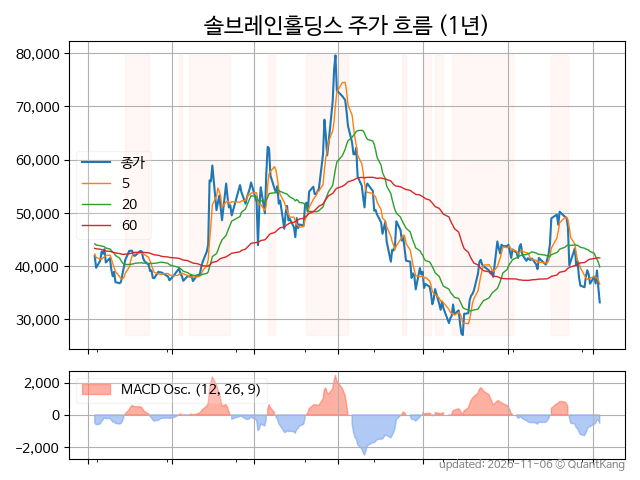
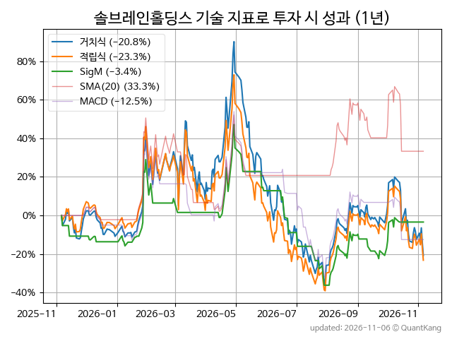
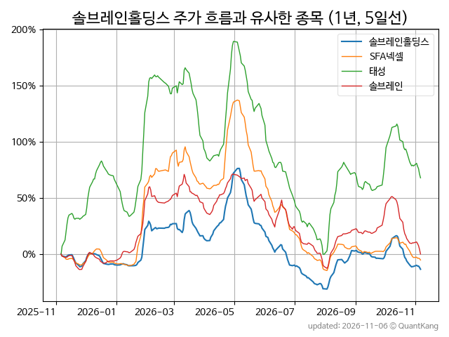
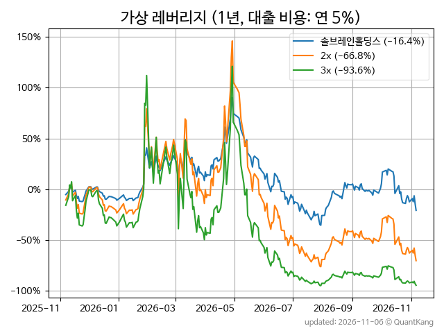

| **종가** | **전일대비** | **업종** | **PER** | **PBR** | **DIV** |
| -------: | -----------: | -------: | ------: | ------: | ------: |
| 33,150 | -7.7<small>%</small> | Q:일반서비스 | 1.4 | 0.4 | 1.5<small>%</small> |

<!-- more -->

> **기업 개요**

| **섹터** | Q:일반서비스 / 우량기업부 |
| **산업** | 회사 본부 및 경영 컨설팅 서비스업 |
| **상장** | KOSDAQ / 2000년 1월 18일 상장 / 12월 결산 |
| **대표자** | 정현석, 정문주 (공동 대표이사) |
| **홈페이지** | [http://www.soulbrainholdings.co.kr](http://www.soulbrainholdings.co.kr){:target="_blank"} |

> **최근 7일 DART 신규 공시**

| **일자** |      | **보고서명** |
| :------- | :--- | :----------- |
| 11&#x2011;02 | | [기타경영사항(자율공시)              (소규모합병 승인 이사회 결의(주주총회 갈음) 결과보고)](https://dart.fss.or.kr/dsaf001/main.do?rcpNo=20261102900507){:target="_blank"} |

> **주가 흐름**

{: .align-center}

> **주요 가격 변동 지표**<small>[^fn_price_metric]</small>

| **종가** | **전일대비** | **5일** | **20일** | **60일** | **120일** |
| -------: | -----------: | ------: | -------: | -------: | --------: |
| 33,150 | -7.7<small>%</small> | -9.5<small>%</small> | -34.0<small>%</small> | -6.2<small>%</small> | -45.7<small>%</small> |
| **1년** | **편차** | **샤프** | **MDD** | **AvDD** | **MARr** |
| -20.8<small>%</small> | 86.7<small>%</small> | -0.24 | -66.1<small>%</small> | -28.9<small>%</small> | 0.3 |

> **주요 재무 지표**<small>[^fn_finance_metric]</small>

| **업종**<small>[^fn_sector_abbr]</small> | **PER** | **PBR** | **DIV** | **평가**<small>[^fn_finance_basic_tags]</small> |
| :--------------------------------------- | ------: | ------: | ------: | ----------------------------------------------: |
| Q:일반서비스 | 1.4 | 0.4 | 1.5<small>%</small> | 저PER, 저PBR |



> **세부 재무/투자 정보 제공 사이트**

| [네이버](https://m.stock.naver.com/domestic/stock/036830/finance/summary){:target="_blank"}<small>모바일</small> | [네이버](https://finance.naver.com/item/coinfo.naver?code=036830){:target="_blank"} | [FnGuide](https://comp.fnguide.com/SVO2/ASP/SVD_Invest.asp?gicode=A036830&MenuYn=Y){:target="_blank"} |
| :---: | :---: | :---: |
| [와이즈리포트](https://comp.wisereport.co.kr/company/c1040001.aspx?cmp_cd=036830){:target="_blank"} | [밸류라인](https://www.valueline.co.kr/finance/summary/036830){:target="_blank"} | [한국경제](https://markets.hankyung.com/stock/036830/financial-summary){:target="_blank"} |

> **주요 기술 지표**<small>[^fn_tech_metric]</small>

{: .align-center}

| **기술 지표** | **1년** | **편차** | **샤프** | **MDD** | **AvDD** |
| :------------ | ------: | -----------: | -------: | ------: | -------: |
| 거치식 | -20.8<small>%</small> | 86.7<small>%</small> | -0.24 | -66.1<small>%</small> | -28.9<small>%</small> |
| 적립식[^fn_tech_metric_dca] | -23.3<small>%</small> | 85.8<small>%</small> | -0.27 | -64.8<small>%</small> | -28.8<small>%</small> |
| Sig. M[^fn_tech_metric_sigm] | -3.4<small>%</small> | 57.2<small>%</small> | -0.06 | -56.7<small>%</small> | -25.5<small>%</small> |
| SMA<small>(5)</small>[^fn_tech_metric_sma_i] | -6.8<small>%</small> | 56.7<small>%</small> | -0.12 | -46.0<small>%</small> | -24.2<small>%</small> |
| SMA<small>(20)</small>[^fn_tech_metric_sma_i] | 33.3<small>%</small> | 60.4<small>%</small> | 0.55 | -32.1<small>%</small> | -13.4<small>%</small> |
| SMA<small>(60)</small>[^fn_tech_metric_sma_i] | -33.9<small>%</small> | 65.7<small>%</small> | -0.52 | -49.1<small>%</small> | -26.0<small>%</small> |
| SMA<small>(120)</small>[^fn_tech_metric_sma_i] | -19.0<small>%</small> | 67.1<small>%</small> | -0.28 | -48.9<small>%</small> | -25.2<small>%</small> |
| SMA<small>(240)</small>[^fn_tech_metric_sma_i] | -33.4<small>%</small> | 69.5<small>%</small> | -0.48 | -59.5<small>%</small> | -30.6<small>%</small> |
| MACD[^fn_tech_metric_macd] | -12.5<small>%</small> | 63.3<small>%</small> | -0.20 | -55.9<small>%</small> | -22.6<small>%</small> |

> **주가 흐름 유사 종목**<small>[^fn_corr_long]</small>

{: .align-center}

|       | [SFA넥셀](/222080/) | [태성](/323280/) | [솔브레인](/357780/) |
| :---: | :------------------------------------: | :------------------------------------: | :------------------------------------: |
|       | [포스코인터내셔널](/047050/) | [SFA](/056190/) | [와이씨](/232140/) |

> **가상 레버리지 상품에 투자했다면**<small>[^fn_lev]</small>

{: .align-center}

> **관련 정보**

- [Q:일반서비스 업종 목록](/stats/sector/kosdaq_업종_일반서비스_종목/){: .btn .btn--info} [저PER 목록](/fn/fn_low_per/){: .btn .btn--info} [저PBR 목록](/fn/fn_low_pbr/){: .btn .btn--info}

> **참고 도서** [오렌지사과의 출간 책 소개와 샘플북 목록](https://kongdori.tistory.com/691)

- [왜 위험한 주식에 투자하라는 걸까? - 장기 투자와 분산 투자에 대한 통계학적 시각](https://kongdori.tistory.com/421)
- [파이썬으로 그려보는 투자 포트폴리오 분석  - 정량적 투자 분석을 위한 입문서](https://kongdori.tistory.com/643)
- [구글 시트로 시작하는 투자 포트폴리오 분석 - 오렌지사과의 불친절한 워크북](https://kongdori.tistory.com/449)

