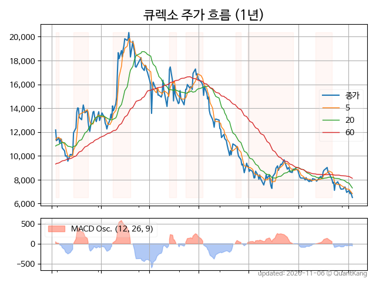
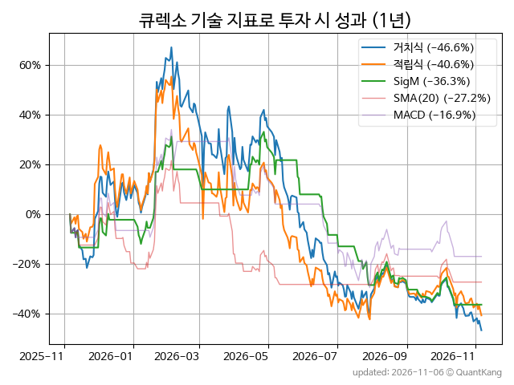
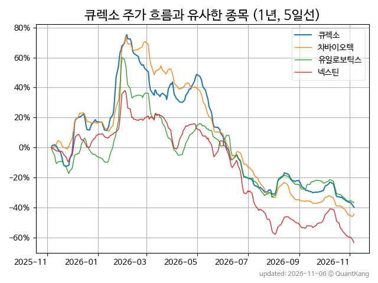
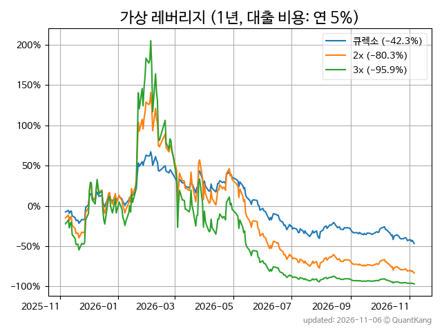

| **종가** | **전일대비** | **업종** | **PER** | **PBR** | **DIV** |
| -------: | -----------: | -------: | ------: | ------: | ------: |
| 6,500 | -3.3<small>%</small> | Q:유통 | 98.1 | 2.8 | - |

<!-- more -->

> **기업 개요**

| **섹터** | Q:유통 / 중견기업부 |
| **산업** | 기타 상품 전문 소매업 |
| **상장** | KOSDAQ / 2002년 7월 3일 상장 / 12월 결산 |
| **대표자** | 이재준 |
| **홈페이지** | [http://www.curexo.com](http://www.curexo.com){:target="_blank"} |

> **최근 7일 DART 신규 공시**

기간 내 신규 공시가 없습니다.

> **주가 흐름**

{: .align-center}

> **주요 가격 변동 지표**<small>[^fn_price_metric]</small>

| **종가** | **전일대비** | **5일** | **20일** | **60일** | **120일** |
| -------: | -----------: | ------: | -------: | -------: | --------: |
| 6,500 | -3.3<small>%</small> | -6.2<small>%</small> | -24.2<small>%</small> | -26.0<small>%</small> | -56.0<small>%</small> |
| **1년** | **편차** | **샤프** | **MDD** | **AvDD** | **MARr** |
| -46.6<small>%</small> | 71.3<small>%</small> | -0.65 | -68.1<small>%</small> | -34.3<small>%</small> | 0.7 |

> **주요 재무 지표**<small>[^fn_finance_metric]</small>

| **업종**<small>[^fn_sector_abbr]</small> | **PER** | **PBR** | **DIV** | **평가**<small>[^fn_finance_basic_tags]</small> |
| :--------------------------------------- | ------: | ------: | ------: | ----------------------------------------------: |
| Q:유통 | 98.1 | 2.8 | - | 고PER |



> **세부 재무/투자 정보 제공 사이트**

| [네이버](https://m.stock.naver.com/domestic/stock/060280/finance/summary){:target="_blank"}<small>모바일</small> | [네이버](https://finance.naver.com/item/coinfo.naver?code=060280){:target="_blank"} | [FnGuide](https://comp.fnguide.com/SVO2/ASP/SVD_Invest.asp?gicode=A060280&MenuYn=Y){:target="_blank"} |
| :---: | :---: | :---: |
| [와이즈리포트](https://comp.wisereport.co.kr/company/c1040001.aspx?cmp_cd=060280){:target="_blank"} | [밸류라인](https://www.valueline.co.kr/finance/summary/060280){:target="_blank"} | [한국경제](https://markets.hankyung.com/stock/060280/financial-summary){:target="_blank"} |

> **주요 기술 지표**<small>[^fn_tech_metric]</small>

{: .align-center}

| **기술 지표** | **1년** | **편차** | **샤프** | **MDD** | **AvDD** |
| :------------ | ------: | -----------: | -------: | ------: | -------: |
| 거치식 | -46.6<small>%</small> | 71.3<small>%</small> | -0.65 | -68.1<small>%</small> | -34.3<small>%</small> |
| 적립식[^fn_tech_metric_dca] | -40.6<small>%</small> | 69.7<small>%</small> | -0.58 | -62.8<small>%</small> | -35.0<small>%</small> |
| Sig. M[^fn_tech_metric_sigm] | -36.3<small>%</small> | 40.7<small>%</small> | -0.89 | -52.2<small>%</small> | -23.1<small>%</small> |
| SMA<small>(5)</small>[^fn_tech_metric_sma_i] | -18.0<small>%</small> | 46.4<small>%</small> | -0.39 | -45.5<small>%</small> | -23.9<small>%</small> |
| SMA<small>(20)</small>[^fn_tech_metric_sma_i] | -27.2<small>%</small> | 42.6<small>%</small> | -0.64 | -41.0<small>%</small> | -28.1<small>%</small> |
| SMA<small>(60)</small>[^fn_tech_metric_sma_i] | -26.1<small>%</small> | 48.1<small>%</small> | -0.54 | -53.2<small>%</small> | -33.9<small>%</small> |
| SMA<small>(120)</small>[^fn_tech_metric_sma_i] | 21.4<small>%</small> | 57.7<small>%</small> | 0.37 | -33.4<small>%</small> | -20.5<small>%</small> |
| SMA<small>(240)</small>[^fn_tech_metric_sma_i] | 1.0<small>%</small> | 59.0<small>%</small> | 0.02 | -39.6<small>%</small> | -26.3<small>%</small> |
| MACD[^fn_tech_metric_macd] | -16.9<small>%</small> | 47.9<small>%</small> | -0.35 | -47.4<small>%</small> | -21.1<small>%</small> |

> **주가 흐름 유사 종목**<small>[^fn_corr_long]</small>

{: .align-center}

|       | [차바이오텍](/085660/) | [유일로보틱스](/388720/) | [넥스틴](/348210/) |
| :---: | :------------------------------------: | :------------------------------------: | :------------------------------------: |
|       | [CJ대한통운](/000120/) | [포스코엠텍](/009520/) | [레이크머티리얼즈](/281740/) |

> **가상 레버리지 상품에 투자했다면**<small>[^fn_lev]</small>

{: .align-center}

> **관련 정보**

- [Q:유통 업종 목록](/stats/sector/kosdaq_업종_유통_종목/){: .btn .btn--info} [고PER 목록](/fn/fn_high_per/){: .btn .btn--info}

> **참고 도서** [오렌지사과의 출간 책 소개와 샘플북 목록](https://kongdori.tistory.com/691)

- [왜 위험한 주식에 투자하라는 걸까? - 장기 투자와 분산 투자에 대한 통계학적 시각](https://kongdori.tistory.com/421)
- [파이썬으로 그려보는 투자 포트폴리오 분석  - 정량적 투자 분석을 위한 입문서](https://kongdori.tistory.com/643)
- [구글 시트로 시작하는 투자 포트폴리오 분석 - 오렌지사과의 불친절한 워크북](https://kongdori.tistory.com/449)

