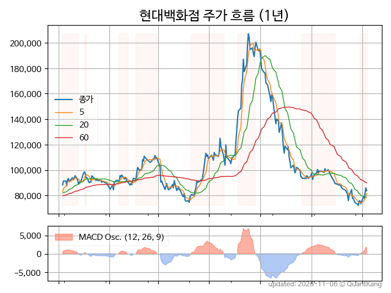
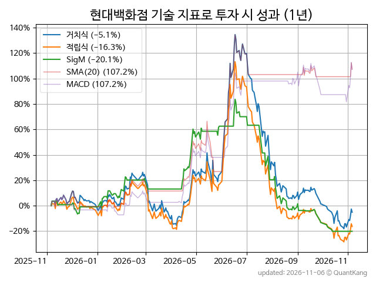
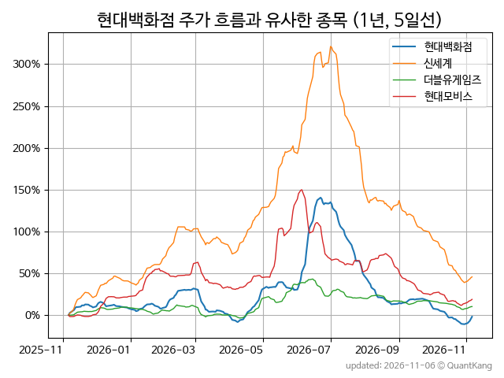
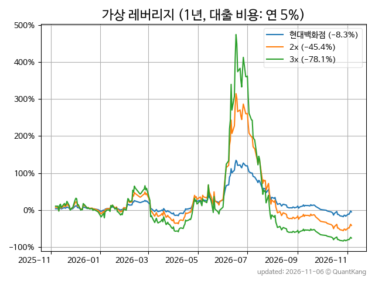

| **종가** | **전일대비** | **업종** | **PER** | **PBR** | **DIV** |
| -------: | -----------: | -------: | ------: | ------: | ------: |
| 83,800 | -2.6<small>%</small> | P:유통 | 8.8 | 0.4 | 2.6<small>%</small> |

<!-- more -->

> **기업 개요**

| **섹터** | P:유통 / nan |
| **산업** | 종합 소매업 |
| **상장** | KOSPI / 2002년 11월 25일 상장 / 12월 결산 |
| **대표자** | 정지선, 정지영 (각자대표) |
| **홈페이지** | [http://home.e-hyundai.com](http://home.e-hyundai.com){:target="_blank"} |

> **최근 7일 DART 신규 공시**

| **일자** |      | **보고서명** |
| :------- | :--- | :----------- |
| 11&#x2011;06 | | [임원ㆍ주요주주특정증권등거래계획보고서](https://dart.fss.or.kr/dsaf001/main.do?rcpNo=20261106000164){:target="_blank"} |
| 11&#x2011;04 | | [동일인등출자계열회사와의상품ㆍ용역거래](https://dart.fss.or.kr/dsaf001/main.do?rcpNo=20261104000252){:target="_blank"} |
|  | | [기업설명회(IR)개최(안내공시)              ](https://dart.fss.or.kr/dsaf001/main.do?rcpNo=20261104800302){:target="_blank"} |
|  | | [주식소각결정              ](https://dart.fss.or.kr/dsaf001/main.do?rcpNo=20261104800274){:target="_blank"} |
|  | | [연결재무제표기준영업(잠정)실적(공정공시)              ](https://dart.fss.or.kr/dsaf001/main.do?rcpNo=20261104800269){:target="_blank"} |

> **주가 흐름**

{: .align-center}

> **주요 가격 변동 지표**<small>[^fn_price_metric]</small>

| **종가** | **전일대비** | **5일** | **20일** | **60일** | **120일** |
| -------: | -----------: | ------: | -------: | -------: | --------: |
| 83,800 | -2.6<small>%</small> | 14.0<small>%</small> | -2.0<small>%</small> | -17.7<small>%</small> | -24.3<small>%</small> |
| **1년** | **편차** | **샤프** | **MDD** | **AvDD** | **MARr** |
| -5.1<small>%</small> | 63.6<small>%</small> | -0.08 | -65.1<small>%</small> | -23.1<small>%</small> | 0.1 |

> **주요 재무 지표**<small>[^fn_finance_metric]</small>

| **업종**<small>[^fn_sector_abbr]</small> | **PER** | **PBR** | **DIV** | **평가**<small>[^fn_finance_basic_tags]</small> |
| :--------------------------------------- | ------: | ------: | ------: | ----------------------------------------------: |
| P:유통 | 8.8 | 0.4 | 2.6<small>%</small> | 저PBR |



> **세부 재무/투자 정보 제공 사이트**

| [네이버](https://m.stock.naver.com/domestic/stock/069960/finance/summary){:target="_blank"}<small>모바일</small> | [네이버](https://finance.naver.com/item/coinfo.naver?code=069960){:target="_blank"} | [FnGuide](https://comp.fnguide.com/SVO2/ASP/SVD_Invest.asp?gicode=A069960&MenuYn=Y){:target="_blank"} |
| :---: | :---: | :---: |
| [와이즈리포트](https://comp.wisereport.co.kr/company/c1040001.aspx?cmp_cd=069960){:target="_blank"} | [밸류라인](https://www.valueline.co.kr/finance/summary/069960){:target="_blank"} | [한국경제](https://markets.hankyung.com/stock/069960/financial-summary){:target="_blank"} |

> **주요 기술 지표**<small>[^fn_tech_metric]</small>

{: .align-center}

| **기술 지표** | **1년** | **편차** | **샤프** | **MDD** | **AvDD** |
| :------------ | ------: | -----------: | -------: | ------: | -------: |
| 거치식 | -5.1<small>%</small> | 63.6<small>%</small> | -0.08 | -65.1<small>%</small> | -23.1<small>%</small> |
| 적립식[^fn_tech_metric_dca] | -16.3<small>%</small> | 62.9<small>%</small> | -0.26 | -66.4<small>%</small> | -24.1<small>%</small> |
| Sig. M[^fn_tech_metric_sigm] | -20.1<small>%</small> | 39.4<small>%</small> | -0.51 | -56.5<small>%</small> | -17.0<small>%</small> |
| SMA<small>(5)</small>[^fn_tech_metric_sma_i] | 40.7<small>%</small> | 45.8<small>%</small> | 0.89 | -29.3<small>%</small> | -11.6<small>%</small> |
| SMA<small>(20)</small>[^fn_tech_metric_sma_i] | 107.2<small>%</small> | 44.5<small>%</small> | 2.41 | -23.8<small>%</small> | -8.8<small>%</small> |
| SMA<small>(60)</small>[^fn_tech_metric_sma_i] | 39.5<small>%</small> | 50.8<small>%</small> | 0.78 | -34.1<small>%</small> | -16.8<small>%</small> |
| SMA<small>(120)</small>[^fn_tech_metric_sma_i] | 19.2<small>%</small> | 54.8<small>%</small> | 0.35 | -42.6<small>%</small> | -20.1<small>%</small> |
| SMA<small>(240)</small>[^fn_tech_metric_sma_i] | 2.9<small>%</small> | 58.3<small>%</small> | 0.05 | -50.8<small>%</small> | -22.5<small>%</small> |
| MACD[^fn_tech_metric_macd] | 107.2<small>%</small> | 41.1<small>%</small> | 2.61 | -14.3<small>%</small> | -6.2<small>%</small> |

> **주가 흐름 유사 종목**<small>[^fn_corr_long]</small>

{: .align-center}

|       | [신세계](/004170/) | [더블유게임즈](/192080/) | [현대모비스](/012330/) |
| :---: | :------------------------------------: | :------------------------------------: | :------------------------------------: |
|       | [롯데쇼핑](/023530/) | [삼성물산](/028260/) | [한국타이어앤테크놀로지](/161390/) |

> **가상 레버리지 상품에 투자했다면**<small>[^fn_lev]</small>

{: .align-center}

> **관련 정보**

- [P:유통 업종 목록](/stats/sector/kospi_업종_유통_종목/){: .btn .btn--info} [저PBR 목록](/fn/fn_low_pbr/){: .btn .btn--info}

> **참고 도서** [오렌지사과의 출간 책 소개와 샘플북 목록](https://kongdori.tistory.com/691)

- [왜 위험한 주식에 투자하라는 걸까? - 장기 투자와 분산 투자에 대한 통계학적 시각](https://kongdori.tistory.com/421)
- [파이썬으로 그려보는 투자 포트폴리오 분석  - 정량적 투자 분석을 위한 입문서](https://kongdori.tistory.com/643)
- [구글 시트로 시작하는 투자 포트폴리오 분석 - 오렌지사과의 불친절한 워크북](https://kongdori.tistory.com/449)

