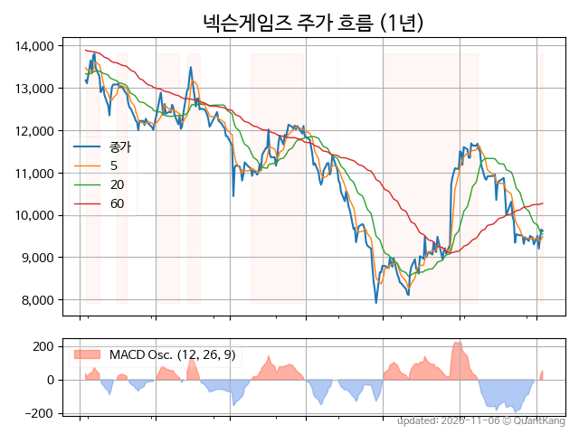
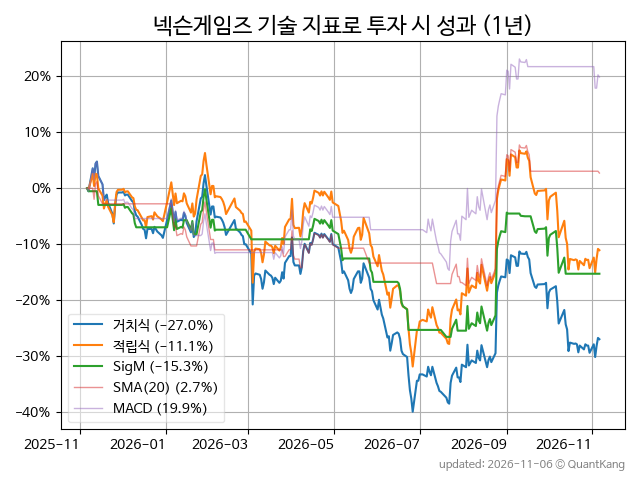
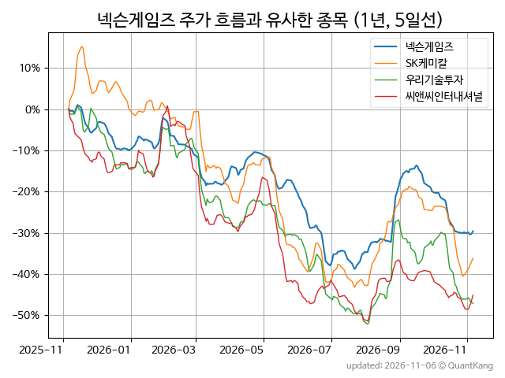
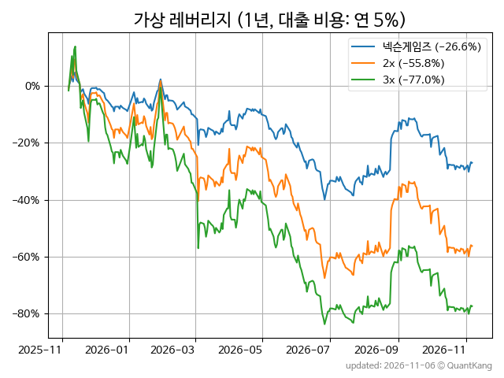

| **종가** | **전일대비** | **업종** | **PER** | **PBR** | **DIV** |
| -------: | -----------: | -------: | ------: | ------: | ------: |
| 9,620 | -0.3<small>%</small> | Q:IT서비스 | - | 2.4 | - |

<!-- more -->

> **기업 개요**

| **섹터** | Q:IT서비스 / 중견기업부 |
| **산업** | 소프트웨어 개발 및 공급업 |
| **상장** | KOSDAQ / 2015년 9월 25일 상장 / 12월 결산 |
| **대표자** | 박용현 |
| **홈페이지** | [http://nexongames.co.kr](http://nexongames.co.kr){:target="_blank"} |

> **최근 7일 DART 신규 공시**

기간 내 신규 공시가 없습니다.

> **주가 흐름**

{: .align-center}

> **주요 가격 변동 지표**<small>[^fn_price_metric]</small>

| **종가** | **전일대비** | **5일** | **20일** | **60일** | **120일** |
| -------: | -----------: | ------: | -------: | -------: | --------: |
| 9,620 | -0.3<small>%</small> | 3.4<small>%</small> | -3.7<small>%</small> | 5.5<small>%</small> | -11.0<small>%</small> |
| **1년** | **편차** | **샤프** | **MDD** | **AvDD** | **MARr** |
| -27.0<small>%</small> | 39.5<small>%</small> | -0.68 | -42.7<small>%</small> | -20.1<small>%</small> | 0.6 |

> **주요 재무 지표**<small>[^fn_finance_metric]</small>

| **업종**<small>[^fn_sector_abbr]</small> | **PER** | **PBR** | **DIV** | **평가**<small>[^fn_finance_basic_tags]</small> |
| :--------------------------------------- | ------: | ------: | ------: | ----------------------------------------------: |
| Q:IT서비스 | - | 2.4 | - | - |



> **세부 재무/투자 정보 제공 사이트**

| [네이버](https://m.stock.naver.com/domestic/stock/225570/finance/summary){:target="_blank"}<small>모바일</small> | [네이버](https://finance.naver.com/item/coinfo.naver?code=225570){:target="_blank"} | [FnGuide](https://comp.fnguide.com/SVO2/ASP/SVD_Invest.asp?gicode=A225570&MenuYn=Y){:target="_blank"} |
| :---: | :---: | :---: |
| [와이즈리포트](https://comp.wisereport.co.kr/company/c1040001.aspx?cmp_cd=225570){:target="_blank"} | [밸류라인](https://www.valueline.co.kr/finance/summary/225570){:target="_blank"} | [한국경제](https://markets.hankyung.com/stock/225570/financial-summary){:target="_blank"} |

> **주요 기술 지표**<small>[^fn_tech_metric]</small>

{: .align-center}

| **기술 지표** | **1년** | **편차** | **샤프** | **MDD** | **AvDD** |
| :------------ | ------: | -----------: | -------: | ------: | -------: |
| 거치식 | -27.0<small>%</small> | 39.5<small>%</small> | -0.68 | -42.7<small>%</small> | -20.1<small>%</small> |
| 적립식[^fn_tech_metric_dca] | -11.1<small>%</small> | 39.1<small>%</small> | -0.28 | -35.9<small>%</small> | -12.9<small>%</small> |
| Sig. M[^fn_tech_metric_sigm] | -15.3<small>%</small> | 27.1<small>%</small> | -0.57 | -26.6<small>%</small> | -11.6<small>%</small> |
| SMA<small>(5)</small>[^fn_tech_metric_sma_i] | -26.8<small>%</small> | 26.1<small>%</small> | -1.03 | -30.1<small>%</small> | -13.6<small>%</small> |
| SMA<small>(20)</small>[^fn_tech_metric_sma_i] | 2.7<small>%</small> | 26.0<small>%</small> | 0.10 | -18.4<small>%</small> | -9.3<small>%</small> |
| SMA<small>(60)</small>[^fn_tech_metric_sma_i] | -17.1<small>%</small> | 23.1<small>%</small> | -0.74 | -23.5<small>%</small> | -10.9<small>%</small> |
| SMA<small>(120)</small>[^fn_tech_metric_sma_i] | -11.6<small>%</small> | 13.0<small>%</small> | -0.89 | -17.4<small>%</small> | -2.9<small>%</small> |
| SMA<small>(240)</small>[^fn_tech_metric_sma_i] | -11.9<small>%</small> | 5.1<small>%</small> | -2.32 | -11.9<small>%</small> | -6.2<small>%</small> |
| MACD[^fn_tech_metric_macd] | 19.9<small>%</small> | 28.7<small>%</small> | 0.69 | -18.6<small>%</small> | -8.8<small>%</small> |

> **주가 흐름 유사 종목**<small>[^fn_corr_long]</small>

{: .align-center}

|       | [SK케미칼](/285130/) | [우리기술투자](/041190/) | [씨앤씨인터내셔널](/352480/) |
| :---: | :------------------------------------: | :------------------------------------: | :------------------------------------: |
|       | [아세아](/002030/) | [율촌화학](/008730/) | [SK바이오사이언스](/302440/) |

> **가상 레버리지 상품에 투자했다면**<small>[^fn_lev]</small>

{: .align-center}

> **관련 정보**

- [Q:IT서비스 업종 목록](/stats/sector/kosdaq_업종_IT서비스_종목/){: .btn .btn--info}

> **참고 도서** [오렌지사과의 출간 책 소개와 샘플북 목록](https://kongdori.tistory.com/691)

- [왜 위험한 주식에 투자하라는 걸까? - 장기 투자와 분산 투자에 대한 통계학적 시각](https://kongdori.tistory.com/421)
- [파이썬으로 그려보는 투자 포트폴리오 분석  - 정량적 투자 분석을 위한 입문서](https://kongdori.tistory.com/643)
- [구글 시트로 시작하는 투자 포트폴리오 분석 - 오렌지사과의 불친절한 워크북](https://kongdori.tistory.com/449)

