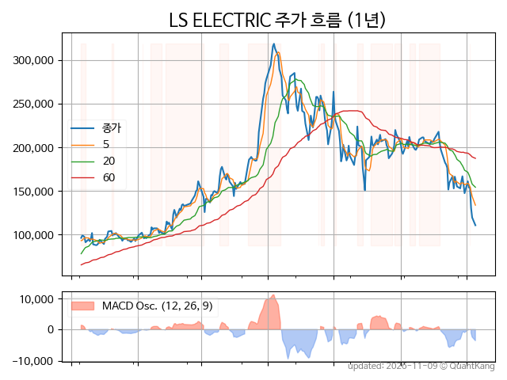
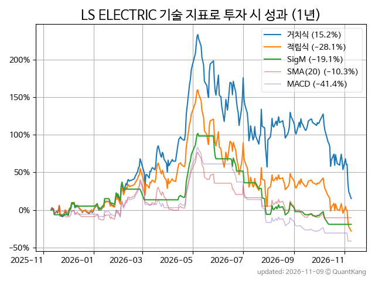
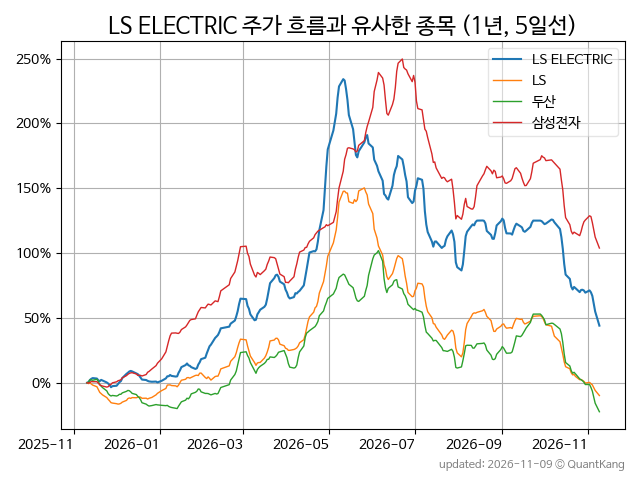
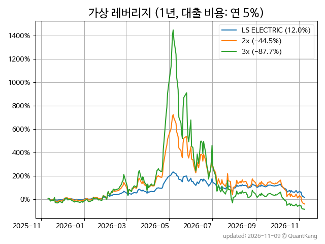

| **종가** | **전일대비** | **업종** | **PER** | **PBR** | **DIV** |
| -------: | -----------: | -------: | ------: | ------: | ------: |
| 110,100 | -7.5<small>%</small> | P:전기전자 | 57.9 | 8.0 | 0.5<small>%</small> |

<!-- more -->

> **기업 개요**

| **섹터** | P:전기전자 / nan |
| **산업** | 전동기, 발전기 및 전기 변환 · 공급 · 제어 장치 제조업 |
| **상장** | KOSPI / 1994년 7월 11일 상장 / 12월 결산 |
| **대표자** | 구자균, 채대석 |
| **홈페이지** | [http://www.ls-electric.com](http://www.ls-electric.com){:target="_blank"} |

> **최근 7일 DART 신규 공시**

| **일자** |      | **보고서명** |
| :------- | :--- | :----------- |
| 11&#x2011;05 | | [단기차입금증가결정              ](https://dart.fss.or.kr/dsaf001/main.do?rcpNo=20261105800556){:target="_blank"} |
|  | | [약관에의한금융거래시계열금융회사의거래상대방의공시](https://dart.fss.or.kr/dsaf001/main.do?rcpNo=20261105000308){:target="_blank"} |
|  | | [영업양도결정(종속회사의주요경영사항)              ](https://dart.fss.or.kr/dsaf001/main.do?rcpNo=20261105800509){:target="_blank"} |

> **주가 흐름**

{: .align-center}

> **주요 가격 변동 지표**<small>[^fn_price_metric]</small>

| **종가** | **전일대비** | **5일** | **20일** | **60일** | **120일** |
| -------: | -----------: | ------: | -------: | -------: | --------: |
| 110,100 | -7.5<small>%</small> | -31.4<small>%</small> | -39.5<small>%</small> | -47.2<small>%</small> | -61.4<small>%</small> |
| **1년** | **편차** | **샤프** | **MDD** | **AvDD** | **MARr** |
| 15.2<small>%</small> | 89.9<small>%</small> | 0.17 | -65.4<small>%</small> | -20.2<small>%</small> | -0.2 |

> **주요 재무 지표**<small>[^fn_finance_metric]</small>

| **업종**<small>[^fn_sector_abbr]</small> | **PER** | **PBR** | **DIV** | **평가**<small>[^fn_finance_basic_tags]</small> |
| :--------------------------------------- | ------: | ------: | ------: | ----------------------------------------------: |
| P:전기전자 | 57.9 | 8.0 | 0.5<small>%</small> | 고PBR |



> **세부 재무/투자 정보 제공 사이트**

| [네이버](https://m.stock.naver.com/domestic/stock/010120/finance/summary){:target="_blank"}<small>모바일</small> | [네이버](https://finance.naver.com/item/coinfo.naver?code=010120){:target="_blank"} | [FnGuide](https://comp.fnguide.com/SVO2/ASP/SVD_Invest.asp?gicode=A010120&MenuYn=Y){:target="_blank"} |
| :---: | :---: | :---: |
| [와이즈리포트](https://comp.wisereport.co.kr/company/c1040001.aspx?cmp_cd=010120){:target="_blank"} | [밸류라인](https://www.valueline.co.kr/finance/summary/010120){:target="_blank"} | [한국경제](https://markets.hankyung.com/stock/010120/financial-summary){:target="_blank"} |

> **주요 기술 지표**<small>[^fn_tech_metric]</small>

{: .align-center}

| **기술 지표** | **1년** | **편차** | **샤프** | **MDD** | **AvDD** |
| :------------ | ------: | -----------: | -------: | ------: | -------: |
| 거치식 | 15.2<small>%</small> | 89.9<small>%</small> | 0.17 | -65.4<small>%</small> | -20.2<small>%</small> |
| 적립식[^fn_tech_metric_dca] | -28.1<small>%</small> | 88.9<small>%</small> | -0.32 | -72.3<small>%</small> | -24.9<small>%</small> |
| Sig. M[^fn_tech_metric_sigm] | -19.1<small>%</small> | 50.6<small>%</small> | -0.38 | -59.9<small>%</small> | -23.7<small>%</small> |
| SMA<small>(5)</small>[^fn_tech_metric_sma_i] | -9.0<small>%</small> | 56.1<small>%</small> | -0.16 | -40.5<small>%</small> | -20.7<small>%</small> |
| SMA<small>(20)</small>[^fn_tech_metric_sma_i] | -10.3<small>%</small> | 57.3<small>%</small> | -0.18 | -49.3<small>%</small> | -24.9<small>%</small> |
| SMA<small>(60)</small>[^fn_tech_metric_sma_i] | 98.2<small>%</small> | 67.5<small>%</small> | 1.46 | -40.6<small>%</small> | -19.1<small>%</small> |
| SMA<small>(120)</small>[^fn_tech_metric_sma_i] | 17.1<small>%</small> | 73.5<small>%</small> | 0.23 | -64.9<small>%</small> | -27.0<small>%</small> |
| SMA<small>(240)</small>[^fn_tech_metric_sma_i] | 58.3<small>%</small> | 85.0<small>%</small> | 0.69 | -52.8<small>%</small> | -20.2<small>%</small> |
| MACD[^fn_tech_metric_macd] | -41.4<small>%</small> | 54.0<small>%</small> | -0.77 | -68.0<small>%</small> | -26.7<small>%</small> |

> **주가 흐름 유사 종목**<small>[^fn_corr_long]</small>

{: .align-center}

|       | [LS](/006260/) | [두산](/000150/) | [삼성전자](/005930/) |
| :---: | :------------------------------------: | :------------------------------------: | :------------------------------------: |
|       | [대우건설](/047040/) | [OCI홀딩스](/010060/) | [SK텔레콤](/017670/) |

> **가상 레버리지 상품에 투자했다면**<small>[^fn_lev]</small>

{: .align-center}

> **관련 정보**

- [P:전기전자 업종 목록](/stats/sector/kospi_업종_전기전자_종목/){: .btn .btn--info} [고PBR 목록](/fn/fn_high_pbr/){: .btn .btn--info}

> **참고 도서** [오렌지사과의 출간 책 소개와 샘플북 목록](https://kongdori.tistory.com/691)

- [왜 위험한 주식에 투자하라는 걸까? - 장기 투자와 분산 투자에 대한 통계학적 시각](https://kongdori.tistory.com/421)
- [파이썬으로 그려보는 투자 포트폴리오 분석  - 정량적 투자 분석을 위한 입문서](https://kongdori.tistory.com/643)
- [구글 시트로 시작하는 투자 포트폴리오 분석 - 오렌지사과의 불친절한 워크북](https://kongdori.tistory.com/449)

