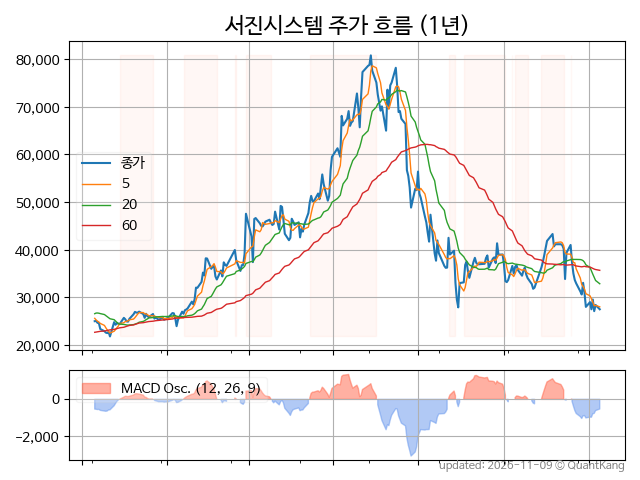
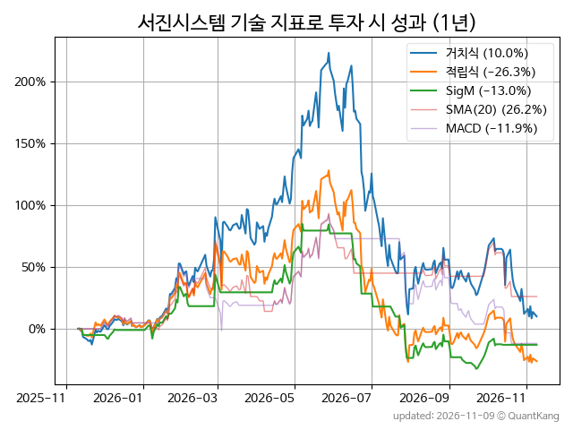
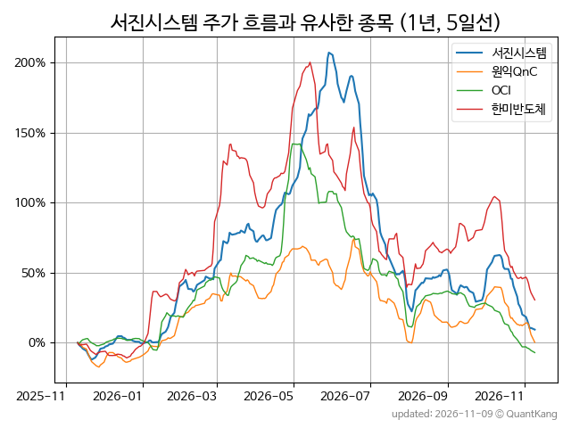
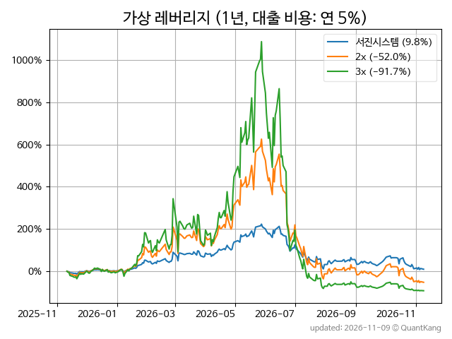

| **종가** | **전일대비** | **업종** | **PER** | **PBR** | **DIV** |
| -------: | -----------: | -------: | ------: | ------: | ------: |
| 27,500 | -3.2<small>%</small> | Q:전기전자 | - | 2.1 | - |

<!-- more -->

> **기업 개요**

| **섹터** | Q:전기전자 / 중견기업부 |
| **산업** | 기타 전기장비 제조업 |
| **상장** | KOSDAQ / 2017년 3월 27일 상장 / 12월 결산 |
| **대표자** | 전동규 |
| **홈페이지** | [http://seojinsystem.net](http://seojinsystem.net){:target="_blank"} |

> **최근 7일 DART 신규 공시**

| **일자** |      | **보고서명** |
| :------- | :--- | :----------- |
| 11&#x2011;09 | | [[기재정정]주요사항보고서(전환사채권발행결정)](https://dart.fss.or.kr/dsaf001/main.do?rcpNo=20261109000003){:target="_blank"} |
|  | | [주요사항보고서(자본으로인정되는채무증권발행결정)](https://dart.fss.or.kr/dsaf001/main.do?rcpNo=20261106000483){:target="_blank"} |
|  | | [주요사항보고서(전환사채권발행결정)](https://dart.fss.or.kr/dsaf001/main.do?rcpNo=20261106000481){:target="_blank"} |
| 11&#x2011;06 | | [주식등의대량보유상황보고서(일반)](https://dart.fss.or.kr/dsaf001/main.do?rcpNo=20261106000380){:target="_blank"} |
|  | | [주식등의대량보유상황보고서(약식)](https://dart.fss.or.kr/dsaf001/main.do?rcpNo=20261106000359){:target="_blank"} |
| 11&#x2011;04 | | [[기재정정]타인에대한채무보증결정              ](https://dart.fss.or.kr/dsaf001/main.do?rcpNo=20261104900666){:target="_blank"} |
|  | | [[기재정정]타인에대한채무보증결정              ](https://dart.fss.or.kr/dsaf001/main.do?rcpNo=20261104900638){:target="_blank"} |
| 11&#x2011;03 | | [[기재정정]최대주주변경을수반하는주식담보제공계약체결              ](https://dart.fss.or.kr/dsaf001/main.do?rcpNo=20261103900379){:target="_blank"} |

> **주가 흐름**

{: .align-center}

> **주요 가격 변동 지표**<small>[^fn_price_metric]</small>

| **종가** | **전일대비** | **5일** | **20일** | **60일** | **120일** |
| -------: | -----------: | ------: | -------: | -------: | --------: |
| 27,500 | -3.2<small>%</small> | -5.2<small>%</small> | -33.2<small>%</small> | -26.6<small>%</small> | -58.3<small>%</small> |
| **1년** | **편차** | **샤프** | **MDD** | **AvDD** | **MARr** |
| 10.0<small>%</small> | 96.3<small>%</small> | 0.10 | -66.5<small>%</small> | -23.3<small>%</small> | -0.2 |

> **주요 재무 지표**<small>[^fn_finance_metric]</small>

| **업종**<small>[^fn_sector_abbr]</small> | **PER** | **PBR** | **DIV** | **평가**<small>[^fn_finance_basic_tags]</small> |
| :--------------------------------------- | ------: | ------: | ------: | ----------------------------------------------: |
| Q:전기전자 | - | 2.1 | - | - |



> **세부 재무/투자 정보 제공 사이트**

| [네이버](https://m.stock.naver.com/domestic/stock/178320/finance/summary){:target="_blank"}<small>모바일</small> | [네이버](https://finance.naver.com/item/coinfo.naver?code=178320){:target="_blank"} | [FnGuide](https://comp.fnguide.com/SVO2/ASP/SVD_Invest.asp?gicode=A178320&MenuYn=Y){:target="_blank"} |
| :---: | :---: | :---: |
| [와이즈리포트](https://comp.wisereport.co.kr/company/c1040001.aspx?cmp_cd=178320){:target="_blank"} | [밸류라인](https://www.valueline.co.kr/finance/summary/178320){:target="_blank"} | [한국경제](https://markets.hankyung.com/stock/178320/financial-summary){:target="_blank"} |

> **주요 기술 지표**<small>[^fn_tech_metric]</small>

{: .align-center}

| **기술 지표** | **1년** | **편차** | **샤프** | **MDD** | **AvDD** |
| :------------ | ------: | -----------: | -------: | ------: | -------: |
| 거치식 | 10.0<small>%</small> | 96.3<small>%</small> | 0.10 | -66.5<small>%</small> | -23.3<small>%</small> |
| 적립식[^fn_tech_metric_dca] | -26.3<small>%</small> | 95.3<small>%</small> | -0.28 | -68.2<small>%</small> | -25.6<small>%</small> |
| Sig. M[^fn_tech_metric_sigm] | -13.0<small>%</small> | 59.8<small>%</small> | -0.22 | -63.4<small>%</small> | -22.7<small>%</small> |
| SMA<small>(5)</small>[^fn_tech_metric_sma_i] | -61.5<small>%</small> | 60.5<small>%</small> | -1.02 | -72.3<small>%</small> | -32.8<small>%</small> |
| SMA<small>(20)</small>[^fn_tech_metric_sma_i] | 26.2<small>%</small> | 61.2<small>%</small> | 0.43 | -34.8<small>%</small> | -17.0<small>%</small> |
| SMA<small>(60)</small>[^fn_tech_metric_sma_i] | 44.1<small>%</small> | 69.8<small>%</small> | 0.63 | -45.6<small>%</small> | -15.9<small>%</small> |
| SMA<small>(120)</small>[^fn_tech_metric_sma_i] | 53.0<small>%</small> | 69.0<small>%</small> | 0.77 | -46.2<small>%</small> | -21.3<small>%</small> |
| SMA<small>(240)</small>[^fn_tech_metric_sma_i] | -3.7<small>%</small> | 77.8<small>%</small> | -0.05 | -67.7<small>%</small> | -26.6<small>%</small> |
| MACD[^fn_tech_metric_macd] | -11.9<small>%</small> | 63.6<small>%</small> | -0.19 | -54.2<small>%</small> | -18.1<small>%</small> |

> **주가 흐름 유사 종목**<small>[^fn_corr_long]</small>

{: .align-center}

|       | [원익QnC](/074600/) | [OCI](/456040/) | [한미반도체](/042700/) |
| :---: | :------------------------------------: | :------------------------------------: | :------------------------------------: |
|       | [RFHIC](/218410/) | [동진쎄미켐](/005290/) | [쏠리드](/050890/) |

> **가상 레버리지 상품에 투자했다면**<small>[^fn_lev]</small>

{: .align-center}

> **관련 정보**

- [Q:전기전자 업종 목록](/stats/sector/kosdaq_업종_전기전자_종목/){: .btn .btn--info}

> **참고 도서** [오렌지사과의 출간 책 소개와 샘플북 목록](https://kongdori.tistory.com/691)

- [왜 위험한 주식에 투자하라는 걸까? - 장기 투자와 분산 투자에 대한 통계학적 시각](https://kongdori.tistory.com/421)
- [파이썬으로 그려보는 투자 포트폴리오 분석  - 정량적 투자 분석을 위한 입문서](https://kongdori.tistory.com/643)
- [구글 시트로 시작하는 투자 포트폴리오 분석 - 오렌지사과의 불친절한 워크북](https://kongdori.tistory.com/449)

