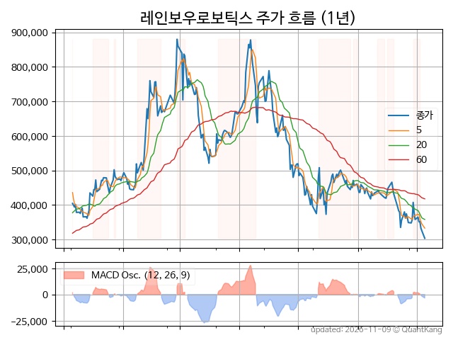
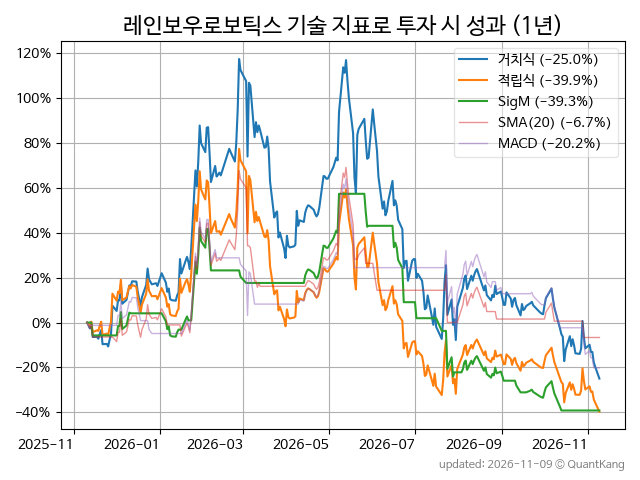
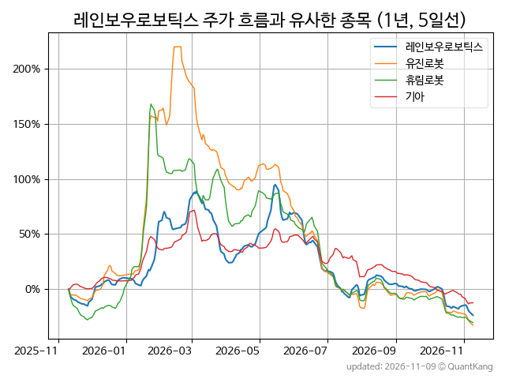
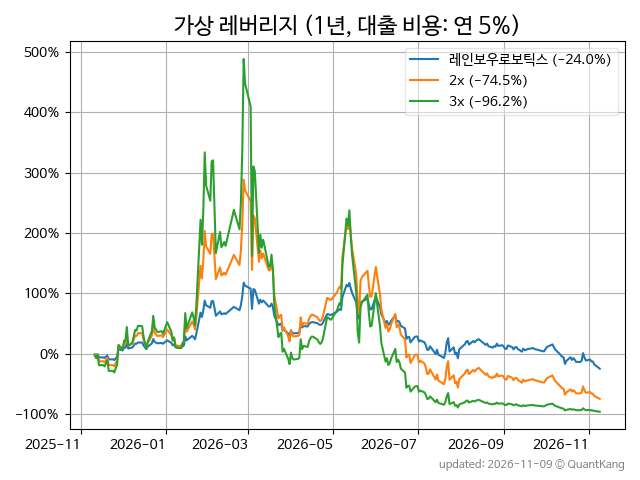

| **종가** | **전일대비** | **업종** | **PER** | **PBR** | **DIV** |
| -------: | -----------: | -------: | ------: | ------: | ------: |
| 303,500 | -6.6<small>%</small> | Q:기계장비 | 4143.8 | 43.9 | - |

<!-- more -->

> **기업 개요**

| **섹터** | Q:기계장비 / 기술성장기업부 |
| **산업** | 특수 목적용 기계 제조업 |
| **상장** | KOSDAQ / 2021년 2월 3일 상장 / 12월 결산 |
| **대표자** | 이정호 |
| **홈페이지** | [http://www.rainbow-robotics.com](http://www.rainbow-robotics.com){:target="_blank"} |

> **최근 7일 DART 신규 공시**

기간 내 신규 공시가 없습니다.

> **주가 흐름**

{: .align-center}

> **주요 가격 변동 지표**<small>[^fn_price_metric]</small>

| **종가** | **전일대비** | **5일** | **20일** | **60일** | **120일** |
| -------: | -----------: | ------: | -------: | -------: | --------: |
| 303,500 | -6.6<small>%</small> | -16.7<small>%</small> | -23.0<small>%</small> | -37.9<small>%</small> | -65.4<small>%</small> |
| **1년** | **편차** | **샤프** | **MDD** | **AvDD** | **MARr** |
| -25.0<small>%</small> | 90.4<small>%</small> | -0.28 | -65.5<small>%</small> | -28.4<small>%</small> | 0.4 |

> **주요 재무 지표**<small>[^fn_finance_metric]</small>

| **업종**<small>[^fn_sector_abbr]</small> | **PER** | **PBR** | **DIV** | **평가**<small>[^fn_finance_basic_tags]</small> |
| :--------------------------------------- | ------: | ------: | ------: | ----------------------------------------------: |
| Q:기계장비 | 4143.8 | 43.9 | - | 고PER, 고PBR |



> **세부 재무/투자 정보 제공 사이트**

| [네이버](https://m.stock.naver.com/domestic/stock/277810/finance/summary){:target="_blank"}<small>모바일</small> | [네이버](https://finance.naver.com/item/coinfo.naver?code=277810){:target="_blank"} | [FnGuide](https://comp.fnguide.com/SVO2/ASP/SVD_Invest.asp?gicode=A277810&MenuYn=Y){:target="_blank"} |
| :---: | :---: | :---: |
| [와이즈리포트](https://comp.wisereport.co.kr/company/c1040001.aspx?cmp_cd=277810){:target="_blank"} | [밸류라인](https://www.valueline.co.kr/finance/summary/277810){:target="_blank"} | [한국경제](https://markets.hankyung.com/stock/277810/financial-summary){:target="_blank"} |

> **주요 기술 지표**<small>[^fn_tech_metric]</small>

{: .align-center}

| **기술 지표** | **1년** | **편차** | **샤프** | **MDD** | **AvDD** |
| :------------ | ------: | -----------: | -------: | ------: | -------: |
| 거치식 | -25.0<small>%</small> | 90.4<small>%</small> | -0.28 | -65.5<small>%</small> | -28.4<small>%</small> |
| 적립식[^fn_tech_metric_dca] | -39.9<small>%</small> | 89.3<small>%</small> | -0.45 | -66.0<small>%</small> | -32.2<small>%</small> |
| Sig. M[^fn_tech_metric_sigm] | -39.3<small>%</small> | 52.8<small>%</small> | -0.75 | -61.4<small>%</small> | -24.5<small>%</small> |
| SMA<small>(5)</small>[^fn_tech_metric_sma_i] | -20.7<small>%</small> | 64.5<small>%</small> | -0.32 | -56.2<small>%</small> | -24.1<small>%</small> |
| SMA<small>(20)</small>[^fn_tech_metric_sma_i] | -6.7<small>%</small> | 60.0<small>%</small> | -0.11 | -44.8<small>%</small> | -24.4<small>%</small> |
| SMA<small>(60)</small>[^fn_tech_metric_sma_i] | 15.3<small>%</small> | 64.7<small>%</small> | 0.24 | -47.0<small>%</small> | -28.2<small>%</small> |
| SMA<small>(120)</small>[^fn_tech_metric_sma_i] | 30.8<small>%</small> | 70.0<small>%</small> | 0.44 | -43.0<small>%</small> | -25.5<small>%</small> |
| SMA<small>(240)</small>[^fn_tech_metric_sma_i] | -8.1<small>%</small> | 75.2<small>%</small> | -0.11 | -57.8<small>%</small> | -30.1<small>%</small> |
| MACD[^fn_tech_metric_macd] | -20.2<small>%</small> | 63.9<small>%</small> | -0.32 | -51.4<small>%</small> | -21.0<small>%</small> |

> **주가 흐름 유사 종목**<small>[^fn_corr_long]</small>

{: .align-center}

|       | [유진로봇](/056080/) | [휴림로봇](/090710/) | [기아](/000270/) |
| :---: | :------------------------------------: | :------------------------------------: | :------------------------------------: |
|       | [에코프로](/086520/) | [현대위아](/011210/) | [인텔리안테크](/189300/) |

> **가상 레버리지 상품에 투자했다면**<small>[^fn_lev]</small>

{: .align-center}

> **관련 정보**

- [Q:기계장비 업종 목록](/stats/sector/kosdaq_업종_기계장비_종목/){: .btn .btn--info} [고PER 목록](/fn/fn_high_per/){: .btn .btn--info} [고PBR 목록](/fn/fn_high_pbr/){: .btn .btn--info}

> **참고 도서** [오렌지사과의 출간 책 소개와 샘플북 목록](https://kongdori.tistory.com/691)

- [왜 위험한 주식에 투자하라는 걸까? - 장기 투자와 분산 투자에 대한 통계학적 시각](https://kongdori.tistory.com/421)
- [파이썬으로 그려보는 투자 포트폴리오 분석  - 정량적 투자 분석을 위한 입문서](https://kongdori.tistory.com/643)
- [구글 시트로 시작하는 투자 포트폴리오 분석 - 오렌지사과의 불친절한 워크북](https://kongdori.tistory.com/449)

