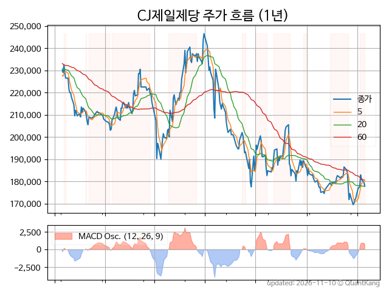
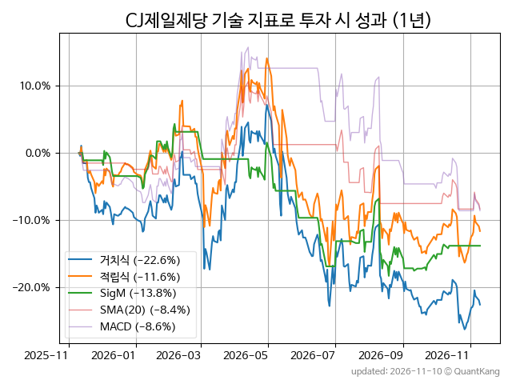
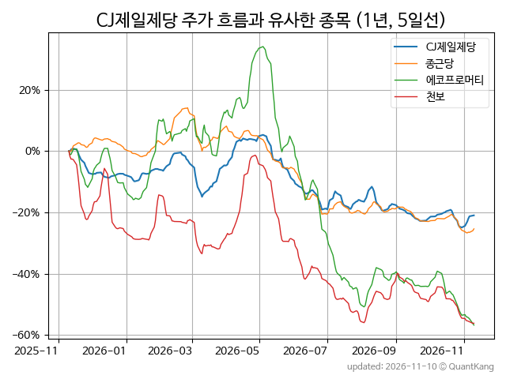
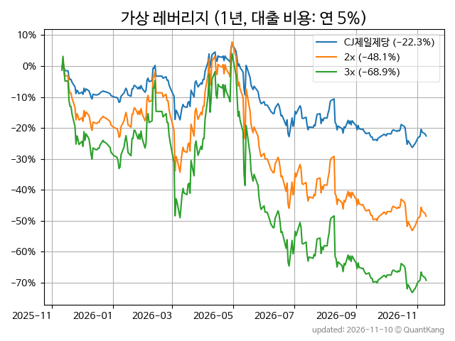

| **종가** | **전일대비** | **업종** | **PER** | **PBR** | **DIV** |
| -------: | -----------: | -------: | ------: | ------: | ------: |
| 178,000 | -0.8<small>%</small> | P:음식료담배 | - | 0.4 | 3.4<small>%</small> |

<!-- more -->

> **기업 개요**

| **섹터** | P:음식료담배 / nan |
| **산업** | 기타 식품 제조업 |
| **상장** | KOSPI / 2007년 9월 28일 상장 / 12월 결산 |
| **대표자** | 손경식,윤석환(각자 대표이사) |
| **홈페이지** | [http://www.cj.co.kr](http://www.cj.co.kr){:target="_blank"} |

> **최근 7일 DART 신규 공시**

| **일자** |      | **보고서명** |
| :------- | :--- | :----------- |
| 11&#x2011;10 | | [연결재무제표기준영업(잠정)실적(공정공시)              ](https://dart.fss.or.kr/dsaf001/main.do?rcpNo=20261110800079){:target="_blank"} |
| 11&#x2011;09 | | [특수관계인과의내부거래](https://dart.fss.or.kr/dsaf001/main.do?rcpNo=20261109000371){:target="_blank"} |
|  | | [동일인등출자계열회사와의상품ㆍ용역거래변경](https://dart.fss.or.kr/dsaf001/main.do?rcpNo=20261109000368){:target="_blank"} |
|  | | [현금ㆍ현물배당결정              ](https://dart.fss.or.kr/dsaf001/main.do?rcpNo=20261109800711){:target="_blank"} |
|  | | [현금ㆍ현물배당을위한주주명부폐쇄(기준일)결정              ](https://dart.fss.or.kr/dsaf001/main.do?rcpNo=20261109800685){:target="_blank"} |
| 11&#x2011;04 | | [기업설명회(IR)개최(안내공시)              ](https://dart.fss.or.kr/dsaf001/main.do?rcpNo=20261104800482){:target="_blank"} |

> **주가 흐름**

{: .align-center}

> **주요 가격 변동 지표**<small>[^fn_price_metric]</small>

| **종가** | **전일대비** | **5일** | **20일** | **60일** | **120일** |
| -------: | -----------: | ------: | -------: | -------: | --------: |
| 178,000 | -0.8<small>%</small> | 0.5<small>%</small> | -2.3<small>%</small> | -5.3<small>%</small> | -22.8<small>%</small> |
| **1년** | **편차** | **샤프** | **MDD** | **AvDD** | **MARr** |
| -22.6<small>%</small> | 32.6<small>%</small> | -0.69 | -31.2<small>%</small> | -15.3<small>%</small> | 0.7 |

> **주요 재무 지표**<small>[^fn_finance_metric]</small>

| **업종**<small>[^fn_sector_abbr]</small> | **PER** | **PBR** | **DIV** | **평가**<small>[^fn_finance_basic_tags]</small> |
| :--------------------------------------- | ------: | ------: | ------: | ----------------------------------------------: |
| P:음식료담배 | - | 0.4 | 3.4<small>%</small> | 저PBR |



> **세부 재무/투자 정보 제공 사이트**

| [네이버](https://m.stock.naver.com/domestic/stock/097950/finance/summary){:target="_blank"}<small>모바일</small> | [네이버](https://finance.naver.com/item/coinfo.naver?code=097950){:target="_blank"} | [FnGuide](https://comp.fnguide.com/SVO2/ASP/SVD_Invest.asp?gicode=A097950&MenuYn=Y){:target="_blank"} |
| :---: | :---: | :---: |
| [와이즈리포트](https://comp.wisereport.co.kr/company/c1040001.aspx?cmp_cd=097950){:target="_blank"} | [밸류라인](https://www.valueline.co.kr/finance/summary/097950){:target="_blank"} | [한국경제](https://markets.hankyung.com/stock/097950/financial-summary){:target="_blank"} |

> **주요 기술 지표**<small>[^fn_tech_metric]</small>

{: .align-center}

| **기술 지표** | **1년** | **편차** | **샤프** | **MDD** | **AvDD** |
| :------------ | ------: | -----------: | -------: | ------: | -------: |
| 거치식 | -22.6<small>%</small> | 32.6<small>%</small> | -0.69 | -31.2<small>%</small> | -15.3<small>%</small> |
| 적립식[^fn_tech_metric_dca] | -11.6<small>%</small> | 32.3<small>%</small> | -0.36 | -27.1<small>%</small> | -12.6<small>%</small> |
| Sig. M[^fn_tech_metric_sigm] | -13.8<small>%</small> | 18.3<small>%</small> | -0.76 | -21.7<small>%</small> | -10.1<small>%</small> |
| SMA<small>(5)</small>[^fn_tech_metric_sma_i] | -7.2<small>%</small> | 21.4<small>%</small> | -0.34 | -24.0<small>%</small> | -11.1<small>%</small> |
| SMA<small>(20)</small>[^fn_tech_metric_sma_i] | -8.4<small>%</small> | 19.3<small>%</small> | -0.43 | -17.2<small>%</small> | -8.0<small>%</small> |
| SMA<small>(60)</small>[^fn_tech_metric_sma_i] | -26.9<small>%</small> | 17.7<small>%</small> | -1.52 | -27.3<small>%</small> | -13.4<small>%</small> |
| SMA<small>(120)</small>[^fn_tech_metric_sma_i] | -11.9<small>%</small> | 13.8<small>%</small> | -0.86 | -19.2<small>%</small> | -10.3<small>%</small> |
| SMA<small>(240)</small>[^fn_tech_metric_sma_i] | -7.0<small>%</small> | 10.7<small>%</small> | -0.66 | -12.1<small>%</small> | -6.3<small>%</small> |
| MACD[^fn_tech_metric_macd] | -8.6<small>%</small> | 21.6<small>%</small> | -0.40 | -21.1<small>%</small> | -7.5<small>%</small> |

> **주가 흐름 유사 종목**<small>[^fn_corr_long]</small>

{: .align-center}

|       | [종근당](/185750/) | [에코프로머티](/450080/) | [천보](/278280/) |
| :---: | :------------------------------------: | :------------------------------------: | :------------------------------------: |
|       | [대한유화](/006650/) | [동화기업](/025900/) | [덕산네오룩스](/213420/) |

> **가상 레버리지 상품에 투자했다면**<small>[^fn_lev]</small>

{: .align-center}

> **관련 정보**

- [P:음식료담배 업종 목록](/stats/sector/kospi_업종_음식료담배_종목/){: .btn .btn--info} [저PBR 목록](/fn/fn_low_pbr/){: .btn .btn--info}

> **참고 도서** [오렌지사과의 출간 책 소개와 샘플북 목록](https://kongdori.tistory.com/691)

- [왜 위험한 주식에 투자하라는 걸까? - 장기 투자와 분산 투자에 대한 통계학적 시각](https://kongdori.tistory.com/421)
- [파이썬으로 그려보는 투자 포트폴리오 분석  - 정량적 투자 분석을 위한 입문서](https://kongdori.tistory.com/643)
- [구글 시트로 시작하는 투자 포트폴리오 분석 - 오렌지사과의 불친절한 워크북](https://kongdori.tistory.com/449)

