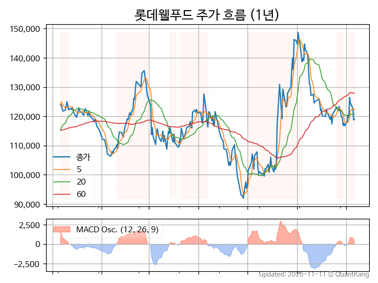
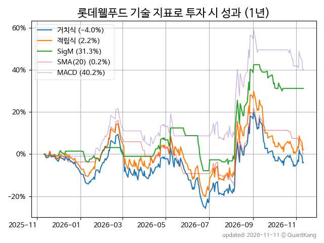
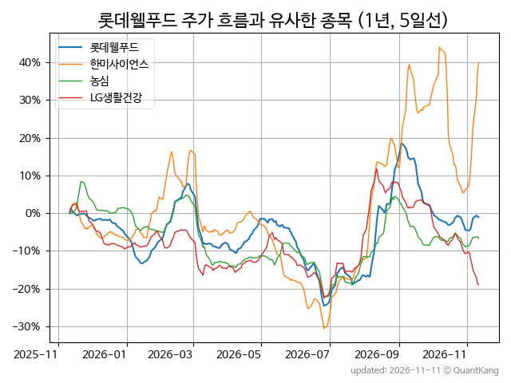
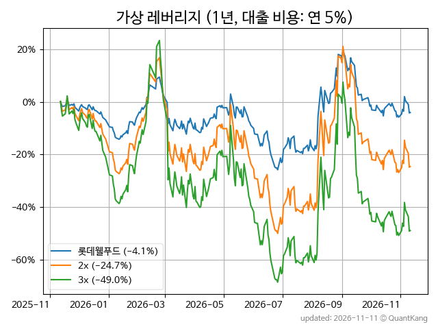

| **종가** | **전일대비** | **업종** | **PER** | **PBR** | **DIV** |
| -------: | -----------: | -------: | ------: | ------: | ------: |
| 118,900 | 0.2<small>%</small> | P:음식료담배 | 14.4 | 0.5 | 2.8<small>%</small> |

<!-- more -->

> **기업 개요**

| **섹터** | P:음식료담배 / nan |
| **산업** | 기타 식품 제조업 |
| **상장** | KOSPI / 2017년 10월 30일 상장 / 12월 결산 |
| **대표자** | 신동빈, 서정호 |
| **홈페이지** | [http://www.lottewellfood.com](http://www.lottewellfood.com){:target="_blank"} |

> **최근 7일 DART 신규 공시**

| **일자** |      | **보고서명** |
| :------- | :--- | :----------- |
| 11&#x2011;11 | | [기업설명회(IR)개최(안내공시)              ](https://dart.fss.or.kr/dsaf001/main.do?rcpNo=20261111800395){:target="_blank"} |
|  | | [연결재무제표기준영업(잠정)실적(공정공시)              ](https://dart.fss.or.kr/dsaf001/main.do?rcpNo=20261111800116){:target="_blank"} |
| 11&#x2011;04 | | [기업설명회(IR)개최(안내공시)              ](https://dart.fss.or.kr/dsaf001/main.do?rcpNo=20261104800195){:target="_blank"} |
|  | | [기업설명회(IR)개최(안내공시)              ](https://dart.fss.or.kr/dsaf001/main.do?rcpNo=20261104800194){:target="_blank"} |

> **주가 흐름**

{: .align-center}

> **주요 가격 변동 지표**<small>[^fn_price_metric]</small>

| **종가** | **전일대비** | **5일** | **20일** | **60일** | **120일** |
| -------: | -----------: | ------: | -------: | -------: | --------: |
| 118,900 | 0.2<small>%</small> | -0.5<small>%</small> | 1.4<small>%</small> | -3.2<small>%</small> | -2.1<small>%</small> |
| **1년** | **편차** | **샤프** | **MDD** | **AvDD** | **MARr** |
| -4.0<small>%</small> | 40.4<small>%</small> | -0.10 | -32.2<small>%</small> | -13.2<small>%</small> | 0.1 |

> **주요 재무 지표**<small>[^fn_finance_metric]</small>

| **업종**<small>[^fn_sector_abbr]</small> | **PER** | **PBR** | **DIV** | **평가**<small>[^fn_finance_basic_tags]</small> |
| :--------------------------------------- | ------: | ------: | ------: | ----------------------------------------------: |
| P:음식료담배 | 14.4 | 0.5 | 2.8<small>%</small> | - |



> **세부 재무/투자 정보 제공 사이트**

| [네이버](https://m.stock.naver.com/domestic/stock/280360/finance/summary){:target="_blank"}<small>모바일</small> | [네이버](https://finance.naver.com/item/coinfo.naver?code=280360){:target="_blank"} | [FnGuide](https://comp.fnguide.com/SVO2/ASP/SVD_Invest.asp?gicode=A280360&MenuYn=Y){:target="_blank"} |
| :---: | :---: | :---: |
| [와이즈리포트](https://comp.wisereport.co.kr/company/c1040001.aspx?cmp_cd=280360){:target="_blank"} | [밸류라인](https://www.valueline.co.kr/finance/summary/280360){:target="_blank"} | [한국경제](https://markets.hankyung.com/stock/280360/financial-summary){:target="_blank"} |

> **주요 기술 지표**<small>[^fn_tech_metric]</small>

{: .align-center}

| **기술 지표** | **1년** | **편차** | **샤프** | **MDD** | **AvDD** |
| :------------ | ------: | -----------: | -------: | ------: | -------: |
| 거치식 | -4.0<small>%</small> | 40.4<small>%</small> | -0.10 | -32.2<small>%</small> | -13.2<small>%</small> |
| 적립식[^fn_tech_metric_dca] | 2.2<small>%</small> | 40.1<small>%</small> | 0.05 | -30.4<small>%</small> | -12.1<small>%</small> |
| Sig. M[^fn_tech_metric_sigm] | 31.3<small>%</small> | 28.7<small>%</small> | 1.09 | -18.1<small>%</small> | -4.6<small>%</small> |
| SMA<small>(5)</small>[^fn_tech_metric_sma_i] | 2.6<small>%</small> | 30.7<small>%</small> | 0.08 | -25.6<small>%</small> | -11.3<small>%</small> |
| SMA<small>(20)</small>[^fn_tech_metric_sma_i] | 0.2<small>%</small> | 32.1<small>%</small> | 0.01 | -26.5<small>%</small> | -10.6<small>%</small> |
| SMA<small>(60)</small>[^fn_tech_metric_sma_i] | -18.3<small>%</small> | 28.1<small>%</small> | -0.65 | -25.2<small>%</small> | -15.4<small>%</small> |
| SMA<small>(120)</small>[^fn_tech_metric_sma_i] | -21.7<small>%</small> | 29.6<small>%</small> | -0.74 | -28.5<small>%</small> | -16.7<small>%</small> |
| SMA<small>(240)</small>[^fn_tech_metric_sma_i] | -22.6<small>%</small> | 29.5<small>%</small> | -0.76 | -27.4<small>%</small> | -16.2<small>%</small> |
| MACD[^fn_tech_metric_macd] | 40.2<small>%</small> | 32.5<small>%</small> | 1.24 | -14.7<small>%</small> | -6.3<small>%</small> |

> **주가 흐름 유사 종목**<small>[^fn_corr_long]</small>

{: .align-center}

|       | [한미사이언스](/008930/) | [농심](/004370/) | [LG생활건강](/051900/) |
| :---: | :------------------------------------: | :------------------------------------: | :------------------------------------: |
|       | [아모레퍼시픽](/090430/) | [SK이노베이션](/096770/) | [컴투스](/078340/) |

> **가상 레버리지 상품에 투자했다면**<small>[^fn_lev]</small>

{: .align-center}

> **관련 정보**

- [P:음식료담배 업종 목록](/stats/sector/kospi_업종_음식료담배_종목/){: .btn .btn--info}

> **참고 도서** [오렌지사과의 출간 책 소개와 샘플북 목록](https://kongdori.tistory.com/691)

- [왜 위험한 주식에 투자하라는 걸까? - 장기 투자와 분산 투자에 대한 통계학적 시각](https://kongdori.tistory.com/421)
- [파이썬으로 그려보는 투자 포트폴리오 분석  - 정량적 투자 분석을 위한 입문서](https://kongdori.tistory.com/643)
- [구글 시트로 시작하는 투자 포트폴리오 분석 - 오렌지사과의 불친절한 워크북](https://kongdori.tistory.com/449)

