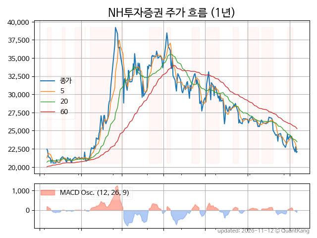
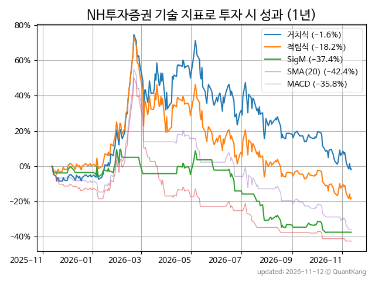
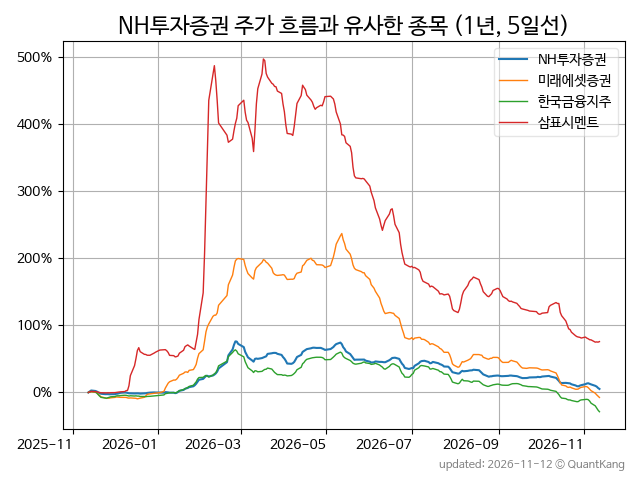
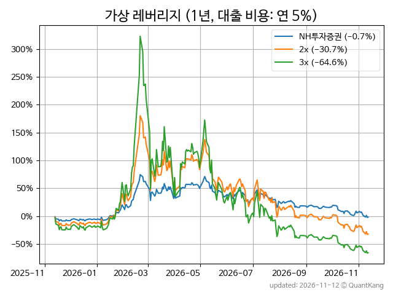

| **종가** | **전일대비** | **업종** | **PER** | **PBR** | **DIV** |
| -------: | -----------: | -------: | ------: | ------: | ------: |
| 22,100 | 0.5<small>%</small> | P:증권 | 7.7 | 0.9 | 5.9<small>%</small> |

<!-- more -->

> **기업 개요**

| **섹터** | P:증권 / nan |
| **산업** | 금융 지원 서비스업 |
| **상장** | KOSPI / 1975년 9월 30일 상장 / 12월 결산 |
| **대표자** | 신재욱, 배광수 |
| **홈페이지** | [http://www.nhqv.com](http://www.nhqv.com){:target="_blank"} |

> **최근 7일 DART 신규 공시**

| **일자** |      | **보고서명** |
| :------- | :--- | :----------- |
| 11&#x2011;12 | | [증권발행실적보고서](https://dart.fss.or.kr/dsaf001/main.do?rcpNo=20261112000380){:target="_blank"} |
|  | | [증권발행실적보고서](https://dart.fss.or.kr/dsaf001/main.do?rcpNo=20261112000324){:target="_blank"} |
|  | | [증권발행실적보고서](https://dart.fss.or.kr/dsaf001/main.do?rcpNo=20261112000244){:target="_blank"} |
|  | | [증권발행실적보고서](https://dart.fss.or.kr/dsaf001/main.do?rcpNo=20261112000175){:target="_blank"} |
|  | | [증권발행실적보고서](https://dart.fss.or.kr/dsaf001/main.do?rcpNo=20261112000170){:target="_blank"} |
|  | | [증권발행실적보고서](https://dart.fss.or.kr/dsaf001/main.do?rcpNo=20261112000163){:target="_blank"} |
|  | | [증권발행실적보고서](https://dart.fss.or.kr/dsaf001/main.do?rcpNo=20261112000158){:target="_blank"} |
|  | | [증권발행실적보고서](https://dart.fss.or.kr/dsaf001/main.do?rcpNo=20261112000151){:target="_blank"} |
|  | | [증권발행실적보고서](https://dart.fss.or.kr/dsaf001/main.do?rcpNo=20261112000078){:target="_blank"} |
|  | | [증권발행실적보고서](https://dart.fss.or.kr/dsaf001/main.do?rcpNo=20261112000072){:target="_blank"} |
|  | | [증권발행실적보고서](https://dart.fss.or.kr/dsaf001/main.do?rcpNo=20261112000068){:target="_blank"} |
| 11&#x2011;11 | | [벌금등의부과              ](https://dart.fss.or.kr/dsaf001/main.do?rcpNo=20261111800234){:target="_blank"} |
| 11&#x2011;10 | | [투자설명서(일괄신고)](https://dart.fss.or.kr/dsaf001/main.do?rcpNo=20261110000152){:target="_blank"} |
|  | | [일괄신고추가서류(파생결합사채-주가연계파생결합사채)](https://dart.fss.or.kr/dsaf001/main.do?rcpNo=20261110000114){:target="_blank"} |
|  | | [증권발행실적보고서](https://dart.fss.or.kr/dsaf001/main.do?rcpNo=20261110000045){:target="_blank"} |
|  | | [증권발행실적보고서](https://dart.fss.or.kr/dsaf001/main.do?rcpNo=20261110000040){:target="_blank"} |
|  | | [증권발행실적보고서](https://dart.fss.or.kr/dsaf001/main.do?rcpNo=20261110000036){:target="_blank"} |
| 11&#x2011;09 | | [투자설명서(일괄신고)](https://dart.fss.or.kr/dsaf001/main.do?rcpNo=20261109000386){:target="_blank"} |
|  | | [일괄신고추가서류(파생결합증권-주가연계증권)](https://dart.fss.or.kr/dsaf001/main.do?rcpNo=20261109000361){:target="_blank"} |
|  | | [최대주주등소유주식변동신고서              ](https://dart.fss.or.kr/dsaf001/main.do?rcpNo=20261109800352){:target="_blank"} |
|  | | [임원ㆍ주요주주특정증권등소유상황보고서](https://dart.fss.or.kr/dsaf001/main.do?rcpNo=20261109000154){:target="_blank"} |
|  | | [증권발행실적보고서](https://dart.fss.or.kr/dsaf001/main.do?rcpNo=20261109000046){:target="_blank"} |
| 11&#x2011;06 | | [증권발행실적보고서](https://dart.fss.or.kr/dsaf001/main.do?rcpNo=20261106000217){:target="_blank"} |
|  | | [증권발행실적보고서](https://dart.fss.or.kr/dsaf001/main.do?rcpNo=20261106000107){:target="_blank"} |
|  | | [증권발행실적보고서](https://dart.fss.or.kr/dsaf001/main.do?rcpNo=20261106000104){:target="_blank"} |
|  | | [증권발행실적보고서](https://dart.fss.or.kr/dsaf001/main.do?rcpNo=20261106000103){:target="_blank"} |
|  | | [증권발행실적보고서](https://dart.fss.or.kr/dsaf001/main.do?rcpNo=20261106000102){:target="_blank"} |
| 11&#x2011;05 | | [투자설명서(일괄신고)](https://dart.fss.or.kr/dsaf001/main.do?rcpNo=20261105000535){:target="_blank"} |
|  | | [투자설명서(일괄신고)](https://dart.fss.or.kr/dsaf001/main.do?rcpNo=20261105000408){:target="_blank"} |
|  | | [일괄신고추가서류(파생결합증권-주가연계증권)](https://dart.fss.or.kr/dsaf001/main.do?rcpNo=20261105000407){:target="_blank"} |
|  | | [투자설명서(일괄신고)](https://dart.fss.or.kr/dsaf001/main.do?rcpNo=20261105000396){:target="_blank"} |
|  | | [투자설명서(일괄신고)](https://dart.fss.or.kr/dsaf001/main.do?rcpNo=20261105000384){:target="_blank"} |
|  | | [투자설명서(일괄신고)](https://dart.fss.or.kr/dsaf001/main.do?rcpNo=20261105000345){:target="_blank"} |
|  | | [투자설명서(일괄신고)](https://dart.fss.or.kr/dsaf001/main.do?rcpNo=20261105000342){:target="_blank"} |
|  | | [투자설명서(일괄신고)](https://dart.fss.or.kr/dsaf001/main.do?rcpNo=20261105000335){:target="_blank"} |
|  | | [일괄신고추가서류(기타파생결합사채)](https://dart.fss.or.kr/dsaf001/main.do?rcpNo=20261105000296){:target="_blank"} |
|  | | [일괄신고추가서류(기타파생결합증권)](https://dart.fss.or.kr/dsaf001/main.do?rcpNo=20261105000279){:target="_blank"} |
|  | | [일괄신고추가서류(파생결합사채-주가연계파생결합사채)](https://dart.fss.or.kr/dsaf001/main.do?rcpNo=20261105000188){:target="_blank"} |
|  | | [일괄신고추가서류(파생결합사채-주가연계파생결합사채)](https://dart.fss.or.kr/dsaf001/main.do?rcpNo=20261105000164){:target="_blank"} |
|  | | [일괄신고추가서류(기타파생결합사채)](https://dart.fss.or.kr/dsaf001/main.do?rcpNo=20261105000163){:target="_blank"} |
|  | | [일괄신고추가서류(기타파생결합증권)](https://dart.fss.or.kr/dsaf001/main.do?rcpNo=20261105000161){:target="_blank"} |

> **주가 흐름**

{: .align-center}

> **주요 가격 변동 지표**<small>[^fn_price_metric]</small>

| **종가** | **전일대비** | **5일** | **20일** | **60일** | **120일** |
| -------: | -----------: | ------: | -------: | -------: | --------: |
| 22,100 | 0.5<small>%</small> | -6.6<small>%</small> | -6.2<small>%</small> | -22.0<small>%</small> | -30.8<small>%</small> |
| **1년** | **편차** | **샤프** | **MDD** | **AvDD** | **MARr** |
| -1.6<small>%</small> | 56.6<small>%</small> | -0.03 | -43.9<small>%</small> | -18.8<small>%</small> | 0.0 |

> **주요 재무 지표**<small>[^fn_finance_metric]</small>

| **업종**<small>[^fn_sector_abbr]</small> | **PER** | **PBR** | **DIV** | **평가**<small>[^fn_finance_basic_tags]</small> |
| :--------------------------------------- | ------: | ------: | ------: | ----------------------------------------------: |
| P:증권 | 7.7 | 0.9 | 5.9<small>%</small> | 고배당 |



> **세부 재무/투자 정보 제공 사이트**

| [네이버](https://m.stock.naver.com/domestic/stock/005940/finance/summary){:target="_blank"}<small>모바일</small> | [네이버](https://finance.naver.com/item/coinfo.naver?code=005940){:target="_blank"} | [FnGuide](https://comp.fnguide.com/SVO2/ASP/SVD_Invest.asp?gicode=A005940&MenuYn=Y){:target="_blank"} |
| :---: | :---: | :---: |
| [와이즈리포트](https://comp.wisereport.co.kr/company/c1040001.aspx?cmp_cd=005940){:target="_blank"} | [밸류라인](https://www.valueline.co.kr/finance/summary/005940){:target="_blank"} | [한국경제](https://markets.hankyung.com/stock/005940/financial-summary){:target="_blank"} |

> **주요 기술 지표**<small>[^fn_tech_metric]</small>

{: .align-center}

| **기술 지표** | **1년** | **편차** | **샤프** | **MDD** | **AvDD** |
| :------------ | ------: | -----------: | -------: | ------: | -------: |
| 거치식 | -1.6<small>%</small> | 56.6<small>%</small> | -0.03 | -43.9<small>%</small> | -18.8<small>%</small> |
| 적립식[^fn_tech_metric_dca] | -18.2<small>%</small> | 55.9<small>%</small> | -0.33 | -53.0<small>%</small> | -26.0<small>%</small> |
| Sig. M[^fn_tech_metric_sigm] | -37.4<small>%</small> | 27.8<small>%</small> | -1.35 | -43.1<small>%</small> | -18.3<small>%</small> |
| SMA<small>(5)</small>[^fn_tech_metric_sma_i] | -12.8<small>%</small> | 39.3<small>%</small> | -0.33 | -40.5<small>%</small> | -19.2<small>%</small> |
| SMA<small>(20)</small>[^fn_tech_metric_sma_i] | -42.4<small>%</small> | 40.0<small>%</small> | -1.06 | -61.6<small>%</small> | -38.5<small>%</small> |
| SMA<small>(60)</small>[^fn_tech_metric_sma_i] | 32.2<small>%</small> | 46.1<small>%</small> | 0.70 | -26.5<small>%</small> | -15.5<small>%</small> |
| SMA<small>(120)</small>[^fn_tech_metric_sma_i] | 23.2<small>%</small> | 49.7<small>%</small> | 0.47 | -29.4<small>%</small> | -17.8<small>%</small> |
| SMA<small>(240)</small>[^fn_tech_metric_sma_i] | 13.2<small>%</small> | 54.6<small>%</small> | 0.24 | -35.2<small>%</small> | -18.8<small>%</small> |
| MACD[^fn_tech_metric_macd] | -35.8<small>%</small> | 39.8<small>%</small> | -0.90 | -58.5<small>%</small> | -29.7<small>%</small> |

> **주가 흐름 유사 종목**<small>[^fn_corr_long]</small>

{: .align-center}

|       | [미래에셋증권](/006800/) | [한국금융지주](/071050/) | [삼표시멘트](/038500/) |
| :---: | :------------------------------------: | :------------------------------------: | :------------------------------------: |
|       | [삼성증권](/016360/) | [현대바이오](/048410/) | [코오롱인더](/120110/) |

> **가상 레버리지 상품에 투자했다면**<small>[^fn_lev]</small>

{: .align-center}

> **관련 정보**

- [P:증권 업종 목록](/stats/sector/kospi_업종_증권_종목/){: .btn .btn--info} [고배당 목록](/fn/fn_high_div/){: .btn .btn--info}

> **참고 도서** [오렌지사과의 출간 책 소개와 샘플북 목록](https://kongdori.tistory.com/691)

- [왜 위험한 주식에 투자하라는 걸까? - 장기 투자와 분산 투자에 대한 통계학적 시각](https://kongdori.tistory.com/421)
- [파이썬으로 그려보는 투자 포트폴리오 분석  - 정량적 투자 분석을 위한 입문서](https://kongdori.tistory.com/643)
- [구글 시트로 시작하는 투자 포트폴리오 분석 - 오렌지사과의 불친절한 워크북](https://kongdori.tistory.com/449)

