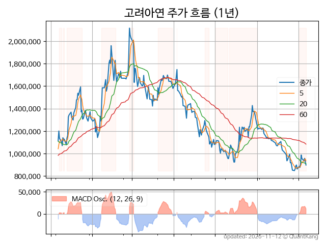
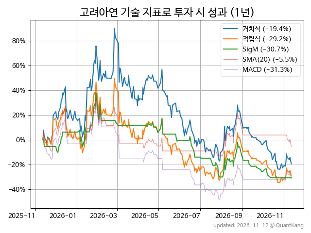
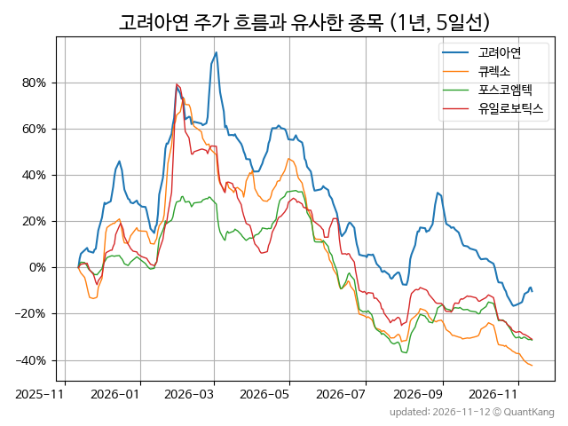
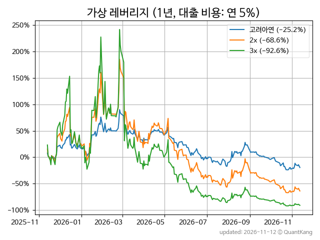

| **종가** | **전일대비** | **업종** | **PER** | **PBR** | **DIV** |
| -------: | -----------: | -------: | ------: | ------: | ------: |
| 898,000 | -2.9<small>%</small> | P:금속 | 21.2 | 1.7 | 2.2<small>%</small> |

<!-- more -->

> **기업 개요**

| **섹터** | P:금속 / nan |
| **산업** | 1차 비철금속 제조업 |
| **상장** | KOSPI / 1990년 7월 28일 상장 / 12월 결산 |
| **대표자** | 박기덕 |
| **홈페이지** | [http://www.koreazinc.co.kr](http://www.koreazinc.co.kr){:target="_blank"} |

> **최근 7일 DART 신규 공시**

| **일자** |      | **보고서명** |
| :------- | :--- | :----------- |
| 11&#x2011;09 | | [[기재정정]소송등의제기ㆍ신청(경영권분쟁소송)              ](https://dart.fss.or.kr/dsaf001/main.do?rcpNo=20261109800201){:target="_blank"} |

> **주가 흐름**

{: .align-center}

> **주요 가격 변동 지표**<small>[^fn_price_metric]</small>

| **종가** | **전일대비** | **5일** | **20일** | **60일** | **120일** |
| -------: | -----------: | ------: | -------: | -------: | --------: |
| 898,000 | -2.9<small>%</small> | -9.0<small>%</small> | -4.0<small>%</small> | -27.2<small>%</small> | -36.8<small>%</small> |
| **1년** | **편차** | **샤프** | **MDD** | **AvDD** | **MARr** |
| -19.4<small>%</small> | 73.5<small>%</small> | -0.26 | -59.9<small>%</small> | -31.0<small>%</small> | 0.3 |

> **주요 재무 지표**<small>[^fn_finance_metric]</small>

| **업종**<small>[^fn_sector_abbr]</small> | **PER** | **PBR** | **DIV** | **평가**<small>[^fn_finance_basic_tags]</small> |
| :--------------------------------------- | ------: | ------: | ------: | ----------------------------------------------: |
| P:금속 | 21.2 | 1.7 | 2.2<small>%</small> | - |



> **세부 재무/투자 정보 제공 사이트**

| [네이버](https://m.stock.naver.com/domestic/stock/010130/finance/summary){:target="_blank"}<small>모바일</small> | [네이버](https://finance.naver.com/item/coinfo.naver?code=010130){:target="_blank"} | [FnGuide](https://comp.fnguide.com/SVO2/ASP/SVD_Invest.asp?gicode=A010130&MenuYn=Y){:target="_blank"} |
| :---: | :---: | :---: |
| [와이즈리포트](https://comp.wisereport.co.kr/company/c1040001.aspx?cmp_cd=010130){:target="_blank"} | [밸류라인](https://www.valueline.co.kr/finance/summary/010130){:target="_blank"} | [한국경제](https://markets.hankyung.com/stock/010130/financial-summary){:target="_blank"} |

> **주요 기술 지표**<small>[^fn_tech_metric]</small>

{: .align-center}

| **기술 지표** | **1년** | **편차** | **샤프** | **MDD** | **AvDD** |
| :------------ | ------: | -----------: | -------: | ------: | -------: |
| 거치식 | -19.4<small>%</small> | 73.5<small>%</small> | -0.26 | -59.9<small>%</small> | -31.0<small>%</small> |
| 적립식[^fn_tech_metric_dca] | -29.2<small>%</small> | 72.0<small>%</small> | -0.41 | -56.3<small>%</small> | -31.2<small>%</small> |
| Sig. M[^fn_tech_metric_sigm] | -30.7<small>%</small> | 47.9<small>%</small> | -0.64 | -49.8<small>%</small> | -25.7<small>%</small> |
| SMA<small>(5)</small>[^fn_tech_metric_sma_i] | -8.9<small>%</small> | 55.2<small>%</small> | -0.16 | -38.2<small>%</small> | -21.4<small>%</small> |
| SMA<small>(20)</small>[^fn_tech_metric_sma_i] | -5.5<small>%</small> | 55.4<small>%</small> | -0.10 | -35.5<small>%</small> | -22.8<small>%</small> |
| SMA<small>(60)</small>[^fn_tech_metric_sma_i] | -12.4<small>%</small> | 57.6<small>%</small> | -0.22 | -47.0<small>%</small> | -28.6<small>%</small> |
| SMA<small>(120)</small>[^fn_tech_metric_sma_i] | 21.5<small>%</small> | 59.0<small>%</small> | 0.36 | -36.0<small>%</small> | -23.4<small>%</small> |
| SMA<small>(240)</small>[^fn_tech_metric_sma_i] | -4.4<small>%</small> | 61.5<small>%</small> | -0.07 | -49.7<small>%</small> | -30.9<small>%</small> |
| MACD[^fn_tech_metric_macd] | -31.3<small>%</small> | 56.6<small>%</small> | -0.55 | -61.0<small>%</small> | -34.8<small>%</small> |

> **주가 흐름 유사 종목**<small>[^fn_corr_long]</small>

{: .align-center}

|       | [큐렉소](/060280/) | [포스코엠텍](/009520/) | [유일로보틱스](/388720/) |
| :---: | :------------------------------------: | :------------------------------------: | :------------------------------------: |
|       | [현대엘리베이터](/017800/) | [성우하이텍](/015750/) | [한전KPS](/051600/) |

> **가상 레버리지 상품에 투자했다면**<small>[^fn_lev]</small>

{: .align-center}

> **관련 정보**

- [P:금속 업종 목록](/stats/sector/kospi_업종_금속_종목/){: .btn .btn--info}

> **참고 도서** [오렌지사과의 출간 책 소개와 샘플북 목록](https://kongdori.tistory.com/691)

- [왜 위험한 주식에 투자하라는 걸까? - 장기 투자와 분산 투자에 대한 통계학적 시각](https://kongdori.tistory.com/421)
- [파이썬으로 그려보는 투자 포트폴리오 분석  - 정량적 투자 분석을 위한 입문서](https://kongdori.tistory.com/643)
- [구글 시트로 시작하는 투자 포트폴리오 분석 - 오렌지사과의 불친절한 워크북](https://kongdori.tistory.com/449)

