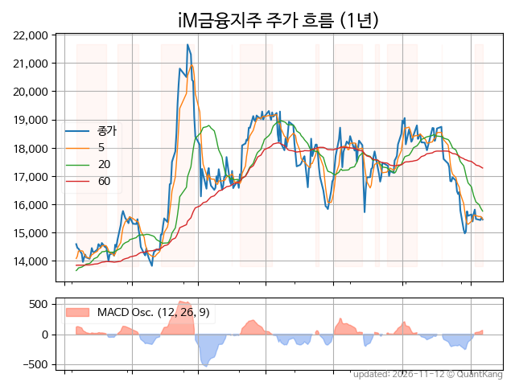
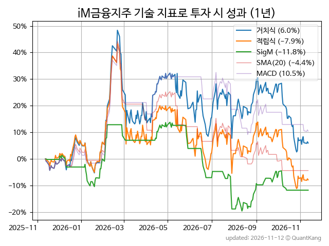
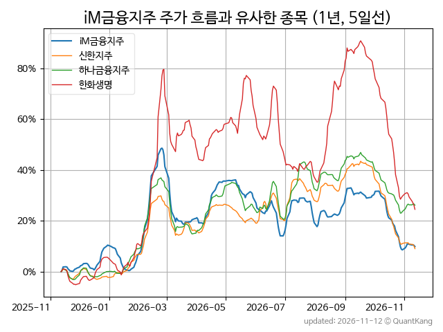
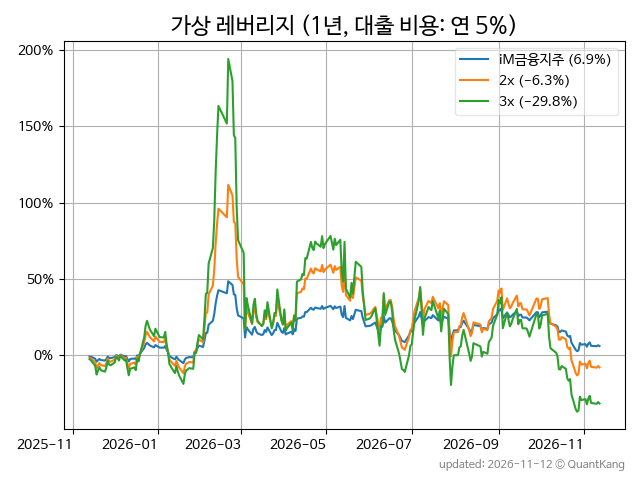

| **종가** | **전일대비** | **업종** | **PER** | **PBR** | **DIV** |
| -------: | -----------: | -------: | ------: | ------: | ------: |
| 15,460 | -0.5<small>%</small> | P:기타금융 | 6.1 | 0.4 | 4.5<small>%</small> |

<!-- more -->

> **기업 개요**

| **섹터** | P:기타금융 / nan |
| **산업** | 기타 금융업 |
| **상장** | KOSPI / 2011년 6월 7일 상장 / 12월 결산 |
| **대표자** | 황병우 |
| **홈페이지** | [http://www.imfngroup.com](http://www.imfngroup.com){:target="_blank"} |

> **최근 7일 DART 신규 공시**

| **일자** |      | **보고서명** |
| :------- | :--- | :----------- |
| 11&#x2011;12 | | [현금ㆍ현물배당을위한주주명부폐쇄(기준일)결정(자회사의 주요경영사항)              ](https://dart.fss.or.kr/dsaf001/main.do?rcpNo=20261112800681){:target="_blank"} |
| 11&#x2011;09 | | [기업설명회(IR)개최(안내공시)              ](https://dart.fss.or.kr/dsaf001/main.do?rcpNo=20261109800146){:target="_blank"} |
| 11&#x2011;06 | | [주식등의대량보유상황보고서(약식)](https://dart.fss.or.kr/dsaf001/main.do?rcpNo=20261106000307){:target="_blank"} |

> **주가 흐름**

{: .align-center}

> **주요 가격 변동 지표**<small>[^fn_price_metric]</small>

| **종가** | **전일대비** | **5일** | **20일** | **60일** | **120일** |
| -------: | -----------: | ------: | -------: | -------: | --------: |
| 15,460 | -0.5<small>%</small> | -2.2<small>%</small> | -8.0<small>%</small> | -8.9<small>%</small> | -13.7<small>%</small> |
| **1년** | **편차** | **샤프** | **MDD** | **AvDD** | **MARr** |
| 6.0<small>%</small> | 39.0<small>%</small> | 0.15 | -30.9<small>%</small> | -14.5<small>%</small> | -0.2 |

> **주요 재무 지표**<small>[^fn_finance_metric]</small>

| **업종**<small>[^fn_sector_abbr]</small> | **PER** | **PBR** | **DIV** | **평가**<small>[^fn_finance_basic_tags]</small> |
| :--------------------------------------- | ------: | ------: | ------: | ----------------------------------------------: |
| P:기타금융 | 6.1 | 0.4 | 4.5<small>%</small> | 저PER, 저PBR, 고배당 |



> **세부 재무/투자 정보 제공 사이트**

| [네이버](https://m.stock.naver.com/domestic/stock/139130/finance/summary){:target="_blank"}<small>모바일</small> | [네이버](https://finance.naver.com/item/coinfo.naver?code=139130){:target="_blank"} | [FnGuide](https://comp.fnguide.com/SVO2/ASP/SVD_Invest.asp?gicode=A139130&MenuYn=Y){:target="_blank"} |
| :---: | :---: | :---: |
| [와이즈리포트](https://comp.wisereport.co.kr/company/c1040001.aspx?cmp_cd=139130){:target="_blank"} | [밸류라인](https://www.valueline.co.kr/finance/summary/139130){:target="_blank"} | [한국경제](https://markets.hankyung.com/stock/139130/financial-summary){:target="_blank"} |

> **주요 기술 지표**<small>[^fn_tech_metric]</small>

{: .align-center}

| **기술 지표** | **1년** | **편차** | **샤프** | **MDD** | **AvDD** |
| :------------ | ------: | -----------: | -------: | ------: | -------: |
| 거치식 | 6.0<small>%</small> | 39.0<small>%</small> | 0.15 | -30.9<small>%</small> | -14.5<small>%</small> |
| 적립식[^fn_tech_metric_dca] | -7.9<small>%</small> | 38.6<small>%</small> | -0.20 | -38.0<small>%</small> | -18.9<small>%</small> |
| Sig. M[^fn_tech_metric_sigm] | -11.8<small>%</small> | 21.3<small>%</small> | -0.55 | -29.3<small>%</small> | -10.9<small>%</small> |
| SMA<small>(5)</small>[^fn_tech_metric_sma_i] | 2.5<small>%</small> | 28.2<small>%</small> | 0.09 | -35.2<small>%</small> | -15.8<small>%</small> |
| SMA<small>(20)</small>[^fn_tech_metric_sma_i] | -4.4<small>%</small> | 27.6<small>%</small> | -0.16 | -33.7<small>%</small> | -18.3<small>%</small> |
| SMA<small>(60)</small>[^fn_tech_metric_sma_i] | -16.4<small>%</small> | 32.8<small>%</small> | -0.50 | -40.3<small>%</small> | -22.2<small>%</small> |
| SMA<small>(120)</small>[^fn_tech_metric_sma_i] | -0.6<small>%</small> | 34.9<small>%</small> | -0.02 | -32.7<small>%</small> | -18.5<small>%</small> |
| SMA<small>(240)</small>[^fn_tech_metric_sma_i] | 9.1<small>%</small> | 37.6<small>%</small> | 0.24 | -27.4<small>%</small> | -15.3<small>%</small> |
| MACD[^fn_tech_metric_macd] | 10.5<small>%</small> | 26.2<small>%</small> | 0.40 | -23.5<small>%</small> | -11.3<small>%</small> |

> **주가 흐름 유사 종목**<small>[^fn_corr_long]</small>

{: .align-center}

|       | [신한지주](/055550/) | [하나금융지주](/086790/) | [한화생명](/088350/) |
| :---: | :------------------------------------: | :------------------------------------: | :------------------------------------: |
|       | [DL](/000210/) | [우리금융지주](/316140/) | [KB금융](/105560/) |

> **가상 레버리지 상품에 투자했다면**<small>[^fn_lev]</small>

{: .align-center}

> **관련 정보**

- [P:기타금융 업종 목록](/stats/sector/kospi_업종_기타금융_종목/){: .btn .btn--info} [저PER 목록](/fn/fn_low_per/){: .btn .btn--info} [저PBR 목록](/fn/fn_low_pbr/){: .btn .btn--info} [고배당 목록](/fn/fn_high_div/){: .btn .btn--info}

> **참고 도서** [오렌지사과의 출간 책 소개와 샘플북 목록](https://kongdori.tistory.com/691)

- [왜 위험한 주식에 투자하라는 걸까? - 장기 투자와 분산 투자에 대한 통계학적 시각](https://kongdori.tistory.com/421)
- [파이썬으로 그려보는 투자 포트폴리오 분석  - 정량적 투자 분석을 위한 입문서](https://kongdori.tistory.com/643)
- [구글 시트로 시작하는 투자 포트폴리오 분석 - 오렌지사과의 불친절한 워크북](https://kongdori.tistory.com/449)

