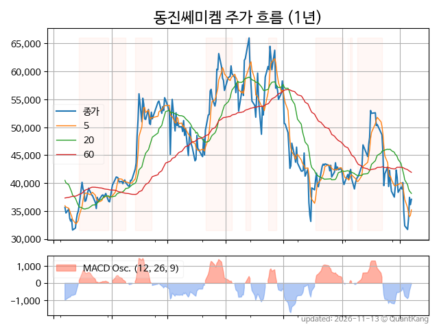
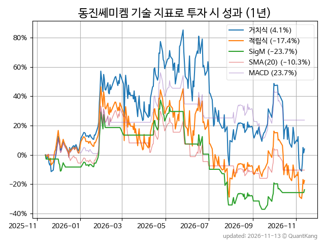
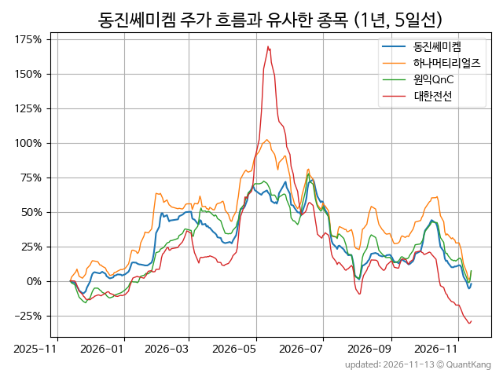
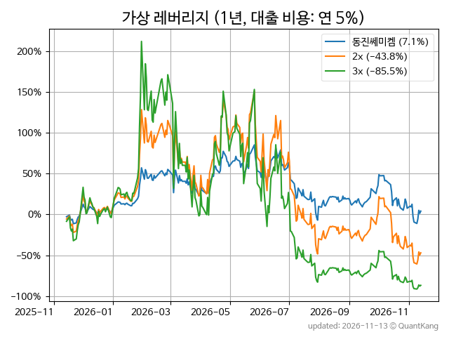

| **종가** | **전일대비** | **업종** | **PER** | **PBR** | **DIV** |
| -------: | -----------: | -------: | ------: | ------: | ------: |
| 37,100 | 2.6<small>%</small> | Q:화학 | 19.1 | 1.8 | 1.8<small>%</small> |

<!-- more -->

> **기업 개요**

| **섹터** | Q:화학 / 우량기업부 |
| **산업** | 기초 화학물질 제조업 |
| **상장** | KOSDAQ / 1999년 12월 21일 상장 / 12월 결산 |
| **대표자** | 이준혁 |
| **홈페이지** | [http://www.dongjin.com](http://www.dongjin.com){:target="_blank"} |

> **최근 7일 DART 신규 공시**

기간 내 신규 공시가 없습니다.

> **주가 흐름**

{: .align-center}

> **주요 가격 변동 지표**<small>[^fn_price_metric]</small>

| **종가** | **전일대비** | **5일** | **20일** | **60일** | **120일** |
| -------: | -----------: | ------: | -------: | -------: | --------: |
| 37,100 | 2.6<small>%</small> | 14.7<small>%</small> | -10.9<small>%</small> | -14.6<small>%</small> | -35.6<small>%</small> |
| **1년** | **편차** | **샤프** | **MDD** | **AvDD** | **MARr** |
| 4.1<small>%</small> | 82.4<small>%</small> | 0.05 | -52.0<small>%</small> | -18.3<small>%</small> | -0.1 |

> **주요 재무 지표**<small>[^fn_finance_metric]</small>

| **업종**<small>[^fn_sector_abbr]</small> | **PER** | **PBR** | **DIV** | **평가**<small>[^fn_finance_basic_tags]</small> |
| :--------------------------------------- | ------: | ------: | ------: | ----------------------------------------------: |
| Q:화학 | 19.1 | 1.8 | 1.8<small>%</small> | - |



> **세부 재무/투자 정보 제공 사이트**

| [네이버](https://m.stock.naver.com/domestic/stock/005290/finance/summary){:target="_blank"}<small>모바일</small> | [네이버](https://finance.naver.com/item/coinfo.naver?code=005290){:target="_blank"} | [FnGuide](https://comp.fnguide.com/SVO2/ASP/SVD_Invest.asp?gicode=A005290&MenuYn=Y){:target="_blank"} |
| :---: | :---: | :---: |
| [와이즈리포트](https://comp.wisereport.co.kr/company/c1040001.aspx?cmp_cd=005290){:target="_blank"} | [밸류라인](https://www.valueline.co.kr/finance/summary/005290){:target="_blank"} | [한국경제](https://markets.hankyung.com/stock/005290/financial-summary){:target="_blank"} |

> **주요 기술 지표**<small>[^fn_tech_metric]</small>

{: .align-center}

| **기술 지표** | **1년** | **편차** | **샤프** | **MDD** | **AvDD** |
| :------------ | ------: | -----------: | -------: | ------: | -------: |
| 거치식 | 4.1<small>%</small> | 82.4<small>%</small> | 0.05 | -52.0<small>%</small> | -18.3<small>%</small> |
| 적립식[^fn_tech_metric_dca] | -17.4<small>%</small> | 81.5<small>%</small> | -0.21 | -52.0<small>%</small> | -21.2<small>%</small> |
| Sig. M[^fn_tech_metric_sigm] | -23.7<small>%</small> | 46.7<small>%</small> | -0.51 | -54.2<small>%</small> | -23.1<small>%</small> |
| SMA<small>(5)</small>[^fn_tech_metric_sma_i] | -60.6<small>%</small> | 50.2<small>%</small> | -1.21 | -73.4<small>%</small> | -43.4<small>%</small> |
| SMA<small>(20)</small>[^fn_tech_metric_sma_i] | -10.3<small>%</small> | 47.4<small>%</small> | -0.22 | -37.0<small>%</small> | -19.9<small>%</small> |
| SMA<small>(60)</small>[^fn_tech_metric_sma_i] | -34.2<small>%</small> | 58.1<small>%</small> | -0.59 | -48.5<small>%</small> | -22.9<small>%</small> |
| SMA<small>(120)</small>[^fn_tech_metric_sma_i] | 16.8<small>%</small> | 63.3<small>%</small> | 0.27 | -35.4<small>%</small> | -17.1<small>%</small> |
| SMA<small>(240)</small>[^fn_tech_metric_sma_i] | -12.2<small>%</small> | 68.0<small>%</small> | -0.18 | -52.6<small>%</small> | -22.6<small>%</small> |
| MACD[^fn_tech_metric_macd] | 23.7<small>%</small> | 44.8<small>%</small> | 0.53 | -28.6<small>%</small> | -11.8<small>%</small> |

> **주가 흐름 유사 종목**<small>[^fn_corr_long]</small>

{: .align-center}

|       | [하나머티리얼즈](/166090/) | [원익QnC](/074600/) | [대한전선](/001440/) |
| :---: | :------------------------------------: | :------------------------------------: | :------------------------------------: |
|       | [제룡전기](/033100/) | [미래에셋벤처투자](/100790/) | [서진시스템](/178320/) |

> **가상 레버리지 상품에 투자했다면**<small>[^fn_lev]</small>

{: .align-center}

> **관련 정보**

- [Q:화학 업종 목록](/stats/sector/kosdaq_업종_화학_종목/){: .btn .btn--info}

> **참고 도서** [오렌지사과의 출간 책 소개와 샘플북 목록](https://kongdori.tistory.com/691)

- [왜 위험한 주식에 투자하라는 걸까? - 장기 투자와 분산 투자에 대한 통계학적 시각](https://kongdori.tistory.com/421)
- [파이썬으로 그려보는 투자 포트폴리오 분석  - 정량적 투자 분석을 위한 입문서](https://kongdori.tistory.com/643)
- [구글 시트로 시작하는 투자 포트폴리오 분석 - 오렌지사과의 불친절한 워크북](https://kongdori.tistory.com/449)

