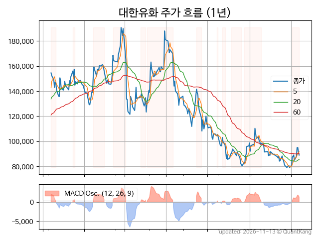
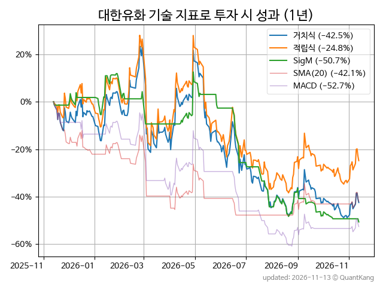
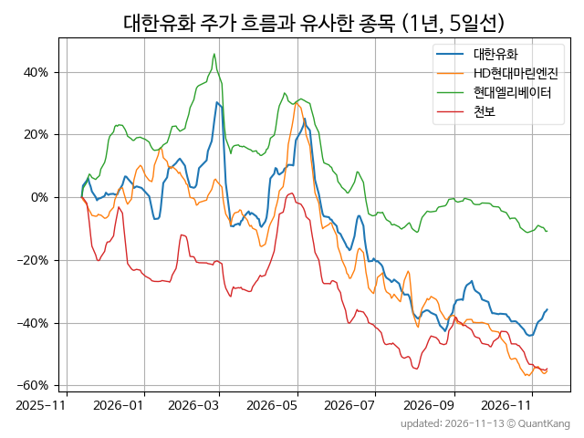
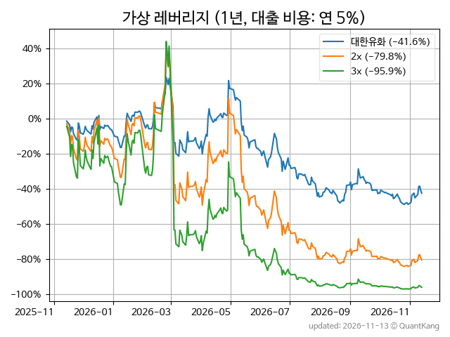

| **종가** | **전일대비** | **업종** | **PER** | **PBR** | **DIV** |
| -------: | -----------: | -------: | ------: | ------: | ------: |
| 88,900 | -2.6<small>%</small> | P:화학 | 17.3 | 0.3 | 1.5<small>%</small> |

<!-- more -->

> **기업 개요**

| **섹터** | P:화학 / nan |
| **산업** | 기초 화학물질 제조업 |
| **상장** | KOSPI / 1999년 8월 11일 상장 / 12월 결산 |
| **대표자** | 강길순 |
| **홈페이지** | [http://www.kpic.co.kr](http://www.kpic.co.kr){:target="_blank"} |

> **최근 7일 DART 신규 공시**

| **일자** |      | **보고서명** |
| :------- | :--- | :----------- |
| 11&#x2011;13 | | [분기보고서 (2026.09)](https://dart.fss.or.kr/dsaf001/main.do?rcpNo=20261113000792){:target="_blank"} |
| 11&#x2011;09 | | [최대주주등소유주식변동신고서              ](https://dart.fss.or.kr/dsaf001/main.do?rcpNo=20261109800603){:target="_blank"} |

> **주가 흐름**

{: .align-center}

> **주요 가격 변동 지표**<small>[^fn_price_metric]</small>

| **종가** | **전일대비** | **5일** | **20일** | **60일** | **120일** |
| -------: | -----------: | ------: | -------: | -------: | --------: |
| 88,900 | -2.6<small>%</small> | 4.8<small>%</small> | 5.2<small>%</small> | -2.7<small>%</small> | -34.2<small>%</small> |
| **1년** | **편차** | **샤프** | **MDD** | **AvDD** | **MARr** |
| -42.5<small>%</small> | 69.6<small>%</small> | -0.61 | -58.6<small>%</small> | -30.0<small>%</small> | 0.7 |

> **주요 재무 지표**<small>[^fn_finance_metric]</small>

| **업종**<small>[^fn_sector_abbr]</small> | **PER** | **PBR** | **DIV** | **평가**<small>[^fn_finance_basic_tags]</small> |
| :--------------------------------------- | ------: | ------: | ------: | ----------------------------------------------: |
| P:화학 | 17.3 | 0.3 | 1.5<small>%</small> | 저PBR |



> **세부 재무/투자 정보 제공 사이트**

| [네이버](https://m.stock.naver.com/domestic/stock/006650/finance/summary){:target="_blank"}<small>모바일</small> | [네이버](https://finance.naver.com/item/coinfo.naver?code=006650){:target="_blank"} | [FnGuide](https://comp.fnguide.com/SVO2/ASP/SVD_Invest.asp?gicode=A006650&MenuYn=Y){:target="_blank"} |
| :---: | :---: | :---: |
| [와이즈리포트](https://comp.wisereport.co.kr/company/c1040001.aspx?cmp_cd=006650){:target="_blank"} | [밸류라인](https://www.valueline.co.kr/finance/summary/006650){:target="_blank"} | [한국경제](https://markets.hankyung.com/stock/006650/financial-summary){:target="_blank"} |

> **주요 기술 지표**<small>[^fn_tech_metric]</small>

{: .align-center}

| **기술 지표** | **1년** | **편차** | **샤프** | **MDD** | **AvDD** |
| :------------ | ------: | -----------: | -------: | ------: | -------: |
| 거치식 | -42.5<small>%</small> | 69.6<small>%</small> | -0.61 | -58.6<small>%</small> | -30.0<small>%</small> |
| 적립식[^fn_tech_metric_dca] | -24.8<small>%</small> | 68.9<small>%</small> | -0.36 | -51.9<small>%</small> | -26.5<small>%</small> |
| Sig. M[^fn_tech_metric_sigm] | -50.7<small>%</small> | 40.0<small>%</small> | -1.27 | -56.2<small>%</small> | -24.9<small>%</small> |
| SMA<small>(5)</small>[^fn_tech_metric_sma_i] | 8.0<small>%</small> | 51.3<small>%</small> | 0.16 | -30.2<small>%</small> | -13.5<small>%</small> |
| SMA<small>(20)</small>[^fn_tech_metric_sma_i] | -42.1<small>%</small> | 48.8<small>%</small> | -0.86 | -47.8<small>%</small> | -35.3<small>%</small> |
| SMA<small>(60)</small>[^fn_tech_metric_sma_i] | -41.7<small>%</small> | 44.5<small>%</small> | -0.94 | -45.3<small>%</small> | -26.2<small>%</small> |
| SMA<small>(120)</small>[^fn_tech_metric_sma_i] | -25.2<small>%</small> | 46.3<small>%</small> | -0.54 | -39.4<small>%</small> | -28.1<small>%</small> |
| SMA<small>(240)</small>[^fn_tech_metric_sma_i] | -27.2<small>%</small> | 54.5<small>%</small> | -0.50 | -41.0<small>%</small> | -26.3<small>%</small> |
| MACD[^fn_tech_metric_macd] | -52.7<small>%</small> | 52.7<small>%</small> | -1.00 | -60.9<small>%</small> | -33.3<small>%</small> |

> **주가 흐름 유사 종목**<small>[^fn_corr_long]</small>

{: .align-center}

|       | [HD현대마린엔진](/071970/) | [현대엘리베이터](/017800/) | [천보](/278280/) |
| :---: | :------------------------------------: | :------------------------------------: | :------------------------------------: |
|       | [동성화인텍](/033500/) | [클래시스](/214150/) | [CJ](/001040/) |

> **가상 레버리지 상품에 투자했다면**<small>[^fn_lev]</small>

{: .align-center}

> **관련 정보**

- [P:화학 업종 목록](/stats/sector/kospi_업종_화학_종목/){: .btn .btn--info} [저PBR 목록](/fn/fn_low_pbr/){: .btn .btn--info}

> **참고 도서** [오렌지사과의 출간 책 소개와 샘플북 목록](https://kongdori.tistory.com/691)

- [왜 위험한 주식에 투자하라는 걸까? - 장기 투자와 분산 투자에 대한 통계학적 시각](https://kongdori.tistory.com/421)
- [파이썬으로 그려보는 투자 포트폴리오 분석  - 정량적 투자 분석을 위한 입문서](https://kongdori.tistory.com/643)
- [구글 시트로 시작하는 투자 포트폴리오 분석 - 오렌지사과의 불친절한 워크북](https://kongdori.tistory.com/449)

