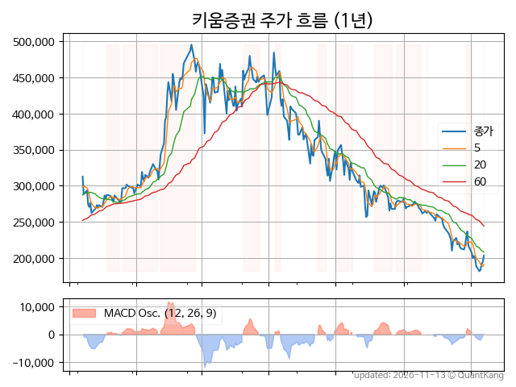
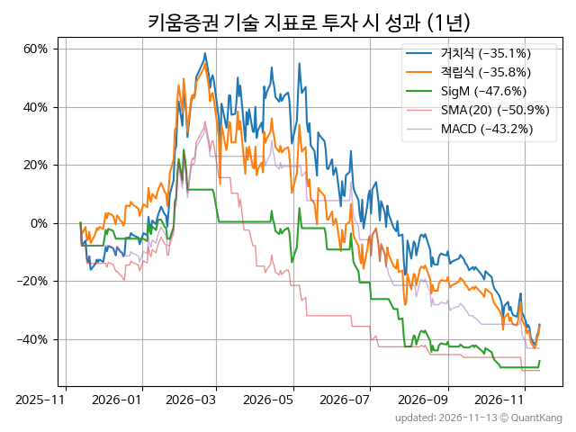
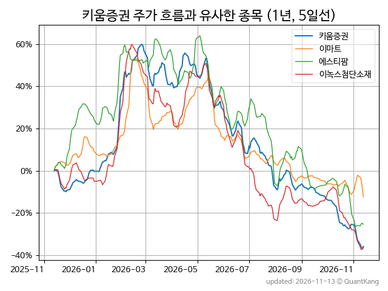
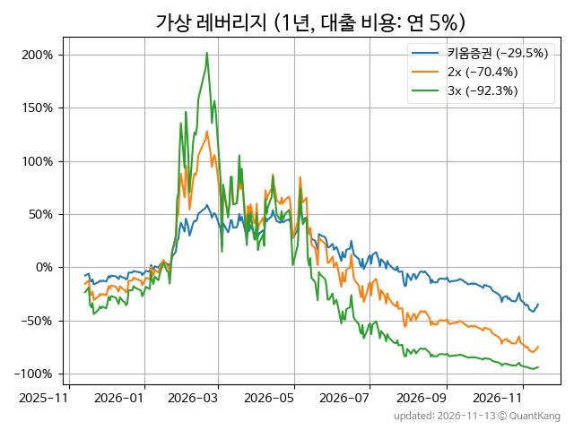

| **종가** | **전일대비** | **업종** | **PER** | **PBR** | **DIV** |
| -------: | -----------: | -------: | ------: | ------: | ------: |
| 203,000 | 4.5<small>%</small> | P:증권 | 4.5 | 0.8 | 5.7<small>%</small> |

<!-- more -->

> **기업 개요**

| **섹터** | P:증권 / nan |
| **산업** | 금융 지원 서비스업 |
| **상장** | KOSPI / 2009년 8월 3일 상장 / 12월 결산 |
| **대표자** | 엄주성 |
| **홈페이지** | [http://www.kiwoom.com](http://www.kiwoom.com){:target="_blank"} |

> **최근 7일 DART 신규 공시**

| **일자** |      | **보고서명** |
| :------- | :--- | :----------- |
| 11&#x2011;12 | | [증권발행실적보고서](https://dart.fss.or.kr/dsaf001/main.do?rcpNo=20261112000490){:target="_blank"} |
|  | | [증권발행실적보고서](https://dart.fss.or.kr/dsaf001/main.do?rcpNo=20261112000484){:target="_blank"} |
|  | | [증권발행실적보고서](https://dart.fss.or.kr/dsaf001/main.do?rcpNo=20261112000475){:target="_blank"} |
|  | | [증권발행실적보고서](https://dart.fss.or.kr/dsaf001/main.do?rcpNo=20261112000472){:target="_blank"} |
|  | | [증권발행실적보고서](https://dart.fss.or.kr/dsaf001/main.do?rcpNo=20261112000405){:target="_blank"} |
|  | | [증권발행실적보고서](https://dart.fss.or.kr/dsaf001/main.do?rcpNo=20261112000393){:target="_blank"} |
|  | | [증권발행실적보고서](https://dart.fss.or.kr/dsaf001/main.do?rcpNo=20261112000392){:target="_blank"} |
|  | | [증권발행실적보고서](https://dart.fss.or.kr/dsaf001/main.do?rcpNo=20261112000386){:target="_blank"} |
| 11&#x2011;11 | | [[기재정정]연결재무제표기준영업(잠정)실적(공정공시)              ](https://dart.fss.or.kr/dsaf001/main.do?rcpNo=20261111800831){:target="_blank"} |
| 11&#x2011;10 | | [증권발행실적보고서](https://dart.fss.or.kr/dsaf001/main.do?rcpNo=20261110000394){:target="_blank"} |
|  | | [투자설명서(일괄신고)](https://dart.fss.or.kr/dsaf001/main.do?rcpNo=20261110000389){:target="_blank"} |
|  | | [일괄신고추가서류(파생결합증권-상장지수증권)](https://dart.fss.or.kr/dsaf001/main.do?rcpNo=20261110000382){:target="_blank"} |
| 11&#x2011;09 | | [증권발행실적보고서](https://dart.fss.or.kr/dsaf001/main.do?rcpNo=20261109000139){:target="_blank"} |
|  | | [증권발행실적보고서](https://dart.fss.or.kr/dsaf001/main.do?rcpNo=20261109000076){:target="_blank"} |
| 11&#x2011;06 | | [증권발행실적보고서](https://dart.fss.or.kr/dsaf001/main.do?rcpNo=20261106000190){:target="_blank"} |
|  | | [증권발행실적보고서](https://dart.fss.or.kr/dsaf001/main.do?rcpNo=20261106000034){:target="_blank"} |
|  | | [증권발행실적보고서](https://dart.fss.or.kr/dsaf001/main.do?rcpNo=20261106000033){:target="_blank"} |

> **주가 흐름**

{: .align-center}

> **주요 가격 변동 지표**<small>[^fn_price_metric]</small>

| **종가** | **전일대비** | **5일** | **20일** | **60일** | **120일** |
| -------: | -----------: | ------: | -------: | -------: | --------: |
| 203,000 | 4.5<small>%</small> | 7.6<small>%</small> | -9.0<small>%</small> | -32.4<small>%</small> | -46.2<small>%</small> |
| **1년** | **편차** | **샤프** | **MDD** | **AvDD** | **MARr** |
| -35.1<small>%</small> | 70.6<small>%</small> | -0.50 | -63.4<small>%</small> | -24.9<small>%</small> | 0.6 |

> **주요 재무 지표**<small>[^fn_finance_metric]</small>

| **업종**<small>[^fn_sector_abbr]</small> | **PER** | **PBR** | **DIV** | **평가**<small>[^fn_finance_basic_tags]</small> |
| :--------------------------------------- | ------: | ------: | ------: | ----------------------------------------------: |
| P:증권 | 4.5 | 0.8 | 5.7<small>%</small> | 저PER, 고배당 |



> **세부 재무/투자 정보 제공 사이트**

| [네이버](https://m.stock.naver.com/domestic/stock/039490/finance/summary){:target="_blank"}<small>모바일</small> | [네이버](https://finance.naver.com/item/coinfo.naver?code=039490){:target="_blank"} | [FnGuide](https://comp.fnguide.com/SVO2/ASP/SVD_Invest.asp?gicode=A039490&MenuYn=Y){:target="_blank"} |
| :---: | :---: | :---: |
| [와이즈리포트](https://comp.wisereport.co.kr/company/c1040001.aspx?cmp_cd=039490){:target="_blank"} | [밸류라인](https://www.valueline.co.kr/finance/summary/039490){:target="_blank"} | [한국경제](https://markets.hankyung.com/stock/039490/financial-summary){:target="_blank"} |

> **주요 기술 지표**<small>[^fn_tech_metric]</small>

{: .align-center}

| **기술 지표** | **1년** | **편차** | **샤프** | **MDD** | **AvDD** |
| :------------ | ------: | -----------: | -------: | ------: | -------: |
| 거치식 | -35.1<small>%</small> | 70.6<small>%</small> | -0.50 | -63.4<small>%</small> | -24.9<small>%</small> |
| 적립식[^fn_tech_metric_dca] | -35.8<small>%</small> | 69.4<small>%</small> | -0.52 | -63.3<small>%</small> | -28.2<small>%</small> |
| Sig. M[^fn_tech_metric_sigm] | -47.6<small>%</small> | 41.1<small>%</small> | -1.16 | -59.9<small>%</small> | -29.4<small>%</small> |
| SMA<small>(5)</small>[^fn_tech_metric_sma_i] | -52.5<small>%</small> | 40.9<small>%</small> | -1.28 | -67.5<small>%</small> | -35.2<small>%</small> |
| SMA<small>(20)</small>[^fn_tech_metric_sma_i] | -50.9<small>%</small> | 39.4<small>%</small> | -1.29 | -63.6<small>%</small> | -38.1<small>%</small> |
| SMA<small>(60)</small>[^fn_tech_metric_sma_i] | 2.7<small>%</small> | 47.2<small>%</small> | 0.06 | -35.3<small>%</small> | -23.2<small>%</small> |
| SMA<small>(120)</small>[^fn_tech_metric_sma_i] | 9.3<small>%</small> | 52.7<small>%</small> | 0.18 | -31.1<small>%</small> | -19.5<small>%</small> |
| SMA<small>(240)</small>[^fn_tech_metric_sma_i] | -20.8<small>%</small> | 59.8<small>%</small> | -0.35 | -50.0<small>%</small> | -26.2<small>%</small> |
| MACD[^fn_tech_metric_macd] | -43.2<small>%</small> | 40.1<small>%</small> | -1.08 | -57.3<small>%</small> | -23.6<small>%</small> |

> **주가 흐름 유사 종목**<small>[^fn_corr_long]</small>

{: .align-center}

|       | [이마트](/139480/) | [에스티팜](/237690/) | [이녹스첨단소재](/272290/) |
| :---: | :------------------------------------: | :------------------------------------: | :------------------------------------: |
|       | [케어젠](/214370/) | [유진로봇](/056080/) | [한국카본](/017960/) |

> **가상 레버리지 상품에 투자했다면**<small>[^fn_lev]</small>

{: .align-center}

> **관련 정보**

- [P:증권 업종 목록](/stats/sector/kospi_업종_증권_종목/){: .btn .btn--info} [저PER 목록](/fn/fn_low_per/){: .btn .btn--info} [고배당 목록](/fn/fn_high_div/){: .btn .btn--info}

> **참고 도서** [오렌지사과의 출간 책 소개와 샘플북 목록](https://kongdori.tistory.com/691)

- [왜 위험한 주식에 투자하라는 걸까? - 장기 투자와 분산 투자에 대한 통계학적 시각](https://kongdori.tistory.com/421)
- [파이썬으로 그려보는 투자 포트폴리오 분석  - 정량적 투자 분석을 위한 입문서](https://kongdori.tistory.com/643)
- [구글 시트로 시작하는 투자 포트폴리오 분석 - 오렌지사과의 불친절한 워크북](https://kongdori.tistory.com/449)

