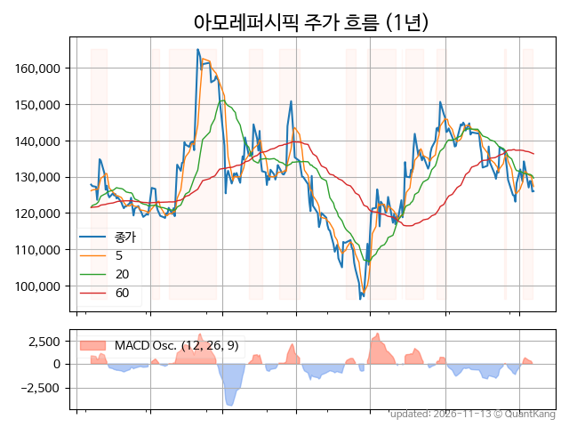
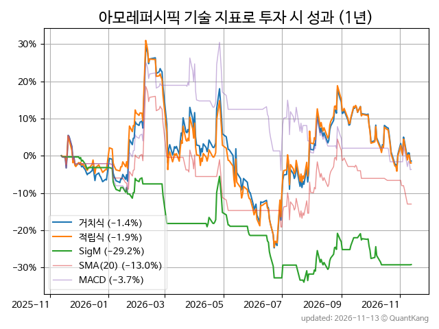
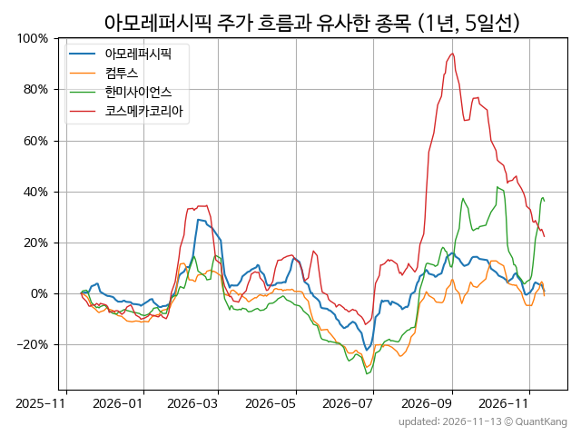
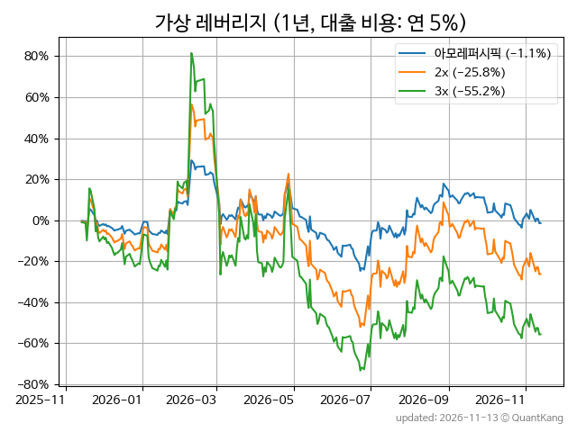

| **종가** | **전일대비** | **업종** | **PER** | **PBR** | **DIV** |
| -------: | -----------: | -------: | ------: | ------: | ------: |
| 126,000 | 0.1<small>%</small> | P:화학 | 36.9 | 1.6 | 1.0<small>%</small> |

<!-- more -->

> **기업 개요**

| **섹터** | P:화학 / nan |
| **산업** | 기타 화학제품 제조업 |
| **상장** | KOSPI / 2006년 6월 29일 상장 / 12월 결산 |
| **대표자** | 서경배, 김승환 |
| **홈페이지** | [http://www.apgroup.com](http://www.apgroup.com){:target="_blank"} |

> **최근 7일 DART 신규 공시**

| **일자** |      | **보고서명** |
| :------- | :--- | :----------- |
| 11&#x2011;12 | | [동일인등출자계열회사와의상품ㆍ용역거래변경](https://dart.fss.or.kr/dsaf001/main.do?rcpNo=20261112000422){:target="_blank"} |
|  | | [[기재정정]대규모기업집단현황공시[연1회공시및1/4분기용(개별회사)]](https://dart.fss.or.kr/dsaf001/main.do?rcpNo=20261112000408){:target="_blank"} |
|  | | [기업설명회(IR)개최(안내공시)              ](https://dart.fss.or.kr/dsaf001/main.do?rcpNo=20261112800321){:target="_blank"} |
|  | | [기업설명회(IR)개최(안내공시)              ](https://dart.fss.or.kr/dsaf001/main.do?rcpNo=20261112800317){:target="_blank"} |
| 11&#x2011;09 | | [최대주주등소유주식변동신고서              ](https://dart.fss.or.kr/dsaf001/main.do?rcpNo=20261109800472){:target="_blank"} |
|  | | [임원ㆍ주요주주특정증권등소유상황보고서](https://dart.fss.or.kr/dsaf001/main.do?rcpNo=20261109000216){:target="_blank"} |

> **주가 흐름**

{: .align-center}

> **주요 가격 변동 지표**<small>[^fn_price_metric]</small>

| **종가** | **전일대비** | **5일** | **20일** | **60일** | **120일** |
| -------: | -----------: | ------: | -------: | -------: | --------: |
| 126,000 | 0.1<small>%</small> | -5.0<small>%</small> | -8.8<small>%</small> | -7.1<small>%</small> | 5.1<small>%</small> |
| **1년** | **편차** | **샤프** | **MDD** | **AvDD** | **MARr** |
| -1.4<small>%</small> | 50.4<small>%</small> | -0.03 | -41.7<small>%</small> | -17.4<small>%</small> | 0.0 |

> **주요 재무 지표**<small>[^fn_finance_metric]</small>

| **업종**<small>[^fn_sector_abbr]</small> | **PER** | **PBR** | **DIV** | **평가**<small>[^fn_finance_basic_tags]</small> |
| :--------------------------------------- | ------: | ------: | ------: | ----------------------------------------------: |
| P:화학 | 36.9 | 1.6 | 1.0<small>%</small> | - |



> **세부 재무/투자 정보 제공 사이트**

| [네이버](https://m.stock.naver.com/domestic/stock/090430/finance/summary){:target="_blank"}<small>모바일</small> | [네이버](https://finance.naver.com/item/coinfo.naver?code=090430){:target="_blank"} | [FnGuide](https://comp.fnguide.com/SVO2/ASP/SVD_Invest.asp?gicode=A090430&MenuYn=Y){:target="_blank"} |
| :---: | :---: | :---: |
| [와이즈리포트](https://comp.wisereport.co.kr/company/c1040001.aspx?cmp_cd=090430){:target="_blank"} | [밸류라인](https://www.valueline.co.kr/finance/summary/090430){:target="_blank"} | [한국경제](https://markets.hankyung.com/stock/090430/financial-summary){:target="_blank"} |

> **주요 기술 지표**<small>[^fn_tech_metric]</small>

{: .align-center}

| **기술 지표** | **1년** | **편차** | **샤프** | **MDD** | **AvDD** |
| :------------ | ------: | -----------: | -------: | ------: | -------: |
| 거치식 | -1.4<small>%</small> | 50.4<small>%</small> | -0.03 | -41.7<small>%</small> | -17.4<small>%</small> |
| 적립식[^fn_tech_metric_dca] | -1.9<small>%</small> | 49.9<small>%</small> | -0.04 | -42.4<small>%</small> | -18.2<small>%</small> |
| Sig. M[^fn_tech_metric_sigm] | -29.2<small>%</small> | 25.7<small>%</small> | -1.14 | -33.9<small>%</small> | -18.5<small>%</small> |
| SMA<small>(5)</small>[^fn_tech_metric_sma_i] | -21.2<small>%</small> | 30.7<small>%</small> | -0.69 | -26.1<small>%</small> | -14.7<small>%</small> |
| SMA<small>(20)</small>[^fn_tech_metric_sma_i] | -13.0<small>%</small> | 37.3<small>%</small> | -0.35 | -31.8<small>%</small> | -17.9<small>%</small> |
| SMA<small>(60)</small>[^fn_tech_metric_sma_i] | -21.5<small>%</small> | 37.8<small>%</small> | -0.57 | -37.4<small>%</small> | -22.2<small>%</small> |
| SMA<small>(120)</small>[^fn_tech_metric_sma_i] | -25.2<small>%</small> | 37.1<small>%</small> | -0.68 | -36.0<small>%</small> | -21.3<small>%</small> |
| SMA<small>(240)</small>[^fn_tech_metric_sma_i] | -27.9<small>%</small> | 38.1<small>%</small> | -0.73 | -39.2<small>%</small> | -22.4<small>%</small> |
| MACD[^fn_tech_metric_macd] | -3.7<small>%</small> | 37.4<small>%</small> | -0.10 | -26.4<small>%</small> | -13.1<small>%</small> |

> **주가 흐름 유사 종목**<small>[^fn_corr_long]</small>

{: .align-center}

|       | [컴투스](/078340/) | [한미사이언스](/008930/) | [코스메카코리아](/241710/) |
| :---: | :------------------------------------: | :------------------------------------: | :------------------------------------: |
|       | [우리금융지주](/316140/) | [코스맥스](/192820/) | [메리츠금융지주](/138040/) |

> **가상 레버리지 상품에 투자했다면**<small>[^fn_lev]</small>

{: .align-center}

> **관련 정보**

- [P:화학 업종 목록](/stats/sector/kospi_업종_화학_종목/){: .btn .btn--info}

> **참고 도서** [오렌지사과의 출간 책 소개와 샘플북 목록](https://kongdori.tistory.com/691)

- [왜 위험한 주식에 투자하라는 걸까? - 장기 투자와 분산 투자에 대한 통계학적 시각](https://kongdori.tistory.com/421)
- [파이썬으로 그려보는 투자 포트폴리오 분석  - 정량적 투자 분석을 위한 입문서](https://kongdori.tistory.com/643)
- [구글 시트로 시작하는 투자 포트폴리오 분석 - 오렌지사과의 불친절한 워크북](https://kongdori.tistory.com/449)

