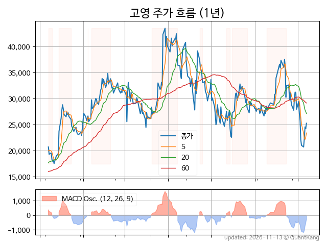
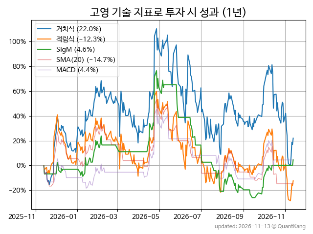
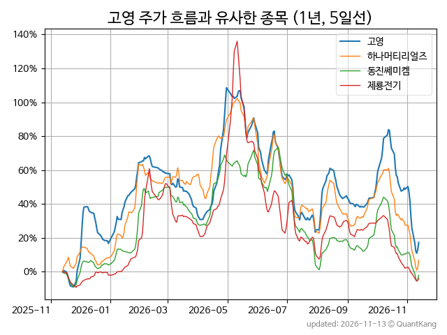
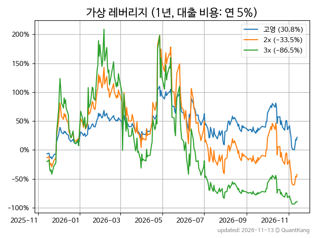

| **종가** | **전일대비** | **업종** | **PER** | **PBR** | **DIV** |
| -------: | -----------: | -------: | ------: | ------: | ------: |
| 25,250 | 4.3<small>%</small> | Q:기계장비 | 111.2 | 4.9 | 0.6<small>%</small> |

<!-- more -->

> **기업 개요**

| **섹터** | Q:기계장비 / 우량기업부 |
| **산업** | 특수 목적용 기계 제조업 |
| **상장** | KOSDAQ / 2008년 6월 3일 상장 / 12월 결산 |
| **대표자** | 고광일 |
| **홈페이지** | [http://www.kohyoung.com](http://www.kohyoung.com){:target="_blank"} |

> **최근 7일 DART 신규 공시**

| **일자** |      | **보고서명** |
| :------- | :--- | :----------- |
| 11&#x2011;12 | | [주식등의대량보유상황보고서(약식)](https://dart.fss.or.kr/dsaf001/main.do?rcpNo=20261112000185){:target="_blank"} |
| 11&#x2011;11 | | [주식등의대량보유상황보고서(약식)](https://dart.fss.or.kr/dsaf001/main.do?rcpNo=20261111000337){:target="_blank"} |
| 11&#x2011;09 | | [주식등의대량보유상황보고서(약식)](https://dart.fss.or.kr/dsaf001/main.do?rcpNo=20261109000037){:target="_blank"} |
| 11&#x2011;06 | | [주식등의대량보유상황보고서(약식)](https://dart.fss.or.kr/dsaf001/main.do?rcpNo=20261106000320){:target="_blank"} |

> **주가 흐름**

{: .align-center}

> **주요 가격 변동 지표**<small>[^fn_price_metric]</small>

| **종가** | **전일대비** | **5일** | **20일** | **60일** | **120일** |
| -------: | -----------: | ------: | -------: | -------: | --------: |
| 25,250 | 4.3<small>%</small> | 20.2<small>%</small> | -22.3<small>%</small> | -21.9<small>%</small> | -26.9<small>%</small> |
| **1년** | **편차** | **샤프** | **MDD** | **AvDD** | **MARr** |
| 22.0<small>%</small> | 99.7<small>%</small> | 0.22 | -52.4<small>%</small> | -20.5<small>%</small> | -0.4 |

> **주요 재무 지표**<small>[^fn_finance_metric]</small>

| **업종**<small>[^fn_sector_abbr]</small> | **PER** | **PBR** | **DIV** | **평가**<small>[^fn_finance_basic_tags]</small> |
| :--------------------------------------- | ------: | ------: | ------: | ----------------------------------------------: |
| Q:기계장비 | 111.2 | 4.9 | 0.6<small>%</small> | 고PER |



> **세부 재무/투자 정보 제공 사이트**

| [네이버](https://m.stock.naver.com/domestic/stock/098460/finance/summary){:target="_blank"}<small>모바일</small> | [네이버](https://finance.naver.com/item/coinfo.naver?code=098460){:target="_blank"} | [FnGuide](https://comp.fnguide.com/SVO2/ASP/SVD_Invest.asp?gicode=A098460&MenuYn=Y){:target="_blank"} |
| :---: | :---: | :---: |
| [와이즈리포트](https://comp.wisereport.co.kr/company/c1040001.aspx?cmp_cd=098460){:target="_blank"} | [밸류라인](https://www.valueline.co.kr/finance/summary/098460){:target="_blank"} | [한국경제](https://markets.hankyung.com/stock/098460/financial-summary){:target="_blank"} |

> **주요 기술 지표**<small>[^fn_tech_metric]</small>

{: .align-center}

| **기술 지표** | **1년** | **편차** | **샤프** | **MDD** | **AvDD** |
| :------------ | ------: | -----------: | -------: | ------: | -------: |
| 거치식 | 22.0<small>%</small> | 99.7<small>%</small> | 0.22 | -52.4<small>%</small> | -20.5<small>%</small> |
| 적립식[^fn_tech_metric_dca] | -12.3<small>%</small> | 98.1<small>%</small> | -0.13 | -55.2<small>%</small> | -24.7<small>%</small> |
| Sig. M[^fn_tech_metric_sigm] | 4.6<small>%</small> | 57.8<small>%</small> | 0.08 | -58.0<small>%</small> | -23.9<small>%</small> |
| SMA<small>(5)</small>[^fn_tech_metric_sma_i] | -20.0<small>%</small> | 66.3<small>%</small> | -0.30 | -52.7<small>%</small> | -25.2<small>%</small> |
| SMA<small>(20)</small>[^fn_tech_metric_sma_i] | -14.7<small>%</small> | 64.9<small>%</small> | -0.23 | -44.3<small>%</small> | -23.8<small>%</small> |
| SMA<small>(60)</small>[^fn_tech_metric_sma_i] | -22.2<small>%</small> | 73.8<small>%</small> | -0.30 | -53.8<small>%</small> | -30.3<small>%</small> |
| SMA<small>(120)</small>[^fn_tech_metric_sma_i] | -29.7<small>%</small> | 79.1<small>%</small> | -0.38 | -62.6<small>%</small> | -30.3<small>%</small> |
| SMA<small>(240)</small>[^fn_tech_metric_sma_i] | -17.8<small>%</small> | 92.4<small>%</small> | -0.19 | -60.9<small>%</small> | -27.1<small>%</small> |
| MACD[^fn_tech_metric_macd] | 4.4<small>%</small> | 58.0<small>%</small> | 0.08 | -38.6<small>%</small> | -19.0<small>%</small> |

> **주가 흐름 유사 종목**<small>[^fn_corr_long]</small>

{: .align-center}

|       | [하나머티리얼즈](/166090/) | [동진쎄미켐](/005290/) | [제룡전기](/033100/) |
| :---: | :------------------------------------: | :------------------------------------: | :------------------------------------: |
|       | [하나마이크론](/067310/) | [솔브레인](/357780/) | [원익QnC](/074600/) |

> **가상 레버리지 상품에 투자했다면**<small>[^fn_lev]</small>

{: .align-center}

> **관련 정보**

- [Q:기계장비 업종 목록](/stats/sector/kosdaq_업종_기계장비_종목/){: .btn .btn--info} [고PER 목록](/fn/fn_high_per/){: .btn .btn--info}

> **참고 도서** [오렌지사과의 출간 책 소개와 샘플북 목록](https://kongdori.tistory.com/691)

- [왜 위험한 주식에 투자하라는 걸까? - 장기 투자와 분산 투자에 대한 통계학적 시각](https://kongdori.tistory.com/421)
- [파이썬으로 그려보는 투자 포트폴리오 분석  - 정량적 투자 분석을 위한 입문서](https://kongdori.tistory.com/643)
- [구글 시트로 시작하는 투자 포트폴리오 분석 - 오렌지사과의 불친절한 워크북](https://kongdori.tistory.com/449)

