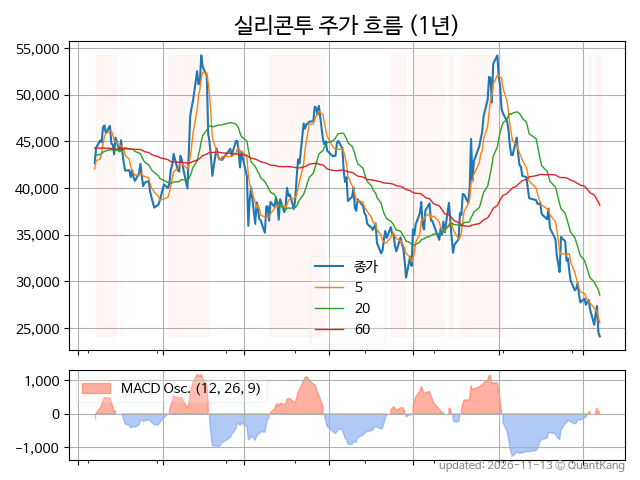
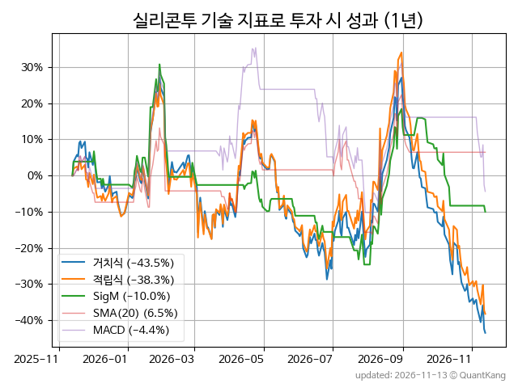
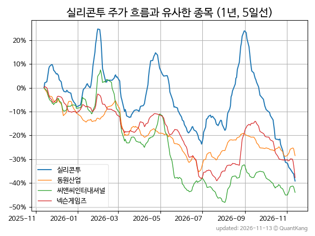
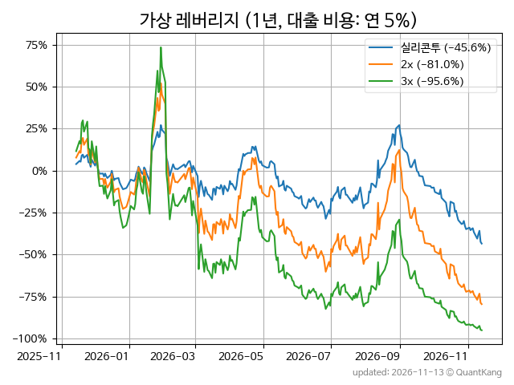

| **종가** | **전일대비** | **업종** | **PER** | **PBR** | **DIV** |
| -------: | -----------: | -------: | ------: | ------: | ------: |
| 24,100 | -1.8<small>%</small> | Q:유통 | 8.7 | 3.4 | 1.3<small>%</small> |

<!-- more -->

> **기업 개요**

| **섹터** | Q:유통 / 우량기업부 |
| **산업** | 상품 종합 도매업 |
| **상장** | KOSDAQ / 2021년 9월 29일 상장 / 12월 결산 |
| **대표자** | 김성운 |
| **홈페이지** | [http://www.siliconii.com](http://www.siliconii.com){:target="_blank"} |

> **최근 7일 DART 신규 공시**

| **일자** |      | **보고서명** |
| :------- | :--- | :----------- |
| 11&#x2011;13 | | [분기보고서 (2026.09)](https://dart.fss.or.kr/dsaf001/main.do?rcpNo=20261113000882){:target="_blank"} |
|  | | [신탁계약해지결과보고서](https://dart.fss.or.kr/dsaf001/main.do?rcpNo=20261113000832){:target="_blank"} |
|  | | [주요사항보고서(자기주식취득신탁계약해지결정)](https://dart.fss.or.kr/dsaf001/main.do?rcpNo=20261113000442){:target="_blank"} |
|  | | [기업설명회(IR)개최              ](https://dart.fss.or.kr/dsaf001/main.do?rcpNo=20261113900370){:target="_blank"} |
| 11&#x2011;11 | | [연결재무제표기준영업(잠정)실적(공정공시)              ](https://dart.fss.or.kr/dsaf001/main.do?rcpNo=20261111900551){:target="_blank"} |
| 11&#x2011;10 | | [기업설명회(IR)개최              ](https://dart.fss.or.kr/dsaf001/main.do?rcpNo=20261110900414){:target="_blank"} |
| 11&#x2011;09 | | [결산실적공시예고              ](https://dart.fss.or.kr/dsaf001/main.do?rcpNo=20261109900270){:target="_blank"} |

> **주가 흐름**

{: .align-center}

> **주요 가격 변동 지표**<small>[^fn_price_metric]</small>

| **종가** | **전일대비** | **5일** | **20일** | **60일** | **120일** |
| -------: | -----------: | ------: | -------: | -------: | --------: |
| 24,100 | -1.8<small>%</small> | -10.7<small>%</small> | -30.6<small>%</small> | -43.8<small>%</small> | -39.8<small>%</small> |
| **1년** | **편차** | **샤프** | **MDD** | **AvDD** | **MARr** |
| -43.5<small>%</small> | 63.8<small>%</small> | -0.68 | -55.5<small>%</small> | -23.6<small>%</small> | 0.8 |

> **주요 재무 지표**<small>[^fn_finance_metric]</small>

| **업종**<small>[^fn_sector_abbr]</small> | **PER** | **PBR** | **DIV** | **평가**<small>[^fn_finance_basic_tags]</small> |
| :--------------------------------------- | ------: | ------: | ------: | ----------------------------------------------: |
| Q:유통 | 8.7 | 3.4 | 1.3<small>%</small> | - |



> **세부 재무/투자 정보 제공 사이트**

| [네이버](https://m.stock.naver.com/domestic/stock/257720/finance/summary){:target="_blank"}<small>모바일</small> | [네이버](https://finance.naver.com/item/coinfo.naver?code=257720){:target="_blank"} | [FnGuide](https://comp.fnguide.com/SVO2/ASP/SVD_Invest.asp?gicode=A257720&MenuYn=Y){:target="_blank"} |
| :---: | :---: | :---: |
| [와이즈리포트](https://comp.wisereport.co.kr/company/c1040001.aspx?cmp_cd=257720){:target="_blank"} | [밸류라인](https://www.valueline.co.kr/finance/summary/257720){:target="_blank"} | [한국경제](https://markets.hankyung.com/stock/257720/financial-summary){:target="_blank"} |

> **주요 기술 지표**<small>[^fn_tech_metric]</small>

{: .align-center}

| **기술 지표** | **1년** | **편차** | **샤프** | **MDD** | **AvDD** |
| :------------ | ------: | -----------: | -------: | ------: | -------: |
| 거치식 | -43.5<small>%</small> | 63.8<small>%</small> | -0.68 | -55.5<small>%</small> | -23.6<small>%</small> |
| 적립식[^fn_tech_metric_dca] | -38.3<small>%</small> | 63.1<small>%</small> | -0.61 | -53.9<small>%</small> | -21.8<small>%</small> |
| Sig. M[^fn_tech_metric_sigm] | -10.0<small>%</small> | 41.6<small>%</small> | -0.24 | -42.3<small>%</small> | -22.0<small>%</small> |
| SMA<small>(5)</small>[^fn_tech_metric_sma_i] | -42.2<small>%</small> | 41.9<small>%</small> | -1.01 | -52.0<small>%</small> | -26.0<small>%</small> |
| SMA<small>(20)</small>[^fn_tech_metric_sma_i] | 6.5<small>%</small> | 40.0<small>%</small> | 0.16 | -26.0<small>%</small> | -11.3<small>%</small> |
| SMA<small>(60)</small>[^fn_tech_metric_sma_i] | -28.3<small>%</small> | 37.7<small>%</small> | -0.75 | -37.6<small>%</small> | -25.4<small>%</small> |
| SMA<small>(120)</small>[^fn_tech_metric_sma_i] | -19.2<small>%</small> | 33.5<small>%</small> | -0.57 | -29.0<small>%</small> | -19.0<small>%</small> |
| SMA<small>(240)</small>[^fn_tech_metric_sma_i] | -37.1<small>%</small> | 33.9<small>%</small> | -1.09 | -43.4<small>%</small> | -29.1<small>%</small> |
| MACD[^fn_tech_metric_macd] | -4.4<small>%</small> | 45.9<small>%</small> | -0.10 | -33.7<small>%</small> | -12.8<small>%</small> |

> **주가 흐름 유사 종목**<small>[^fn_corr_long]</small>

{: .align-center}

|       | [동원산업](/006040/) | [씨앤씨인터내셔널](/352480/) | [넥슨게임즈](/225570/) |
| :---: | :------------------------------------: | :------------------------------------: | :------------------------------------: |
|       | [SK케미칼](/285130/) | [알테오젠](/196170/) | [파마리서치](/214450/) |

> **가상 레버리지 상품에 투자했다면**<small>[^fn_lev]</small>

{: .align-center}

> **관련 정보**

- [Q:유통 업종 목록](/stats/sector/kosdaq_업종_유통_종목/){: .btn .btn--info}

> **참고 도서** [오렌지사과의 출간 책 소개와 샘플북 목록](https://kongdori.tistory.com/691)

- [왜 위험한 주식에 투자하라는 걸까? - 장기 투자와 분산 투자에 대한 통계학적 시각](https://kongdori.tistory.com/421)
- [파이썬으로 그려보는 투자 포트폴리오 분석  - 정량적 투자 분석을 위한 입문서](https://kongdori.tistory.com/643)
- [구글 시트로 시작하는 투자 포트폴리오 분석 - 오렌지사과의 불친절한 워크북](https://kongdori.tistory.com/449)

