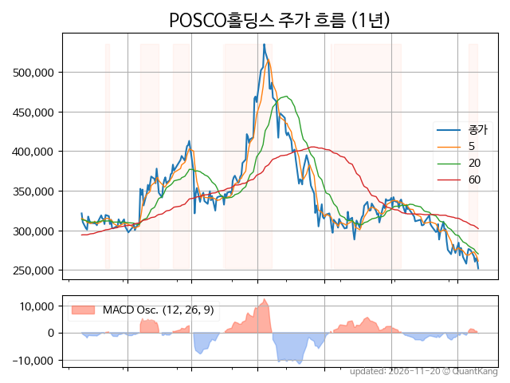
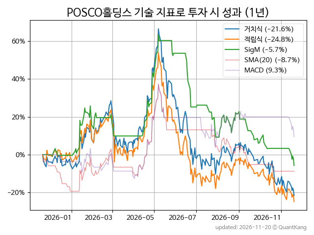
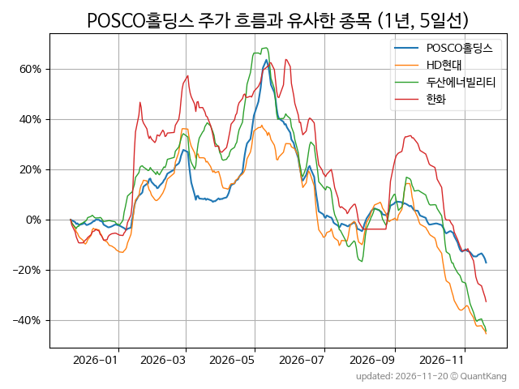
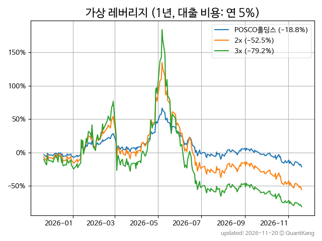

| **종가** | **전일대비** | **업종** | **PER** | **PBR** | **DIV** |
| -------: | -----------: | -------: | ------: | ------: | ------: |
| 252,000 | -3.6<small>%</small> | P:금속 | 29.0 | 0.3 | 4.0<small>%</small> |

<!-- more -->

> **기업 개요**

| **섹터** | P:금속 / nan |
| **산업** | 1차 철강 제조업 |
| **상장** | KOSPI / 1988년 6월 10일 상장 / 12월 결산 |
| **대표자** | 대표이사 회장 장인화, 대표이사 사장 이주태 |
| **홈페이지** | [http://www.posco-inc.com](http://www.posco-inc.com){:target="_blank"} |

> **최근 7일 DART 신규 공시**

| **일자** |      | **보고서명** |
| :------- | :--- | :----------- |
| 11&#x2011;19 | | [풍문또는보도에대한해명(미확정)(자회사의 주요경영사항)              ](https://dart.fss.or.kr/dsaf001/main.do?rcpNo=20261119800164){:target="_blank"} |
| 11&#x2011;16 | | [특수관계인에대한주식의처분](https://dart.fss.or.kr/dsaf001/main.do?rcpNo=20261116001551){:target="_blank"} |
| 11&#x2011;13 | | [분기보고서 (2026.09)](https://dart.fss.or.kr/dsaf001/main.do?rcpNo=20261113001097){:target="_blank"} |
|  | | [현금ㆍ현물배당결정              ](https://dart.fss.or.kr/dsaf001/main.do?rcpNo=20261113801151){:target="_blank"} |
|  | | [현금ㆍ현물배당을위한주주명부폐쇄(기준일)결정              ](https://dart.fss.or.kr/dsaf001/main.do?rcpNo=20261113801052){:target="_blank"} |

> **주가 흐름**

{: .align-center}

> **주요 가격 변동 지표**<small>[^fn_price_metric]</small>

| **종가** | **전일대비** | **5일** | **20일** | **60일** | **120일** |
| -------: | -----------: | ------: | -------: | -------: | --------: |
| 252,000 | -3.6<small>%</small> | -8.4<small>%</small> | -8.5<small>%</small> | -23.1<small>%</small> | -40.5<small>%</small> |
| **1년** | **편차** | **샤프** | **MDD** | **AvDD** | **MARr** |
| -21.6<small>%</small> | 53.4<small>%</small> | -0.41 | -52.9<small>%</small> | -23.6<small>%</small> | 0.4 |

> **주요 재무 지표**<small>[^fn_finance_metric]</small>

| **업종**<small>[^fn_sector_abbr]</small> | **PER** | **PBR** | **DIV** | **평가**<small>[^fn_finance_basic_tags]</small> |
| :--------------------------------------- | ------: | ------: | ------: | ----------------------------------------------: |
| P:금속 | 29.0 | 0.3 | 4.0<small>%</small> | 저PBR |



> **세부 재무/투자 정보 제공 사이트**

| [네이버](https://m.stock.naver.com/domestic/stock/005490/finance/summary){:target="_blank"}<small>모바일</small> | [네이버](https://finance.naver.com/item/coinfo.naver?code=005490){:target="_blank"} | [FnGuide](https://comp.fnguide.com/SVO2/ASP/SVD_Invest.asp?gicode=A005490&MenuYn=Y){:target="_blank"} |
| :---: | :---: | :---: |
| [와이즈리포트](https://comp.wisereport.co.kr/company/c1040001.aspx?cmp_cd=005490){:target="_blank"} | [밸류라인](https://www.valueline.co.kr/finance/summary/005490){:target="_blank"} | [한국경제](https://markets.hankyung.com/stock/005490/financial-summary){:target="_blank"} |

> **주요 기술 지표**<small>[^fn_tech_metric]</small>

{: .align-center}

| **기술 지표** | **1년** | **편차** | **샤프** | **MDD** | **AvDD** |
| :------------ | ------: | -----------: | -------: | ------: | -------: |
| 거치식 | -21.6<small>%</small> | 53.4<small>%</small> | -0.41 | -52.9<small>%</small> | -23.6<small>%</small> |
| 적립식[^fn_tech_metric_dca] | -24.8<small>%</small> | 52.7<small>%</small> | -0.47 | -51.1<small>%</small> | -23.8<small>%</small> |
| Sig. M[^fn_tech_metric_sigm] | -5.7<small>%</small> | 34.8<small>%</small> | -0.16 | -42.2<small>%</small> | -16.0<small>%</small> |
| SMA<small>(5)</small>[^fn_tech_metric_sma_i] | -37.2<small>%</small> | 36.4<small>%</small> | -1.02 | -46.2<small>%</small> | -18.0<small>%</small> |
| SMA<small>(20)</small>[^fn_tech_metric_sma_i] | -8.7<small>%</small> | 35.3<small>%</small> | -0.25 | -33.6<small>%</small> | -16.8<small>%</small> |
| SMA<small>(60)</small>[^fn_tech_metric_sma_i] | -14.0<small>%</small> | 39.6<small>%</small> | -0.35 | -33.6<small>%</small> | -20.2<small>%</small> |
| SMA<small>(120)</small>[^fn_tech_metric_sma_i] | 5.7<small>%</small> | 42.7<small>%</small> | 0.13 | -34.7<small>%</small> | -20.4<small>%</small> |
| SMA<small>(240)</small>[^fn_tech_metric_sma_i] | 0.2<small>%</small> | 43.9<small>%</small> | 0.00 | -39.8<small>%</small> | -22.5<small>%</small> |
| MACD[^fn_tech_metric_macd] | 9.3<small>%</small> | 33.9<small>%</small> | 0.28 | -24.3<small>%</small> | -10.0<small>%</small> |

> **주가 흐름 유사 종목**<small>[^fn_corr_long]</small>

{: .align-center}

|       | [HD현대](/267250/) | [두산에너빌리티](/034020/) | [한화](/000880/) |
| :---: | :------------------------------------: | :------------------------------------: | :------------------------------------: |
|       | [KCC](/002380/) | [현대차](/005380/) | [한화엔진](/082740/) |

> **가상 레버리지 상품에 투자했다면**<small>[^fn_lev]</small>

{: .align-center}

> **관련 정보**

- [P:금속 업종 목록](/stats/sector/kospi_업종_금속_종목/){: .btn .btn--info} [저PBR 목록](/fn/fn_low_pbr/){: .btn .btn--info}

> **참고 도서** [오렌지사과의 출간 책 소개와 샘플북 목록](https://kongdori.tistory.com/691)

- [왜 위험한 주식에 투자하라는 걸까? - 장기 투자와 분산 투자에 대한 통계학적 시각](https://kongdori.tistory.com/421)
- [파이썬으로 그려보는 투자 포트폴리오 분석  - 정량적 투자 분석을 위한 입문서](https://kongdori.tistory.com/643)
- [구글 시트로 시작하는 투자 포트폴리오 분석 - 오렌지사과의 불친절한 워크북](https://kongdori.tistory.com/449)

