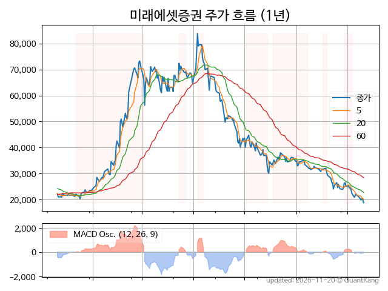
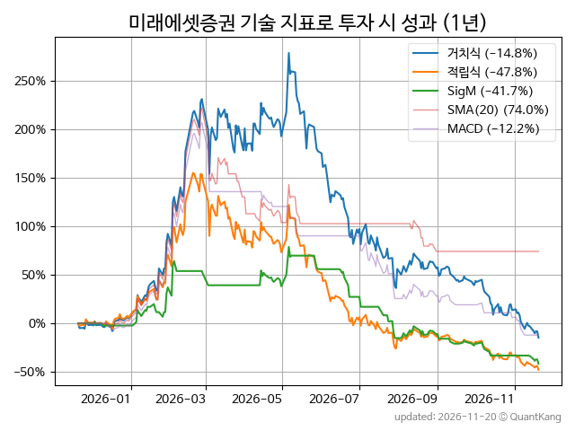
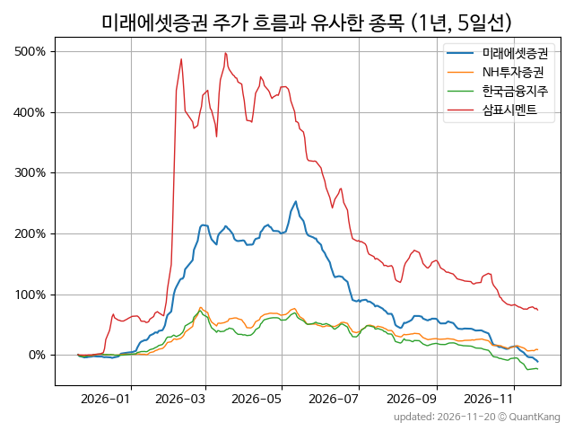
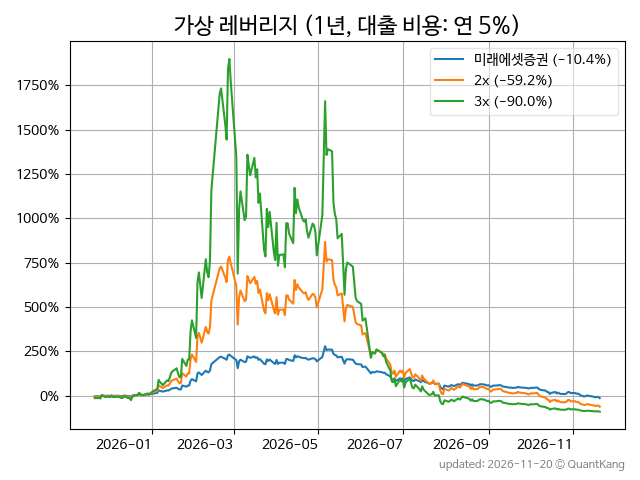

| **종가** | **전일대비** | **업종** | **PER** | **PBR** | **DIV** |
| -------: | -----------: | -------: | ------: | ------: | ------: |
| 18,870 | -7.0<small>%</small> | P:증권 | 7.1 | 0.8 | 1.6<small>%</small> |

<!-- more -->

> **기업 개요**

| **섹터** | P:증권 / nan |
| **산업** | 금융 지원 서비스업 |
| **상장** | KOSPI / 1975년 9월 30일 상장 / 12월 결산 |
| **대표자** | 김미섭, 허선호 |
| **홈페이지** | [http://securities.miraeasset.com](http://securities.miraeasset.com){:target="_blank"} |

> **최근 7일 DART 신규 공시**

| **일자** |      | **보고서명** |
| :------- | :--- | :----------- |
| 11&#x2011;20 | | [임원ㆍ주요주주특정증권등소유상황보고서](https://dart.fss.or.kr/dsaf001/main.do?rcpNo=20261120000414){:target="_blank"} |
|  | | [투자설명서(일괄신고)](https://dart.fss.or.kr/dsaf001/main.do?rcpNo=20261120000342){:target="_blank"} |
|  | | [투자설명서(일괄신고)](https://dart.fss.or.kr/dsaf001/main.do?rcpNo=20261120000334){:target="_blank"} |
|  | | [일괄신고추가서류(파생결합사채-주가연계파생결합사채)](https://dart.fss.or.kr/dsaf001/main.do?rcpNo=20261120000328){:target="_blank"} |
|  | | [일괄신고추가서류(파생결합증권-주가연계증권)](https://dart.fss.or.kr/dsaf001/main.do?rcpNo=20261120000269){:target="_blank"} |
|  | | [투자설명서(일괄신고)](https://dart.fss.or.kr/dsaf001/main.do?rcpNo=20261120000053){:target="_blank"} |
|  | | [투자설명서(일괄신고)](https://dart.fss.or.kr/dsaf001/main.do?rcpNo=20261120000047){:target="_blank"} |
|  | | [일괄신고추가서류(파생결합증권-주가연계증권)](https://dart.fss.or.kr/dsaf001/main.do?rcpNo=20261120000022){:target="_blank"} |
|  | | [일괄신고추가서류(파생결합사채-주가연계파생결합사채)](https://dart.fss.or.kr/dsaf001/main.do?rcpNo=20261120000021){:target="_blank"} |
| 11&#x2011;18 | | [임원ㆍ주요주주특정증권등소유상황보고서](https://dart.fss.or.kr/dsaf001/main.do?rcpNo=20261118000234){:target="_blank"} |
|  | | [임원ㆍ주요주주특정증권등소유상황보고서](https://dart.fss.or.kr/dsaf001/main.do?rcpNo=20261118000232){:target="_blank"} |
|  | | [임원ㆍ주요주주특정증권등소유상황보고서](https://dart.fss.or.kr/dsaf001/main.do?rcpNo=20261118000224){:target="_blank"} |
|  | | [임원ㆍ주요주주특정증권등소유상황보고서](https://dart.fss.or.kr/dsaf001/main.do?rcpNo=20261118000221){:target="_blank"} |
|  | | [임원ㆍ주요주주특정증권등소유상황보고서](https://dart.fss.or.kr/dsaf001/main.do?rcpNo=20261118000217){:target="_blank"} |
|  | | [임원ㆍ주요주주특정증권등소유상황보고서](https://dart.fss.or.kr/dsaf001/main.do?rcpNo=20261118000211){:target="_blank"} |
|  | | [임원ㆍ주요주주특정증권등소유상황보고서](https://dart.fss.or.kr/dsaf001/main.do?rcpNo=20261118000209){:target="_blank"} |
|  | | [임원ㆍ주요주주특정증권등소유상황보고서](https://dart.fss.or.kr/dsaf001/main.do?rcpNo=20261118000206){:target="_blank"} |
|  | | [임원ㆍ주요주주특정증권등소유상황보고서](https://dart.fss.or.kr/dsaf001/main.do?rcpNo=20261118000203){:target="_blank"} |
|  | | [임원ㆍ주요주주특정증권등소유상황보고서](https://dart.fss.or.kr/dsaf001/main.do?rcpNo=20261118000193){:target="_blank"} |
| 11&#x2011;16 | | [[기재정정]일괄신고서(파생결합증권-주식워런트증권)](https://dart.fss.or.kr/dsaf001/main.do?rcpNo=20261116002203){:target="_blank"} |
|  | | [[기재정정]일괄신고서(파생결합증권-상장지수증권)](https://dart.fss.or.kr/dsaf001/main.do?rcpNo=20261116002183){:target="_blank"} |
|  | | [[기재정정]일괄신고서(파생결합사채-주가연계파생결합사채)](https://dart.fss.or.kr/dsaf001/main.do?rcpNo=20261116002169){:target="_blank"} |
|  | | [[기재정정]일괄신고서(파생결합증권-주가연계증권)](https://dart.fss.or.kr/dsaf001/main.do?rcpNo=20261116002153){:target="_blank"} |
|  | | [분기보고서 (2026.09)](https://dart.fss.or.kr/dsaf001/main.do?rcpNo=20261116002051){:target="_blank"} |
| 11&#x2011;13 | | [증권발행실적보고서](https://dart.fss.or.kr/dsaf001/main.do?rcpNo=20261113000788){:target="_blank"} |
|  | | [증권발행실적보고서](https://dart.fss.or.kr/dsaf001/main.do?rcpNo=20261113000770){:target="_blank"} |
|  | | [증권발행실적보고서](https://dart.fss.or.kr/dsaf001/main.do?rcpNo=20261113000748){:target="_blank"} |
|  | | [증권발행실적보고서](https://dart.fss.or.kr/dsaf001/main.do?rcpNo=20261113000620){:target="_blank"} |
|  | | [증권발행실적보고서](https://dart.fss.or.kr/dsaf001/main.do?rcpNo=20261113000608){:target="_blank"} |
|  | | [기업설명회(IR)개최(안내공시)              ](https://dart.fss.or.kr/dsaf001/main.do?rcpNo=20261113800756){:target="_blank"} |
|  | | [증권발행실적보고서](https://dart.fss.or.kr/dsaf001/main.do?rcpNo=20261113000274){:target="_blank"} |
|  | | [증권발행실적보고서](https://dart.fss.or.kr/dsaf001/main.do?rcpNo=20261113000255){:target="_blank"} |

> **주가 흐름**

{: .align-center}

> **주요 가격 변동 지표**<small>[^fn_price_metric]</small>

| **종가** | **전일대비** | **5일** | **20일** | **60일** | **120일** |
| -------: | -----------: | ------: | -------: | -------: | --------: |
| 18,870 | -7.0<small>%</small> | -12.2<small>%</small> | -21.9<small>%</small> | -45.7<small>%</small> | -70.7<small>%</small> |
| **1년** | **편차** | **샤프** | **MDD** | **AvDD** | **MARr** |
| -14.8<small>%</small> | 83.8<small>%</small> | -0.18 | -77.5<small>%</small> | -31.4<small>%</small> | 0.2 |

> **주요 재무 지표**<small>[^fn_finance_metric]</small>

| **업종**<small>[^fn_sector_abbr]</small> | **PER** | **PBR** | **DIV** | **평가**<small>[^fn_finance_basic_tags]</small> |
| :--------------------------------------- | ------: | ------: | ------: | ----------------------------------------------: |
| P:증권 | 7.1 | 0.8 | 1.6<small>%</small> | - |



> **세부 재무/투자 정보 제공 사이트**

| [네이버](https://m.stock.naver.com/domestic/stock/006800/finance/summary){:target="_blank"}<small>모바일</small> | [네이버](https://finance.naver.com/item/coinfo.naver?code=006800){:target="_blank"} | [FnGuide](https://comp.fnguide.com/SVO2/ASP/SVD_Invest.asp?gicode=A006800&MenuYn=Y){:target="_blank"} |
| :---: | :---: | :---: |
| [와이즈리포트](https://comp.wisereport.co.kr/company/c1040001.aspx?cmp_cd=006800){:target="_blank"} | [밸류라인](https://www.valueline.co.kr/finance/summary/006800){:target="_blank"} | [한국경제](https://markets.hankyung.com/stock/006800/financial-summary){:target="_blank"} |

> **주요 기술 지표**<small>[^fn_tech_metric]</small>

{: .align-center}

| **기술 지표** | **1년** | **편차** | **샤프** | **MDD** | **AvDD** |
| :------------ | ------: | -----------: | -------: | ------: | -------: |
| 거치식 | -14.8<small>%</small> | 83.8<small>%</small> | -0.18 | -77.5<small>%</small> | -31.4<small>%</small> |
| 적립식[^fn_tech_metric_dca] | -47.8<small>%</small> | 81.9<small>%</small> | -0.58 | -79.5<small>%</small> | -38.4<small>%</small> |
| Sig. M[^fn_tech_metric_sigm] | -41.7<small>%</small> | 55.1<small>%</small> | -0.76 | -67.3<small>%</small> | -26.2<small>%</small> |
| SMA<small>(5)</small>[^fn_tech_metric_sma_i] | -13.3<small>%</small> | 57.7<small>%</small> | -0.23 | -61.3<small>%</small> | -30.0<small>%</small> |
| SMA<small>(20)</small>[^fn_tech_metric_sma_i] | 74.0<small>%</small> | 61.4<small>%</small> | 1.21 | -45.9<small>%</small> | -27.8<small>%</small> |
| SMA<small>(60)</small>[^fn_tech_metric_sma_i] | 175.7<small>%</small> | 66.2<small>%</small> | 2.66 | -23.2<small>%</small> | -13.5<small>%</small> |
| SMA<small>(120)</small>[^fn_tech_metric_sma_i] | 107.9<small>%</small> | 69.6<small>%</small> | 1.55 | -40.6<small>%</small> | -22.8<small>%</small> |
| SMA<small>(240)</small>[^fn_tech_metric_sma_i] | 67.9<small>%</small> | 74.0<small>%</small> | 0.92 | -55.6<small>%</small> | -28.6<small>%</small> |
| MACD[^fn_tech_metric_macd] | -12.2<small>%</small> | 62.4<small>%</small> | -0.19 | -71.4<small>%</small> | -33.9<small>%</small> |

> **주가 흐름 유사 종목**<small>[^fn_corr_long]</small>

{: .align-center}

|       | [NH투자증권](/005940/) | [한국금융지주](/071050/) | [삼표시멘트](/038500/) |
| :---: | :------------------------------------: | :------------------------------------: | :------------------------------------: |
|       | [인텔리안테크](/189300/) | [코오롱인더](/120110/) | [현대바이오](/048410/) |

> **가상 레버리지 상품에 투자했다면**<small>[^fn_lev]</small>

{: .align-center}

> **관련 정보**

- [P:증권 업종 목록](/stats/sector/kospi_업종_증권_종목/){: .btn .btn--info}

> **참고 도서** [오렌지사과의 출간 책 소개와 샘플북 목록](https://kongdori.tistory.com/691)

- [왜 위험한 주식에 투자하라는 걸까? - 장기 투자와 분산 투자에 대한 통계학적 시각](https://kongdori.tistory.com/421)
- [파이썬으로 그려보는 투자 포트폴리오 분석  - 정량적 투자 분석을 위한 입문서](https://kongdori.tistory.com/643)
- [구글 시트로 시작하는 투자 포트폴리오 분석 - 오렌지사과의 불친절한 워크북](https://kongdori.tistory.com/449)

