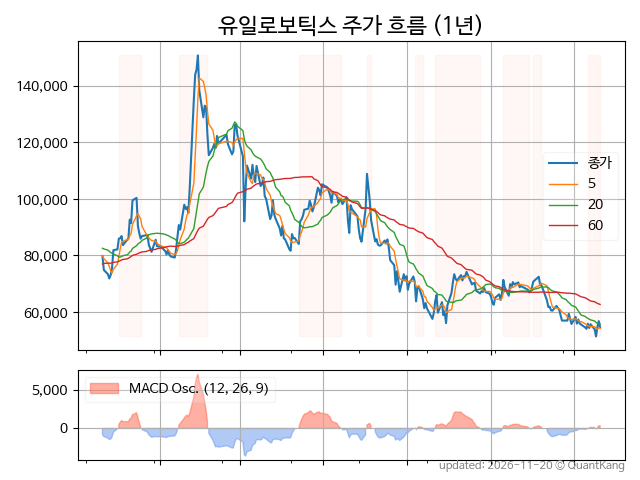
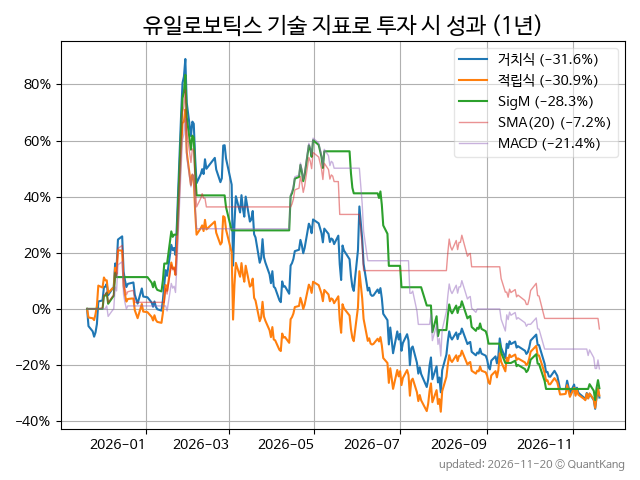
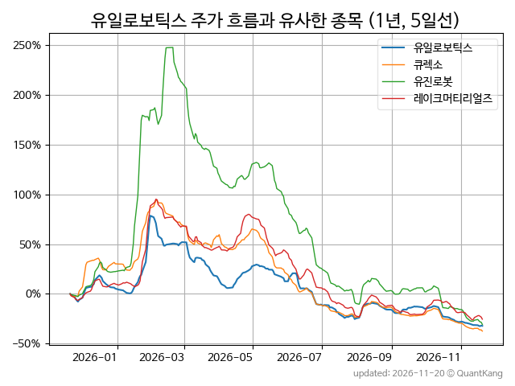
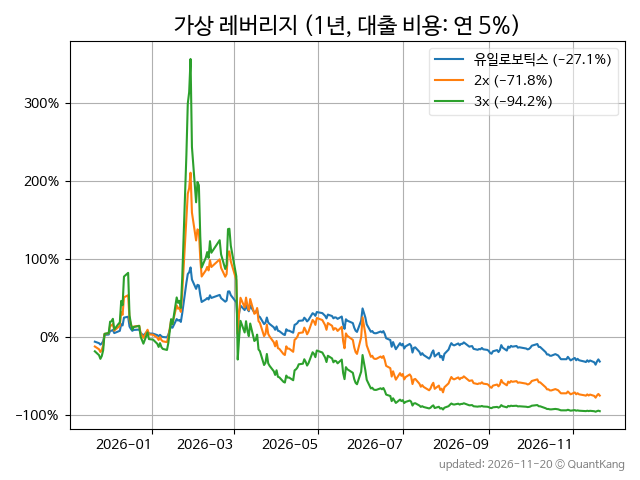

| **종가** | **전일대비** | **업종** | **PER** | **PBR** | **DIV** |
| -------: | -----------: | -------: | ------: | ------: | ------: |
| 54,500 | -3.9<small>%</small> | Q:기계장비 | - | 6.9 | - |

<!-- more -->

> **기업 개요**

| **섹터** | Q:기계장비 / 벤처기업부 |
| **산업** | 특수 목적용 기계 제조업 |
| **상장** | KOSDAQ / 2022년 3월 18일 상장 / 12월 결산 |
| **대표자** | 김동헌 |
| **홈페이지** | [http://www.yuilrobotics.com](http://www.yuilrobotics.com){:target="_blank"} |

> **최근 7일 DART 신규 공시**

| **일자** |      | **보고서명** |
| :------- | :--- | :----------- |
| 11&#x2011;13 | | [분기보고서 (2026.09)](https://dart.fss.or.kr/dsaf001/main.do?rcpNo=20261113001392){:target="_blank"} |

> **주가 흐름**

{: .align-center}

> **주요 가격 변동 지표**<small>[^fn_price_metric]</small>

| **종가** | **전일대비** | **5일** | **20일** | **60일** | **120일** |
| -------: | -----------: | ------: | -------: | -------: | --------: |
| 54,500 | -3.9<small>%</small> | -2.0<small>%</small> | -4.2<small>%</small> | -18.0<small>%</small> | -38.8<small>%</small> |
| **1년** | **편차** | **샤프** | **MDD** | **AvDD** | **MARr** |
| -31.6<small>%</small> | 78.9<small>%</small> | -0.40 | -66.0<small>%</small> | -38.4<small>%</small> | 0.5 |

> **주요 재무 지표**<small>[^fn_finance_metric]</small>

| **업종**<small>[^fn_sector_abbr]</small> | **PER** | **PBR** | **DIV** | **평가**<small>[^fn_finance_basic_tags]</small> |
| :--------------------------------------- | ------: | ------: | ------: | ----------------------------------------------: |
| Q:기계장비 | - | 6.9 | - | - |



> **세부 재무/투자 정보 제공 사이트**

| [네이버](https://m.stock.naver.com/domestic/stock/388720/finance/summary){:target="_blank"}<small>모바일</small> | [네이버](https://finance.naver.com/item/coinfo.naver?code=388720){:target="_blank"} | [FnGuide](https://comp.fnguide.com/SVO2/ASP/SVD_Invest.asp?gicode=A388720&MenuYn=Y){:target="_blank"} |
| :---: | :---: | :---: |
| [와이즈리포트](https://comp.wisereport.co.kr/company/c1040001.aspx?cmp_cd=388720){:target="_blank"} | [밸류라인](https://www.valueline.co.kr/finance/summary/388720){:target="_blank"} | [한국경제](https://markets.hankyung.com/stock/388720/financial-summary){:target="_blank"} |

> **주요 기술 지표**<small>[^fn_tech_metric]</small>

{: .align-center}

| **기술 지표** | **1년** | **편차** | **샤프** | **MDD** | **AvDD** |
| :------------ | ------: | -----------: | -------: | ------: | -------: |
| 거치식 | -31.6<small>%</small> | 78.9<small>%</small> | -0.40 | -66.0<small>%</small> | -38.4<small>%</small> |
| 적립식[^fn_tech_metric_dca] | -30.9<small>%</small> | 77.6<small>%</small> | -0.40 | -63.0<small>%</small> | -39.9<small>%</small> |
| Sig. M[^fn_tech_metric_sigm] | -28.3<small>%</small> | 51.1<small>%</small> | -0.55 | -63.2<small>%</small> | -30.9<small>%</small> |
| SMA<small>(5)</small>[^fn_tech_metric_sma_i] | -45.3<small>%</small> | 54.3<small>%</small> | -0.83 | -70.0<small>%</small> | -39.2<small>%</small> |
| SMA<small>(20)</small>[^fn_tech_metric_sma_i] | -7.2<small>%</small> | 48.9<small>%</small> | -0.15 | -47.9<small>%</small> | -26.8<small>%</small> |
| SMA<small>(60)</small>[^fn_tech_metric_sma_i] | -39.7<small>%</small> | 53.7<small>%</small> | -0.74 | -61.0<small>%</small> | -40.8<small>%</small> |
| SMA<small>(120)</small>[^fn_tech_metric_sma_i] | -3.5<small>%</small> | 57.7<small>%</small> | -0.06 | -48.6<small>%</small> | -35.5<small>%</small> |
| SMA<small>(240)</small>[^fn_tech_metric_sma_i] | -18.5<small>%</small> | 62.8<small>%</small> | -0.29 | -56.9<small>%</small> | -40.3<small>%</small> |
| MACD[^fn_tech_metric_macd] | -21.4<small>%</small> | 55.8<small>%</small> | -0.38 | -53.2<small>%</small> | -26.4<small>%</small> |

> **주가 흐름 유사 종목**<small>[^fn_corr_long]</small>

{: .align-center}

|       | [큐렉소](/060280/) | [유진로봇](/056080/) | [레이크머티리얼즈](/281740/) |
| :---: | :------------------------------------: | :------------------------------------: | :------------------------------------: |
|       | [차바이오텍](/085660/) | [포스코엠텍](/009520/) | [HS효성첨단소재](/298050/) |

> **가상 레버리지 상품에 투자했다면**<small>[^fn_lev]</small>

{: .align-center}

> **관련 정보**

- [Q:기계장비 업종 목록](/stats/sector/kosdaq_업종_기계장비_종목/){: .btn .btn--info}

> **참고 도서** [오렌지사과의 출간 책 소개와 샘플북 목록](https://kongdori.tistory.com/691)

- [왜 위험한 주식에 투자하라는 걸까? - 장기 투자와 분산 투자에 대한 통계학적 시각](https://kongdori.tistory.com/421)
- [파이썬으로 그려보는 투자 포트폴리오 분석  - 정량적 투자 분석을 위한 입문서](https://kongdori.tistory.com/643)
- [구글 시트로 시작하는 투자 포트폴리오 분석 - 오렌지사과의 불친절한 워크북](https://kongdori.tistory.com/449)

