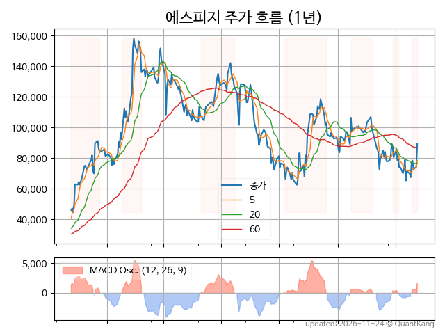
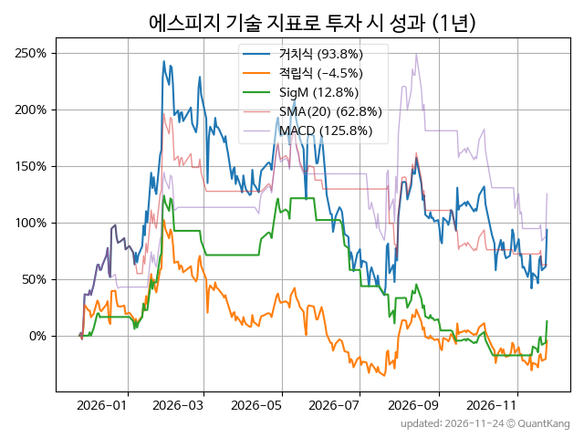
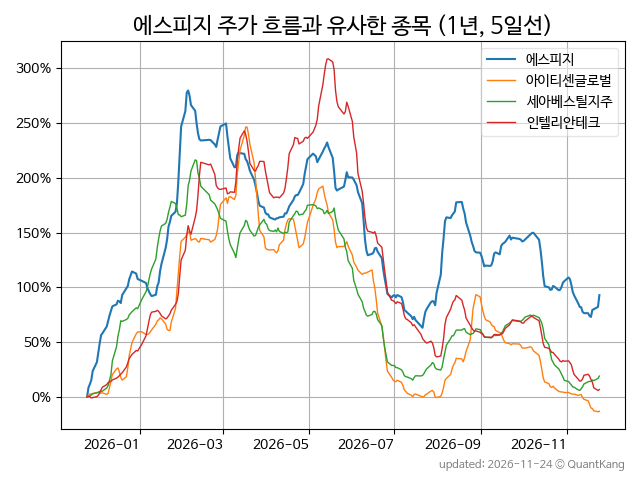
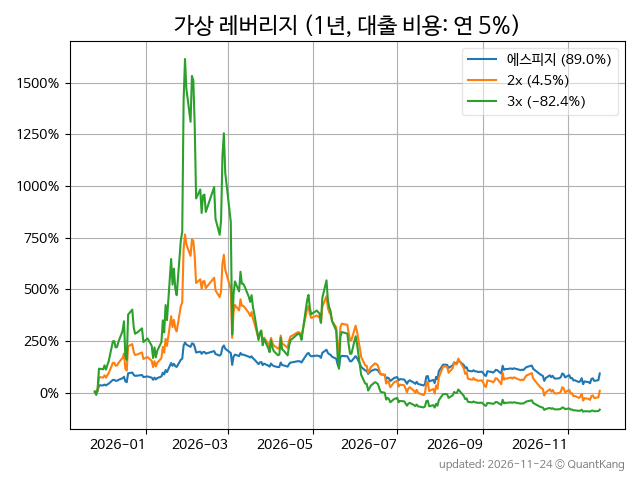

| **종가** | **전일대비** | **업종** | **PER** | **PBR** | **DIV** |
| -------: | -----------: | -------: | ------: | ------: | ------: |
| 89,300 | 20.2<small>%</small> | Q:전기전자 | 220.6 | 7.8 | 0.3<small>%</small> |

<!-- more -->

> **기업 개요**

| **섹터** | Q:전기전자 / 우량기업부 |
| **산업** | 전동기, 발전기 및 전기 변환 · 공급 · 제어 장치 제조업 |
| **상장** | KOSDAQ / 2002년 7월 23일 상장 / 12월 결산 |
| **대표자** | 이준호, 여영길(각자 대표이사) |
| **홈페이지** | [http://www.spg.co.kr](http://www.spg.co.kr){:target="_blank"} |

> **최근 7일 DART 신규 공시**

기간 내 신규 공시가 없습니다.

> **주가 흐름**

{: .align-center}

> **주요 가격 변동 지표**<small>[^fn_price_metric]</small>

| **종가** | **전일대비** | **5일** | **20일** | **60일** | **120일** |
| -------: | -----------: | ------: | -------: | -------: | --------: |
| 89,300 | 20.2<small>%</small> | 32.3<small>%</small> | 9.2<small>%</small> | -5.1<small>%</small> | -23.4<small>%</small> |
| **1년** | **편차** | **샤프** | **MDD** | **AvDD** | **MARr** |
| 93.8<small>%</small> | 116.5<small>%</small> | 0.81 | -60.4<small>%</small> | -29.2<small>%</small> | -1.6 |

> **주요 재무 지표**<small>[^fn_finance_metric]</small>

| **업종**<small>[^fn_sector_abbr]</small> | **PER** | **PBR** | **DIV** | **평가**<small>[^fn_finance_basic_tags]</small> |
| :--------------------------------------- | ------: | ------: | ------: | ----------------------------------------------: |
| Q:전기전자 | 220.6 | 7.8 | 0.3<small>%</small> | 고PER, 고PBR |



> **세부 재무/투자 정보 제공 사이트**

| [네이버](https://m.stock.naver.com/domestic/stock/058610/finance/summary){:target="_blank"}<small>모바일</small> | [네이버](https://finance.naver.com/item/coinfo.naver?code=058610){:target="_blank"} | [FnGuide](https://comp.fnguide.com/SVO2/ASP/SVD_Invest.asp?gicode=A058610&MenuYn=Y){:target="_blank"} |
| :---: | :---: | :---: |
| [와이즈리포트](https://comp.wisereport.co.kr/company/c1040001.aspx?cmp_cd=058610){:target="_blank"} | [밸류라인](https://www.valueline.co.kr/finance/summary/058610){:target="_blank"} | [한국경제](https://markets.hankyung.com/stock/058610/financial-summary){:target="_blank"} |

> **주요 기술 지표**<small>[^fn_tech_metric]</small>

{: .align-center}

| **기술 지표** | **1년** | **편차** | **샤프** | **MDD** | **AvDD** |
| :------------ | ------: | -----------: | -------: | ------: | -------: |
| 거치식 | 93.8<small>%</small> | 116.5<small>%</small> | 0.81 | -60.4<small>%</small> | -29.2<small>%</small> |
| 적립식[^fn_tech_metric_dca] | -4.5<small>%</small> | 113.6<small>%</small> | -0.04 | -68.1<small>%</small> | -39.1<small>%</small> |
| Sig. M[^fn_tech_metric_sigm] | 12.8<small>%</small> | 70.7<small>%</small> | 0.18 | -63.1<small>%</small> | -27.2<small>%</small> |
| SMA<small>(5)</small>[^fn_tech_metric_sma_i] | -22.1<small>%</small> | 78.6<small>%</small> | -0.28 | -69.7<small>%</small> | -32.2<small>%</small> |
| SMA<small>(20)</small>[^fn_tech_metric_sma_i] | 62.8<small>%</small> | 80.3<small>%</small> | 0.78 | -45.1<small>%</small> | -22.0<small>%</small> |
| SMA<small>(60)</small>[^fn_tech_metric_sma_i] | 29.0<small>%</small> | 83.0<small>%</small> | 0.35 | -62.4<small>%</small> | -35.4<small>%</small> |
| SMA<small>(120)</small>[^fn_tech_metric_sma_i] | 42.3<small>%</small> | 82.5<small>%</small> | 0.51 | -58.5<small>%</small> | -32.7<small>%</small> |
| SMA<small>(240)</small>[^fn_tech_metric_sma_i] | -17.1<small>%</small> | 94.1<small>%</small> | -0.18 | -75.8<small>%</small> | -38.6<small>%</small> |
| MACD[^fn_tech_metric_macd] | 125.8<small>%</small> | 84.6<small>%</small> | 1.49 | -47.4<small>%</small> | -16.2<small>%</small> |

> **주가 흐름 유사 종목**<small>[^fn_corr_long]</small>

{: .align-center}

|       | [아이티센글로벌](/124500/) | [세아베스틸지주](/001430/) | [인텔리안테크](/189300/) |
| :---: | :------------------------------------: | :------------------------------------: | :------------------------------------: |
|       | [다우데이타](/032190/) | [비에이치아이](/083650/) | [한화시스템](/272210/) |

> **가상 레버리지 상품에 투자했다면**<small>[^fn_lev]</small>

{: .align-center}

> **관련 정보**

- [Q:전기전자 업종 목록](/stats/sector/kosdaq_업종_전기전자_종목/){: .btn .btn--info} [고PER 목록](/fn/fn_high_per/){: .btn .btn--info} [고PBR 목록](/fn/fn_high_pbr/){: .btn .btn--info}

> **참고 도서** [오렌지사과의 출간 책 소개와 샘플북 목록](https://kongdori.tistory.com/691)

- [왜 위험한 주식에 투자하라는 걸까? - 장기 투자와 분산 투자에 대한 통계학적 시각](https://kongdori.tistory.com/421)
- [파이썬으로 그려보는 투자 포트폴리오 분석  - 정량적 투자 분석을 위한 입문서](https://kongdori.tistory.com/643)
- [구글 시트로 시작하는 투자 포트폴리오 분석 - 오렌지사과의 불친절한 워크북](https://kongdori.tistory.com/449)

