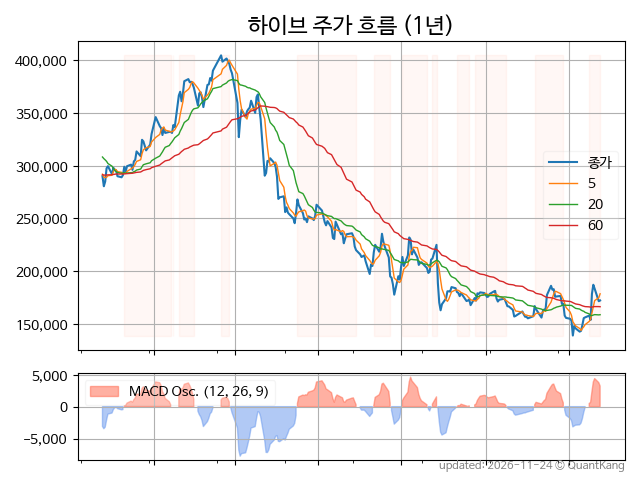
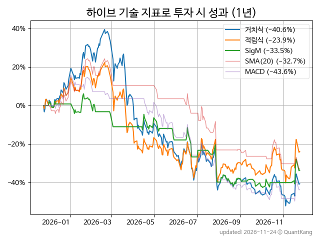
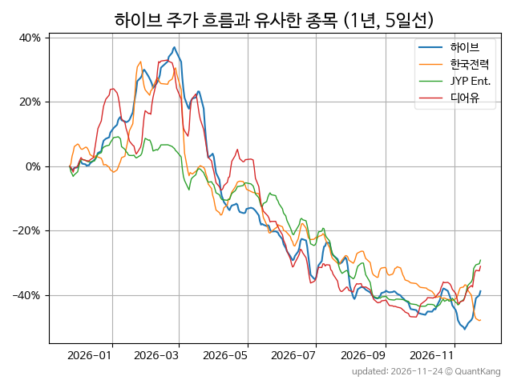
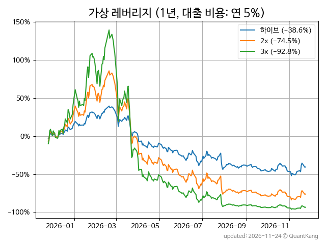

| **종가** | **전일대비** | **업종** | **PER** | **PBR** | **DIV** |
| -------: | -----------: | -------: | ------: | ------: | ------: |
| 172,300 | 0.4<small>%</small> | P:오락문화 | - | 2.2 | 0.3<small>%</small> |

<!-- more -->

> **기업 개요**

| **섹터** | P:오락문화 / nan |
| **산업** | 오디오물 출판 및 원판 녹음업 |
| **상장** | KOSPI / 2020년 10월 15일 상장 / 12월 결산 |
| **대표자** | 이재상 |
| **홈페이지** | [http://hybecorp.com](http://hybecorp.com){:target="_blank"} |

> **최근 7일 DART 신규 공시**

| **일자** |      | **보고서명** |
| :------- | :--- | :----------- |
| 11&#x2011;24 | | [[기재정정]주주총회소집결의              ](https://dart.fss.or.kr/dsaf001/main.do?rcpNo=20261124800807){:target="_blank"} |
|  | | [[기재정정]타법인주식및출자증권처분결정              ](https://dart.fss.or.kr/dsaf001/main.do?rcpNo=20261124800768){:target="_blank"} |
|  | | [[기재정정]주식매수선택권부여에관한신고](https://dart.fss.or.kr/dsaf001/main.do?rcpNo=20261124000430){:target="_blank"} |
|  | | [[기재정정]주식매수선택권부여에관한신고](https://dart.fss.or.kr/dsaf001/main.do?rcpNo=20261124000424){:target="_blank"} |
|  | | [[기재정정]주식매수선택권부여에관한신고](https://dart.fss.or.kr/dsaf001/main.do?rcpNo=20261124000419){:target="_blank"} |
|  | | [[기재정정]주식매수선택권부여에관한신고](https://dart.fss.or.kr/dsaf001/main.do?rcpNo=20261124000396){:target="_blank"} |
|  | | [[기재정정]주식매수선택권부여에관한신고](https://dart.fss.or.kr/dsaf001/main.do?rcpNo=20261124000383){:target="_blank"} |
| 11&#x2011;19 | | [임원ㆍ주요주주특정증권등소유상황보고서](https://dart.fss.or.kr/dsaf001/main.do?rcpNo=20261119000270){:target="_blank"} |
|  | | [자기주식처분결과보고서](https://dart.fss.or.kr/dsaf001/main.do?rcpNo=20261119000249){:target="_blank"} |
| 11&#x2011;18 | | [타법인주식및출자증권취득결정(자율공시)(종속회사의주요경영사항)              ](https://dart.fss.or.kr/dsaf001/main.do?rcpNo=20261118800338){:target="_blank"} |
|  | | [주주명부폐쇄기간또는기준일설정              ](https://dart.fss.or.kr/dsaf001/main.do?rcpNo=20261118800279){:target="_blank"} |

> **주가 흐름**

{: .align-center}

> **주요 가격 변동 지표**<small>[^fn_price_metric]</small>

| **종가** | **전일대비** | **5일** | **20일** | **60일** | **120일** |
| -------: | -----------: | ------: | -------: | -------: | --------: |
| 172,300 | 0.4<small>%</small> | 12.0<small>%</small> | 2.0<small>%</small> | -3.8<small>%</small> | -21.7<small>%</small> |
| **1년** | **편차** | **샤프** | **MDD** | **AvDD** | **MARr** |
| -40.6<small>%</small> | 57.8<small>%</small> | -0.70 | -65.6<small>%</small> | -35.1<small>%</small> | 0.6 |

> **주요 재무 지표**<small>[^fn_finance_metric]</small>

| **업종**<small>[^fn_sector_abbr]</small> | **PER** | **PBR** | **DIV** | **평가**<small>[^fn_finance_basic_tags]</small> |
| :--------------------------------------- | ------: | ------: | ------: | ----------------------------------------------: |
| P:오락문화 | - | 2.2 | 0.3<small>%</small> | - |



> **세부 재무/투자 정보 제공 사이트**

| [네이버](https://m.stock.naver.com/domestic/stock/352820/finance/summary){:target="_blank"}<small>모바일</small> | [네이버](https://finance.naver.com/item/coinfo.naver?code=352820){:target="_blank"} | [FnGuide](https://comp.fnguide.com/SVO2/ASP/SVD_Invest.asp?gicode=A352820&MenuYn=Y){:target="_blank"} |
| :---: | :---: | :---: |
| [와이즈리포트](https://comp.wisereport.co.kr/company/c1040001.aspx?cmp_cd=352820){:target="_blank"} | [밸류라인](https://www.valueline.co.kr/finance/summary/352820){:target="_blank"} | [한국경제](https://markets.hankyung.com/stock/352820/financial-summary){:target="_blank"} |

> **주요 기술 지표**<small>[^fn_tech_metric]</small>

{: .align-center}

| **기술 지표** | **1년** | **편차** | **샤프** | **MDD** | **AvDD** |
| :------------ | ------: | -----------: | -------: | ------: | -------: |
| 거치식 | -40.6<small>%</small> | 57.8<small>%</small> | -0.70 | -65.6<small>%</small> | -35.1<small>%</small> |
| 적립식[^fn_tech_metric_dca] | -23.9<small>%</small> | 57.2<small>%</small> | -0.42 | -51.0<small>%</small> | -29.0<small>%</small> |
| Sig. M[^fn_tech_metric_sigm] | -33.5<small>%</small> | 38.7<small>%</small> | -0.87 | -45.8<small>%</small> | -23.2<small>%</small> |
| SMA<small>(5)</small>[^fn_tech_metric_sma_i] | 7.9<small>%</small> | 36.4<small>%</small> | 0.22 | -20.6<small>%</small> | -10.0<small>%</small> |
| SMA<small>(20)</small>[^fn_tech_metric_sma_i] | -32.7<small>%</small> | 34.4<small>%</small> | -0.95 | -46.0<small>%</small> | -20.6<small>%</small> |
| SMA<small>(60)</small>[^fn_tech_metric_sma_i] | -27.5<small>%</small> | 30.8<small>%</small> | -0.89 | -45.2<small>%</small> | -23.6<small>%</small> |
| SMA<small>(120)</small>[^fn_tech_metric_sma_i] | -13.4<small>%</small> | 29.9<small>%</small> | -0.45 | -34.2<small>%</small> | -20.6<small>%</small> |
| SMA<small>(240)</small>[^fn_tech_metric_sma_i] | -1.6<small>%</small> | 29.6<small>%</small> | -0.06 | -29.5<small>%</small> | -21.3<small>%</small> |
| MACD[^fn_tech_metric_macd] | -43.6<small>%</small> | 41.0<small>%</small> | -1.06 | -56.5<small>%</small> | -26.5<small>%</small> |

> **주가 흐름 유사 종목**<small>[^fn_corr_long]</small>

{: .align-center}

|       | [한국전력](/015760/) | [JYP Ent.](/035900/) | [디어유](/376300/) |
| :---: | :------------------------------------: | :------------------------------------: | :------------------------------------: |
|       | [SOOP](/067160/) | [에이비엘바이오](/298380/) | [클로봇](/466100/) |

> **가상 레버리지 상품에 투자했다면**<small>[^fn_lev]</small>

{: .align-center}

> **관련 정보**

- [P:오락문화 업종 목록](/stats/sector/kospi_업종_오락문화_종목/){: .btn .btn--info}

> **참고 도서** [오렌지사과의 출간 책 소개와 샘플북 목록](https://kongdori.tistory.com/691)

- [왜 위험한 주식에 투자하라는 걸까? - 장기 투자와 분산 투자에 대한 통계학적 시각](https://kongdori.tistory.com/421)
- [파이썬으로 그려보는 투자 포트폴리오 분석  - 정량적 투자 분석을 위한 입문서](https://kongdori.tistory.com/643)
- [구글 시트로 시작하는 투자 포트폴리오 분석 - 오렌지사과의 불친절한 워크북](https://kongdori.tistory.com/449)

