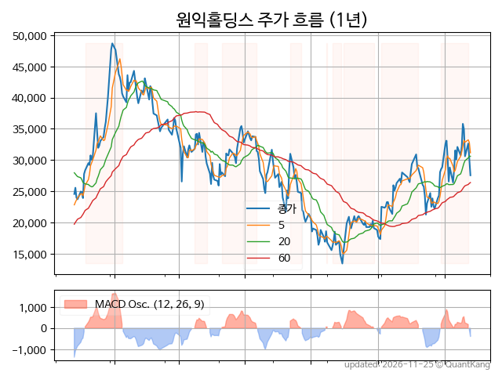
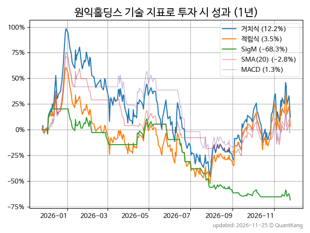
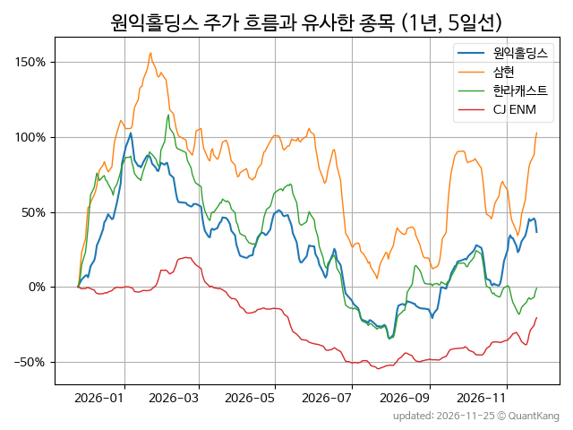
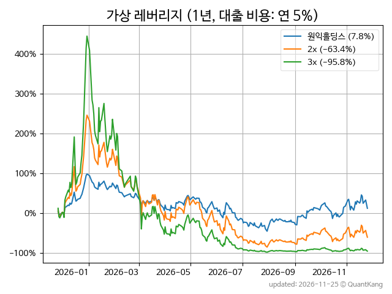

| **종가** | **전일대비** | **업종** | **PER** | **PBR** | **DIV** |
| -------: | -----------: | -------: | ------: | ------: | ------: |
| 27,550 | -8.3<small>%</small> | Q:화학 | 77.6 | 2.1 | - |

<!-- more -->

> **기업 개요**

| **섹터** | Q:화학 / 중견기업부 |
| **산업** | 기초 화학물질 제조업 |
| **상장** | KOSDAQ / 1996년 9월 24일 상장 / 12월 결산 |
| **대표자** | 조남성, 장성대 (각자대표이사) |
| **홈페이지** | [http://www.wonikholdings.kr](http://www.wonikholdings.kr){:target="_blank"} |

> **최근 7일 DART 신규 공시**

기간 내 신규 공시가 없습니다.

> **주가 흐름**

{: .align-center}

> **주요 가격 변동 지표**<small>[^fn_price_metric]</small>

| **종가** | **전일대비** | **5일** | **20일** | **60일** | **120일** |
| -------: | -----------: | ------: | -------: | -------: | --------: |
| 27,550 | -8.3<small>%</small> | -23.0<small>%</small> | -1.8<small>%</small> | 36.0<small>%</small> | -0.7<small>%</small> |
| **1년** | **편차** | **샤프** | **MDD** | **AvDD** | **MARr** |
| 12.2<small>%</small> | 112.4<small>%</small> | 0.11 | -72.5<small>%</small> | -38.1<small>%</small> | -0.2 |

> **주요 재무 지표**<small>[^fn_finance_metric]</small>

| **업종**<small>[^fn_sector_abbr]</small> | **PER** | **PBR** | **DIV** | **평가**<small>[^fn_finance_basic_tags]</small> |
| :--------------------------------------- | ------: | ------: | ------: | ----------------------------------------------: |
| Q:화학 | 77.6 | 2.1 | - | 고PER |



> **세부 재무/투자 정보 제공 사이트**

| [네이버](https://m.stock.naver.com/domestic/stock/030530/finance/summary){:target="_blank"}<small>모바일</small> | [네이버](https://finance.naver.com/item/coinfo.naver?code=030530){:target="_blank"} | [FnGuide](https://comp.fnguide.com/SVO2/ASP/SVD_Invest.asp?gicode=A030530&MenuYn=Y){:target="_blank"} |
| :---: | :---: | :---: |
| [와이즈리포트](https://comp.wisereport.co.kr/company/c1040001.aspx?cmp_cd=030530){:target="_blank"} | [밸류라인](https://www.valueline.co.kr/finance/summary/030530){:target="_blank"} | [한국경제](https://markets.hankyung.com/stock/030530/financial-summary){:target="_blank"} |

> **주요 기술 지표**<small>[^fn_tech_metric]</small>

{: .align-center}

| **기술 지표** | **1년** | **편차** | **샤프** | **MDD** | **AvDD** |
| :------------ | ------: | -----------: | -------: | ------: | -------: |
| 거치식 | 12.2<small>%</small> | 112.4<small>%</small> | 0.11 | -72.5<small>%</small> | -38.1<small>%</small> |
| 적립식[^fn_tech_metric_dca] | 3.5<small>%</small> | 110.9<small>%</small> | 0.03 | -70.3<small>%</small> | -39.0<small>%</small> |
| Sig. M[^fn_tech_metric_sigm] | -68.3<small>%</small> | 57.9<small>%</small> | -1.18 | -74.2<small>%</small> | -38.2<small>%</small> |
| SMA<small>(5)</small>[^fn_tech_metric_sma_i] | -19.7<small>%</small> | 72.4<small>%</small> | -0.27 | -61.5<small>%</small> | -38.6<small>%</small> |
| SMA<small>(20)</small>[^fn_tech_metric_sma_i] | -2.8<small>%</small> | 69.9<small>%</small> | -0.04 | -57.5<small>%</small> | -36.1<small>%</small> |
| SMA<small>(60)</small>[^fn_tech_metric_sma_i] | 18.2<small>%</small> | 72.4<small>%</small> | 0.25 | -52.0<small>%</small> | -33.4<small>%</small> |
| SMA<small>(120)</small>[^fn_tech_metric_sma_i] | -31.2<small>%</small> | 72.2<small>%</small> | -0.43 | -69.9<small>%</small> | -44.6<small>%</small> |
| SMA<small>(240)</small>[^fn_tech_metric_sma_i] | -47.1<small>%</small> | 81.6<small>%</small> | -0.58 | -73.3<small>%</small> | -44.0<small>%</small> |
| MACD[^fn_tech_metric_macd] | 1.3<small>%</small> | 79.9<small>%</small> | 0.02 | -60.6<small>%</small> | -28.6<small>%</small> |

> **주가 흐름 유사 종목**<small>[^fn_corr_long]</small>

{: .align-center}

|       | [삼현](/437730/) | [한라캐스트](/125490/) | [CJ ENM](/035760/) |
| :---: | :------------------------------------: | :------------------------------------: | :------------------------------------: |
|       | [루닛](/328130/) | [녹십자](/006280/) | [에스엠](/041510/) |

> **가상 레버리지 상품에 투자했다면**<small>[^fn_lev]</small>

{: .align-center}

> **관련 정보**

- [Q:화학 업종 목록](/stats/sector/kosdaq_업종_화학_종목/){: .btn .btn--info} [고PER 목록](/fn/fn_high_per/){: .btn .btn--info}

> **참고 도서** [오렌지사과의 출간 책 소개와 샘플북 목록](https://kongdori.tistory.com/691)

- [왜 위험한 주식에 투자하라는 걸까? - 장기 투자와 분산 투자에 대한 통계학적 시각](https://kongdori.tistory.com/421)
- [파이썬으로 그려보는 투자 포트폴리오 분석  - 정량적 투자 분석을 위한 입문서](https://kongdori.tistory.com/643)
- [구글 시트로 시작하는 투자 포트폴리오 분석 - 오렌지사과의 불친절한 워크북](https://kongdori.tistory.com/449)

