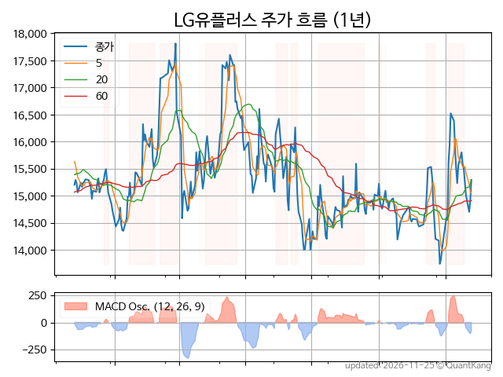
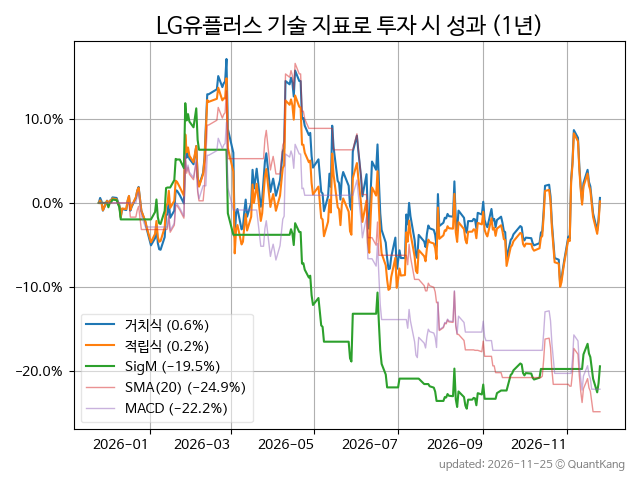
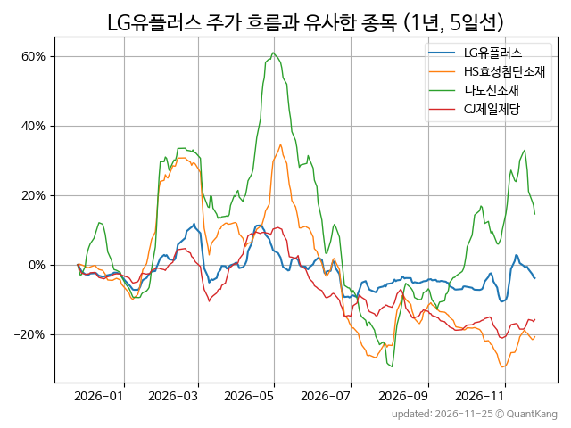
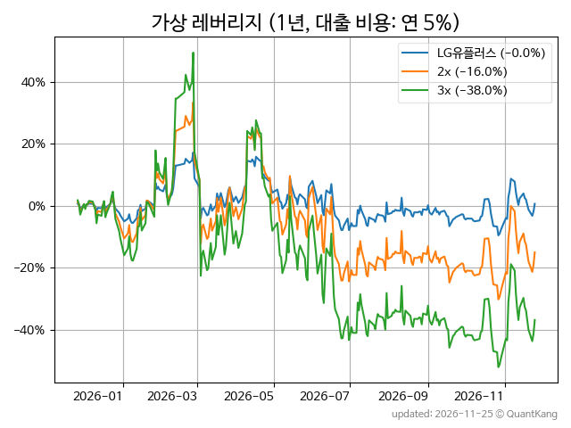

| **종가** | **전일대비** | **업종** | **PER** | **PBR** | **DIV** |
| -------: | -----------: | -------: | ------: | ------: | ------: |
| 15,290 | 2.5<small>%</small> | P:통신 | 12.5 | 0.7 | 4.3<small>%</small> |

<!-- more -->

> **기업 개요**

| **섹터** | P:통신 / nan |
| **산업** | 전기 통신업 |
| **상장** | KOSPI / 2008년 4월 21일 상장 / 12월 결산 |
| **대표자** | 홍범식 |
| **홈페이지** | [http://www.uplus.co.kr](http://www.uplus.co.kr){:target="_blank"} |

> **최근 7일 DART 신규 공시**

| **일자** |      | **보고서명** |
| :------- | :--- | :----------- |
| 11&#x2011;23 | | [기업설명회(IR)개최(안내공시)              ](https://dart.fss.or.kr/dsaf001/main.do?rcpNo=20261123800371){:target="_blank"} |
| 11&#x2011;20 | | [특수관계인으로부터주식의취득](https://dart.fss.or.kr/dsaf001/main.do?rcpNo=20261120000448){:target="_blank"} |
| 11&#x2011;19 | | [기업가치제고계획예고(안내공시)              ](https://dart.fss.or.kr/dsaf001/main.do?rcpNo=20261119800441){:target="_blank"} |
|  | | [신규시설투자등              ](https://dart.fss.or.kr/dsaf001/main.do?rcpNo=20261119800399){:target="_blank"} |

> **주가 흐름**

{: .align-center}

> **주요 가격 변동 지표**<small>[^fn_price_metric]</small>

| **종가** | **전일대비** | **5일** | **20일** | **60일** | **120일** |
| -------: | -----------: | ------: | -------: | -------: | --------: |
| 15,290 | 2.5<small>%</small> | -1.4<small>%</small> | 10.6<small>%</small> | 3.7<small>%</small> | -6.9<small>%</small> |
| **1년** | **편차** | **샤프** | **MDD** | **AvDD** | **MARr** |
| 0.6<small>%</small> | 36.1<small>%</small> | 0.02 | -22.9<small>%</small> | -11.3<small>%</small> | -0.0 |

> **주요 재무 지표**<small>[^fn_finance_metric]</small>

| **업종**<small>[^fn_sector_abbr]</small> | **PER** | **PBR** | **DIV** | **평가**<small>[^fn_finance_basic_tags]</small> |
| :--------------------------------------- | ------: | ------: | ------: | ----------------------------------------------: |
| P:통신 | 12.5 | 0.7 | 4.3<small>%</small> | - |



> **세부 재무/투자 정보 제공 사이트**

| [네이버](https://m.stock.naver.com/domestic/stock/032640/finance/summary){:target="_blank"}<small>모바일</small> | [네이버](https://finance.naver.com/item/coinfo.naver?code=032640){:target="_blank"} | [FnGuide](https://comp.fnguide.com/SVO2/ASP/SVD_Invest.asp?gicode=A032640&MenuYn=Y){:target="_blank"} |
| :---: | :---: | :---: |
| [와이즈리포트](https://comp.wisereport.co.kr/company/c1040001.aspx?cmp_cd=032640){:target="_blank"} | [밸류라인](https://www.valueline.co.kr/finance/summary/032640){:target="_blank"} | [한국경제](https://markets.hankyung.com/stock/032640/financial-summary){:target="_blank"} |

> **주요 기술 지표**<small>[^fn_tech_metric]</small>

{: .align-center}

| **기술 지표** | **1년** | **편차** | **샤프** | **MDD** | **AvDD** |
| :------------ | ------: | -----------: | -------: | ------: | -------: |
| 거치식 | 0.6<small>%</small> | 36.1<small>%</small> | 0.02 | -22.9<small>%</small> | -11.3<small>%</small> |
| 적립식[^fn_tech_metric_dca] | 0.2<small>%</small> | 35.9<small>%</small> | 0.01 | -22.0<small>%</small> | -11.1<small>%</small> |
| Sig. M[^fn_tech_metric_sigm] | -19.5<small>%</small> | 21.0<small>%</small> | -0.93 | -32.6<small>%</small> | -19.3<small>%</small> |
| SMA<small>(5)</small>[^fn_tech_metric_sma_i] | -6.3<small>%</small> | 26.4<small>%</small> | -0.24 | -22.1<small>%</small> | -9.5<small>%</small> |
| SMA<small>(20)</small>[^fn_tech_metric_sma_i] | -24.9<small>%</small> | 24.0<small>%</small> | -1.04 | -35.6<small>%</small> | -15.2<small>%</small> |
| SMA<small>(60)</small>[^fn_tech_metric_sma_i] | -42.4<small>%</small> | 24.8<small>%</small> | -1.71 | -48.3<small>%</small> | -25.6<small>%</small> |
| SMA<small>(120)</small>[^fn_tech_metric_sma_i] | -35.0<small>%</small> | 25.2<small>%</small> | -1.39 | -44.0<small>%</small> | -24.2<small>%</small> |
| SMA<small>(240)</small>[^fn_tech_metric_sma_i] | -23.5<small>%</small> | 29.3<small>%</small> | -0.80 | -34.7<small>%</small> | -17.3<small>%</small> |
| MACD[^fn_tech_metric_macd] | -22.2<small>%</small> | 26.0<small>%</small> | -0.85 | -29.1<small>%</small> | -13.9<small>%</small> |

> **주가 흐름 유사 종목**<small>[^fn_corr_long]</small>

{: .align-center}

|       | [HS효성첨단소재](/298050/) | [나노신소재](/121600/) | [CJ제일제당](/097950/) |
| :---: | :------------------------------------: | :------------------------------------: | :------------------------------------: |
|       | [포스코퓨처엠](/003670/) | [포스코DX](/022100/) | [세아제강지주](/003030/) |

> **가상 레버리지 상품에 투자했다면**<small>[^fn_lev]</small>

{: .align-center}

> **관련 정보**

- [P:통신 업종 목록](/stats/sector/kospi_업종_통신_종목/){: .btn .btn--info}

> **참고 도서** [오렌지사과의 출간 책 소개와 샘플북 목록](https://kongdori.tistory.com/691)

- [왜 위험한 주식에 투자하라는 걸까? - 장기 투자와 분산 투자에 대한 통계학적 시각](https://kongdori.tistory.com/421)
- [파이썬으로 그려보는 투자 포트폴리오 분석  - 정량적 투자 분석을 위한 입문서](https://kongdori.tistory.com/643)
- [구글 시트로 시작하는 투자 포트폴리오 분석 - 오렌지사과의 불친절한 워크북](https://kongdori.tistory.com/449)

