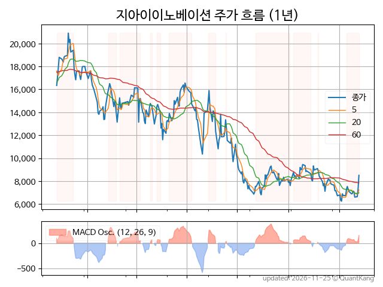
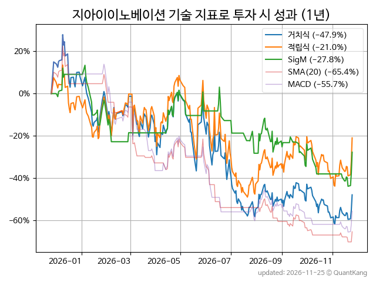
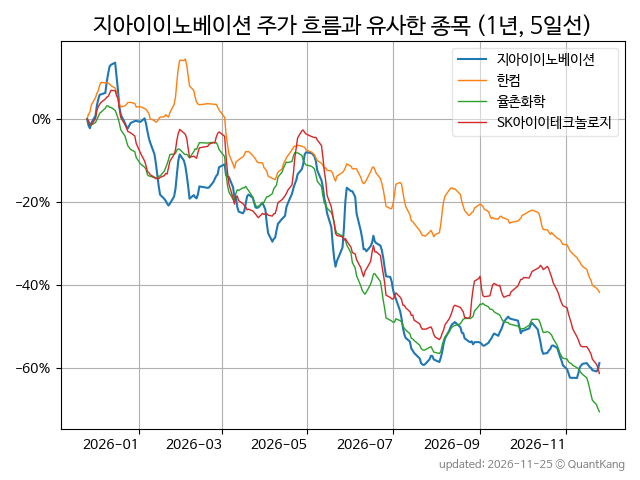
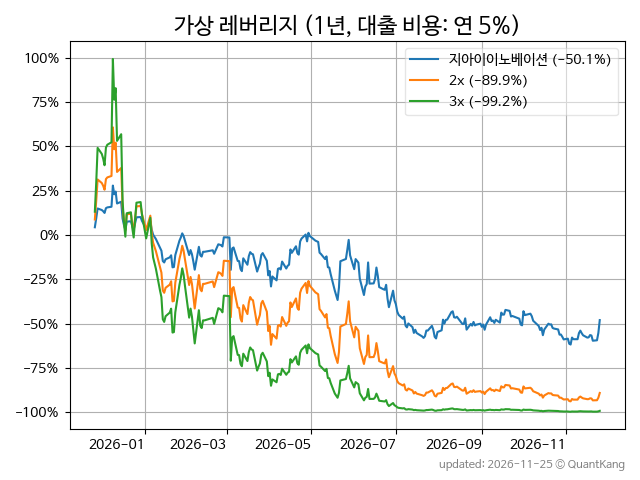

| **종가** | **전일대비** | **업종** | **PER** | **PBR** | **DIV** |
| -------: | -----------: | -------: | ------: | ------: | ------: |
| 8,510 | 16.1<small>%</small> | Q:일반서비스 | - | 4.8 | - |

<!-- more -->

> **기업 개요**

| **섹터** | Q:일반서비스 / 기술성장기업부 |
| **산업** | 자연과학 및 공학 연구개발업 |
| **상장** | KOSDAQ / 2023년 3월 30일 상장 / 12월 결산 |
| **대표자** | 장명호, 홍준호(각자대표이사) |
| **홈페이지** | [http://www.gi-innovation.com/kr/](http://www.gi-innovation.com/kr/){:target="_blank"} |

> **최근 7일 DART 신규 공시**

| **일자** |      | **보고서명** |
| :------- | :--- | :----------- |
| 11&#x2011;23 | | [투자판단관련주요경영사항(임상시험계획변경승인신청)              (림프구 감소증을 동반한 성인 및 암 생존자를 대상으로 한 GI102 요법의 노화 관련 생체지표를 평가하기 위한 임상시험 (GIANTS1) 변경승인 신청)](https://dart.fss.or.kr/dsaf001/main.do?rcpNo=20261123900702){:target="_blank"} |

> **주가 흐름**

{: .align-center}

> **주요 가격 변동 지표**<small>[^fn_price_metric]</small>

| **종가** | **전일대비** | **5일** | **20일** | **60일** | **120일** |
| -------: | -----------: | ------: | -------: | -------: | --------: |
| 8,510 | 16.1<small>%</small> | 19.4<small>%</small> | 18.5<small>%</small> | 6.1<small>%</small> | -35.5<small>%</small> |
| **1년** | **편차** | **샤프** | **MDD** | **AvDD** | **MARr** |
| -47.9<small>%</small> | 93.9<small>%</small> | -0.51 | -70.0<small>%</small> | -42.2<small>%</small> | 0.7 |

> **주요 재무 지표**<small>[^fn_finance_metric]</small>

| **업종**<small>[^fn_sector_abbr]</small> | **PER** | **PBR** | **DIV** | **평가**<small>[^fn_finance_basic_tags]</small> |
| :--------------------------------------- | ------: | ------: | ------: | ----------------------------------------------: |
| Q:일반서비스 | - | 4.8 | - | - |



> **세부 재무/투자 정보 제공 사이트**

| [네이버](https://m.stock.naver.com/domestic/stock/358570/finance/summary){:target="_blank"}<small>모바일</small> | [네이버](https://finance.naver.com/item/coinfo.naver?code=358570){:target="_blank"} | [FnGuide](https://comp.fnguide.com/SVO2/ASP/SVD_Invest.asp?gicode=A358570&MenuYn=Y){:target="_blank"} |
| :---: | :---: | :---: |
| [와이즈리포트](https://comp.wisereport.co.kr/company/c1040001.aspx?cmp_cd=358570){:target="_blank"} | [밸류라인](https://www.valueline.co.kr/finance/summary/358570){:target="_blank"} | [한국경제](https://markets.hankyung.com/stock/358570/financial-summary){:target="_blank"} |

> **주요 기술 지표**<small>[^fn_tech_metric]</small>

{: .align-center}

| **기술 지표** | **1년** | **편차** | **샤프** | **MDD** | **AvDD** |
| :------------ | ------: | -----------: | -------: | ------: | -------: |
| 거치식 | -47.9<small>%</small> | 93.9<small>%</small> | -0.51 | -70.0<small>%</small> | -42.2<small>%</small> |
| 적립식[^fn_tech_metric_dca] | -21.0<small>%</small> | 93.0<small>%</small> | -0.23 | -55.1<small>%</small> | -28.8<small>%</small> |
| Sig. M[^fn_tech_metric_sigm] | -27.8<small>%</small> | 55.4<small>%</small> | -0.50 | -50.5<small>%</small> | -25.8<small>%</small> |
| SMA<small>(5)</small>[^fn_tech_metric_sma_i] | -57.0<small>%</small> | 61.6<small>%</small> | -0.93 | -67.5<small>%</small> | -39.2<small>%</small> |
| SMA<small>(20)</small>[^fn_tech_metric_sma_i] | -65.4<small>%</small> | 53.5<small>%</small> | -1.22 | -75.7<small>%</small> | -46.7<small>%</small> |
| SMA<small>(60)</small>[^fn_tech_metric_sma_i] | -45.4<small>%</small> | 30.9<small>%</small> | -1.47 | -53.3<small>%</small> | -33.1<small>%</small> |
| SMA<small>(120)</small>[^fn_tech_metric_sma_i] | -19.8<small>%</small> | 20.1<small>%</small> | -0.99 | -27.3<small>%</small> | -20.4<small>%</small> |
| SMA<small>(240)</small>[^fn_tech_metric_sma_i] | 0.2<small>%</small> | 21.4<small>%</small> | 0.01 | -21.6<small>%</small> | -20.1<small>%</small> |
| MACD[^fn_tech_metric_macd] | -55.7<small>%</small> | 64.6<small>%</small> | -0.86 | -73.1<small>%</small> | -46.8<small>%</small> |

> **주가 흐름 유사 종목**<small>[^fn_corr_long]</small>

{: .align-center}

|       | [한컴](/030520/) | [율촌화학](/008730/) | [SK아이이테크놀로지](/361610/) |
| :---: | :------------------------------------: | :------------------------------------: | :------------------------------------: |
|       | [엔켐](/348370/) | [에이비엘바이오](/298380/) | [시노펙스](/025320/) |

> **가상 레버리지 상품에 투자했다면**<small>[^fn_lev]</small>

{: .align-center}

> **관련 정보**

- [Q:일반서비스 업종 목록](/stats/sector/kosdaq_업종_일반서비스_종목/){: .btn .btn--info}

> **참고 도서** [오렌지사과의 출간 책 소개와 샘플북 목록](https://kongdori.tistory.com/691)

- [왜 위험한 주식에 투자하라는 걸까? - 장기 투자와 분산 투자에 대한 통계학적 시각](https://kongdori.tistory.com/421)
- [파이썬으로 그려보는 투자 포트폴리오 분석  - 정량적 투자 분석을 위한 입문서](https://kongdori.tistory.com/643)
- [구글 시트로 시작하는 투자 포트폴리오 분석 - 오렌지사과의 불친절한 워크북](https://kongdori.tistory.com/449)

