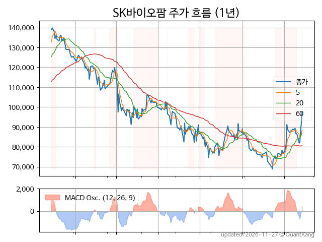
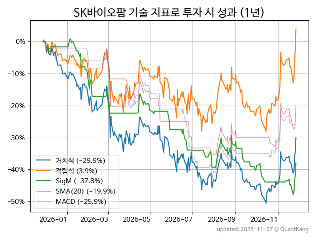
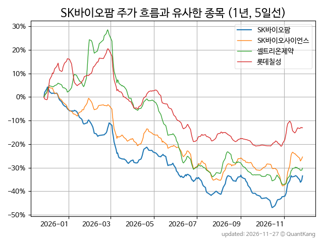
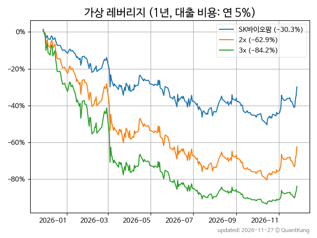

| **종가** | **전일대비** | **업종** | **PER** | **PBR** | **DIV** |
| -------: | -----------: | -------: | ------: | ------: | ------: |
| 97,500 | 6.8<small>%</small> | P:일반서비스 | 28.6 | 9.4 | - |

<!-- more -->

> **기업 개요**

| **섹터** | P:일반서비스 / nan |
| **산업** | 자연과학 및 공학 연구개발업 |
| **상장** | KOSPI / 2020년 7월 2일 상장 / 12월 결산 |
| **대표자** | 이동훈 |
| **홈페이지** | [nan](nan){:target="_blank"} |

> **최근 7일 DART 신규 공시**

| **일자** |      | **보고서명** |
| :------- | :--- | :----------- |
| 11&#x2011;26 | | [대규모기업집단현황공시[분기별공시(개별회사용)]](https://dart.fss.or.kr/dsaf001/main.do?rcpNo=20261126000727){:target="_blank"} |
|  | | [단기차입금증가결정              ](https://dart.fss.or.kr/dsaf001/main.do?rcpNo=20261126800472){:target="_blank"} |

> **주가 흐름**

{: .align-center}

> **주요 가격 변동 지표**<small>[^fn_price_metric]</small>

| **종가** | **전일대비** | **5일** | **20일** | **60일** | **120일** |
| -------: | -----------: | ------: | -------: | -------: | --------: |
| 97,500 | 6.8<small>%</small> | 13.4<small>%</small> | 26.6<small>%</small> | 11.7<small>%</small> | 7.7<small>%</small> |
| **1년** | **편차** | **샤프** | **MDD** | **AvDD** | **MARr** |
| -29.9<small>%</small> | 47.9<small>%</small> | -0.62 | -50.8<small>%</small> | -30.8<small>%</small> | 0.6 |

> **주요 재무 지표**<small>[^fn_finance_metric]</small>

| **업종**<small>[^fn_sector_abbr]</small> | **PER** | **PBR** | **DIV** | **평가**<small>[^fn_finance_basic_tags]</small> |
| :--------------------------------------- | ------: | ------: | ------: | ----------------------------------------------: |
| P:일반서비스 | 28.6 | 9.4 | - | 고PBR |



> **세부 재무/투자 정보 제공 사이트**

| [네이버](https://m.stock.naver.com/domestic/stock/326030/finance/summary){:target="_blank"}<small>모바일</small> | [네이버](https://finance.naver.com/item/coinfo.naver?code=326030){:target="_blank"} | [FnGuide](https://comp.fnguide.com/SVO2/ASP/SVD_Invest.asp?gicode=A326030&MenuYn=Y){:target="_blank"} |
| :---: | :---: | :---: |
| [와이즈리포트](https://comp.wisereport.co.kr/company/c1040001.aspx?cmp_cd=326030){:target="_blank"} | [밸류라인](https://www.valueline.co.kr/finance/summary/326030){:target="_blank"} | [한국경제](https://markets.hankyung.com/stock/326030/financial-summary){:target="_blank"} |

> **주요 기술 지표**<small>[^fn_tech_metric]</small>

{: .align-center}

| **기술 지표** | **1년** | **편차** | **샤프** | **MDD** | **AvDD** |
| :------------ | ------: | -----------: | -------: | ------: | -------: |
| 거치식 | -29.9<small>%</small> | 47.9<small>%</small> | -0.62 | -50.8<small>%</small> | -30.8<small>%</small> |
| 적립식[^fn_tech_metric_dca] | 3.9<small>%</small> | 47.6<small>%</small> | 0.08 | -28.3<small>%</small> | -13.6<small>%</small> |
| Sig. M[^fn_tech_metric_sigm] | -37.8<small>%</small> | 27.0<small>%</small> | -1.40 | -48.2<small>%</small> | -26.1<small>%</small> |
| SMA<small>(5)</small>[^fn_tech_metric_sma_i] | -37.2<small>%</small> | 29.3<small>%</small> | -1.27 | -50.1<small>%</small> | -29.4<small>%</small> |
| SMA<small>(20)</small>[^fn_tech_metric_sma_i] | -19.9<small>%</small> | 27.6<small>%</small> | -0.72 | -35.5<small>%</small> | -20.4<small>%</small> |
| SMA<small>(60)</small>[^fn_tech_metric_sma_i] | -20.0<small>%</small> | 21.5<small>%</small> | -0.93 | -33.5<small>%</small> | -19.0<small>%</small> |
| SMA<small>(120)</small>[^fn_tech_metric_sma_i] | -26.8<small>%</small> | 18.8<small>%</small> | -1.42 | -38.3<small>%</small> | -25.5<small>%</small> |
| SMA<small>(240)</small>[^fn_tech_metric_sma_i] | -29.9<small>%</small> | 20.1<small>%</small> | -1.49 | -30.3<small>%</small> | -25.6<small>%</small> |
| MACD[^fn_tech_metric_macd] | -25.9<small>%</small> | 32.3<small>%</small> | -0.80 | -43.4<small>%</small> | -21.9<small>%</small> |

> **주가 흐름 유사 종목**<small>[^fn_corr_long]</small>

{: .align-center}

|       | [SK바이오사이언스](/302440/) | [셀트리온제약](/068760/) | [롯데칠성](/005300/) |
| :---: | :------------------------------------: | :------------------------------------: | :------------------------------------: |
|       | [하이트진로](/000080/) | [JYP Ent.](/035900/) | [카카오](/035720/) |

> **가상 레버리지 상품에 투자했다면**<small>[^fn_lev]</small>

{: .align-center}

> **관련 정보**

- [P:일반서비스 업종 목록](/stats/sector/kospi_업종_일반서비스_종목/){: .btn .btn--info} [고PBR 목록](/fn/fn_high_pbr/){: .btn .btn--info}

> **참고 도서** [오렌지사과의 출간 책 소개와 샘플북 목록](https://kongdori.tistory.com/691)

- [왜 위험한 주식에 투자하라는 걸까? - 장기 투자와 분산 투자에 대한 통계학적 시각](https://kongdori.tistory.com/421)
- [파이썬으로 그려보는 투자 포트폴리오 분석  - 정량적 투자 분석을 위한 입문서](https://kongdori.tistory.com/643)
- [구글 시트로 시작하는 투자 포트폴리오 분석 - 오렌지사과의 불친절한 워크북](https://kongdori.tistory.com/449)

