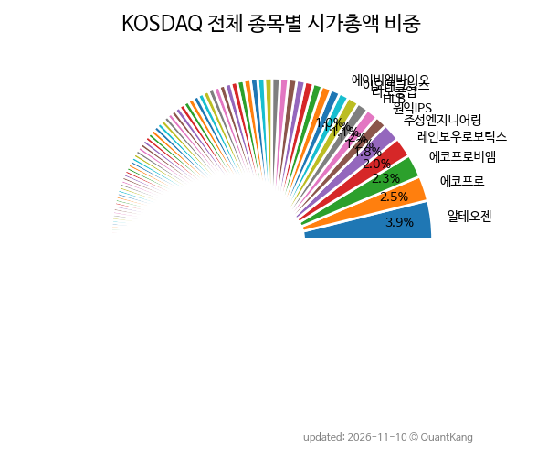

{: .align-center}

> **종목 목록 (1822)**

| **종목** | **PER** | **PBR** | **DIV** | **비중** |
| :------- | ------: | ------: | ------: | -------: |
| [알테오젠](/196170/) | 86.3 | 27.7 | 0.2<small>%</small> | 3.9<small>%</small> |
| [에코프로](/086520/) | - | 5.0 | 0.2<small>%</small> | 2.5<small>%</small> |
| [에코프로비엠](/247540/) | 228.7 | 5.2 | 0.1<small>%</small> | 2.3<small>%</small> |
| [레인보우로보틱스](/277810/) | 4979.4 | 52.7 | - | 2.0<small>%</small> |
| [주성엔지니어링](/036930/) | 220.9 | 13.3 | 0.0<small>%</small> | 1.8<small>%</small> |
| [원익IPS](/240810/) | 45.0 | 3.9 | 0.3<small>%</small> | 1.2<small>%</small> |
| [HLB](/028300/) | - | 9.0 | - | 1.2<small>%</small> |
| [리노공업](/058470/) | 25.8 | 5.4 | 1.6<small>%</small> | 1.1<small>%</small> |
| [이오테크닉스](/039030/) | 76.2 | 6.4 | 0.3<small>%</small> | 1.1<small>%</small> |
| [에이비엘바이오](/298380/) | - | 14.5 | - | 1.0<small>%</small> |
| [펩트론](/087010/) | - | 15.2 | - | 0.9<small>%</small> |
| [파마리서치](/214450/) | 15.8 | 4.2 | 1.5<small>%</small> | 0.9<small>%</small> |
| [삼천당제약](/000250/) | 792.0 | 15.1 | 0.0<small>%</small> | 0.9<small>%</small> |
| [심텍](/222800/) | - | 8.1 | 0.1<small>%</small> | 0.8<small>%</small> |
| [로보티즈](/108490/) | 631.2 | 11.2 | - | 0.8<small>%</small> |
| [리가켐바이오](/141080/) | - | 4.5 | - | 0.8<small>%</small> |
| [HPSP](/403870/) | 45.2 | 10.7 | 1.2<small>%</small> | 0.8<small>%</small> |
| [피에스케이](/319660/) | 36.1 | 5.3 | 0.7<small>%</small> | 0.8<small>%</small> |
| [ISC](/095340/) | 55.0 | 5.8 | 0.6<small>%</small> | 0.7<small>%</small> |
| [실리콘투](/257720/) | 8.7 | 3.4 | 1.3<small>%</small> | 0.7<small>%</small> |
| 파두 | - | 91.6 | - | 0.7<small>%</small> |
| [휴젤](/145020/) | 14.7 | 2.2 | - | 0.7<small>%</small> |
| [유진테크](/084370/) | 42.0 | 3.9 | 0.3<small>%</small> | 0.7<small>%</small> |
| [보로노이](/310210/) | - | 19.6 | - | 0.6<small>%</small> |
| [케어젠](/214370/) | 68.5 | 6.5 | 1.6<small>%</small> | 0.6<small>%</small> |
| [테스](/095610/) | 27.2 | 4.0 | 1.0<small>%</small> | 0.6<small>%</small> |
| [현대무벡스](/319400/) | 150.8 | 10.7 | 0.3<small>%</small> | 0.6<small>%</small> |
| [솔브레인](/357780/) | 28.8 | 2.1 | 0.8<small>%</small> | 0.6<small>%</small> |
| [제주반도체](/080220/) | 51.2 | 8.9 | - | 0.6<small>%</small> |
| [티씨케이](/064760/) | 30.5 | 4.0 | 0.8<small>%</small> | 0.6<small>%</small> |
| [티에스이](/131290/) | 71.0 | 7.1 | 0.2<small>%</small> | 0.6<small>%</small> |
| [디앤디파마텍](/347850/) | - | 22.3 | - | 0.6<small>%</small> |
| [하나마이크론](/067310/) | 45.5 | 4.8 | 0.2<small>%</small> | 0.5<small>%</small> |
| [피에스케이홀딩스](/031980/) | 35.6 | 6.4 | 0.7<small>%</small> | 0.5<small>%</small> |
| [서진시스템](/178320/) | - | 2.4 | - | 0.5<small>%</small> |
| [에스피지](/058610/) | 172.1 | 6.1 | 0.3<small>%</small> | 0.5<small>%</small> |
| [클래시스](/214150/) | 11.8 | 2.8 | 4.2<small>%</small> | 0.5<small>%</small> |
| [동진쎄미켐](/005290/) | 19.1 | 1.8 | 1.8<small>%</small> | 0.5<small>%</small> |
| [에스티팜](/237690/) | 26.5 | 2.5 | 0.7<small>%</small> | 0.5<small>%</small> |
| [올릭스](/226950/) | - | 12.0 | - | 0.5<small>%</small> |
| [우리기술](/032820/) | 1706.0 | 11.3 | - | 0.5<small>%</small> |
| [펄어비스](/263750/) | - | 2.1 | - | 0.5<small>%</small> |
| [고영](/098460/) | 111.2 | 4.9 | 0.6<small>%</small> | 0.4<small>%</small> |
| 메지온 | - | 117.3 | - | 0.4<small>%</small> |
| 대한광통신 | - | 27.5 | - | 0.4<small>%</small> |
| [셀트리온제약](/068760/) | 47.0 | 4.2 | 0.5<small>%</small> | 0.4<small>%</small> |
| [파크시스템스](/140860/) | 42.8 | 6.6 | 0.2<small>%</small> | 0.4<small>%</small> |
| [테크윙](/089030/) | 146.8 | 6.4 | 0.3<small>%</small> | 0.4<small>%</small> |
| 코오롱티슈진 | - | - | - | 0.4<small>%</small> |
| [비에이치아이](/083650/) | 18.2 | 6.7 | - | 0.4<small>%</small> |
| [에스엠](/041510/) | 5.1 | 1.8 | 2.1<small>%</small> | 0.4<small>%</small> |
| [LS마린솔루션](/060370/) | 118.6 | 2.1 | 0.6<small>%</small> | 0.4<small>%</small> |
| [씨젠](/096530/) | 23.5 | 1.1 | 4.1<small>%</small> | 0.4<small>%</small> |
| [에임드바이오](/0009K0/) | 169.5 | 6.1 | - | 0.4<small>%</small> |
| [네이처셀](/007390/) | - | 22.1 | - | 0.3<small>%</small> |
| [브이엠](/089970/) | 36.3 | 6.0 | - | 0.3<small>%</small> |
| [원익홀딩스](/030530/) | 87.3 | 2.4 | - | 0.3<small>%</small> |
| [두산테스나](/131970/) | 975.6 | 3.4 | 0.2<small>%</small> | 0.3<small>%</small> |
| [태성](/323280/) | - | 11.7 | - | 0.3<small>%</small> |
| [코스메카코리아](/241710/) | 21.4 | 3.8 | 0.4<small>%</small> | 0.3<small>%</small> |
| [코미코](/183300/) | 20.5 | 3.8 | 2.7<small>%</small> | 0.3<small>%</small> |
| [오스코텍](/039200/) | 26.2 | 7.5 | - | 0.3<small>%</small> |
| [JYP Ent.](/035900/) | 9.0 | 2.3 | 2.0<small>%</small> | 0.3<small>%</small> |
| [비츠로셀](/082920/) | 16.1 | 2.8 | 1.3<small>%</small> | 0.3<small>%</small> |
| [엘앤씨바이오](/290650/) | - | 5.1 | 0.2<small>%</small> | 0.3<small>%</small> |
| [오름테라퓨틱](/475830/) | - | 2.4 | - | 0.3<small>%</small> |
| [기가비스](/420770/) | 64.6 | 4.7 | 1.0<small>%</small> | 0.3<small>%</small> |
| [성호전자](/043260/) | 17.4 | 6.6 | - | 0.3<small>%</small> |
| [대주전자재료](/078600/) | 64.0 | 5.3 | 0.1<small>%</small> | 0.3<small>%</small> |
| [RFHIC](/218410/) | 48.3 | 4.1 | 0.7<small>%</small> | 0.3<small>%</small> |
| 제이에스링크 | - | 8.6 | - | 0.3<small>%</small> |
| 스피어 | 3200.0 | 10.8 | - | 0.3<small>%</small> |
| [하림지주](/003380/) | 4.7 | 0.3 | 1.1<small>%</small> | 0.3<small>%</small> |
| [HK이노엔](/195940/) | 13.4 | 0.8 | 1.1<small>%</small> | 0.3<small>%</small> |
| [제이앤티씨](/204270/) | - | 4.5 | - | 0.2<small>%</small> |
| [하나머티리얼즈](/166090/) | 23.8 | 2.0 | 0.6<small>%</small> | 0.2<small>%</small> |
| [삼현](/437730/) | 153.3 | 11.3 | 0.1<small>%</small> | 0.2<small>%</small> |
| 큐리언트 | - | 16.8 | - | 0.2<small>%</small> |
| [SFA반도체](/036540/) | - | 3.1 | - | 0.2<small>%</small> |
| [카카오게임즈](/293490/) | - | 0.9 | - | 0.2<small>%</small> |
| [에스앤에스텍](/101490/) | 13.5 | 2.6 | 0.5<small>%</small> | 0.2<small>%</small> |
| [SFA](/056190/) | 12.8 | 0.8 | 3.9<small>%</small> | 0.2<small>%</small> |
| 알지노믹스 | - | 9.5 | - | 0.2<small>%</small> |
| 리브스메드 | - | 4.6 | - | 0.2<small>%</small> |
| [와이씨](/232140/) | 54.2 | 2.9 | - | 0.2<small>%</small> |
| 인바디 | 16.0 | 1.6 | 1.6<small>%</small> | 0.2<small>%</small> |
| 동국제약 | 16.1 | 1.6 | 0.8<small>%</small> | 0.2<small>%</small> |
| 씨어스 | 33.0 | 13.5 | - | 0.2<small>%</small> |
| [유일로보틱스](/388720/) | - | 7.1 | - | 0.2<small>%</small> |
| 지엔씨에너지 | 14.5 | 2.8 | 0.4<small>%</small> | 0.2<small>%</small> |
| [휴림로봇](/090710/) | - | 4.4 | - | 0.2<small>%</small> |
| GST | 16.7 | 2.5 | 1.5<small>%</small> | 0.2<small>%</small> |
| [덕산네오룩스](/213420/) | 9.9 | 1.2 | - | 0.2<small>%</small> |
| 에스에이엠티 | 10.3 | 1.6 | 2.9<small>%</small> | 0.2<small>%</small> |
| 인제니아테라퓨틱스(Reg.S) | - | - | - | 0.2<small>%</small> |
| [솔브레인홀딩스](/036830/) | 1.6 | 0.5 | 1.2<small>%</small> | 0.2<small>%</small> |
| [삼표시멘트](/038500/) | 14.6 | 0.8 | 2.2<small>%</small> | 0.2<small>%</small> |
| 샘씨엔에스 | 63.1 | 5.8 | - | 0.2<small>%</small> |
| [미래에셋벤처투자](/100790/) | 21.6 | 1.8 | - | 0.2<small>%</small> |
| [신성델타테크](/065350/) | 39.1 | 3.4 | 0.4<small>%</small> | 0.2<small>%</small> |
| [차바이오텍](/085660/) | - | 2.0 | - | 0.2<small>%</small> |
| [로보스타](/090360/) | - | 6.2 | - | 0.2<small>%</small> |
| [쎄트렉아이](/099320/) | 44.8 | 2.8 | 0.2<small>%</small> | 0.2<small>%</small> |
| [레이크머티리얼즈](/281740/) | 94.1 | 5.4 | 0.3<small>%</small> | 0.2<small>%</small> |
| [아이티센글로벌](/124500/) | 9.0 | 3.4 | - | 0.2<small>%</small> |
| [다우데이타](/032190/) | 2.9 | 0.4 | 3.4<small>%</small> | 0.2<small>%</small> |
| [큐리옥스바이오시스템즈](/445680/) | - | 15.1 | - | 0.2<small>%</small> |
| [제룡전기](/033100/) | 10.1 | 2.5 | 3.0<small>%</small> | 0.2<small>%</small> |
| [펌텍코리아](/251970/) | 26.6 | 3.1 | 0.6<small>%</small> | 0.2<small>%</small> |
| 티엘비 | 46.6 | 7.0 | 1.0<small>%</small> | 0.2<small>%</small> |
| [LS머트리얼즈](/417200/) | 1676.7 | 3.7 | 0.2<small>%</small> | 0.2<small>%</small> |
| [와이지엔터테인먼트](/122870/) | 22.1 | 1.6 | 0.7<small>%</small> | 0.2<small>%</small> |
| 케이아이엔엑스 | 49.5 | 4.2 | 0.3<small>%</small> | 0.2<small>%</small> |
| 동운아나텍 | 386.5 | 5.9 | 0.8<small>%</small> | 0.2<small>%</small> |
| [CJ ENM](/035760/) | 28.1 | 0.3 | - | 0.2<small>%</small> |
| [원익QnC](/074600/) | 33.9 | 1.6 | 0.5<small>%</small> | 0.2<small>%</small> |
| [클로봇](/466100/) | - | 7.5 | - | 0.2<small>%</small> |
| [루닛](/328130/) | - | 6.8 | - | 0.2<small>%</small> |
| 코미팜 | - | 8.7 | - | 0.2<small>%</small> |
| [인텔리안테크](/189300/) | 70.2 | 1.9 | 0.4<small>%</small> | 0.2<small>%</small> |
| 씨엠티엑스 | - | 1.9 | - | 0.2<small>%</small> |
| [피엔티](/137400/) | 8.2 | 1.0 | 0.8<small>%</small> | 0.1<small>%</small> |
| 온코닉테라퓨틱스 | 35.0 | 7.8 | - | 0.1<small>%</small> |
| [선익시스템](/171090/) | 7.4 | 5.0 | 1.2<small>%</small> | 0.1<small>%</small> |
| [서부T&D](/006730/) | 8.1 | 0.6 | 1.0<small>%</small> | 0.1<small>%</small> |
| [현대바이오](/048410/) | - | 5.3 | - | 0.1<small>%</small> |
| 이엔에프테크놀로지 | 11.9 | 1.4 | 0.5<small>%</small> | 0.1<small>%</small> |
| 예스티 | - | 3.9 | - | 0.1<small>%</small> |
| [스튜디오드래곤](/253450/) | 67.3 | 0.9 | - | 0.1<small>%</small> |
| [케이엠더블유](/032500/) | - | 5.8 | - | 0.1<small>%</small> |
| [안랩](/053800/) | 19.6 | 2.7 | 1.2<small>%</small> | 0.1<small>%</small> |
| 지투지바이오 | - | 9.8 | - | 0.1<small>%</small> |
| [필옵틱스](/161580/) | - | 5.2 | - | 0.1<small>%</small> |
| [성광벤드](/014620/) | 16.1 | 1.0 | 1.0<small>%</small> | 0.1<small>%</small> |
| 가비아 | 40.0 | 3.6 | 0.2<small>%</small> | 0.1<small>%</small> |
| [넥슨게임즈](/225570/) | - | 1.9 | - | 0.1<small>%</small> |
| RF머트리얼즈 | 68.9 | 9.5 | - | 0.1<small>%</small> |
| [SFA넥셀](/222080/) | 19.2 | 1.1 | - | 0.1<small>%</small> |
| 미코 | 24.1 | 6.2 | - | 0.1<small>%</small> |
| [코나아이](/052400/) | 5.2 | 1.5 | 6.6<small>%</small> | 0.1<small>%</small> |
| [나노신소재](/121600/) | 546.3 | 3.6 | 0.3<small>%</small> | 0.1<small>%</small> |
| [NHN KCP](/060250/) | 9.4 | 1.4 | 2.2<small>%</small> | 0.1<small>%</small> |
| 하이젠알앤엠 | - | 4.2 | - | 0.1<small>%</small> |
| 태웅 | 80.1 | 0.7 | - | 0.1<small>%</small> |
| 앱클론 | - | 7.8 | - | 0.1<small>%</small> |
| [쏠리드](/050890/) | 14.1 | 1.5 | 0.6<small>%</small> | 0.1<small>%</small> |
| [에이치브이엠](/295310/) | 49.2 | 6.9 | - | 0.1<small>%</small> |
| 에이프릴바이오 | - | 2.9 | - | 0.1<small>%</small> |
| 서울반도체 | - | 0.8 | - | 0.1<small>%</small> |
| 와이지-원 | 13.3 | 0.8 | 1.9<small>%</small> | 0.1<small>%</small> |
| [아난티](/025980/) | - | 0.5 | - | 0.1<small>%</small> |
| [가온칩스](/399720/) | - | 8.2 | - | 0.1<small>%</small> |
| 프로텍 | 13.1 | 1.8 | 0.6<small>%</small> | 0.1<small>%</small> |
| [인카금융서비스](/211050/) | 6.9 | 2.3 | 3.6<small>%</small> | 0.1<small>%</small> |
| 에스티큐브 | - | 5.8 | - | 0.1<small>%</small> |
| [위메이드](/112040/) | - | 1.2 | 2.1<small>%</small> | 0.1<small>%</small> |
| 태광 | 9.7 | 1.0 | 2.2<small>%</small> | 0.1<small>%</small> |
| 삼지전자 | 5.4 | 0.8 | 2.0<small>%</small> | 0.1<small>%</small> |
| 한양이엔지 | 10.5 | 0.7 | - | 0.1<small>%</small> |
| 티에프이 | 57.2 | 9.7 | - | 0.1<small>%</small> |
| 아이센스 | - | 1.1 | 0.8<small>%</small> | 0.1<small>%</small> |
| [동성화인텍](/033500/) | 6.3 | 1.4 | 3.4<small>%</small> | 0.1<small>%</small> |
| [우리기술투자](/041190/) | 3.2 | 0.5 | - | 0.1<small>%</small> |
| [지아이이노베이션](/358570/) | - | 3.9 | - | 0.1<small>%</small> |
| 메디톡스 | 30.2 | 1.1 | 1.7<small>%</small> | 0.1<small>%</small> |
| [에프에스티](/036810/) | - | 2.1 | - | 0.1<small>%</small> |
| 마키나락스 | - | 14.0 | - | 0.1<small>%</small> |
| 세미파이브 | - | 1.9 | - | 0.1<small>%</small> |
| 현대힘스 | 15.7 | 1.3 | 1.4<small>%</small> | 0.1<small>%</small> |
| 로킷헬스케어 | - | 23.3 | - | 0.1<small>%</small> |
| [포스코엠텍](/009520/) | 320.6 | 4.0 | 0.1<small>%</small> | 0.1<small>%</small> |
| [성우하이텍](/015750/) | 2.5 | 0.2 | 3.7<small>%</small> | 0.1<small>%</small> |
| 피노 | - | 4.2 | - | 0.1<small>%</small> |
| 에코프로에이치엔 | 37.0 | 1.6 | 0.9<small>%</small> | 0.1<small>%</small> |
| 월덱스 | 10.8 | 1.3 | 0.4<small>%</small> | 0.1<small>%</small> |
| 한국기업평가 | 17.6 | 3.4 | 8.0<small>%</small> | 0.1<small>%</small> |
| [네오셈](/253590/) | 129.4 | 5.8 | 0.6<small>%</small> | 0.1<small>%</small> |
| [유진로봇](/056080/) | - | 11.4 | - | 0.1<small>%</small> |
| [젬백스](/082270/) | - | 6.2 | - | 0.1<small>%</small> |
| 비나텍 | - | 7.6 | - | 0.1<small>%</small> |
| 서희건설 | 3.3 | 0.4 | 4.5<small>%</small> | 0.1<small>%</small> |
| HLB이노베이션 | - | 1.8 | - | 0.1<small>%</small> |
| [아이쓰리시스템](/214430/) | 23.0 | 3.2 | 0.7<small>%</small> | 0.1<small>%</small> |
| 코스모로보틱스 | - | 7.4 | - | 0.1<small>%</small> |
| 파이버프로 | 36.9 | 7.5 | 0.8<small>%</small> | 0.1<small>%</small> |
| [SOOP](/067160/) | 3.8 | 0.8 | 9.4<small>%</small> | 0.1<small>%</small> |
| [디어유](/376300/) | 26.3 | 2.3 | 1.5<small>%</small> | 0.1<small>%</small> |
| [브이티](/018290/) | 5.6 | 1.4 | - | 0.1<small>%</small> |
| 뉴파워프라즈마 | 67.4 | 2.0 | 0.3<small>%</small> | 0.1<small>%</small> |
| 성일하이텍 | - | 2.6 | - | 0.1<small>%</small> |
| 덕산하이메탈 | - | 1.7 | - | 0.1<small>%</small> |
| 네패스 | 29.0 | 3.9 | - | 0.1<small>%</small> |
| PS일렉트로닉스 | 14.8 | 2.6 | - | 0.1<small>%</small> |
| 인텍플러스 | - | 14.5 | - | 0.1<small>%</small> |
| 원익머트리얼즈 | 9.3 | 0.9 | 1.4<small>%</small> | 0.1<small>%</small> |
| [천보](/278280/) | - | 0.8 | - | 0.1<small>%</small> |
| [한컴](/030520/) | 10.0 | 0.9 | 2.8<small>%</small> | 0.1<small>%</small> |
| 원텍 | 9.1 | 2.0 | 1.4<small>%</small> | 0.1<small>%</small> |
| [한라캐스트](/125490/) | 76.0 | 3.4 | - | 0.1<small>%</small> |
| 타이거일렉 | 135.7 | 12.3 | - | 0.1<small>%</small> |
| 프로티나 | - | 22.4 | - | 0.1<small>%</small> |
| 노타 | - | 10.3 | - | 0.1<small>%</small> |
| 국일제지 | - | 3.4 | - | 0.1<small>%</small> |
| 아주IB투자 | 36.6 | 1.1 | 2.7<small>%</small> | 0.1<small>%</small> |
| [이녹스첨단소재](/272290/) | 5.2 | 0.8 | 2.2<small>%</small> | 0.1<small>%</small> |
| [카페24](/042000/) | 8.9 | 1.3 | - | 0.1<small>%</small> |
| 슈프리마 | 11.8 | 1.4 | - | 0.1<small>%</small> |
| 서울바이오시스 | - | 3.9 | - | 0.1<small>%</small> |
| [엔켐](/348370/) | - | 0.8 | - | 0.1<small>%</small> |
| 토모큐브 | - | 8.7 | - | 0.1<small>%</small> |
| 다날 | - | 0.9 | - | 0.1<small>%</small> |
| [네오위즈](/095660/) | 6.5 | 0.6 | 1.8<small>%</small> | 0.1<small>%</small> |
| [컴투스](/078340/) | 8.5 | 0.3 | 4.8<small>%</small> | 0.1<small>%</small> |
| [위메이드맥스](/101730/) | - | 0.7 | - | 0.1<small>%</small> |
| 메카로 | 23.8 | 1.5 | 1.1<small>%</small> | 0.1<small>%</small> |
| 인벤티지랩 | - | 3.9 | - | 0.1<small>%</small> |
| 엘티씨 | 60.1 | 2.4 | 0.3<small>%</small> | 0.1<small>%</small> |
| [메가스터디교육](/215200/) | 5.1 | 0.9 | 7.3<small>%</small> | 0.1<small>%</small> |
| 코세스 | 42.8 | 7.6 | - | 0.1<small>%</small> |
| LS증권 | 16.6 | 0.4 | 8.1<small>%</small> | 0.1<small>%</small> |
| [시노펙스](/025320/) | 42.3 | 1.8 | - | 0.1<small>%</small> |
| 네오팜 | 12.1 | 1.7 | 3.5<small>%</small> | 0.1<small>%</small> |
| 켐트로닉스 | 29.5 | 1.4 | 1.1<small>%</small> | 0.1<small>%</small> |
| HLB생명과학 | - | 1.0 | - | 0.1<small>%</small> |
| 에이스침대 | 6.0 | 0.5 | 7.2<small>%</small> | 0.1<small>%</small> |
| [큐렉소](/060280/) | 100.3 | 2.9 | - | 0.1<small>%</small> |
| 큐로셀 | - | 64.1 | - | 0.1<small>%</small> |
| 하이록코리아 | 7.2 | 0.8 | 4.5<small>%</small> | 0.1<small>%</small> |
| 오킨스전자 | 58.8 | 10.0 | - | 0.1<small>%</small> |
| [넥스틴](/348210/) | - | 1.9 | 1.9<small>%</small> | 0.1<small>%</small> |
| [동화기업](/025900/) | - | 0.3 | - | 0.1<small>%</small> |
| 한솔아이원스 | 9.7 | 1.3 | - | 0.1<small>%</small> |
| [감성코퍼레이션](/036620/) | 9.2 | 2.4 | - | 0.1<small>%</small> |
| [웹젠](/069080/) | 14.6 | 0.5 | 5.8<small>%</small> | 0.1<small>%</small> |
| 메디포스트 | - | 1.3 | - | 0.1<small>%</small> |
| 에이디테크놀로지 | 73.2 | 1.9 | - | 0.1<small>%</small> |
| 글로벌텍스프리 | 11.0 | 2.8 | - | 0.1<small>%</small> |
| 툴젠 | - | 4.8 | - | 0.1<small>%</small> |
| 엠케이전자 | 190.8 | 0.7 | 1.0<small>%</small> | 0.1<small>%</small> |
| 골프존홀딩스 | 14.3 | 0.5 | 2.9<small>%</small> | 0.1<small>%</small> |
| 마이크로컨텍솔 | 25.5 | 5.3 | 0.2<small>%</small> | 0.1<small>%</small> |
| 엑스게이트 | 100.5 | 8.1 | - | 0.1<small>%</small> |
| 한양디지텍 | 27.2 | 2.4 | - | 0.1<small>%</small> |
| 보성파워텍 | 11.1 | 2.0 | - | 0.1<small>%</small> |
| 한국피아이엠 | - | 4.4 | - | 0.1<small>%</small> |
| 유바이오로직스 | 7.1 | 1.7 | - | 0.1<small>%</small> |
| 디케이티 | 23.4 | 2.7 | - | 0.1<small>%</small> |
| 엔젤로보틱스 | - | 8.0 | - | 0.1<small>%</small> |
| 나이스정보통신 | 8.1 | 0.9 | 2.8<small>%</small> | 0.1<small>%</small> |
| 에스티아이 | 24.1 | 1.3 | 0.6<small>%</small> | 0.1<small>%</small> |
| 신라젠 | - | 2.4 | - | 0.1<small>%</small> |
| 매커스 | 9.9 | 1.8 | 4.6<small>%</small> | 0.1<small>%</small> |
| 인화정공 | 11.8 | 0.9 | 4.6<small>%</small> | 0.1<small>%</small> |
| 뉴로메카 | - | 19.3 | - | 0.1<small>%</small> |
| 네패스아크 | 73.9 | 1.5 | - | 0.1<small>%</small> |
| 제우스 | - | 1.0 | 0.5<small>%</small> | 0.1<small>%</small> |
| 지노믹트리 | - | 1.9 | - | 0.1<small>%</small> |
| 휴온스 | 4.3 | 0.5 | 5.9<small>%</small> | 0.1<small>%</small> |
| 한중엔시에스 | 94.6 | 4.1 | - | 0.1<small>%</small> |
| 한라IMS | 8.3 | 1.1 | 4.9<small>%</small> | 0.1<small>%</small> |
| 디아이티 | 8.1 | 1.0 | 3.2<small>%</small> | 0.1<small>%</small> |
| 인투셀 | - | 7.8 | - | 0.1<small>%</small> |
| [씨앤씨인터내셔널](/352480/) | 13.4 | 0.7 | - | 0.1<small>%</small> |
| 더블유씨피 | - | 0.3 | - | 0.1<small>%</small> |
| 티로보틱스 | - | 5.0 | - | 0.1<small>%</small> |
| 한국정보통신 | 7.5 | 0.8 | 3.8<small>%</small> | 0.1<small>%</small> |
| 오이솔루션 | - | 3.9 | - | 0.1<small>%</small> |
| 파인엠텍 | - | 1.5 | - | 0.1<small>%</small> |
| HEM파마 | - | 30.8 | - | 0.1<small>%</small> |
| 마녀공장 | 24.9 | 1.9 | - | 0.1<small>%</small> |
| 아스플로 | - | 10.8 | - | 0.1<small>%</small> |
| 빛과전자 | - | 3.8 | - | 0.1<small>%</small> |
| GRT | - | - | - | 0.1<small>%</small> |
| 휴온스글로벌 | 8.2 | 0.4 | 4.5<small>%</small> | 0.1<small>%</small> |
| 삼양엔씨켐 | 15.1 | 1.9 | - | 0.1<small>%</small> |
| AP시스템 | 10.2 | 0.7 | 2.1<small>%</small> | 0.1<small>%</small> |
| 제이브이엠 | 10.3 | 1.2 | 2.6<small>%</small> | 0.1<small>%</small> |
| 이지홀딩스 | 10.1 | 0.4 | 32.5<small>%</small> | 0.1<small>%</small> |
| 바텍 | 6.3 | 0.5 | 1.8<small>%</small> | 0.1<small>%</small> |
| LB세미콘 | - | 0.7 | - | 0.1<small>%</small> |
| 휴메딕스 | 4.4 | 0.8 | 4.1<small>%</small> | 0.1<small>%</small> |
| 리파인 | 24.9 | 1.1 | 1.8<small>%</small> | 0.1<small>%</small> |
| 싸이맥스 | 14.0 | 1.1 | 2.0<small>%</small> | 0.1<small>%</small> |
| 하림 | 7.3 | 0.9 | 1.5<small>%</small> | 0.1<small>%</small> |
| 엑시콘 | 86.3 | 4.1 | 0.2<small>%</small> | 0.1<small>%</small> |
| CJ프레시웨이 | 5.1 | 0.5 | 2.5<small>%</small> | 0.1<small>%</small> |
| 유니셈 | 28.5 | 1.1 | 0.9<small>%</small> | 0.1<small>%</small> |
| KG이니시스 | 5.1 | 0.5 | 6.5<small>%</small> | 0.1<small>%</small> |
| 헥토파이낸셜 | 23.7 | 1.3 | 1.3<small>%</small> | 0.1<small>%</small> |
| 파트론 | 5.7 | 0.4 | 8.0<small>%</small> | 0.1<small>%</small> |
| 펨트론 | - | 6.8 | 0.6<small>%</small> | 0.1<small>%</small> |
| 콜마비앤에이치 | - | 0.6 | 1.1<small>%</small> | 0.1<small>%</small> |
| 저스템 | 69.5 | 4.5 | - | 0.1<small>%</small> |
| 쿠콘 | 9.8 | 1.2 | 1.4<small>%</small> | 0.1<small>%</small> |
| 폰드그룹 | 6.4 | 0.9 | 7.3<small>%</small> | 0.1<small>%</small> |
| 인탑스 | 14.9 | 0.4 | 1.3<small>%</small> | 0.1<small>%</small> |
| 한국알콜 | 10.2 | 0.6 | 0.7<small>%</small> | 0.1<small>%</small> |
| 비츠로넥스텍 | - | 3.6 | - | 0.1<small>%</small> |
| 이뮨온시아 | - | 6.7 | - | 0.1<small>%</small> |
| 아이티켐 | - | 4.0 | - | 0.1<small>%</small> |
| 넥스트바이오메디컬 | - | 4.5 | - | 0.1<small>%</small> |
| 에코아이 | 146.2 | 2.1 | 0.8<small>%</small> | 0.1<small>%</small> |
| 엔케이젠바이오텍코리아 | - | 37.1 | - | 0.1<small>%</small> |
| 스맥 | - | 2.4 | - | 0.1<small>%</small> |
| 한텍 | 5.8 | 1.1 | 2.2<small>%</small> | 0.1<small>%</small> |
| 에이팩트 | 60.4 | 4.5 | - | 0.1<small>%</small> |
| 진성티이씨 | 5.8 | 0.6 | 3.5<small>%</small> | 0.1<small>%</small> |
| 매일유업 | 4.4 | 0.4 | 3.8<small>%</small> | 0.1<small>%</small> |
| HLB제약 | 54.7 | 2.0 | - | 0.1<small>%</small> |
| 비덴트 | 29.1 | 0.4 | - | 0.1<small>%</small> |
| KG에코솔루션 | 2.1 | 0.1 | 3.6<small>%</small> | 0.1<small>%</small> |
| 큐에이드 | 19.8 | 4.5 | - | 0.1<small>%</small> |
| 셀바스AI | - | 1.9 | - | 0.1<small>%</small> |
| 유진기업 | - | 0.3 | 5.1<small>%</small> | 0.1<small>%</small> |
| 베뉴지 | 1.5 | 0.3 | 2.1<small>%</small> | 0.1<small>%</small> |
| 유니슨 | - | 2.0 | - | 0.1<small>%</small> |
| 삼양컴텍 | 7.8 | 1.3 | - | 0.1<small>%</small> |
| DXVX | - | 2.2 | - | 0.1<small>%</small> |
| 아이스크림미디어 | 4.3 | 1.0 | 9.3<small>%</small> | 0.1<small>%</small> |
| 한스바이오메드 | - | 5.0 | - | 0.1<small>%</small> |
| 갤럭시아머니트리 | 20.4 | 1.4 | 1.0<small>%</small> | 0.1<small>%</small> |
| 티앤엘 | 10.8 | 2.0 | 5.8<small>%</small> | 0.1<small>%</small> |
| 에이유브랜즈 | 16.8 | 2.1 | - | 0.1<small>%</small> |
| 큐라클 | - | 4.5 | - | 0.1<small>%</small> |
| 뷰웍스 | 11.7 | 1.0 | 2.4<small>%</small> | 0.1<small>%</small> |
| 아이씨티케이 | - | 5.3 | - | 0.1<small>%</small> |
| KH바텍 | 11.2 | 0.8 | 3.5<small>%</small> | 0.1<small>%</small> |
| 에스비비테크 | - | 15.7 | - | 0.1<small>%</small> |
| 오픈엣지테크놀로지 | - | 11.9 | - | 0.1<small>%</small> |
| 바이오니아 | - | 0.8 | - | 0.1<small>%</small> |
| 케이티알파 | 5.5 | 0.8 | 5.8<small>%</small> | 0.1<small>%</small> |
| 에스바이오메딕스 | - | 26.3 | - | 0.1<small>%</small> |
| LIG아큐버 | - | 1.4 | 0.3<small>%</small> | 0.1<small>%</small> |
| 케이프 | 3.0 | 0.6 | 11.5<small>%</small> | 0.1<small>%</small> |
| 클리오 | 13.8 | 0.8 | 2.4<small>%</small> | 0.1<small>%</small> |
| 대아티아이 | 8.6 | 1.1 | - | 0.1<small>%</small> |
| KBI메탈 | - | 1.3 | - | 0.1<small>%</small> |
| 네오티스 | 52.1 | 4.1 | 1.2<small>%</small> | 0.1<small>%</small> |
| 인피니트헬스케어 | 10.3 | 1.4 | 0.9<small>%</small> | 0.1<small>%</small> |
| 상신이디피 | 153.6 | 1.9 | 0.4<small>%</small> | 0.1<small>%</small> |
| 대명에너지 | 17.2 | 1.5 | - | 0.1<small>%</small> |
| 세나테크놀로지 | 7.5 | 0.8 | - | 0.1<small>%</small> |
| 디지털대성 | 11.9 | 1.8 | 5.5<small>%</small> | 0.1<small>%</small> |
| 서호전기 | 9.5 | 2.4 | 13.8<small>%</small> | 0.1<small>%</small> |
| 피에이치에이 | 4.5 | 0.2 | 3.8<small>%</small> | 0.1<small>%</small> |
| 아이엠바이오로직스 | 105.3 | 2.3 | - | 0.1<small>%</small> |
| 에이직랜드 | - | 3.3 | - | 0.1<small>%</small> |
| 상아프론테크 | 30.4 | 1.0 | 1.5<small>%</small> | 0.1<small>%</small> |
| 제닉 | 5.9 | 2.7 | - | 0.1<small>%</small> |
| 아이엘 | - | 7.1 | - | 0.0<small>%</small> |
| JTC | - | - | - | 0.0<small>%</small> |
| 슈어소프트테크 | 21.2 | 1.7 | - | 0.0<small>%</small> |
| 미래반도체 | 13.7 | 1.8 | - | 0.0<small>%</small> |
| 바디텍메드 | 8.8 | 0.9 | 1.6<small>%</small> | 0.0<small>%</small> |
| 지놈앤컴퍼니 | - | 1.3 | - | 0.0<small>%</small> |
| 채비 | - | 2.1 | - | 0.0<small>%</small> |
| 강스템바이오텍 | - | 2.4 | - | 0.0<small>%</small> |
| 대원산업 | 2.9 | 0.4 | 2.2<small>%</small> | 0.0<small>%</small> |
| 바이오다인 | 191.7 | 3.7 | - | 0.0<small>%</small> |
| 바이넥스 | - | 1.1 | - | 0.0<small>%</small> |
| 세보엠이씨 | 5.6 | 0.7 | 3.0<small>%</small> | 0.0<small>%</small> |
| 칩스앤미디어 | 42.9 | 3.0 | 0.9<small>%</small> | 0.0<small>%</small> |
| 지씨셀 | - | 0.8 | - | 0.0<small>%</small> |
| 씨메스로보틱스 | - | 3.2 | - | 0.0<small>%</small> |
| 티엑스알로보틱스 | - | 2.3 | - | 0.0<small>%</small> |
| 골프존 | 8.2 | 0.5 | 11.4<small>%</small> | 0.0<small>%</small> |
| 강원에너지 | - | 5.8 | - | 0.0<small>%</small> |
| 덕양에너젠 | 25.9 | 2.7 | - | 0.0<small>%</small> |
| 필에너지 | - | 1.7 | - | 0.0<small>%</small> |
| 아스트 | - | 0.6 | - | 0.0<small>%</small> |
| 도우인시스 | 332.9 | 1.1 | - | 0.0<small>%</small> |
| 그래피 | - | 5.4 | - | 0.0<small>%</small> |
| 아리바이오홀딩스 | - | 1.9 | - | 0.0<small>%</small> |
| 한국캐피탈 | 2.4 | 0.3 | 5.7<small>%</small> | 0.0<small>%</small> |
| 비츠로테크 | 31.6 | 0.8 | 0.8<small>%</small> | 0.0<small>%</small> |
| SAMG엔터 | 4.2 | 1.7 | - | 0.0<small>%</small> |
| 미래나노텍 | 11.9 | 0.6 | 1.2<small>%</small> | 0.0<small>%</small> |
| 오리엔탈정공 | 8.4 | 1.3 | - | 0.0<small>%</small> |
| DSC인베스트먼트 | 12.1 | 1.7 | 0.5<small>%</small> | 0.0<small>%</small> |
| 유니테스트 | - | 2.5 | - | 0.0<small>%</small> |
| 에스엔시스 | 8.6 | 1.0 | 2.6<small>%</small> | 0.0<small>%</small> |
| 바이오플러스 | 11.9 | 1.1 | 2.3<small>%</small> | 0.0<small>%</small> |
| 우주일렉트로 | 5.9 | 0.5 | 2.2<small>%</small> | 0.0<small>%</small> |
| 옵티코어 | - | 8.9 | - | 0.0<small>%</small> |
| 드림시큐리티 | 24.0 | 1.7 | - | 0.0<small>%</small> |
| 덕산테코피아 | - | 1.6 | - | 0.0<small>%</small> |
| 사피엔반도체 | - | 16.8 | - | 0.0<small>%</small> |
| 코텍 | 3.9 | 0.3 | 3.4<small>%</small> | 0.0<small>%</small> |
| 이지바이오 | 6.0 | 1.6 | 5.0<small>%</small> | 0.0<small>%</small> |
| 아스테라시스 | 20.0 | 4.0 | 2.1<small>%</small> | 0.0<small>%</small> |
| 금화피에스시 | 5.8 | 0.5 | 5.3<small>%</small> | 0.0<small>%</small> |
| 와이씨켐 | 36.5 | 3.4 | - | 0.0<small>%</small> |
| 이노스페이스 | - | 3.4 | - | 0.0<small>%</small> |
| 심텍홀딩스 | - | 11.9 | 0.2<small>%</small> | 0.0<small>%</small> |
| 삼목에스폼 | 20.7 | 0.3 | 2.0<small>%</small> | 0.0<small>%</small> |
| 메가터치 | - | 2.9 | - | 0.0<small>%</small> |
| 신성에스티 | 380.6 | 2.0 | 0.8<small>%</small> | 0.0<small>%</small> |
| 코오롱생명과학 | 6.0 | 0.3 | - | 0.0<small>%</small> |
| 노바렉스 | 4.3 | 0.6 | 4.7<small>%</small> | 0.0<small>%</small> |
| 케이엔제이 | 7.5 | 2.0 | - | 0.0<small>%</small> |
| 오로라 | 5.9 | 0.7 | 4.5<small>%</small> | 0.0<small>%</small> |
| 동원개발 | 6.8 | 0.2 | 4.5<small>%</small> | 0.0<small>%</small> |
| 알멕 | - | 1.5 | - | 0.0<small>%</small> |
| 솔트룩스 | - | 2.1 | - | 0.0<small>%</small> |
| 엠로 | 54.9 | 1.7 | - | 0.0<small>%</small> |
| 비보존 제약 | - | 2.2 | - | 0.0<small>%</small> |
| 나우로보틱스 | - | 8.8 | - | 0.0<small>%</small> |
| 네오위즈홀딩스 | 3.4 | 0.3 | 2.7<small>%</small> | 0.0<small>%</small> |
| 티이엠씨 | 17.9 | 1.4 | 1.1<small>%</small> | 0.0<small>%</small> |
| 압타바이오 | - | 2.7 | - | 0.0<small>%</small> |
| 한선엔지니어링 | 24.1 | 3.2 | - | 0.0<small>%</small> |
| 한국정보인증 | 8.4 | 1.1 | 3.6<small>%</small> | 0.0<small>%</small> |
| 아이티엠반도체 | - | 1.1 | - | 0.0<small>%</small> |
| KZ정밀 | 18.3 | 0.3 | 7.4<small>%</small> | 0.0<small>%</small> |
| 나이벡 | 30.9 | 3.2 | - | 0.0<small>%</small> |
| 대화제약 | 101.0 | 2.3 | 1.6<small>%</small> | 0.0<small>%</small> |
| 제테마 | - | 3.3 | - | 0.0<small>%</small> |
| 현대사료 | 43.2 | 2.5 | - | 0.0<small>%</small> |
| [데브시스터즈](/194480/) | 10.8 | 0.7 | - | 0.0<small>%</small> |
| 에프앤가이드 | 14.8 | 2.1 | 2.0<small>%</small> | 0.0<small>%</small> |
| 신흥에스이씨 | - | 0.7 | - | 0.0<small>%</small> |
| HLB테라퓨틱스 | - | 1.4 | - | 0.0<small>%</small> |
| 페니트리움바이오 | - | 16.3 | - | 0.0<small>%</small> |
| 해성산업 | - | 0.2 | 4.5<small>%</small> | 0.0<small>%</small> |
| 우리로 | - | 7.6 | - | 0.0<small>%</small> |
| 헥토이노베이션 | 5.6 | 0.8 | 3.7<small>%</small> | 0.0<small>%</small> |
| 국보디자인 | 3.6 | 0.5 | 2.3<small>%</small> | 0.0<small>%</small> |
| 티쓰리 | 8.8 | 1.5 | 5.2<small>%</small> | 0.0<small>%</small> |
| 더즌 | 11.0 | 1.9 | 1.6<small>%</small> | 0.0<small>%</small> |
| 사람인 | 1.7 | 0.6 | 4.6<small>%</small> | 0.0<small>%</small> |
| 퓨쳐켐 | - | 3.2 | - | 0.0<small>%</small> |
| 석경에이티 | 44.2 | 3.8 | - | 0.0<small>%</small> |
| 아이텍 | - | 1.0 | - | 0.0<small>%</small> |
| 코메론 | 8.7 | 0.8 | 3.2<small>%</small> | 0.0<small>%</small> |
| 듀켐바이오 | 23.4 | 3.1 | - | 0.0<small>%</small> |
| 나무가 | 8.3 | 1.2 | 5.0<small>%</small> | 0.0<small>%</small> |
| HB테크놀러지 | 5.9 | 0.6 | 1.1<small>%</small> | 0.0<small>%</small> |
| 티씨머티리얼즈 | 79.8 | 1.8 | - | 0.0<small>%</small> |
| 이랜시스 | 33.6 | 2.6 | 1.1<small>%</small> | 0.0<small>%</small> |
| 에치에프알 | - | 0.9 | - | 0.0<small>%</small> |
| BGF에코머티리얼즈 | 12.5 | 0.4 | 1.8<small>%</small> | 0.0<small>%</small> |
| 바이오솔루션 | 439.6 | 3.6 | - | 0.0<small>%</small> |
| 카나프테라퓨틱스 | - | 7.8 | - | 0.0<small>%</small> |
| 슈피겐코리아 | 5.4 | 0.3 | 1.9<small>%</small> | 0.0<small>%</small> |
| 아이디스 | 7.7 | 0.6 | 3.0<small>%</small> | 0.0<small>%</small> |
| 삼미금속 | 77.3 | 1.6 | - | 0.0<small>%</small> |
| 에스오에스랩 | - | 4.9 | - | 0.0<small>%</small> |
| 이랜텍 | 5.1 | 0.5 | 1.9<small>%</small> | 0.0<small>%</small> |
| 쓰리빌리언 | - | 8.6 | - | 0.0<small>%</small> |
| 재영솔루텍 | 12.1 | 1.2 | - | 0.0<small>%</small> |
| DMS | 1.1 | 0.3 | 3.8<small>%</small> | 0.0<small>%</small> |
| 엘오티베큠 | - | 0.6 | - | 0.0<small>%</small> |
| 이크레더블 | 12.8 | 3.9 | 6.2<small>%</small> | 0.0<small>%</small> |
| 에브리봇 | - | 2.5 | - | 0.0<small>%</small> |
| 스트라드비젼 | - | 4.1 | - | 0.0<small>%</small> |
| 코난테크놀로지 | - | 5.5 | - | 0.0<small>%</small> |
| EDGC | 2.0 | - | - | 0.0<small>%</small> |
| 일진파워 | 7.3 | 0.9 | 3.9<small>%</small> | 0.0<small>%</small> |
| 코스맥스엔비티 | - | 1.8 | - | 0.0<small>%</small> |
| 셀비온 | - | 6.9 | - | 0.0<small>%</small> |
| 레드캡투어 | 7.1 | 0.8 | 8.0<small>%</small> | 0.0<small>%</small> |
| 그린광학 | 43.1 | 1.6 | - | 0.0<small>%</small> |
| 모두투어 | 12.2 | 2.0 | 3.4<small>%</small> | 0.0<small>%</small> |
| 모베이스전자 | 7.3 | 0.6 | 2.0<small>%</small> | 0.0<small>%</small> |
| 지앤비에스 에코 | 25.2 | 1.4 | 2.4<small>%</small> | 0.0<small>%</small> |
| 아바코 | 5.2 | 0.7 | 4.8<small>%</small> | 0.0<small>%</small> |
| 아나패스 | 45.6 | 1.6 | 2.5<small>%</small> | 0.0<small>%</small> |
| 엠아이텍 | 6.1 | 1.0 | 3.1<small>%</small> | 0.0<small>%</small> |
| 아모텍 | 28.8 | 1.5 | - | 0.0<small>%</small> |
| 지투파워 | 24.4 | 3.2 | 1.4<small>%</small> | 0.0<small>%</small> |
| 한국비엔씨 | 52.6 | 0.7 | 3.2<small>%</small> | 0.0<small>%</small> |
| 바이오비쥬 | 51.5 | 3.7 | 0.7<small>%</small> | 0.0<small>%</small> |
| 대양전기공업 | 6.1 | 0.6 | 1.2<small>%</small> | 0.0<small>%</small> |
| 인터로조 | 13.2 | 1.1 | 4.9<small>%</small> | 0.0<small>%</small> |
| 메디아나 | 26.9 | 1.1 | - | 0.0<small>%</small> |
| 더핑크퐁컴퍼니 | 7.4 | 0.8 | - | 0.0<small>%</small> |
| 코칩 | 45.4 | 2.3 | 2.5<small>%</small> | 0.0<small>%</small> |
| 화신정공 | 9.8 | 0.8 | 2.6<small>%</small> | 0.0<small>%</small> |
| 제일일렉트릭 | 20.2 | 0.8 | 1.7<small>%</small> | 0.0<small>%</small> |
| 버킷스튜디오 | - | 1.2 | - | 0.0<small>%</small> |
| 져스텍 | - | 6.2 | - | 0.0<small>%</small> |
| 코다코 | - | - | - | 0.0<small>%</small> |
| 잉글우드랩 | - | - | - | 0.0<small>%</small> |
| 하이비젼시스템 | - | 0.5 | 0.9<small>%</small> | 0.0<small>%</small> |
| 대한약품 | 5.4 | 0.5 | 4.0<small>%</small> | 0.0<small>%</small> |
| GC메디아이 | 4.0 | 1.1 | 1.7<small>%</small> | 0.0<small>%</small> |
| 빅솔론 | 6.0 | 0.6 | 4.3<small>%</small> | 0.0<small>%</small> |
| 메가스터디 | 5.3 | 0.4 | 10.3<small>%</small> | 0.0<small>%</small> |
| 디오 | - | 0.6 | - | 0.0<small>%</small> |
| 씨이랩 | - | 2.7 | - | 0.0<small>%</small> |
| 경동제약 | 15.8 | 0.6 | 6.0<small>%</small> | 0.0<small>%</small> |
| 우양에이치씨 | - | 0.7 | - | 0.0<small>%</small> |
| 유성티엔에스 | 2.2 | 0.2 | - | 0.0<small>%</small> |
| 윤성에프앤씨 | - | 0.8 | 0.4<small>%</small> | 0.0<small>%</small> |
| KG파이낸셜 | 6.1 | 0.4 | 6.4<small>%</small> | 0.0<small>%</small> |
| 티케이케미칼 | 1.5 | 0.1 | - | 0.0<small>%</small> |
| 아이디스홀딩스 | 2.7 | 0.3 | 2.1<small>%</small> | 0.0<small>%</small> |
| 흥구석유 | 927.3 | 1.9 | 0.2<small>%</small> | 0.0<small>%</small> |
| 앤로보틱스 | 9.1 | 1.1 | - | 0.0<small>%</small> |
| 와이솔 | - | 0.6 | 7.5<small>%</small> | 0.0<small>%</small> |
| 안트로젠 | - | 1.6 | - | 0.0<small>%</small> |
| 제넥신 | - | 0.4 | - | 0.0<small>%</small> |
| 녹십자웰빙 | 15.6 | 1.4 | 1.6<small>%</small> | 0.0<small>%</small> |
| 유비쿼스 | 6.3 | 0.8 | 4.6<small>%</small> | 0.0<small>%</small> |
| 푸른저축은행 | 5.8 | 0.4 | 7.8<small>%</small> | 0.0<small>%</small> |
| 코리아에프티 | 3.1 | 0.5 | 4.1<small>%</small> | 0.0<small>%</small> |
| 코스텍시스 | - | 4.0 | - | 0.0<small>%</small> |
| 에스앤디 | 8.2 | 2.0 | 3.1<small>%</small> | 0.0<small>%</small> |
| 유비쿼스홀딩스 | 6.5 | 0.5 | 3.0<small>%</small> | 0.0<small>%</small> |
| 비엠티 | 8.2 | 1.1 | 3.6<small>%</small> | 0.0<small>%</small> |
| 디바이스 | 7.7 | 0.8 | 6.5<small>%</small> | 0.0<small>%</small> |
| 삼보판지 | 5.1 | 0.2 | 2.4<small>%</small> | 0.0<small>%</small> |
| 지어소프트 | 16.0 | 1.4 | - | 0.0<small>%</small> |
| 매드업 | 10.9 | 3.2 | - | 0.0<small>%</small> |
| 아이패밀리에스씨 | 7.5 | 1.6 | 3.1<small>%</small> | 0.0<small>%</small> |
| 큐리오시스 | - | 6.4 | - | 0.0<small>%</small> |
| 오르비텍 | 106.7 | 1.4 | - | 0.0<small>%</small> |
| 에이치엠넥스 | 12.5 | 1.0 | - | 0.0<small>%</small> |
| 애니플러스 | 8.0 | 0.9 | 4.7<small>%</small> | 0.0<small>%</small> |
| 퓨릿 | 8.7 | 1.2 | 1.6<small>%</small> | 0.0<small>%</small> |
| 폴라리스오피스 | 26.6 | 1.4 | - | 0.0<small>%</small> |
| 케이엔알시스템 | - | 7.5 | - | 0.0<small>%</small> |
| KT나스미디어 | 21.2 | 0.7 | 5.5<small>%</small> | 0.0<small>%</small> |
| 디엔에프 | 103.2 | 0.8 | 0.9<small>%</small> | 0.0<small>%</small> |
| 자람테크놀로지 | - | 1.8 | - | 0.0<small>%</small> |
| 시너지이노베이션 | 38.1 | 0.6 | - | 0.0<small>%</small> |
| 매일홀딩스 | 3.9 | 0.3 | 2.6<small>%</small> | 0.0<small>%</small> |
| 동양이엔피 | 2.3 | 0.2 | 3.0<small>%</small> | 0.0<small>%</small> |
| 범한퓨얼셀 | 84.5 | 0.8 | - | 0.0<small>%</small> |
| 이노테크 | 10.3 | 1.6 | - | 0.0<small>%</small> |
| 쎌바이오텍 | 9.2 | 0.7 | 4.4<small>%</small> | 0.0<small>%</small> |
| 텔레칩스 | - | 0.8 | - | 0.0<small>%</small> |
| 넥써쓰 | - | 3.2 | - | 0.0<small>%</small> |
| 와이바이오로직스 | - | 5.0 | - | 0.0<small>%</small> |
| 멀티캠퍼스 | 6.2 | 0.7 | 4.9<small>%</small> | 0.0<small>%</small> |
| 헬릭스미스 | - | 1.1 | - | 0.0<small>%</small> |
| 플리토 | 19.7 | 7.4 | - | 0.0<small>%</small> |
| 크레오에스지 | - | 0.9 | - | 0.0<small>%</small> |
| 나노엔텍 | 88.8 | 1.7 | - | 0.0<small>%</small> |
| 에스텍 | 4.8 | 0.8 | 3.6<small>%</small> | 0.0<small>%</small> |
| 리센스메디컬 | - | 6.0 | - | 0.0<small>%</small> |
| 인선이엔티 | - | 0.4 | - | 0.0<small>%</small> |
| 이엘씨 | 17.2 | 0.8 | 3.0<small>%</small> | 0.0<small>%</small> |
| 켄코아에어로스페이스 | - | 0.7 | - | 0.0<small>%</small> |
| 새로닉스 | - | 1.2 | - | 0.0<small>%</small> |
| 아가방컴퍼니 | 11.0 | 0.7 | - | 0.0<small>%</small> |
| 선광 | 3.0 | 0.3 | 2.4<small>%</small> | 0.0<small>%</small> |
| 그래디언트 | - | 0.3 | 1.8<small>%</small> | 0.0<small>%</small> |
| 마크로젠 | 61.8 | 0.8 | 4.3<small>%</small> | 0.0<small>%</small> |
| 에이스테크 | - | 1.8 | - | 0.0<small>%</small> |
| 안국약품 | 14.5 | 0.7 | 6.6<small>%</small> | 0.0<small>%</small> |
| 케이알엠 | - | 1.8 | - | 0.0<small>%</small> |
| 모트렉스 | 18.5 | 0.5 | - | 0.0<small>%</small> |
| 메쎄이상 | 7.2 | 1.4 | 4.6<small>%</small> | 0.0<small>%</small> |
| 나우IB | 17.9 | 1.0 | 2.0<small>%</small> | 0.0<small>%</small> |
| SG | - | 0.9 | - | 0.0<small>%</small> |
| 프레스티지바이오로직스 | - | 0.7 | - | 0.0<small>%</small> |
| 와이엠티 | - | 0.6 | - | 0.0<small>%</small> |
| 제이오 | - | 0.7 | - | 0.0<small>%</small> |
| 인터플렉스 | 4.0 | 0.4 | - | 0.0<small>%</small> |
| 동국산업 | - | 0.4 | 4.6<small>%</small> | 0.0<small>%</small> |
| 이수앱지스 | - | 1.1 | - | 0.0<small>%</small> |
| 제룡산업 | 9.5 | 1.3 | 5.3<small>%</small> | 0.0<small>%</small> |
| 코데즈컴바인 | 23.9 | 1.5 | - | 0.0<small>%</small> |
| 모다이노칩 | - | 0.3 | - | 0.0<small>%</small> |
| 링크솔루션 | - | 2.2 | - | 0.0<small>%</small> |
| 고려신용정보 | 9.2 | 2.0 | 5.7<small>%</small> | 0.0<small>%</small> |
| 에코앤드림 | - | 0.7 | - | 0.0<small>%</small> |
| 피델릭스 | - | 5.0 | - | 0.0<small>%</small> |
| 네오오토 | 7.0 | 0.8 | 2.3<small>%</small> | 0.0<small>%</small> |
| 솔본 | 6.2 | 0.7 | - | 0.0<small>%</small> |
| 씨앤지하이테크 | 5.8 | 0.8 | 4.6<small>%</small> | 0.0<small>%</small> |
| 오늘이엔엠 | - | 25.4 | - | 0.0<small>%</small> |
| 지니언스 | 39.6 | 4.8 | 0.9<small>%</small> | 0.0<small>%</small> |
| 윈스테크넷 | 7.6 | 0.8 | 6.2<small>%</small> | 0.0<small>%</small> |
| 레이언스 | - | 0.5 | 4.1<small>%</small> | 0.0<small>%</small> |
| 지씨지놈 | 46.2 | 2.6 | - | 0.0<small>%</small> |
| 나인앤컴퍼니 | 12.7 | 1.1 | 1.9<small>%</small> | 0.0<small>%</small> |
| 유니트론텍 | 9.4 | 0.9 | 2.7<small>%</small> | 0.0<small>%</small> |
| 슈프리마에이치큐 | 9.6 | 0.6 | - | 0.0<small>%</small> |
| 어보브반도체 | 10.9 | 0.9 | 3.0<small>%</small> | 0.0<small>%</small> |
| SM C&C | - | 0.9 | - | 0.0<small>%</small> |
| 코맥스 | - | 4.6 | - | 0.0<small>%</small> |
| KX | 4.7 | 0.3 | - | 0.0<small>%</small> |
| 노머스 | 7.9 | 1.1 | - | 0.0<small>%</small> |
| 엠디바이스 | 8.7 | 2.0 | - | 0.0<small>%</small> |
| 엘케이켐 | 28.5 | 2.1 | - | 0.0<small>%</small> |
| 아크릴 | - | 2.1 | - | 0.0<small>%</small> |
| 티움바이오 | - | 2.7 | - | 0.0<small>%</small> |
| 하이텍팜 | 8.0 | 0.7 | 1.7<small>%</small> | 0.0<small>%</small> |
| 알에스오토메이션 | - | 1.7 | - | 0.0<small>%</small> |
| 비씨엔씨 | 95.8 | 1.4 | - | 0.0<small>%</small> |
| 인포바인 | 10.3 | 0.7 | 2.6<small>%</small> | 0.0<small>%</small> |
| 퀄리타스반도체 | - | 3.9 | - | 0.0<small>%</small> |
| 오로스테크놀로지 | - | 1.5 | - | 0.0<small>%</small> |
| 쇼박스 | - | 0.9 | - | 0.0<small>%</small> |
| 엠에스씨 | 5.4 | 0.7 | 1.8<small>%</small> | 0.0<small>%</small> |
| 라온로보틱스 | 39.0 | 4.0 | 1.6<small>%</small> | 0.0<small>%</small> |
| SV인베스트먼트 | - | 1.9 | 0.8<small>%</small> | 0.0<small>%</small> |
| 큐알티 | 65.4 | 2.1 | 3.0<small>%</small> | 0.0<small>%</small> |
| 세경하이테크 | 2.3 | 0.7 | 3.1<small>%</small> | 0.0<small>%</small> |
| 노바텍 | 5.7 | 0.6 | 26.8<small>%</small> | 0.0<small>%</small> |
| 켐트로스 | - | 2.0 | - | 0.0<small>%</small> |
| 현대바이오랜드 | 447.5 | 0.8 | 2.0<small>%</small> | 0.0<small>%</small> |
| 라이콤 | 455.6 | 5.1 | - | 0.0<small>%</small> |
| 제이엘케이 | - | 2.4 | - | 0.0<small>%</small> |
| HB솔루션 | 3.9 | 0.4 | 2.1<small>%</small> | 0.0<small>%</small> |
| 신화프리텍 | - | 1.0 | - | 0.0<small>%</small> |
| 메쥬 | 34.7 | 12.2 | - | 0.0<small>%</small> |
| 나인테크 | - | 1.3 | - | 0.0<small>%</small> |
| 동방메디컬 | 9.8 | 0.9 | - | 0.0<small>%</small> |
| 우진엔텍 | 11.7 | 1.2 | 2.2<small>%</small> | 0.0<small>%</small> |
| KCC건설 | 2.4 | 0.2 | 3.6<small>%</small> | 0.0<small>%</small> |
| 팜스토리 | 4.0 | 0.4 | 9.2<small>%</small> | 0.0<small>%</small> |
| 제이아이테크 | 17.2 | 1.5 | 2.7<small>%</small> | 0.0<small>%</small> |
| 아진엑스텍 | 130.2 | 2.7 | - | 0.0<small>%</small> |
| 케이엔솔 | - | 0.8 | - | 0.0<small>%</small> |
| 위더스제약 | 17.2 | 0.9 | - | 0.0<small>%</small> |
| 씨피시스템 | 54.7 | 2.5 | 2.0<small>%</small> | 0.0<small>%</small> |
| 티앤알바이오팹 | - | 3.7 | - | 0.0<small>%</small> |
| 아바텍 | 19.2 | 0.9 | 2.1<small>%</small> | 0.0<small>%</small> |
| 탑코미디어 | - | 2.0 | - | 0.0<small>%</small> |
| 플래스크 | 395.0 | 2.8 | - | 0.0<small>%</small> |
| 피아이이 | - | 2.7 | - | 0.0<small>%</small> |
| 핑거 | 334.4 | 2.2 | 0.9<small>%</small> | 0.0<small>%</small> |
| 넵튠 | - | 0.3 | - | 0.0<small>%</small> |
| 컨텍 | - | 2.0 | - | 0.0<small>%</small> |
| JW신약 | 9.5 | 3.2 | - | 0.0<small>%</small> |
| AP위성 | - | 1.4 | - | 0.0<small>%</small> |
| 세아메카닉스 | 123.7 | 2.4 | - | 0.0<small>%</small> |
| 엔에프씨 | 9.5 | 1.5 | 1.1<small>%</small> | 0.0<small>%</small> |
| 일승 | 11.4 | 1.9 | - | 0.0<small>%</small> |
| 제노코 | - | 1.6 | - | 0.0<small>%</small> |
| 라온텍 | - | 5.7 | - | 0.0<small>%</small> |
| 국전 | - | 1.0 | - | 0.0<small>%</small> |
| 디에스케이 | - | 0.7 | - | 0.0<small>%</small> |
| 유아이엘 | 5.1 | 0.6 | 11.0<small>%</small> | 0.0<small>%</small> |
| 세종텔레콤 | 25.3 | 0.5 | 3.8<small>%</small> | 0.0<small>%</small> |
| 나무에이엑스 | - | 2.1 | - | 0.0<small>%</small> |
| 현대이지웰 | 4.0 | 0.8 | 5.3<small>%</small> | 0.0<small>%</small> |
| 아로마티카 | 13.0 | 1.7 | - | 0.0<small>%</small> |
| 성우 | 19.9 | 0.4 | 4.8<small>%</small> | 0.0<small>%</small> |
| 케이에스피 | 15.0 | 1.2 | 0.8<small>%</small> | 0.0<small>%</small> |
| 푸드나무 | 12.8 | 0.9 | - | 0.0<small>%</small> |
| NICE인프라 | 12.6 | 0.5 | 4.7<small>%</small> | 0.0<small>%</small> |
| 나라스페이스테크놀로지 | - | 1.9 | - | 0.0<small>%</small> |
| 고스트스튜디오 | - | - | - | 0.0<small>%</small> |
| 바이젠셀 | - | 2.1 | - | 0.0<small>%</small> |
| 성도이엔지 | 3.1 | 0.3 | 4.1<small>%</small> | 0.0<small>%</small> |
| 진로발효 | 8.9 | 1.2 | 7.7<small>%</small> | 0.0<small>%</small> |
| 아이비김영 | 4.5 | 1.3 | 13.8<small>%</small> | 0.0<small>%</small> |
| 에이럭스 | - | 1.6 | - | 0.0<small>%</small> |
| 코윈테크 | 61.0 | 0.6 | 2.2<small>%</small> | 0.0<small>%</small> |
| 그리드위즈 | 36.9 | 0.6 | - | 0.0<small>%</small> |
| 기도산업 | 1.3 | 0.3 | 18.9<small>%</small> | 0.0<small>%</small> |
| 루미르 | 1651.7 | 1.4 | - | 0.0<small>%</small> |
| 상상인 | - | 0.3 | - | 0.0<small>%</small> |
| 케이엔더블유 | - | 0.8 | - | 0.0<small>%</small> |
| 엠플러스 | 4.9 | 1.0 | 2.4<small>%</small> | 0.0<small>%</small> |
| 그린리소스 | 7.6 | 1.1 | - | 0.0<small>%</small> |
| 엠에스오토텍 | - | 0.5 | - | 0.0<small>%</small> |
| 현대에버다임 | 22.9 | 0.6 | 1.2<small>%</small> | 0.0<small>%</small> |
| 아미노로직스 | 25.0 | 1.6 | - | 0.0<small>%</small> |
| NH농우바이오 | 8.5 | 0.4 | 3.8<small>%</small> | 0.0<small>%</small> |
| 에이티넘인베스트 | 3.2 | 0.4 | 8.0<small>%</small> | 0.0<small>%</small> |
| 시지메드텍 | 13.2 | 0.9 | - | 0.0<small>%</small> |
| 아톤 | 70.0 | 1.1 | 1.1<small>%</small> | 0.0<small>%</small> |
| 킵스파마 | - | 1.6 | - | 0.0<small>%</small> |
| 삼보모터스 | 3.7 | 0.2 | 1.5<small>%</small> | 0.0<small>%</small> |
| 중앙첨단소재 | - | 0.5 | - | 0.0<small>%</small> |
| 와이엔텍 | 3.4 | 0.3 | 1.8<small>%</small> | 0.0<small>%</small> |
| 에스투더블유 | - | 4.2 | - | 0.0<small>%</small> |
| 세명전기 | 7.0 | 1.0 | 3.7<small>%</small> | 0.0<small>%</small> |
| 파워로직스 | - | 0.5 | - | 0.0<small>%</small> |
| 우림피티에스 | 39.1 | 1.1 | 0.7<small>%</small> | 0.0<small>%</small> |
| 한국경제TV | 28.3 | 0.5 | 3.1<small>%</small> | 0.0<small>%</small> |
| 파세코 | 36.4 | 1.6 | 2.2<small>%</small> | 0.0<small>%</small> |
| 한울소재과학 | - | 1.7 | - | 0.0<small>%</small> |
| 토비스 | 3.4 | 0.5 | 3.3<small>%</small> | 0.0<small>%</small> |
| 대정화금 | 7.6 | 0.6 | 3.3<small>%</small> | 0.0<small>%</small> |
| 톱텍 | - | 0.2 | 4.1<small>%</small> | 0.0<small>%</small> |
| 우리손에프앤지 | 4.3 | 0.3 | 10.2<small>%</small> | 0.0<small>%</small> |
| 코아스템켐온 | - | 1.2 | - | 0.0<small>%</small> |
| 동구바이오제약 | 1.8 | 0.6 | 3.5<small>%</small> | 0.0<small>%</small> |
| 원익 | 10.8 | 0.4 | - | 0.0<small>%</small> |
| 지오엘리먼트 | 13.9 | 1.3 | 1.0<small>%</small> | 0.0<small>%</small> |
| 워트 | 28.7 | 1.6 | 1.1<small>%</small> | 0.0<small>%</small> |
| 메타바이오메드 | 8.2 | 0.8 | 2.9<small>%</small> | 0.0<small>%</small> |
| 하나기술 | - | 0.8 | - | 0.0<small>%</small> |
| 도이치모터스 | 32.1 | 0.3 | 10.1<small>%</small> | 0.0<small>%</small> |
| 아이크래프트 | 6.5 | 1.4 | 1.8<small>%</small> | 0.0<small>%</small> |
| 케이씨에스 | 38.4 | 4.9 | 2.2<small>%</small> | 0.0<small>%</small> |
| 케이앤에스아이앤씨 | - | 2.0 | - | 0.0<small>%</small> |
| 비아트론 | 12.3 | 0.7 | 0.8<small>%</small> | 0.0<small>%</small> |
| 씨에스베어링 | 10.4 | 1.2 | - | 0.0<small>%</small> |
| 세운메디칼 | 7.8 | 0.6 | 3.2<small>%</small> | 0.0<small>%</small> |
| 스모트로닉 | - | 1.1 | - | 0.0<small>%</small> |
| 탑런토탈솔루션 | 16.1 | 0.6 | 2.8<small>%</small> | 0.0<small>%</small> |
| 뷰노 | - | 2.1 | - | 0.0<small>%</small> |
| 로체시스템즈 | 11.9 | 1.1 | 0.5<small>%</small> | 0.0<small>%</small> |
| 금강철강 | - | 0.7 | 3.2<small>%</small> | 0.0<small>%</small> |
| 레메디 | 13.0 | 5.8 | - | 0.0<small>%</small> |
| LB인베스트먼트 | 6.8 | 0.7 | 5.5<small>%</small> | 0.0<small>%</small> |
| 나노팀 | 106.0 | 2.2 | - | 0.0<small>%</small> |
| 한컴위드 | 11.2 | 0.6 | - | 0.0<small>%</small> |
| 아스타 | - | 10.0 | - | 0.0<small>%</small> |
| 엔알비 | - | 0.9 | - | 0.0<small>%</small> |
| 옵투스제약 | 8.2 | 0.6 | - | 0.0<small>%</small> |
| 다산네트웍스 | - | 0.3 | 0.9<small>%</small> | 0.0<small>%</small> |
| 서산 | - | 2.1 | - | 0.0<small>%</small> |
| 청담글로벌 | 55.0 | 1.2 | - | 0.0<small>%</small> |
| 미래컴퍼니 | - | 0.8 | - | 0.0<small>%</small> |
| 네오이뮨텍 | - | - | - | 0.0<small>%</small> |
| 씨씨에스 | - | 3.6 | - | 0.0<small>%</small> |
| 대성하이텍 | - | 1.0 | - | 0.0<small>%</small> |
| SKAI | - | 5.4 | - | 0.0<small>%</small> |
| RF시스템즈 | 16.8 | 1.8 | - | 0.0<small>%</small> |
| 더네이쳐홀딩스 | 12.5 | 0.2 | 8.5<small>%</small> | 0.0<small>%</small> |
| 오상헬스케어 | 19.5 | 0.2 | 4.5<small>%</small> | 0.0<small>%</small> |
| 야스 | - | 0.7 | - | 0.0<small>%</small> |
| 다원시스 | - | - | - | 0.0<small>%</small> |
| 셀레믹스 | - | 2.6 | - | 0.0<small>%</small> |
| 서울옥션 | - | 0.8 | - | 0.0<small>%</small> |
| 컴퍼니케이 | 10.5 | 0.9 | 3.3<small>%</small> | 0.0<small>%</small> |
| 아이앤씨 | 21.4 | 2.8 | - | 0.0<small>%</small> |
| 스톰테크 | 9.6 | 1.1 | 12.3<small>%</small> | 0.0<small>%</small> |
| YTN | - | 0.4 | - | 0.0<small>%</small> |
| 링네트 | 7.8 | 0.8 | 6.8<small>%</small> | 0.0<small>%</small> |
| 선진뷰티사이언스 | 11.7 | 0.8 | 3.5<small>%</small> | 0.0<small>%</small> |
| 엘앤케이바이오 | - | 2.3 | - | 0.0<small>%</small> |
| 에프엔에스테크 | 11.1 | 1.1 | 2.7<small>%</small> | 0.0<small>%</small> |
| 위드텍 | 13.6 | 0.7 | 2.2<small>%</small> | 0.0<small>%</small> |
| 박셀바이오 | - | 1.5 | - | 0.0<small>%</small> |
| 한일사료 | 12.5 | 0.5 | 3.7<small>%</small> | 0.0<small>%</small> |
| 디앤씨미디어 | 9.3 | 0.8 | - | 0.0<small>%</small> |
| 피에스텍 | 7.8 | 0.5 | 5.8<small>%</small> | 0.0<small>%</small> |
| 아진산업 | 3.6 | 0.2 | 4.7<small>%</small> | 0.0<small>%</small> |
| 뉴로핏 | - | 3.0 | - | 0.0<small>%</small> |
| 나노 | 8.4 | 1.4 | - | 0.0<small>%</small> |
| 동아엘텍 | 1.9 | 0.6 | 2.8<small>%</small> | 0.0<small>%</small> |
| 에이엘티 | - | 0.8 | - | 0.0<small>%</small> |
| 대림제지 | 13.4 | 0.3 | 1.0<small>%</small> | 0.0<small>%</small> |
| 와이제이링크 | - | 1.4 | - | 0.0<small>%</small> |
| 엑스페릭스 | - | 0.9 | - | 0.0<small>%</small> |
| 삼기에너지솔루션즈 | - | 1.5 | - | 0.0<small>%</small> |
| 정상제이엘에스 | 12.9 | 1.0 | 9.2<small>%</small> | 0.0<small>%</small> |
| 웹케시 | 6.5 | 0.7 | 3.1<small>%</small> | 0.0<small>%</small> |
| 풍국주정 | 8.2 | 0.5 | 3.0<small>%</small> | 0.0<small>%</small> |
| 이지케어텍 | 14.0 | 1.9 | - | 0.0<small>%</small> |
| 엑셈 | 12.1 | 0.7 | 3.8<small>%</small> | 0.0<small>%</small> |
| 이스트소프트 | - | 1.3 | - | 0.0<small>%</small> |
| 서원인텍 | 13.1 | 0.4 | 7.6<small>%</small> | 0.0<small>%</small> |
| 스톤브릿지벤처스 | 6.8 | 0.8 | 7.0<small>%</small> | 0.0<small>%</small> |
| 아비코전자 | 8.5 | 0.7 | 0.5<small>%</small> | 0.0<small>%</small> |
| 아모그린텍 | 14.7 | 1.1 | - | 0.0<small>%</small> |
| THE E&M | - | 3.1 | - | 0.0<small>%</small> |
| 모비스 | - | 2.5 | - | 0.0<small>%</small> |
| 새빗켐 | - | 1.2 | - | 0.0<small>%</small> |
| 오성첨단소재 | 1.9 | 0.2 | - | 0.0<small>%</small> |
| 에스와이 | - | 0.6 | 2.2<small>%</small> | 0.0<small>%</small> |
| 앱튼 | - | 0.1 | - | 0.0<small>%</small> |
| 에이치엔에스하이텍 | 8.1 | 0.7 | 2.5<small>%</small> | 0.0<small>%</small> |
| 메드팩토 | - | 3.2 | - | 0.0<small>%</small> |
| 원익피앤이 | 37.6 | 0.7 | - | 0.0<small>%</small> |
| 삼아제약 | 6.1 | 0.3 | 6.5<small>%</small> | 0.0<small>%</small> |
| 해성옵틱스 | - | 2.3 | - | 0.0<small>%</small> |
| LS티라유텍 | - | 1.2 | - | 0.0<small>%</small> |
| 엠엑스로보틱스 | - | 1.0 | - | 0.0<small>%</small> |
| 지에프아이 | - | 1.1 | - | 0.0<small>%</small> |
| 금양그린파워 | 4620.0 | 1.2 | - | 0.0<small>%</small> |
| 빅텍 | 17.4 | 1.3 | 1.1<small>%</small> | 0.0<small>%</small> |
| 동신건설 | 471.7 | 0.7 | 1.8<small>%</small> | 0.0<small>%</small> |
| 대봉엘에스 | 7.0 | 0.5 | 0.8<small>%</small> | 0.0<small>%</small> |
| 에이치피오 | 9.4 | 0.5 | 3.7<small>%</small> | 0.0<small>%</small> |
| 크레버스 | 11.8 | 1.5 | 9.7<small>%</small> | 0.0<small>%</small> |
| 중앙백신 | 13.8 | 0.8 | 2.2<small>%</small> | 0.0<small>%</small> |
| 창해에탄올 | 5.3 | 0.5 | 6.5<small>%</small> | 0.0<small>%</small> |
| 하이로닉 | 18.1 | 0.9 | - | 0.0<small>%</small> |
| 나이스디앤비 | 8.3 | 0.9 | 3.3<small>%</small> | 0.0<small>%</small> |
| 오스테오닉 | 10.1 | 1.1 | - | 0.0<small>%</small> |
| 라온시큐어 | 48.4 | 3.0 | - | 0.0<small>%</small> |
| 한성크린텍 | 558.5 | 1.0 | - | 0.0<small>%</small> |
| 큐브엔터 | - | 0.6 | - | 0.0<small>%</small> |
| 젝시믹스 | 4.7 | 0.5 | 10.7<small>%</small> | 0.0<small>%</small> |
| 폴라리스AI | - | 0.7 | - | 0.0<small>%</small> |
| 인트론바이오 | - | 1.2 | - | 0.0<small>%</small> |
| 다이나믹솔루션 | - | 0.8 | - | 0.0<small>%</small> |
| MDS테크 | 8.4 | 0.5 | - | 0.0<small>%</small> |
| 대동기어 | - | 1.2 | 0.6<small>%</small> | 0.0<small>%</small> |
| 지아이에스 | - | 1.4 | - | 0.0<small>%</small> |
| 광무 | - | 0.4 | - | 0.0<small>%</small> |
| 로젠 | 3.9 | 0.2 | - | 0.0<small>%</small> |
| 셀루메드 | - | 6.6 | - | 0.0<small>%</small> |
| 리메드 | 154.4 | 2.0 | - | 0.0<small>%</small> |
| 컴투스홀딩스 | 6.1 | 0.3 | - | 0.0<small>%</small> |
| 엔지켐생명과학 | - | 0.5 | - | 0.0<small>%</small> |
| 웨이비스 | 45.7 | 1.6 | - | 0.0<small>%</small> |
| 이니텍 | 36.1 | 0.8 | - | 0.0<small>%</small> |
| 데이타솔루션 | 54.5 | 1.6 | - | 0.0<small>%</small> |
| 폴레드 | 6.0 | 1.4 | - | 0.0<small>%</small> |
| 에스넷 | 13.0 | 0.6 | 3.1<small>%</small> | 0.0<small>%</small> |
| 제너셈 | 86.3 | 1.6 | 0.8<small>%</small> | 0.0<small>%</small> |
| SBI인베스트먼트 | 4.4 | 0.3 | - | 0.0<small>%</small> |
| 엠오티 | 18.8 | 1.1 | 1.8<small>%</small> | 0.0<small>%</small> |
| 딜리셔스 | 11.8 | - | - | 0.0<small>%</small> |
| 아이로보틱스 | 37.4 | 1.4 | - | 0.0<small>%</small> |
| 한국파마 | - | 1.2 | 0.7<small>%</small> | 0.0<small>%</small> |
| 테라뷰 | - | - | - | 0.0<small>%</small> |
| 로보로보 | - | 2.1 | - | 0.0<small>%</small> |
| CMG제약 | - | 0.3 | - | 0.0<small>%</small> |
| 세미티에스 | - | - | - | 0.0<small>%</small> |
| 한빛레이저 | 42.3 | 3.4 | - | 0.0<small>%</small> |
| 케이옥션 | - | 0.6 | - | 0.0<small>%</small> |
| 케이엔에스 | - | 1.3 | - | 0.0<small>%</small> |
| 아이큐어 | - | 2.0 | - | 0.0<small>%</small> |
| 파워넷 | 4.1 | 0.5 | - | 0.0<small>%</small> |
| 제일엠앤에스 | - | - | - | 0.0<small>%</small> |
| 아이진 | - | 1.3 | - | 0.0<small>%</small> |
| 쎄니트 | - | 0.9 | 2.0<small>%</small> | 0.0<small>%</small> |
| 제이씨케미칼 | - | 0.4 | 1.8<small>%</small> | 0.0<small>%</small> |
| 삼영엠텍 | 7.8 | 0.8 | 3.2<small>%</small> | 0.0<small>%</small> |
| KX하이텍 | 11.7 | 0.4 | - | 0.0<small>%</small> |
| 드림씨아이에스 | 12.8 | 1.2 | - | 0.0<small>%</small> |
| 디알텍 | - | 0.9 | - | 0.0<small>%</small> |
| 대한뉴팜 | 4.6 | 0.5 | 2.0<small>%</small> | 0.0<small>%</small> |
| KT밀리의서재 | 4.7 | 0.9 | 6.3<small>%</small> | 0.0<small>%</small> |
| 아이씨디 | - | 0.6 | - | 0.0<small>%</small> |
| 뉴엔AI | - | 0.8 | - | 0.0<small>%</small> |
| HRS | 5.7 | 0.6 | 6.2<small>%</small> | 0.0<small>%</small> |
| 제닉스로보틱스 | - | 1.4 | - | 0.0<small>%</small> |
| 엑세스바이오 | - | - | - | 0.0<small>%</small> |
| 풍원정밀 | - | 4.2 | - | 0.0<small>%</small> |
| 대창솔루션 | - | 1.8 | - | 0.0<small>%</small> |
| 액스비스 | 12.0 | 2.2 | - | 0.0<small>%</small> |
| 서한 | 2.4 | 0.1 | 7.1<small>%</small> | 0.0<small>%</small> |
| 예스24 | - | 0.4 | 9.3<small>%</small> | 0.0<small>%</small> |
| 에코플라스틱 | 33.7 | 0.2 | 3.0<small>%</small> | 0.0<small>%</small> |
| 지니너스 | - | 5.0 | - | 0.0<small>%</small> |
| 리드코프 | 5.1 | 0.2 | 5.6<small>%</small> | 0.0<small>%</small> |
| 조이시티 | - | 0.8 | - | 0.0<small>%</small> |
| 디와이피엔에프 | 2.5 | 0.4 | 10.4<small>%</small> | 0.0<small>%</small> |
| 소마젠 | - | - | - | 0.0<small>%</small> |
| 엠엑스온 | 34.0 | 0.8 | 1.7<small>%</small> | 0.0<small>%</small> |
| 키스트론 | 6.8 | 0.3 | 1.3<small>%</small> | 0.0<small>%</small> |
| 코아시아 | - | 1.3 | - | 0.0<small>%</small> |
| 알서포트 | 40.4 | 0.7 | 0.7<small>%</small> | 0.0<small>%</small> |
| 엠게임 | 4.7 | 0.6 | 5.5<small>%</small> | 0.0<small>%</small> |
| 테라젠이텍스 | 6.9 | 0.5 | - | 0.0<small>%</small> |
| 에이텍 | 134.6 | 0.6 | 4.1<small>%</small> | 0.0<small>%</small> |
| 가온그룹 | 8.5 | 0.5 | 2.1<small>%</small> | 0.0<small>%</small> |
| 모베이스 | 7.3 | 0.2 | 3.6<small>%</small> | 0.0<small>%</small> |
| 강동씨앤엘 | 115.1 | 0.6 | - | 0.0<small>%</small> |
| 테라사이언스 | - | 2.3 | - | 0.0<small>%</small> |
| 라파스 | - | 2.3 | - | 0.0<small>%</small> |
| 한켐 | 10.1 | 1.0 | 2.7<small>%</small> | 0.0<small>%</small> |
| 삐아 | 12.6 | 1.4 | 3.3<small>%</small> | 0.0<small>%</small> |
| 이상네트웍스 | 4.1 | 0.4 | 3.1<small>%</small> | 0.0<small>%</small> |
| 바이오에프디엔씨 | 10.2 | 1.0 | - | 0.0<small>%</small> |
| 케이피에프 | 3.1 | 0.2 | 22.4<small>%</small> | 0.0<small>%</small> |
| 액트로 | 10.3 | 1.0 | 1.2<small>%</small> | 0.0<small>%</small> |
| 로스웰 | - | - | - | 0.0<small>%</small> |
| 태웅로직스 | - | 0.3 | 6.9<small>%</small> | 0.0<small>%</small> |
| 세원물산 | 3.6 | 0.2 | 2.5<small>%</small> | 0.0<small>%</small> |
| 우리넷 | 20.7 | 0.8 | 0.7<small>%</small> | 0.0<small>%</small> |
| 네오뷰 | - | - | - | 0.0<small>%</small> |
| 미투온 | 101.2 | 0.6 | - | 0.0<small>%</small> |
| 아이에스티이 | - | 2.0 | - | 0.0<small>%</small> |
| 초록뱀미디어 | 24.1 | 0.2 | - | 0.0<small>%</small> |
| 동국S&C | - | 0.4 | - | 0.0<small>%</small> |
| 현대공업 | 5.8 | 0.4 | 6.6<small>%</small> | 0.0<small>%</small> |
| 제이스로보틱스 | - | 0.5 | 1.3<small>%</small> | 0.0<small>%</small> |
| 삼현철강 | 11.0 | 0.3 | 6.7<small>%</small> | 0.0<small>%</small> |
| 누리플렉스 | - | 0.7 | - | 0.0<small>%</small> |
| 일지테크 | 1.3 | 0.3 | 3.4<small>%</small> | 0.0<small>%</small> |
| 퀀텀레일 | 16.4 | 0.2 | - | 0.0<small>%</small> |
| 정다운 | 11.8 | 0.6 | 9.1<small>%</small> | 0.0<small>%</small> |
| 비투엔 | - | 1.9 | - | 0.0<small>%</small> |
| 피스피스스튜디오 | 3.1 | 0.4 | - | 0.0<small>%</small> |
| 블루콤 | 5.8 | 0.5 | - | 0.0<small>%</small> |
| 영화테크 | 3.0 | 0.6 | 2.4<small>%</small> | 0.0<small>%</small> |
| 선바이오 | 22.1 | 2.1 | - | 0.0<small>%</small> |
| 나래나노텍 | 1.8 | 0.6 | - | 0.0<small>%</small> |
| HC보광산업 | - | 0.9 | 2.3<small>%</small> | 0.0<small>%</small> |
| 휴비츠 | - | 0.7 | 3.9<small>%</small> | 0.0<small>%</small> |
| 디케이락 | 18.3 | 0.9 | 2.4<small>%</small> | 0.0<small>%</small> |
| 싸이토젠 | - | 1.5 | - | 0.0<small>%</small> |
| 디에스엠 | 32.4 | 0.7 | - | 0.0<small>%</small> |
| 중앙에너비스 | - | 0.9 | 3.5<small>%</small> | 0.0<small>%</small> |
| 라이온켐텍 | 8.0 | 0.5 | 5.2<small>%</small> | 0.0<small>%</small> |
| 포커스에이아이 | - | 2.6 | - | 0.0<small>%</small> |
| 에스와이스틸텍 | - | 0.9 | - | 0.0<small>%</small> |
| 유니크 | 6.8 | 0.5 | 1.6<small>%</small> | 0.0<small>%</small> |
| 에스트래픽 | 15.3 | 0.7 | 5.1<small>%</small> | 0.0<small>%</small> |
| 한국컴퓨터 | 2.5 | 0.3 | 7.7<small>%</small> | 0.0<small>%</small> |
| 피제이메탈 | 9.0 | 0.9 | 6.1<small>%</small> | 0.0<small>%</small> |
| 오텍 | - | 0.4 | - | 0.0<small>%</small> |
| 마음AI | - | 2.3 | - | 0.0<small>%</small> |
| 아이티센엔텍 | 3.1 | 0.7 | - | 0.0<small>%</small> |
| 에이치엘지노믹스 | 4.7 | 0.5 | - | 0.0<small>%</small> |
| 한국가구 | 5.1 | 0.4 | 3.9<small>%</small> | 0.0<small>%</small> |
| SY동아 | 2.3 | 0.3 | 6.8<small>%</small> | 0.0<small>%</small> |
| 자이글 | - | 3.7 | - | 0.0<small>%</small> |
| 원준 | - | 0.6 | - | 0.0<small>%</small> |
| 휴마시스 | - | 0.3 | - | 0.0<small>%</small> |
| 엔브이에이치코리아 | - | 0.3 | 9.3<small>%</small> | 0.0<small>%</small> |
| 오파스넷 | 7.5 | 1.5 | 3.4<small>%</small> | 0.0<small>%</small> |
| 양지사 | - | 0.5 | 0.8<small>%</small> | 0.0<small>%</small> |
| 예림당 | 0.5 | 0.2 | - | 0.0<small>%</small> |
| 블랙야크아이앤씨 | - | 2.1 | 10.3<small>%</small> | 0.0<small>%</small> |
| KT지니뮤직 | - | 0.3 | - | 0.0<small>%</small> |
| 레이 | 19.9 | 0.8 | - | 0.0<small>%</small> |
| 싸이닉솔루션 | 35.0 | 1.8 | - | 0.0<small>%</small> |
| 남화토건 | 5.2 | 0.3 | 2.1<small>%</small> | 0.0<small>%</small> |
| 아미코젠 | - | 0.6 | - | 0.0<small>%</small> |
| 디지틀조선 | 11.6 | 0.7 | 2.4<small>%</small> | 0.0<small>%</small> |
| 동국생명과학 | 6.4 | 0.4 | - | 0.0<small>%</small> |
| 아리바이오랩 | - | 10.4 | - | 0.0<small>%</small> |
| 유라테크 | 5.4 | 0.4 | 3.9<small>%</small> | 0.0<small>%</small> |
| 팅크웨어 | - | 0.3 | - | 0.0<small>%</small> |
| 씨티씨바이오 | 20.4 | 0.9 | - | 0.0<small>%</small> |
| 신일제약 | 10.1 | 0.5 | 2.9<small>%</small> | 0.0<small>%</small> |
| 피제이전자 | 7.3 | 0.5 | 4.4<small>%</small> | 0.0<small>%</small> |
| 레몬헬스케어 | - | 12.4 | - | 0.0<small>%</small> |
| 포니링크 | 3.5 | 0.3 | - | 0.0<small>%</small> |
| 아이디피 | 5.5 | 0.8 | 3.6<small>%</small> | 0.0<small>%</small> |
| 잉크테크 | 26.3 | 0.8 | - | 0.0<small>%</small> |
| 트루엔 | 6.0 | 0.7 | 2.9<small>%</small> | 0.0<small>%</small> |
| 와이즈넛 | 34.0 | 0.9 | 1.9<small>%</small> | 0.0<small>%</small> |
| 센코 | 12.4 | 1.2 | - | 0.0<small>%</small> |
| 디에이테크놀로지 | - | - | - | 0.0<small>%</small> |
| 크리스에프앤씨 | 4.4 | 0.2 | 11.7<small>%</small> | 0.0<small>%</small> |
| 포바이포 | - | 1.8 | - | 0.0<small>%</small> |
| 애드바이오텍 | - | 0.8 | - | 0.0<small>%</small> |
| 페스카로 | 18.9 | 0.9 | - | 0.0<small>%</small> |
| 한울반도체 | - | 1.0 | - | 0.0<small>%</small> |
| 피앤에스로보틱스 | 23.1 | 1.5 | 0.8<small>%</small> | 0.0<small>%</small> |
| APS | - | 0.3 | - | 0.0<small>%</small> |
| 빛샘전자 | 12.4 | 1.1 | 0.6<small>%</small> | 0.0<small>%</small> |
| 이엠텍 | - | 0.4 | - | 0.0<small>%</small> |
| 뉴프렉스 | 8.2 | 0.7 | 3.4<small>%</small> | 0.0<small>%</small> |
| 대원미디어 | 17.6 | 0.9 | 2.1<small>%</small> | 0.0<small>%</small> |
| 서남 | - | 6.5 | - | 0.0<small>%</small> |
| 시공테크 | 1.9 | 0.3 | 10.7<small>%</small> | 0.0<small>%</small> |
| 에스피소프트 | 35.2 | 2.0 | - | 0.0<small>%</small> |
| 폴라리스AI파마 | 11.7 | 0.5 | - | 0.0<small>%</small> |
| KNN | 7.1 | 0.3 | 4.2<small>%</small> | 0.0<small>%</small> |
| 센서뷰 | - | 4.6 | - | 0.0<small>%</small> |
| 한일단조 | 41.6 | 0.4 | - | 0.0<small>%</small> |
| SCL사이언스 | - | 2.8 | - | 0.0<small>%</small> |
| 내츄럴엔도텍 | - | 2.8 | - | 0.0<small>%</small> |
| 네오리진 | - | 1.4 | - | 0.0<small>%</small> |
| 이녹스 | 2.3 | 0.3 | - | 0.0<small>%</small> |
| 서플러스글로벌 | - | 0.4 | - | 0.0<small>%</small> |
| 벡트 | - | 1.3 | - | 0.0<small>%</small> |
| 신스틸 | 49.4 | 0.8 | 1.3<small>%</small> | 0.0<small>%</small> |
| 아이엠티 | 59.5 | 1.9 | - | 0.0<small>%</small> |
| 한국첨단소재 | - | 3.1 | - | 0.0<small>%</small> |
| 바이오스마트 | 6.4 | 0.4 | - | 0.0<small>%</small> |
| 티에스아이 | 48.5 | 0.6 | - | 0.0<small>%</small> |
| 엔젯 | - | 1.2 | - | 0.0<small>%</small> |
| 옵티팜 | - | 2.6 | - | 0.0<small>%</small> |
| APS이노베이션 | 816.2 | 0.4 | - | 0.0<small>%</small> |
| 모델솔루션 | 8.0 | 0.8 | 3.3<small>%</small> | 0.0<small>%</small> |
| 화일약품 | - | 0.2 | - | 0.0<small>%</small> |
| 동일금속 | 11.7 | 0.4 | 4.6<small>%</small> | 0.0<small>%</small> |
| 신신제약 | 6.3 | 0.8 | 2.1<small>%</small> | 0.0<small>%</small> |
| 기가레인 | - | 1.2 | - | 0.0<small>%</small> |
| 오가닉티코스메틱 | - | - | - | 0.0<small>%</small> |
| 비트컴퓨터 | 8.2 | 0.8 | 1.7<small>%</small> | 0.0<small>%</small> |
| 팬젠 | 26.0 | 1.8 | - | 0.0<small>%</small> |
| 파로스아이바이오 | - | 5.8 | - | 0.0<small>%</small> |
| 티플랙스 | 15.8 | 0.3 | 2.3<small>%</small> | 0.0<small>%</small> |
| 수젠텍 | - | 0.8 | - | 0.0<small>%</small> |
| 특수건설 | - | 0.7 | 0.8<small>%</small> | 0.0<small>%</small> |
| 위메이드플레이 | 3.0 | 0.2 | - | 0.0<small>%</small> |
| 이노메트리 | - | 1.0 | - | 0.0<small>%</small> |
| 지엘팜텍 | - | 2.6 | - | 0.0<small>%</small> |
| 넥스트칩 | - | 2.8 | - | 0.0<small>%</small> |
| 인지소프트 | 2.5 | 0.8 | 5.6<small>%</small> | 0.0<small>%</small> |
| 지아이텍 | 83.2 | 0.7 | 0.8<small>%</small> | 0.0<small>%</small> |
| 큐에스아이 | 25.9 | 0.8 | 1.4<small>%</small> | 0.0<small>%</small> |
| TJ미디어 | 19.5 | 0.9 | 8.6<small>%</small> | 0.0<small>%</small> |
| 탑머티리얼 | - | 0.6 | - | 0.0<small>%</small> |
| 삼륭물산 | 9.1 | 1.0 | 2.8<small>%</small> | 0.0<small>%</small> |
| 남화산업 | 8.6 | 0.3 | 7.2<small>%</small> | 0.0<small>%</small> |
| 한국전자인증 | 12.3 | 0.9 | 3.1<small>%</small> | 0.0<small>%</small> |
| 레뷰코퍼레이션 | 10.3 | 1.1 | 5.4<small>%</small> | 0.0<small>%</small> |
| 대륙제관 | 7.3 | 0.4 | 3.6<small>%</small> | 0.0<small>%</small> |
| 이건홀딩스 | - | 0.3 | 1.9<small>%</small> | 0.0<small>%</small> |
| 팬스타엔터프라이즈 | - | 0.7 | - | 0.0<small>%</small> |
| 흥국 | 4.5 | 0.5 | 5.6<small>%</small> | 0.0<small>%</small> |
| 국순당 | 8.7 | 0.2 | 2.3<small>%</small> | 0.0<small>%</small> |
| 피엠티 | - | 3.6 | - | 0.0<small>%</small> |
| 위닉스 | - | 0.3 | 4.2<small>%</small> | 0.0<small>%</small> |
| 다원넥스뷰 | 32.1 | 5.9 | - | 0.0<small>%</small> |
| 유니테크노 | - | 0.5 | 0.7<small>%</small> | 0.0<small>%</small> |
| 이엔셀 | - | 1.2 | - | 0.0<small>%</small> |
| 해성에어로보틱스 | 313.9 | 1.1 | - | 0.0<small>%</small> |
| LK삼양 | - | 1.5 | - | 0.0<small>%</small> |
| 이화공영 | 16.9 | 4.0 | - | 0.0<small>%</small> |
| 녹십자엠에스 | 17.1 | 1.4 | - | 0.0<small>%</small> |
| 이오플로우 | - | - | - | 0.0<small>%</small> |
| 인크로스 | 5.5 | 0.5 | 5.4<small>%</small> | 0.0<small>%</small> |
| 엔비알모션 | - | 1.1 | - | 0.0<small>%</small> |
| 스마트레이더시스템 | - | 2.2 | - | 0.0<small>%</small> |
| 유비벨록스 | - | 0.4 | - | 0.0<small>%</small> |
| 현대에이치티 | 5.8 | 0.6 | 5.7<small>%</small> | 0.0<small>%</small> |
| 케이엘넷 | 5.3 | 0.7 | 4.2<small>%</small> | 0.0<small>%</small> |
| 프로티아 | 12.2 | 1.8 | - | 0.0<small>%</small> |
| 셀바스헬스케어 | 15.4 | 0.8 | - | 0.0<small>%</small> |
| CG인바이츠 | - | 0.7 | - | 0.0<small>%</small> |
| 인성정보 | - | 0.6 | - | 0.0<small>%</small> |
| 지구홀딩스 | - | 1.1 | 3.0<small>%</small> | 0.0<small>%</small> |
| 아모센스 | 127.3 | 1.5 | - | 0.0<small>%</small> |
| HLB제넥스 | 2.4 | 1.3 | - | 0.0<small>%</small> |
| 테고사이언스 | - | 1.0 | - | 0.0<small>%</small> |
| 푸드웰 | 5.3 | 0.5 | 2.7<small>%</small> | 0.0<small>%</small> |
| 에이비온 | - | 0.9 | - | 0.0<small>%</small> |
| 머큐리 | - | 0.5 | - | 0.0<small>%</small> |
| 샌즈랩 | - | 1.7 | 2.5<small>%</small> | 0.0<small>%</small> |
| 원풍 | 8.4 | 0.6 | 8.3<small>%</small> | 0.0<small>%</small> |
| 경창산업 | - | 0.4 | - | 0.0<small>%</small> |
| 츌립앤사이언스 | - | 1.6 | - | 0.0<small>%</small> |
| 수산아이앤티 | 10.0 | 0.6 | 4.0<small>%</small> | 0.0<small>%</small> |
| 알트 | 5.8 | 0.7 | - | 0.0<small>%</small> |
| FSN | - | 0.9 | - | 0.0<small>%</small> |
| 원일티엔아이 | - | 1.1 | - | 0.0<small>%</small> |
| 위지트 | 5.5 | 0.3 | - | 0.0<small>%</small> |
| 엔시스 | - | 0.8 | 1.0<small>%</small> | 0.0<small>%</small> |
| 제이엔케이글로벌 | 26.6 | 0.5 | 1.5<small>%</small> | 0.0<small>%</small> |
| 케이피항공산업 | - | - | - | 0.0<small>%</small> |
| 쿼드메디슨 | - | 1.4 | - | 0.0<small>%</small> |
| 아고스 | - | 1.5 | - | 0.0<small>%</small> |
| 제이씨현시스템 | 5.9 | 0.5 | 1.8<small>%</small> | 0.0<small>%</small> |
| 레이저쎌 | - | 3.0 | - | 0.0<small>%</small> |
| 참좋은여행 | 4.9 | 0.5 | 3.8<small>%</small> | 0.0<small>%</small> |
| 블루엠텍 | - | 1.4 | - | 0.0<small>%</small> |
| 코츠테크놀로지 | 5.7 | 0.8 | 1.6<small>%</small> | 0.0<small>%</small> |
| 태양 | 4.5 | 0.3 | 6.0<small>%</small> | 0.0<small>%</small> |
| 동양파일 | - | 0.5 | - | 0.0<small>%</small> |
| 고바이오랩 | - | 1.6 | - | 0.0<small>%</small> |
| 옵트론텍 | - | 1.0 | - | 0.0<small>%</small> |
| 인벤테라 | - | 3.3 | - | 0.0<small>%</small> |
| DGI | - | 1.9 | - | 0.0<small>%</small> |
| 부방 | 23.8 | 0.3 | - | 0.0<small>%</small> |
| 디티씨 | 13.5 | 0.3 | - | 0.0<small>%</small> |
| 위츠 | 23.2 | 1.0 | 8.5<small>%</small> | 0.0<small>%</small> |
| 좋은사람들 | - | 0.8 | - | 0.0<small>%</small> |
| 이글루 | - | 0.8 | 3.4<small>%</small> | 0.0<small>%</small> |
| 레몬 | - | 5.5 | - | 0.0<small>%</small> |
| 피엔케이피부임상연구센타 | 11.1 | 0.7 | 2.8<small>%</small> | 0.0<small>%</small> |
| 오픈베이스 | 6.7 | 0.6 | 1.4<small>%</small> | 0.0<small>%</small> |
| 아우토크립트 | - | 1.7 | - | 0.0<small>%</small> |
| 웨이브일렉트로 | 31.5 | 0.9 | - | 0.0<small>%</small> |
| 와이어블 | 12.8 | 0.8 | 4.1<small>%</small> | 0.0<small>%</small> |
| 디알젬 | 7.9 | 0.6 | 3.6<small>%</small> | 0.0<small>%</small> |
| 우리산업 | 3.8 | 0.4 | 3.4<small>%</small> | 0.0<small>%</small> |
| 와이엠씨 | 45.6 | 0.5 | 2.2<small>%</small> | 0.0<small>%</small> |
| 대주산업 | 7.0 | 0.4 | 2.8<small>%</small> | 0.0<small>%</small> |
| 덕우전자 | 7.9 | 0.5 | - | 0.0<small>%</small> |
| 알에프텍 | - | 0.2 | - | 0.0<small>%</small> |
| SGC E&C | - | 0.2 | - | 0.0<small>%</small> |
| 오리콤 | 7.0 | 0.4 | 5.8<small>%</small> | 0.0<small>%</small> |
| 알체라 | - | 2.0 | - | 0.0<small>%</small> |
| 삼기 | - | 0.5 | - | 0.0<small>%</small> |
| 푸른로보틱스 | - | 1.1 | - | 0.0<small>%</small> |
| 3S | - | 1.4 | - | 0.0<small>%</small> |
| 토탈소프트 | 6.3 | 1.5 | 1.6<small>%</small> | 0.0<small>%</small> |
| 앤디포스 | 5.8 | 0.3 | - | 0.0<small>%</small> |
| 삼천리자전거 | 9.0 | 0.6 | 2.1<small>%</small> | 0.0<small>%</small> |
| 진양제약 | 1.9 | 0.3 | 4.4<small>%</small> | 0.0<small>%</small> |
| 브이원텍 | - | 0.5 | 3.1<small>%</small> | 0.0<small>%</small> |
| 프리엠스 | 47.9 | 0.6 | 1.6<small>%</small> | 0.0<small>%</small> |
| 티이엠씨씨엔에스 | 13.6 | 0.5 | 1.2<small>%</small> | 0.0<small>%</small> |
| 성원에너텍 | - | 1.1 | - | 0.0<small>%</small> |
| 에스엠씨지 | 32.2 | 1.1 | - | 0.0<small>%</small> |
| 삼양케이씨아이 | 5.4 | 0.4 | 5.1<small>%</small> | 0.0<small>%</small> |
| 셀바이오휴먼텍 | 5.2 | 0.8 | - | 0.0<small>%</small> |
| 서울평가정보 | 7.9 | 1.7 | 4.9<small>%</small> | 0.0<small>%</small> |
| 코리아나 | - | 0.5 | - | 0.0<small>%</small> |
| 비트플래닛 | - | 0.7 | - | 0.0<small>%</small> |
| 한국선재 | 159.2 | 0.4 | - | 0.0<small>%</small> |
| 구영테크 | 2.1 | 0.3 | 3.8<small>%</small> | 0.0<small>%</small> |
| 에스디생명공학 | - | 1.9 | - | 0.0<small>%</small> |
| 컴투스엔 | - | 0.7 | - | 0.0<small>%</small> |
| 와이엠텍 | 16.8 | 0.9 | 1.9<small>%</small> | 0.0<small>%</small> |
| 엠투엔 | - | 0.3 | - | 0.0<small>%</small> |
| 이닉스 | 156.2 | 0.3 | - | 0.0<small>%</small> |
| 한패스 | 3.9 | 0.8 | - | 0.0<small>%</small> |
| 코스리거글로벌 | - | 1.5 | - | 0.0<small>%</small> |
| 희림 | 6.1 | 0.5 | 2.7<small>%</small> | 0.0<small>%</small> |
| 비엘팜텍 | - | 5.4 | - | 0.0<small>%</small> |
| 드림어스컴퍼니 | 21.5 | 0.4 | - | 0.0<small>%</small> |
| 화성밸브 | - | 0.6 | - | 0.0<small>%</small> |
| SG&G | 1.7 | 0.1 | - | 0.0<small>%</small> |
| 에이에스텍 | 17.2 | 0.6 | 7.6<small>%</small> | 0.0<small>%</small> |
| 유신 | 4.9 | 0.3 | 5.2<small>%</small> | 0.0<small>%</small> |
| 유티아이 | - | 0.8 | - | 0.0<small>%</small> |
| 코렌텍 | 9.7 | 0.8 | - | 0.0<small>%</small> |
| 윈팩 | - | 1.0 | - | 0.0<small>%</small> |
| 동우팜투테이블 | 1.8 | 0.2 | 2.6<small>%</small> | 0.0<small>%</small> |
| 퓨런티어 | - | 0.9 | - | 0.0<small>%</small> |
| 현우산업 | 6.7 | 0.5 | 2.5<small>%</small> | 0.0<small>%</small> |
| 에르코스 | - | 1.0 | 1.8<small>%</small> | 0.0<small>%</small> |
| 파이오링크 | 7.9 | 0.7 | 3.9<small>%</small> | 0.0<small>%</small> |
| 홈캐스트 | 1981.0 | 0.8 | - | 0.0<small>%</small> |
| 우원개발 | 0.9 | 0.3 | 4.9<small>%</small> | 0.0<small>%</small> |
| 노랑풍선 | - | 1.5 | - | 0.0<small>%</small> |
| 지에스이 | 12.6 | 0.5 | 2.5<small>%</small> | 0.0<small>%</small> |
| 케이사인 | 20.4 | 0.6 | 2.6<small>%</small> | 0.0<small>%</small> |
| 셀리드 | - | 0.7 | - | 0.0<small>%</small> |
| 러셀 | - | 0.6 | 2.5<small>%</small> | 0.0<small>%</small> |
| 대성창투 | 106.5 | 0.3 | - | 0.0<small>%</small> |
| 씨유테크 | 33.4 | 0.4 | 0.9<small>%</small> | 0.0<small>%</small> |
| 알파칩스 | - | 2.0 | - | 0.0<small>%</small> |
| HLB파나진 | - | 0.6 | - | 0.0<small>%</small> |
| 알에프세미 | - | - | - | 0.0<small>%</small> |
| 엔바이오니아 | - | 1.2 | - | 0.0<small>%</small> |
| 코위버 | 13.2 | 0.3 | 1.0<small>%</small> | 0.0<small>%</small> |
| 에스피시스템스 | - | 0.7 | - | 0.0<small>%</small> |
| 제이투케이바이오 | 18.7 | 1.5 | 2.9<small>%</small> | 0.0<small>%</small> |
| 삼진식품 | 6.0 | 1.1 | - | 0.0<small>%</small> |
| 에피소드컴퍼니 | - | 1.9 | - | 0.0<small>%</small> |
| 더블유에스아이 | - | 0.8 | - | 0.0<small>%</small> |
| HC홈센타 | - | 0.3 | 2.7<small>%</small> | 0.0<small>%</small> |
| 경남스틸 | 11.0 | 0.5 | 6.3<small>%</small> | 0.0<small>%</small> |
| 대진첨단소재 | - | 0.8 | - | 0.0<small>%</small> |
| 코콤 | 7.2 | 0.3 | 6.0<small>%</small> | 0.0<small>%</small> |
| 영우디에스피 | 7.9 | 1.4 | - | 0.0<small>%</small> |
| 제일테크노스 | 4.7 | 0.3 | 2.1<small>%</small> | 0.0<small>%</small> |
| 시선AI | - | 2.2 | - | 0.0<small>%</small> |
| 삼익제약 | - | 1.1 | 0.5<small>%</small> | 0.0<small>%</small> |
| 엔투텍 | 1.8 | 0.3 | - | 0.0<small>%</small> |
| 에이테크솔루션 | 89.8 | 0.5 | - | 0.0<small>%</small> |
| 씨티케이 | - | 0.2 | 6.1<small>%</small> | 0.0<small>%</small> |
| 포스뱅크 | 10.9 | 0.5 | - | 0.0<small>%</small> |
| 에스씨디 | 7.0 | 0.3 | 5.4<small>%</small> | 0.0<small>%</small> |
| 엘컴텍 | 22.2 | 0.7 | - | 0.0<small>%</small> |
| 포인트엔지니어링 | - | 0.6 | 1.4<small>%</small> | 0.0<small>%</small> |
| 모티브링크 | - | 1.0 | - | 0.0<small>%</small> |
| 퀀타매트릭스 | - | 0.9 | - | 0.0<small>%</small> |
| 알비더블유 | - | 0.7 | - | 0.0<small>%</small> |
| 알피바이오 | 9.2 | 0.4 | 1.0<small>%</small> | 0.0<small>%</small> |
| 딥노이드 | - | 1.6 | - | 0.0<small>%</small> |
| CJ 바이오사이언스 | - | 0.9 | - | 0.0<small>%</small> |
| 코닉오토메이션 | - | 1.5 | - | 0.0<small>%</small> |
| 코스나인 | - | - | - | 0.0<small>%</small> |
| 다보링크 | - | 1.1 | - | 0.0<small>%</small> |
| 옵티시스 | 8.4 | 0.6 | 3.2<small>%</small> | 0.0<small>%</small> |
| 시큐레터 | - | 13.1 | - | 0.0<small>%</small> |
| 린드먼아시아 | 12.0 | 0.6 | 8.8<small>%</small> | 0.0<small>%</small> |
| 제노레이 | 51.2 | 0.5 | 4.8<small>%</small> | 0.0<small>%</small> |
| 노브랜드 | 8.0 | 0.3 | - | 0.0<small>%</small> |
| 코어라인소프트 | - | 2.1 | - | 0.0<small>%</small> |
| 제이스코홀딩스 | - | 0.8 | - | 0.0<small>%</small> |
| 앱코 | 6.0 | 0.6 | 20.6<small>%</small> | 0.0<small>%</small> |
| 이브이첨단소재 | - | 0.3 | - | 0.0<small>%</small> |
| HB인베스트먼트 | 6.7 | 0.5 | 7.9<small>%</small> | 0.0<small>%</small> |
| 셀로맥스사이언스 | 14.3 | 0.9 | 4.9<small>%</small> | 0.0<small>%</small> |
| SM Life Design | 9.2 | 0.8 | - | 0.0<small>%</small> |
| 에이프로 | - | 0.5 | 1.9<small>%</small> | 0.0<small>%</small> |
| 캐프 | 2.0 | 0.3 | - | 0.0<small>%</small> |
| 오상자이엘 | 4.1 | 0.4 | 6.7<small>%</small> | 0.0<small>%</small> |
| 탑엔지니어링 | - | 0.2 | - | 0.0<small>%</small> |
| 에너토크 | - | 1.0 | 2.5<small>%</small> | 0.0<small>%</small> |
| 에이텀 | - | 13.2 | - | 0.0<small>%</small> |
| 제이피아이헬스케어 | 6.2 | 0.6 | 3.3<small>%</small> | 0.0<small>%</small> |
| 아셈스 | 3.8 | 0.5 | 4.2<small>%</small> | 0.0<small>%</small> |
| 나노실리칸첨단소재 | - | 1.2 | - | 0.0<small>%</small> |
| 아시아경제 | 11.5 | 0.4 | - | 0.0<small>%</small> |
| 우리산업홀딩스 | 3.4 | 0.3 | 3.0<small>%</small> | 0.0<small>%</small> |
| 레이저옵텍 | - | 1.6 | - | 0.0<small>%</small> |
| 오가노이드사이언스 | - | 1.3 | - | 0.0<small>%</small> |
| 에이텍모빌리티 | 52.7 | 0.5 | 4.2<small>%</small> | 0.0<small>%</small> |
| TPC로보틱스 | - | 1.4 | 0.3<small>%</small> | 0.0<small>%</small> |
| 흥국에프엔비 | 5.4 | 0.4 | 12.1<small>%</small> | 0.0<small>%</small> |
| 제이엠티 | 3.0 | 0.3 | 2.3<small>%</small> | 0.0<small>%</small> |
| 프로이천 | 8.3 | 0.8 | 5.0<small>%</small> | 0.0<small>%</small> |
| YW | 6.3 | 0.4 | 5.8<small>%</small> | 0.0<small>%</small> |
| 세코닉스 | 8.2 | 0.3 | - | 0.0<small>%</small> |
| ES큐브 | - | 0.5 | - | 0.0<small>%</small> |
| 에이치시티 | 6.7 | 0.5 | 1.5<small>%</small> | 0.0<small>%</small> |
| 파라택시스코리아 | - | 1.0 | - | 0.0<small>%</small> |
| TS인베스트먼트 | 5.4 | 0.5 | 1.6<small>%</small> | 0.0<small>%</small> |
| 코리아에셋투자증권 | 6.4 | 0.4 | 9.4<small>%</small> | 0.0<small>%</small> |
| 아이컴포넌트 | 6.3 | 0.8 | 2.6<small>%</small> | 0.0<small>%</small> |
| 쎄크 | - | 1.2 | - | 0.0<small>%</small> |
| 일신바이오 | 8.5 | 0.6 | 1.0<small>%</small> | 0.0<small>%</small> |
| 동방선기 | 4.2 | 0.7 | - | 0.0<small>%</small> |
| 쎄노텍 | 31.0 | 1.1 | - | 0.0<small>%</small> |
| 제로투세븐 | 10.4 | 0.4 | 2.8<small>%</small> | 0.0<small>%</small> |
| HLB펩 | - | 1.2 | - | 0.0<small>%</small> |
| 온코크로스 | - | 2.8 | - | 0.0<small>%</small> |
| 대원 | - | 0.1 | 7.1<small>%</small> | 0.0<small>%</small> |
| 우리바이오 | - | 0.2 | 2.7<small>%</small> | 0.0<small>%</small> |
| 랩지노믹스 | - | 0.2 | - | 0.0<small>%</small> |
| 케이엠 | 8.7 | 0.3 | 1.7<small>%</small> | 0.0<small>%</small> |
| 아이엠비디엑스 | - | 1.4 | - | 0.0<small>%</small> |
| 에어레인 | 18.4 | 0.8 | - | 0.0<small>%</small> |
| 제이티 | - | 0.7 | - | 0.0<small>%</small> |
| 대모 | 25.8 | 1.0 | 1.0<small>%</small> | 0.0<small>%</small> |
| 디와이디 | - | 3.0 | - | 0.0<small>%</small> |
| 디케이앤디 | 4.8 | 0.5 | 3.7<small>%</small> | 0.0<small>%</small> |
| 아이빔테크놀로지 | - | 1.3 | - | 0.0<small>%</small> |
| 위너스일렉 | 7.2 | 0.8 | 9.9<small>%</small> | 0.0<small>%</small> |
| 크리스탈신소재 | - | - | - | 0.0<small>%</small> |
| 하츠 | 4.0 | 0.3 | 4.7<small>%</small> | 0.0<small>%</small> |
| 일월지엠엘 | 6.8 | 0.9 | 12.2<small>%</small> | 0.0<small>%</small> |
| 와이즈버즈 | 18.2 | 0.7 | - | 0.0<small>%</small> |
| 사이냅소프트 | 6.7 | 0.5 | - | 0.0<small>%</small> |
| 엘엠에스 | - | 0.5 | 4.9<small>%</small> | 0.0<small>%</small> |
| 얼라인드 | 13.5 | 1.1 | - | 0.0<small>%</small> |
| 미래생명자원 | - | 0.8 | - | 0.0<small>%</small> |
| 본느 | - | 0.8 | - | 0.0<small>%</small> |
| iMBC | - | 0.6 | - | 0.0<small>%</small> |
| 포시에스 | 8.1 | 0.5 | 3.5<small>%</small> | 0.0<small>%</small> |
| 그린생명과학 | 350.0 | 1.1 | - | 0.0<small>%</small> |
| 케일럼 | - | 0.8 | - | 0.0<small>%</small> |
| 원바이오젠 | 5.9 | 0.9 | 2.5<small>%</small> | 0.0<small>%</small> |
| 마이크로투나노 | - | 1.9 | - | 0.0<small>%</small> |
| 오비고 | - | 1.5 | - | 0.0<small>%</small> |
| 대창스틸 | 14.4 | 0.3 | 7.7<small>%</small> | 0.0<small>%</small> |
| 엑스플러스 | - | 2.8 | - | 0.0<small>%</small> |
| 원익큐브 | 13.7 | 0.3 | - | 0.0<small>%</small> |
| 파수AI | 20.2 | 1.4 | 2.1<small>%</small> | 0.0<small>%</small> |
| 이지스 | - | 1.0 | - | 0.0<small>%</small> |
| 액토즈소프트 | 1.7 | 0.2 | - | 0.0<small>%</small> |
| 오리엔트정공 | 15.6 | 0.7 | - | 0.0<small>%</small> |
| 신화인터텍 | 12.0 | 0.4 | - | 0.0<small>%</small> |
| HLB바이오스텝 | - | 0.7 | - | 0.0<small>%</small> |
| 삼일기업공사 | 5.8 | 0.5 | 7.0<small>%</small> | 0.0<small>%</small> |
| 하스 | 20.3 | 0.7 | 1.5<small>%</small> | 0.0<small>%</small> |
| 상지건설 | - | 0.3 | - | 0.0<small>%</small> |
| 케이피엠테크 | - | 0.1 | - | 0.0<small>%</small> |
| 비아이매트릭스 | 16.0 | 1.2 | - | 0.0<small>%</small> |
| 에쎈테크 | 62.2 | 0.9 | - | 0.0<small>%</small> |
| 한독크린텍 | 13.3 | 0.6 | 5.3<small>%</small> | 0.0<small>%</small> |
| 서진오토모티브 | - | 0.2 | - | 0.0<small>%</small> |
| 젠큐릭스 | - | 2.1 | - | 0.0<small>%</small> |
| 상신전자 | 24.0 | 0.8 | - | 0.0<small>%</small> |
| 루멘스 | - | 0.2 | - | 0.0<small>%</small> |
| 진바이오텍 | 11.5 | 0.8 | 1.0<small>%</small> | 0.0<small>%</small> |
| 승일 | 15.1 | 0.2 | 2.3<small>%</small> | 0.0<small>%</small> |
| 쏘닉스 | - | 1.7 | - | 0.0<small>%</small> |
| 알엔티엑스 | - | 2.0 | - | 0.0<small>%</small> |
| 인크레더블버즈 | - | 0.6 | - | 0.0<small>%</small> |
| 케이씨피드 | 3.5 | 0.5 | 7.2<small>%</small> | 0.0<small>%</small> |
| 서전기전 | 5.3 | 0.9 | - | 0.0<small>%</small> |
| 보라티알 | 148.6 | 0.4 | 7.7<small>%</small> | 0.0<small>%</small> |
| 데이원컴퍼니 | 7.2 | 0.8 | - | 0.0<small>%</small> |
| 네이블 | 11.5 | 0.8 | - | 0.0<small>%</small> |
| 한국팩키지 | 6.3 | 0.3 | 4.2<small>%</small> | 0.0<small>%</small> |
| 서린바이오 | 40.2 | 0.3 | 3.0<small>%</small> | 0.0<small>%</small> |
| 다산디엠씨 | - | 0.5 | - | 0.0<small>%</small> |
| 덴티스 | - | 0.8 | - | 0.0<small>%</small> |
| 옴니시스템 | - | 0.3 | - | 0.0<small>%</small> |
| 효성오앤비 | 10.7 | 0.4 | - | 0.0<small>%</small> |
| 유에스티 | 14.0 | 0.4 | 4.1<small>%</small> | 0.0<small>%</small> |
| 영림원소프트랩 | 4.8 | 0.6 | 3.2<small>%</small> | 0.0<small>%</small> |
| 씨큐브 | 3.5 | 0.3 | - | 0.0<small>%</small> |
| 이글벳 | 9.1 | 0.7 | 2.8<small>%</small> | 0.0<small>%</small> |
| 서연탑메탈 | 4.3 | 0.4 | 1.9<small>%</small> | 0.0<small>%</small> |
| 백금T&A | 10.0 | 0.6 | 3.8<small>%</small> | 0.0<small>%</small> |
| 디에이피 | - | 5.4 | - | 0.0<small>%</small> |
| 폴라리스세원 | 75.8 | 0.2 | - | 0.0<small>%</small> |
| 램테크놀러지 | - | 0.8 | - | 0.0<small>%</small> |
| 애드포러스 | - | 0.8 | 3.9<small>%</small> | 0.0<small>%</small> |
| 링크제니시스 | 10.6 | 0.7 | - | 0.0<small>%</small> |
| 나라엠앤디 | 5.5 | 0.3 | 4.1<small>%</small> | 0.0<small>%</small> |
| 대보마그네틱 | - | 1.9 | - | 0.0<small>%</small> |
| 포톤 | - | 0.7 | - | 0.0<small>%</small> |
| 덕신이피씨 | 18.6 | 0.2 | - | 0.0<small>%</small> |
| NHN벅스 | - | 0.6 | - | 0.0<small>%</small> |
| 그린플러스 | - | 1.3 | - | 0.0<small>%</small> |
| 서암기계공업 | 29.9 | 0.5 | 0.3<small>%</small> | 0.0<small>%</small> |
| 이루온 | 19.9 | 0.6 | - | 0.0<small>%</small> |
| 고려제약 | 4.7 | 0.4 | 6.3<small>%</small> | 0.0<small>%</small> |
| 쓰리에이로직스 | - | 0.6 | - | 0.0<small>%</small> |
| 자연과환경 | - | 0.4 | - | 0.0<small>%</small> |
| 블리츠웨이엔터테인먼트 | - | 1.6 | - | 0.0<small>%</small> |
| 바이오톡스텍 | 32.3 | 0.9 | - | 0.0<small>%</small> |
| 하이즈항공 | 17.2 | 0.8 | - | 0.0<small>%</small> |
| 토마토시스템 | - | 1.8 | - | 0.0<small>%</small> |
| 케어랩스 | 2.1 | 0.6 | - | 0.0<small>%</small> |
| 지슨 | - | 5.2 | - | 0.0<small>%</small> |
| 케이디켐 | 9.9 | 0.3 | 5.4<small>%</small> | 0.0<small>%</small> |
| 민테크 | - | 0.9 | - | 0.0<small>%</small> |
| DH오토리드 | 2.1 | 0.3 | 5.2<small>%</small> | 0.0<small>%</small> |
| 멤레이비티 | - | 0.6 | - | 0.0<small>%</small> |
| 비비씨 | 5.6 | 0.4 | 7.2<small>%</small> | 0.0<small>%</small> |
| 아티스트컴퍼니 | 44.2 | 1.4 | - | 0.0<small>%</small> |
| 뱅크웨어글로벌 | - | 1.8 | - | 0.0<small>%</small> |
| 아세아텍 | 11.7 | 0.2 | 3.0<small>%</small> | 0.0<small>%</small> |
| 한울앤제주 | - | 0.5 | - | 0.0<small>%</small> |
| 그리티 | 6.7 | 0.4 | 7.2<small>%</small> | 0.0<small>%</small> |
| 이엠넷 | 15.6 | 0.3 | 4.2<small>%</small> | 0.0<small>%</small> |
| 알리코제약 | - | 0.4 | 3.9<small>%</small> | 0.0<small>%</small> |
| 동일기연 | 7.9 | 0.7 | 3.8<small>%</small> | 0.0<small>%</small> |
| 뉴트리 | - | 0.3 | - | 0.0<small>%</small> |
| 넥사다이내믹스 | - | 6.2 | - | 0.0<small>%</small> |
| 카이노스메드 | - | 31.1 | - | 0.0<small>%</small> |
| 에프엔씨엔터 | - | 1.7 | - | 0.0<small>%</small> |
| YBM넷 | 14.7 | 0.5 | 6.9<small>%</small> | 0.0<small>%</small> |
| 코아시아씨엠 | 9.3 | 0.5 | - | 0.0<small>%</small> |
| 누보 | 29.4 | 1.0 | - | 0.0<small>%</small> |
| 큐라티스 | - | 0.7 | - | 0.0<small>%</small> |
| 콜마바이오텍 | - | 1.3 | - | 0.0<small>%</small> |
| 유니온바이오메트릭스 | 15.5 | 0.8 | 3.5<small>%</small> | 0.0<small>%</small> |
| 셀피글로벌 | - | 3.4 | - | 0.0<small>%</small> |
| KB오토시스 | 9.0 | 0.3 | 8.2<small>%</small> | 0.0<small>%</small> |
| 베노티앤알 | - | 0.3 | - | 0.0<small>%</small> |
| 브리지텍 | 51.1 | 0.6 | 5.3<small>%</small> | 0.0<small>%</small> |
| 오공 | 6.1 | 0.3 | 2.5<small>%</small> | 0.0<small>%</small> |
| 유틸렉스 | - | 2.3 | - | 0.0<small>%</small> |
| DH오토웨어 | - | 0.5 | - | 0.0<small>%</small> |
| SGA솔루션즈 | 2.2 | 1.3 | - | 0.0<small>%</small> |
| 모헨즈 | - | 0.9 | - | 0.0<small>%</small> |
| 파라텍 | - | 0.2 | - | 0.0<small>%</small> |
| 삼화네트웍스 | - | 0.5 | - | 0.0<small>%</small> |
| 제이에스티나 | 14.0 | 0.6 | 5.7<small>%</small> | 0.0<small>%</small> |
| 와이랩 | - | 0.9 | - | 0.0<small>%</small> |
| 한네트 | 7.8 | 0.7 | 7.3<small>%</small> | 0.0<small>%</small> |
| 성우전자 | 2.6 | 0.3 | 2.4<small>%</small> | 0.0<small>%</small> |
| TS트릴리온 | - | 0.8 | - | 0.0<small>%</small> |
| 메가엠디 | 11.8 | 0.5 | 4.0<small>%</small> | 0.0<small>%</small> |
| 에이치와이티씨 | 9.6 | 0.5 | 0.4<small>%</small> | 0.0<small>%</small> |
| 파인메딕스 | - | 1.6 | - | 0.0<small>%</small> |
| 폴라리스AI핸디 | 37.2 | 0.4 | - | 0.0<small>%</small> |
| 화인써키트 | - | 0.7 | 7.2<small>%</small> | 0.0<small>%</small> |
| 씨앤투스 | - | 0.2 | 3.8<small>%</small> | 0.0<small>%</small> |
| 인지디스플레 | 4.1 | 0.1 | 6.0<small>%</small> | 0.0<small>%</small> |
| 인포뱅크 | - | 0.4 | - | 0.0<small>%</small> |
| 정원엔시스 | 30.4 | 0.8 | - | 0.0<small>%</small> |
| 진시스템 | - | 3.4 | - | 0.0<small>%</small> |
| 엣지파운드리 | 1.1 | 0.1 | - | 0.0<small>%</small> |
| 포인트모바일 | 9.2 | 0.5 | 4.7<small>%</small> | 0.0<small>%</small> |
| 와이엠 | 15.1 | 0.7 | 1.1<small>%</small> | 0.0<small>%</small> |
| 티디에스팜 | 5.1 | 0.5 | - | 0.0<small>%</small> |
| 미트박스 | 18.1 | 0.9 | 5.3<small>%</small> | 0.0<small>%</small> |
| 아이비젼웍스 | - | 0.7 | - | 0.0<small>%</small> |
| 원티드랩 | 19.2 | 0.6 | - | 0.0<small>%</small> |
| 기산텔레콤 | 7.3 | 0.6 | - | 0.0<small>%</small> |
| 에코캡 | - | 0.3 | - | 0.0<small>%</small> |
| 산돌 | 11.1 | 0.7 | 3.7<small>%</small> | 0.0<small>%</small> |
| 한국큐빅 | 6.3 | 0.3 | 5.6<small>%</small> | 0.0<small>%</small> |
| 큐캐피탈 | 10.3 | 0.2 | - | 0.0<small>%</small> |
| 오디텍 | 30.2 | 0.2 | 3.9<small>%</small> | 0.0<small>%</small> |
| 테크엘 | - | 0.3 | - | 0.0<small>%</small> |
| 인스피언 | 11.9 | 0.6 | 3.2<small>%</small> | 0.0<small>%</small> |
| 이노에이엑스 | 13.5 | 1.0 | 3.2<small>%</small> | 0.0<small>%</small> |
| 에코글로우 | - | 1.9 | - | 0.0<small>%</small> |
| 스튜디오미르 | - | 0.7 | - | 0.0<small>%</small> |
| 휴엠앤씨 | 16.4 | 0.6 | 7.6<small>%</small> | 0.0<small>%</small> |
| 팸텍 | - | 0.4 | - | 0.0<small>%</small> |
| 코셈 | - | 2.2 | - | 0.0<small>%</small> |
| 팬엔터테인먼트 | - | 0.4 | - | 0.0<small>%</small> |
| 넥스턴앤롤코리아 | - | 0.2 | - | 0.0<small>%</small> |
| 플랜티넷 | 12.0 | 0.4 | 5.8<small>%</small> | 0.0<small>%</small> |
| 캐스텍코리아 | - | 0.5 | - | 0.0<small>%</small> |
| 비씨월드제약 | - | 0.4 | 3.6<small>%</small> | 0.0<small>%</small> |
| 대신정보통신 | 2.2 | 0.6 | 7.0<small>%</small> | 0.0<small>%</small> |
| SDN | - | 0.3 | - | 0.0<small>%</small> |
| 체리부로 | 1.5 | 0.3 | - | 0.0<small>%</small> |
| M83 | - | 0.8 | - | 0.0<small>%</small> |
| 미스터블루 | - | 0.7 | - | 0.0<small>%</small> |
| 에스디시스템 | 26.9 | 2.9 | - | 0.0<small>%</small> |
| 오브젠 | - | 2.8 | - | 0.0<small>%</small> |
| 파인디지털 | - | 0.2 | 1.9<small>%</small> | 0.0<small>%</small> |
| 프리시젼바이오 | - | 0.8 | - | 0.0<small>%</small> |
| 닷밀 | 30.6 | 0.7 | - | 0.0<small>%</small> |
| 시큐브 | 7.0 | 0.7 | 3.5<small>%</small> | 0.0<small>%</small> |
| 오스템 | 31.7 | 0.4 | 1.7<small>%</small> | 0.0<small>%</small> |
| 모니터랩 | 51.2 | 0.9 | - | 0.0<small>%</small> |
| 뉴키즈온 | - | 0.5 | - | 0.0<small>%</small> |
| 티케이지애강 | - | 0.5 | - | 0.0<small>%</small> |
| 하이드로리튬 | - | 0.2 | - | 0.0<small>%</small> |
| 세종메디칼 | - | 1.2 | - | 0.0<small>%</small> |
| 신화콘텍 | 8.6 | 0.4 | 1.7<small>%</small> | 0.0<small>%</small> |
| 광진실업 | - | 0.5 | - | 0.0<small>%</small> |
| 에스팀 | 7.8 | 1.1 | - | 0.0<small>%</small> |
| 피엔에이치테크 | 10.8 | 0.6 | 6.4<small>%</small> | 0.0<small>%</small> |
| 원일특강 | 4.0 | 0.2 | 3.6<small>%</small> | 0.0<small>%</small> |
| 픽셀플러스 | - | 0.2 | - | 0.0<small>%</small> |
| 브레인즈컴퍼니 | 4.5 | 0.4 | 5.7<small>%</small> | 0.0<small>%</small> |
| 트윔 | - | 0.4 | - | 0.0<small>%</small> |
| 네오크레마 | 8.1 | 0.3 | 2.6<small>%</small> | 0.0<small>%</small> |
| 케이씨티 | 9.2 | 0.7 | 5.3<small>%</small> | 0.0<small>%</small> |
| 에스에이티 | 39.3 | 0.3 | 4.2<small>%</small> | 0.0<small>%</small> |
| 티비씨 | 8.4 | 0.2 | 4.2<small>%</small> | 0.0<small>%</small> |
| 파라택시스이더리움 | 4.6 | 0.6 | - | 0.0<small>%</small> |
| EG | - | 0.6 | - | 0.0<small>%</small> |
| 캡스톤파트너스 | 14.4 | 1.0 | 1.2<small>%</small> | 0.0<small>%</small> |
| NE능률 | - | 0.3 | - | 0.0<small>%</small> |
| 에스엘에스바이오 | - | 3.9 | - | 0.0<small>%</small> |
| 에스코넥 | 0.6 | 0.2 | - | 0.0<small>%</small> |
| 소노스퀘어 | - | 0.3 | - | 0.0<small>%</small> |
| 신테카바이오 | - | 0.8 | - | 0.0<small>%</small> |
| 경남제약 | - | 0.2 | - | 0.0<small>%</small> |
| 모비릭스 | - | 0.9 | - | 0.0<small>%</small> |
| 아틀라스링크 | 4.3 | 0.5 | - | 0.0<small>%</small> |
| LSK아이로봇 | - | 1.0 | - | 0.0<small>%</small> |
| 디지캡 | - | 0.6 | - | 0.0<small>%</small> |
| 제이엔비 | - | 0.8 | 3.0<small>%</small> | 0.0<small>%</small> |
| 웰크론 | - | 0.7 | 2.0<small>%</small> | 0.0<small>%</small> |
| 캠시스 | - | 0.4 | - | 0.0<small>%</small> |
| 에이치엘사이언스 | - | 0.4 | - | 0.0<small>%</small> |
| 포메탈 | 16.1 | 0.7 | 2.0<small>%</small> | 0.0<small>%</small> |
| 지에프씨생명과학 | 34.8 | 0.9 | - | 0.0<small>%</small> |
| 이삭엔지니어링 | - | 0.6 | - | 0.0<small>%</small> |
| 디와이씨 | 7.3 | 0.5 | 1.5<small>%</small> | 0.0<small>%</small> |
| 솔디펜스 | 8.6 | 0.5 | - | 0.0<small>%</small> |
| 와토스코리아 | - | 0.3 | 12.3<small>%</small> | 0.0<small>%</small> |
| 유라클 | - | 1.0 | - | 0.0<small>%</small> |
| 모비데이즈 | 6.8 | 0.5 | 6.2<small>%</small> | 0.0<small>%</small> |
| 파인테크닉스 | - | 0.3 | - | 0.0<small>%</small> |
| 링크드 | - | 0.4 | - | 0.0<small>%</small> |
| 한창산업 | 4.2 | 0.4 | 4.0<small>%</small> | 0.0<small>%</small> |
| 아이티센피엔에스 | - | 2.1 | - | 0.0<small>%</small> |
| 아이퀘스트 | 5.1 | 0.5 | 5.0<small>%</small> | 0.0<small>%</small> |
| 인스웨이브 | - | 0.5 | - | 0.0<small>%</small> |
| 손오공 | 19.9 | 0.4 | - | 0.0<small>%</small> |
| 풍강 | 31.2 | 0.4 | 3.0<small>%</small> | 0.0<small>%</small> |
| 엔텔스 | 6.1 | 0.3 | - | 0.0<small>%</small> |
| 진매트릭스 | - | 1.5 | - | 0.0<small>%</small> |
| 시그네틱스 | - | 0.8 | - | 0.0<small>%</small> |
| 앱토크롬 | - | 0.1 | - | 0.0<small>%</small> |
| 휴림에이텍 | - | 0.3 | - | 0.0<small>%</small> |
| 부스타 | 12.9 | 0.2 | 6.4<small>%</small> | 0.0<small>%</small> |
| 청보 | - | 0.4 | - | 0.0<small>%</small> |
| NEW | 35.9 | 0.3 | - | 0.0<small>%</small> |
| 누리플랜 | 93.9 | 0.6 | - | 0.0<small>%</small> |
| 동국알앤에스 | 46.6 | 0.3 | 5.5<small>%</small> | 0.0<small>%</small> |
| 하이딥 | - | 9.4 | - | 0.0<small>%</small> |
| 자비스 | - | 0.9 | - | 0.0<small>%</small> |
| 위즈코프 | 6.0 | 0.3 | - | 0.0<small>%</small> |
| 팜스빌 | 8.9 | 0.4 | 6.0<small>%</small> | 0.0<small>%</small> |
| 파인디앤씨 | - | 0.5 | - | 0.0<small>%</small> |
| 우양 | 9.3 | 0.5 | - | 0.0<small>%</small> |
| 플레이디 | 4.3 | 0.3 | 9.6<small>%</small> | 0.0<small>%</small> |
| 플래티어 | - | 0.8 | - | 0.0<small>%</small> |
| 마이크로디지탈 | - | 0.3 | - | 0.0<small>%</small> |
| 피코그램 | - | 0.5 | 9.1<small>%</small> | 0.0<small>%</small> |
| 아이즈비전 | 2.4 | 0.1 | - | 0.0<small>%</small> |
| 티에스넥스젠 | - | 1.6 | - | 0.0<small>%</small> |
| 심플랫폼 | - | 1.4 | - | 0.0<small>%</small> |
| 세니젠 | - | 5.4 | - | 0.0<small>%</small> |
| 꿈비 | - | 0.5 | - | 0.0<small>%</small> |
| 더라미 | - | 0.5 | - | 0.0<small>%</small> |
| 케이웨더 | - | 1.9 | - | 0.0<small>%</small> |
| 카스 | - | 0.4 | 1.0<small>%</small> | 0.0<small>%</small> |
| 씨유메디칼 | 28.3 | 0.4 | - | 0.0<small>%</small> |
| 코디 | 3.9 | 0.4 | - | 0.0<small>%</small> |
| 신원종합개발 | 4.7 | 0.2 | - | 0.0<small>%</small> |
| 에이아이코리아 | - | 0.6 | - | 0.0<small>%</small> |
| 글로벌에스엠 | - | - | - | 0.0<small>%</small> |
| 이노인스트루먼트 | - | 0.5 | - | 0.0<small>%</small> |
| 빌리언스 | - | 0.3 | - | 0.0<small>%</small> |
| 뉴온 | - | 0.1 | - | 0.0<small>%</small> |
| 웨이버스 | 11.3 | 0.7 | - | 0.0<small>%</small> |
| 키네마스터 | 7.3 | 1.0 | - | 0.0<small>%</small> |
| 인티큐브 | 44.9 | 2.7 | - | 0.0<small>%</small> |
| 에이루트 | - | 0.2 | - | 0.0<small>%</small> |
| 대한과학 | 7.5 | 0.6 | 3.5<small>%</small> | 0.0<small>%</small> |
| 신진에스엠 | - | 0.3 | 2.2<small>%</small> | 0.0<small>%</small> |
| 멕아이씨에스 | - | 0.6 | - | 0.0<small>%</small> |
| 에스켐 | - | 0.5 | - | 0.0<small>%</small> |
| 에스프리즘 | - | 0.5 | - | 0.0<small>%</small> |
| 제놀루션 | - | 0.5 | - | 0.0<small>%</small> |
| 메이슨캐피탈 | - | 0.3 | - | 0.0<small>%</small> |
| 에프알텍 | 12.1 | 0.4 | 3.4<small>%</small> | 0.0<small>%</small> |
| 휴네시온 | 3.9 | 0.4 | 2.1<small>%</small> | 0.0<small>%</small> |
| 싸이버원 | - | 0.7 | 1.5<small>%</small> | 0.0<small>%</small> |
| 서울전자통신 | - | 2.8 | - | 0.0<small>%</small> |
| 아이지넷 | 9.7 | 1.1 | - | 0.0<small>%</small> |
| 뷰티스킨 | - | 0.7 | - | 0.0<small>%</small> |
| GH신소재 | - | 0.3 | - | 0.0<small>%</small> |
| 마니커에프앤지 | 15.6 | 0.4 | - | 0.0<small>%</small> |
| 성우테크론 | 6.1 | 0.4 | 0.7<small>%</small> | 0.0<small>%</small> |
| 무림SP | - | 0.1 | 1.3<small>%</small> | 0.0<small>%</small> |
| 엠아이큐브솔루션 | 12.9 | 0.9 | 14.3<small>%</small> | 0.0<small>%</small> |
| 한일화학 | - | 0.3 | - | 0.0<small>%</small> |
| 바이브컴퍼니 | - | 0.7 | - | 0.0<small>%</small> |
| 제이엠아이 | 6.4 | 0.4 | - | 0.0<small>%</small> |
| GMI벤처 | 6.3 | 0.5 | - | 0.0<small>%</small> |
| 이씨에스 | 16.3 | 0.5 | 4.0<small>%</small> | 0.0<small>%</small> |
| 파버나인 | - | 0.3 | 3.7<small>%</small> | 0.0<small>%</small> |
| 대동스틸 | 81.5 | 0.3 | 1.2<small>%</small> | 0.0<small>%</small> |
| 이퓨쳐 | 16.7 | 0.9 | 4.6<small>%</small> | 0.0<small>%</small> |
| 삼진 | 6.2 | 0.2 | 3.4<small>%</small> | 0.0<small>%</small> |
| 세중 | - | 0.2 | - | 0.0<small>%</small> |
| 한싹 | - | 1.3 | - | 0.0<small>%</small> |
| 솔트웨어 | 25.6 | 0.9 | - | 0.0<small>%</small> |
| 동양에스텍 | 16.1 | 0.2 | 4.4<small>%</small> | 0.0<small>%</small> |
| 배럴 | 5.2 | 0.6 | 2.6<small>%</small> | 0.0<small>%</small> |
| 한주라이트메탈 | - | 0.5 | - | 0.0<small>%</small> |
| 라메디텍 | - | 2.2 | - | 0.0<small>%</small> |
| KBG | 7.8 | 0.4 | 2.6<small>%</small> | 0.0<small>%</small> |
| 웰크론한텍 | - | 1.6 | - | 0.0<small>%</small> |
| 폴라리스우노 | 8.5 | 0.2 | - | 0.0<small>%</small> |
| S&K폴리텍 | 8.6 | 0.3 | - | 0.0<small>%</small> |
| 율촌 | 7.1 | 0.4 | - | 0.0<small>%</small> |
| 컬러레이 | - | - | - | 0.0<small>%</small> |
| 키이스트 | - | 0.8 | - | 0.0<small>%</small> |
| 보원케미칼 | - | - | - | 0.0<small>%</small> |
| 엔비티 | - | 1.1 | - | 0.0<small>%</small> |
| 인콘 | - | 0.2 | - | 0.0<small>%</small> |
| 크라우드웍스 | - | 1.0 | - | 0.0<small>%</small> |
| 프럼파스트 | 21.3 | 0.6 | 3.0<small>%</small> | 0.0<small>%</small> |
| 케이바이오랩스 | - | 0.2 | - | 0.0<small>%</small> |
| 밸로프 | 11.3 | 0.6 | - | 0.0<small>%</small> |
| 힘스 | - | 0.3 | - | 0.0<small>%</small> |
| 알티캐스트 | - | 0.3 | - | 0.0<small>%</small> |
| 이노테나 | 12.1 | 1.1 | 2.1<small>%</small> | 0.0<small>%</small> |
| 피엔티엠에스 | - | 0.9 | - | 0.0<small>%</small> |
| 대산F&B | 2.2 | 0.8 | - | 0.0<small>%</small> |
| 아이언디바이스 | - | 0.8 | - | 0.0<small>%</small> |
| 오에스피 | - | 0.4 | - | 0.0<small>%</small> |
| 비트맥스 | - | 1.8 | - | 0.0<small>%</small> |
| 나라셀라 | 240.0 | 0.3 | - | 0.0<small>%</small> |
| 아우딘퓨쳐스 | - | 0.7 | - | 0.0<small>%</small> |
| 아이에이 | - | 0.4 | - | 0.0<small>%</small> |
| 아티스트스튜디오 | - | 0.7 | - | 0.0<small>%</small> |
| 한국정보공학 | 9.4 | 0.4 | - | 0.0<small>%</small> |
| 에코심플렉스 | - | 0.4 | - | 0.0<small>%</small> |
| 신도기연 | 11.3 | 0.3 | - | 0.0<small>%</small> |
| 티피씨글로벌 | - | 0.3 | - | 0.0<small>%</small> |
| 한국맥널티 | - | 0.7 | - | 0.0<small>%</small> |
| 풍전약품 | 77.2 | 0.6 | - | 0.0<small>%</small> |
| 엠브레인 | - | 1.2 | 4.5<small>%</small> | 0.0<small>%</small> |
| 아이윈 | 2.6 | 0.5 | - | 0.0<small>%</small> |
| 티사이언티픽 | - | 0.1 | - | 0.0<small>%</small> |
| 에코볼트 | - | 0.2 | - | 0.0<small>%</small> |
| 씨엔플러스 | - | 2.1 | - | 0.0<small>%</small> |
| 에이치케이 | 4.3 | 0.3 | - | 0.0<small>%</small> |
| 피씨디렉트 | 8.0 | 0.5 | 5.0<small>%</small> | 0.0<small>%</small> |
| 차이커뮤니케이션 | 18.1 | 0.4 | - | 0.0<small>%</small> |
| 세동 | 4.0 | 0.6 | - | 0.0<small>%</small> |
| 삼진엘앤디 | - | 0.5 | - | 0.0<small>%</small> |
| 비큐AI | - | 2.2 | - | 0.0<small>%</small> |
| 씨싸이트 | - | 1.1 | - | 0.0<small>%</small> |
| 토박스코리아 | - | 0.5 | - | 0.0<small>%</small> |
| 오픈놀 | - | 0.6 | - | 0.0<small>%</small> |
| 디티앤씨 | 9.8 | 0.2 | 5.5<small>%</small> | 0.0<small>%</small> |
| 디모아 | 1.3 | 0.2 | - | 0.0<small>%</small> |
| 자이언트스텝 | - | 0.4 | - | 0.0<small>%</small> |
| 이엘피 | 8.0 | 0.3 | 4.1<small>%</small> | 0.0<small>%</small> |
| 대성미생물 | 33.2 | 0.6 | 1.4<small>%</small> | 0.0<small>%</small> |
| 바이오포트 | - | 0.6 | - | 0.0<small>%</small> |
| 에스에너지 | - | 0.3 | - | 0.0<small>%</small> |
| 모아텍 | - | 0.3 | - | 0.0<small>%</small> |
| 엠젠솔루션 | - | 0.8 | - | 0.0<small>%</small> |
| 한빛소프트 | 4.5 | 1.4 | - | 0.0<small>%</small> |
| 서울제약 | 27.7 | 0.5 | - | 0.0<small>%</small> |
| 우듬지팜 | - | 0.5 | - | 0.0<small>%</small> |
| 알톤 | 101.3 | 1.1 | - | 0.0<small>%</small> |
| 피앤씨테크 | - | 0.4 | 3.6<small>%</small> | 0.0<small>%</small> |
| 한국정밀기계 | - | 0.6 | - | 0.0<small>%</small> |
| 에스지헬스케어 | 22.8 | 0.9 | - | 0.0<small>%</small> |
| 에이스토리 | - | 0.4 | - | 0.0<small>%</small> |
| 인바이오 | 20.6 | 0.5 | - | 0.0<small>%</small> |
| 스페코 | - | 0.4 | - | 0.0<small>%</small> |
| 지란지교시큐리티 | 11.4 | 0.4 | - | 0.0<small>%</small> |
| 씨엔알리서치 | 9.3 | 0.5 | 2.4<small>%</small> | 0.0<small>%</small> |
| 비스토스 | - | 0.8 | - | 0.0<small>%</small> |
| 비피도 | - | 0.4 | - | 0.0<small>%</small> |
| 엔시트론 | - | 0.5 | - | 0.0<small>%</small> |
| 덱스터 | - | 0.6 | - | 0.0<small>%</small> |
| 아즈텍WB | 21.2 | 0.2 | - | 0.0<small>%</small> |
| 다산솔루에타 | 1.4 | 0.3 | - | 0.0<small>%</small> |
| 스튜디오삼익 | 8.0 | 0.6 | 5.1<small>%</small> | 0.0<small>%</small> |
| 삼일 | 21.6 | 0.3 | 3.0<small>%</small> | 0.0<small>%</small> |
| 소프트캠프 | 8.5 | 2.1 | - | 0.0<small>%</small> |
| 세진티에스 | 12.0 | 0.2 | - | 0.0<small>%</small> |
| 엠에프씨 | 22.9 | 0.6 | - | 0.0<small>%</small> |
| 딥커머스 | - | - | - | 0.0<small>%</small> |
| 에스에스알 | - | 0.6 | - | 0.0<small>%</small> |
| 휴맥스 | - | 0.2 | - | 0.0<small>%</small> |
| 휴럼 | 14.7 | 0.4 | 18.8<small>%</small> | 0.0<small>%</small> |
| 루트K | - | 0.2 | - | 0.0<small>%</small> |
| 오션인더블유 | - | 0.1 | - | 0.0<small>%</small> |
| 윈하이텍 | - | 0.3 | - | 0.0<small>%</small> |
| 딜리 | 11.5 | 0.3 | 11.7<small>%</small> | 0.0<small>%</small> |
| 샤페론 | - | 0.8 | - | 0.0<small>%</small> |
| 한국유니온제약 | - | - | - | 0.0<small>%</small> |
| 인산가 | 28.2 | 0.3 | 4.2<small>%</small> | 0.0<small>%</small> |
| 파루 | - | 1.0 | - | 0.0<small>%</small> |
| 디티앤씨알오 | - | 1.1 | - | 0.0<small>%</small> |
| 엑셀세라퓨틱스 | - | 2.1 | - | 0.0<small>%</small> |
| 로지시스 | 6.0 | 0.9 | 7.3<small>%</small> | 0.0<small>%</small> |
| 한국비티비 | - | 1.5 | - | 0.0<small>%</small> |
| 라온피플 | - | 0.6 | - | 0.0<small>%</small> |
| 엑사이엔씨 | 34.2 | 0.3 | - | 0.0<small>%</small> |
| 인터엠 | 10.4 | 0.5 | - | 0.0<small>%</small> |
| 글로본 | - | 1.7 | - | 0.0<small>%</small> |
| 리더스코스메틱 | - | 0.7 | - | 0.0<small>%</small> |
| 시지트로닉스 | - | 0.6 | - | 0.0<small>%</small> |
| 세림B&G | 7.3 | 0.4 | - | 0.0<small>%</small> |
| 이지트로닉스 | - | 0.5 | - | 0.0<small>%</small> |
| 이엠앤아이 | - | 2.0 | - | 0.0<small>%</small> |
| 라닉스 | - | 0.8 | - | 0.0<small>%</small> |
| 성창오토텍 | 2.0 | 0.3 | 3.1<small>%</small> | 0.0<small>%</small> |
| 대호특수강 | - | 0.4 | - | 0.0<small>%</small> |
| 소프트센 | - | 0.4 | - | 0.0<small>%</small> |
| 유비온 | 14.9 | 2.6 | - | 0.0<small>%</small> |
| 지엔코 | - | 0.4 | - | 0.0<small>%</small> |
| 플레이위드 | - | 1.0 | - | 0.0<small>%</small> |
| 오토앤 | - | 1.0 | - | 0.0<small>%</small> |
| 케이쓰리아이 | - | 0.5 | - | 0.0<small>%</small> |
| 이노시뮬레이션 | - | 0.6 | - | 0.0<small>%</small> |
| 세화피앤씨 | 16.0 | 0.5 | 2.2<small>%</small> | 0.0<small>%</small> |
| 핌스 | - | 0.4 | - | 0.0<small>%</small> |
| 드림인사이트 | - | 0.6 | 1.6<small>%</small> | 0.0<small>%</small> |
| CNT85 | - | 0.2 | - | 0.0<small>%</small> |
| 아이티아이즈 | - | 1.8 | - | 0.0<small>%</small> |
| 삼영에스앤씨 | - | 1.2 | - | 0.0<small>%</small> |
| 비츠로시스 | 13.0 | 1.0 | - | 0.0<small>%</small> |
| 텔콘RF제약 | - | 0.1 | - | 0.0<small>%</small> |
| 케이피티유 | 5.2 | 0.2 | - | 0.0<small>%</small> |
| 메디앙스 | - | 0.3 | - | 0.0<small>%</small> |
| CSA 코스믹 | - | 0.6 | - | 0.0<small>%</small> |
| 이노뎁 | - | 0.6 | - | 0.0<small>%</small> |
| 파커스 | 3.9 | 0.5 | - | 0.0<small>%</small> |
| 엘디티 | 14.6 | 0.9 | - | 0.0<small>%</small> |
| 벨로크 | 8.7 | 0.7 | - | 0.0<small>%</small> |
| 윙입푸드 | - | - | - | 0.0<small>%</small> |
| 엔피케이 | 14.8 | 0.4 | 3.4<small>%</small> | 0.0<small>%</small> |
| 디지아이 | - | 0.5 | - | 0.0<small>%</small> |
| 아시아종묘 | - | 0.8 | - | 0.0<small>%</small> |
| 웰킵스하이텍 | - | 0.6 | - | 0.0<small>%</small> |
| 제이케이시냅스 | - | 0.1 | - | 0.0<small>%</small> |
| 스타플렉스 | 5.9 | 0.3 | 3.8<small>%</small> | 0.0<small>%</small> |
| 판타지오 | - | 0.2 | - | 0.0<small>%</small> |
| 듀오백 | - | 0.5 | - | 0.0<small>%</small> |
| 케이지에이 | - | 0.3 | - | 0.0<small>%</small> |
| 상보 | - | 0.5 | - | 0.0<small>%</small> |
| 오아 | - | 0.4 | - | 0.0<small>%</small> |
| 리튬포어스 | - | 0.6 | - | 0.0<small>%</small> |
| 롤링스톤 | - | 1.2 | - | 0.0<small>%</small> |
| 에스티오 | - | 0.9 | - | 0.0<small>%</small> |
| 넥스트아이 | - | 0.3 | - | 0.0<small>%</small> |
| 카티스 | - | 0.5 | - | 0.0<small>%</small> |
| 알엔투테크놀로지 | - | 0.5 | - | 0.0<small>%</small> |
| PN풍년 | 6.0 | 0.3 | 1.9<small>%</small> | 0.0<small>%</small> |
| 유아이디 | 11.6 | 0.8 | - | 0.0<small>%</small> |
| 버넥트 | - | 0.5 | - | 0.0<small>%</small> |
| 웹스 | 2.8 | 0.3 | - | 0.0<small>%</small> |
| 위세아이텍 | 12.2 | 0.6 | 5.8<small>%</small> | 0.0<small>%</small> |
| 플라즈맵 | - | 2.4 | - | 0.0<small>%</small> |
| 디에이치엑스컴퍼니 | - | 0.6 | - | 0.0<small>%</small> |
| 에스폴리텍 | - | 0.3 | - | 0.0<small>%</small> |
| 에이전트AI | - | 0.1 | - | 0.0<small>%</small> |
| 코퍼스코리아 | - | 0.5 | - | 0.0<small>%</small> |
| 브이씨 | - | 0.5 | - | 0.0<small>%</small> |
| 이노진 | 50.0 | 1.0 | 6.9<small>%</small> | 0.0<small>%</small> |
| 우리이앤엘하루틴 | - | 0.4 | 3.2<small>%</small> | 0.0<small>%</small> |
| 지니틱스 | - | 0.8 | - | 0.0<small>%</small> |
| 윙스풋 | - | 0.4 | - | 0.0<small>%</small> |
| 하이퍼코퍼레이션 | - | 0.6 | - | 0.0<small>%</small> |
| 우진비앤지 | - | 0.6 | - | 0.0<small>%</small> |
| 동일스틸럭스 | - | 0.8 | - | 0.0<small>%</small> |
| 아이씨에이치 | - | 0.5 | - | 0.0<small>%</small> |
| 캔버스엔 | - | 2.3 | - | 0.0<small>%</small> |
| 전진바이오팜 | - | 1.1 | - | 0.0<small>%</small> |
| 조이웍스앤코 | - | 0.8 | - | 0.0<small>%</small> |
| 이원컴포텍 | - | 1.8 | - | 0.0<small>%</small> |
| 큐로홀딩스 | - | 0.5 | - | 0.0<small>%</small> |
| 미디어젠 | - | 1.2 | - | 0.0<small>%</small> |
| 비케이홀딩스 | - | 1.1 | - | 0.0<small>%</small> |
| 졸스 | - | 0.5 | - | 0.0<small>%</small> |
| 노을 | - | 0.8 | - | 0.0<small>%</small> |
| 국영지앤엠 | 5.1 | 0.2 | - | 0.0<small>%</small> |
| 이미지스 | - | 1.5 | - | 0.0<small>%</small> |
| 조아제약 | - | 0.4 | - | 0.0<small>%</small> |
| 대동금속 | - | 0.4 | 2.0<small>%</small> | 0.0<small>%</small> |
| 핑거스토리 | 4.1 | 0.5 | - | 0.0<small>%</small> |
| 아이오케이이엔엠 | - | 0.3 | - | 0.0<small>%</small> |
| 미래에셋비전스팩7호 | - | - | - | 0.0<small>%</small> |
| 피씨엘 | - | 2.5 | - | 0.0<small>%</small> |
| 프롬바이오 | - | 0.3 | - | 0.0<small>%</small> |
| 에스앤더블류 | 3.0 | 0.2 | - | 0.0<small>%</small> |
| 미래에셋비전스팩4호 | - | - | - | 0.0<small>%</small> |
| 디젠스 | 28.3 | 0.9 | - | 0.0<small>%</small> |
| 우리엔터프라이즈 | - | 0.1 | 2.4<small>%</small> | 0.0<small>%</small> |
| 이렘 | - | 0.6 | - | 0.0<small>%</small> |
| 에스제이그룹 | - | 0.1 | - | 0.0<small>%</small> |
| CS | - | 0.4 | - | 0.0<small>%</small> |
| 크린앤사이언스 | - | 0.8 | - | 0.0<small>%</small> |
| 사토시홀딩스 | - | 0.8 | - | 0.0<small>%</small> |
| 베셀 | 0.4 | 0.2 | - | 0.0<small>%</small> |
| 더코디 | 0.5 | 0.1 | - | 0.0<small>%</small> |
| 패션플랫폼 | 5.4 | 0.2 | - | 0.0<small>%</small> |
| KB제33호스팩 | - | - | - | 0.0<small>%</small> |
| 삼보산업 | - | 13.3 | - | 0.0<small>%</small> |
| 에이치엠씨제7호스팩 | - | - | - | 0.0<small>%</small> |
| 뉴보텍 | 4.8 | 0.4 | 1.5<small>%</small> | 0.0<small>%</small> |
| 씨엑스아이 | - | - | - | 0.0<small>%</small> |
| 하나36호스팩 | - | - | - | 0.0<small>%</small> |
| 엔에이치스팩33호 | - | - | - | 0.0<small>%</small> |
| 드래곤플라이 | - | 2.7 | - | 0.0<small>%</small> |
| 엔젠바이오 | - | 0.4 | - | 0.0<small>%</small> |
| 파인텍 | - | 0.2 | - | 0.0<small>%</small> |
| 삼성스팩10호 | - | - | - | 0.0<small>%</small> |
| 이스트에이드 | - | 0.7 | - | 0.0<small>%</small> |
| 핀텔 | - | 0.3 | - | 0.0<small>%</small> |
| 유안타제15호스팩 | - | - | - | 0.0<small>%</small> |
| 모아라이프플러스 | - | 0.1 | - | 0.0<small>%</small> |
| 티엔엔터테인먼트 | 73.1 | 0.4 | - | 0.0<small>%</small> |
| 삼성스팩13호 | - | - | - | 0.0<small>%</small> |
| 육일씨엔에쓰 | 12.2 | 1.0 | - | 0.0<small>%</small> |
| 모아데이타 | - | 0.2 | - | 0.0<small>%</small> |
| 한탑 | 8.0 | 0.3 | - | 0.0<small>%</small> |
| 미래에셋비전스팩6호 | - | - | - | 0.0<small>%</small> |
| 국일신동 | 90.8 | 0.2 | 3.7<small>%</small> | 0.0<small>%</small> |
| 한국제15호스팩 | - | - | - | 0.0<small>%</small> |
| 메리츠제2호스팩 | - | - | - | 0.0<small>%</small> |
| 미래에셋비전스팩11호 | - | - | - | 0.0<small>%</small> |
| 피플바이오 | - | 0.4 | - | 0.0<small>%</small> |
| 셀레스트라 | - | - | - | 0.0<small>%</small> |
| 바른손이앤에이 | - | 0.1 | - | 0.0<small>%</small> |
| 키움제11호스팩 | - | - | - | 0.0<small>%</small> |
| 올리패스 | - | 7.9 | - | 0.0<small>%</small> |
| 대신밸런스제20호스팩 | - | - | - | 0.0<small>%</small> |
| 한국제16호스팩 | - | - | - | 0.0<small>%</small> |
| 진영 | - | 0.3 | - | 0.0<small>%</small> |
| 인베니아 | - | 0.6 | - | 0.0<small>%</small> |
| 엔에이치스팩31호 | - | - | - | 0.0<small>%</small> |
| IBKS제25호스팩 | - | - | - | 0.0<small>%</small> |
| 삼성스팩12호 | - | - | - | 0.0<small>%</small> |
| 디비금융제13호스팩 | - | - | - | 0.0<small>%</small> |
| 미래에셋비전스팩10호 | - | - | - | 0.0<small>%</small> |
| 엑시온그룹 | - | 0.5 | - | 0.0<small>%</small> |
| 대신밸런스제17호스팩 | - | - | - | 0.0<small>%</small> |
| KB제29호스팩 | - | - | - | 0.0<small>%</small> |
| 미래에셋비전스팩8호 | - | - | - | 0.0<small>%</small> |
| 메디콕스 | - | 0.3 | - | 0.0<small>%</small> |
| KB제32호스팩 | - | - | - | 0.0<small>%</small> |
| 아이스크림에듀 | - | 0.2 | - | 0.0<small>%</small> |
| KB제31호스팩 | - | - | - | 0.0<small>%</small> |
| 교보16호스팩 | - | - | - | 0.0<small>%</small> |
| 엔에이치스팩32호 | - | - | - | 0.0<small>%</small> |
| 키움히어로제2호스팩 | - | - | - | 0.0<small>%</small> |
| 삼영이엔씨 | 14.7 | 0.7 | - | 0.0<small>%</small> |
| 신영스팩11호 | - | - | - | 0.0<small>%</small> |
| 뉴인텍 | - | 0.5 | - | 0.0<small>%</small> |
| DB금융스팩12호 | - | - | - | 0.0<small>%</small> |
| 하나35호스팩 | - | - | - | 0.0<small>%</small> |
| 유진테크놀로지 | - | 0.2 | - | 0.0<small>%</small> |
| 교보20호스팩 | - | - | - | 0.0<small>%</small> |
| 메리츠제1호스팩 | - | - | - | 0.0<small>%</small> |
| 케스피온 | - | 0.9 | - | 0.0<small>%</small> |
| 하나31호스팩 | - | - | - | 0.0<small>%</small> |
| 한주에이알티 | - | 0.2 | - | 0.0<small>%</small> |
| 수성웹툰 | - | - | - | 0.0<small>%</small> |
| 대신밸런스제19호스팩 | - | - | - | 0.0<small>%</small> |
| 신한제12호스팩 | - | - | - | 0.0<small>%</small> |
| 삼성스팩11호 | - | - | - | 0.0<small>%</small> |
| 유안타제16호스팩 | - | - | - | 0.0<small>%</small> |
| 신한제14호스팩 | - | - | - | 0.0<small>%</small> |
| 미래에셋비전스팩5호 | - | - | - | 0.0<small>%</small> |
| 유진스팩12호 | - | - | - | 0.0<small>%</small> |
| 신라섬유 | 142.0 | 0.7 | - | 0.0<small>%</small> |
| 휴맥스홀딩스 | - | - | - | 0.0<small>%</small> |
| 신한제16호스팩 | - | - | - | 0.0<small>%</small> |
| 나노씨엠에스 | - | 1.0 | - | 0.0<small>%</small> |
| 신한제18호스팩 | - | - | - | 0.0<small>%</small> |
| 원풍물산 | - | - | - | 0.0<small>%</small> |
| 미래에셋비전스팩9호 | - | - | - | 0.0<small>%</small> |
| KB제30호스팩 | - | - | - | 0.0<small>%</small> |
| 교보19호스팩 | - | - | - | 0.0<small>%</small> |
| 헝셩그룹 | - | - | - | 0.0<small>%</small> |
| 예선테크 | - | 0.6 | - | 0.0<small>%</small> |
| 유안타제17호스팩 | - | - | - | 0.0<small>%</small> |
| 디비금융제14호스팩 | - | - | - | 0.0<small>%</small> |
| 신한제17호스팩 | - | - | - | 0.0<small>%</small> |
| 교보17호스팩 | - | - | - | 0.0<small>%</small> |
| 알파AI | - | 0.3 | - | 0.0<small>%</small> |
| 이베스트스팩6호 | - | - | - | 0.0<small>%</small> |
| 키움히어로제1호스팩 | - | - | - | 0.0<small>%</small> |
| 교보18호스팩 | - | - | - | 0.0<small>%</small> |
| 한화플러스제5호스팩 | - | - | - | 0.0<small>%</small> |
| 케이엠제약 | - | 0.1 | - | 0.0<small>%</small> |
| 형지글로벌 | - | 0.1 | - | 0.0<small>%</small> |
| 신영스팩10호 | - | - | - | 0.0<small>%</small> |
| E8 | - | 0.5 | - | 0.0<small>%</small> |
| 썸에이지 | - | 0.9 | - | 0.0<small>%</small> |
| 유진스팩11호 | - | - | - | 0.0<small>%</small> |
| 케이이엠텍 | - | 0.3 | - | 0.0<small>%</small> |
| 파이온엑스 | - | - | - | 0.0<small>%</small> |
| 앤씨앤 | 0.6 | 0.2 | - | 0.0<small>%</small> |
| 하나34호스팩 | - | - | - | 0.0<small>%</small> |
| 에스케이증권제13호스팩 | - | - | - | 0.0<small>%</small> |
| 골드앤에스 | - | 0.2 | - | 0.0<small>%</small> |
| IBKS제24호스팩 | - | - | - | 0.0<small>%</small> |
| 신라에스지 | - | 0.3 | - | 0.0<small>%</small> |
| 유진스팩10호 | - | - | - | 0.0<small>%</small> |
| 신한제15호스팩 | - | - | - | 0.0<small>%</small> |
| 에스케이증권제11호스팩 | - | - | - | 0.0<small>%</small> |
| 비엔케이제3호스팩 | - | - | - | 0.0<small>%</small> |
| 키움제10호스팩 | - | - | - | 0.0<small>%</small> |
| 해성산업1우 | - | - | 4.5<small>%</small> | 0.0<small>%</small> |
| 엘에스스팩1호 | - | - | - | 0.0<small>%</small> |
| 교보15호스팩 | - | - | - | 0.0<small>%</small> |
| 유디엠텍 | - | 2.3 | - | 0.0<small>%</small> |
| 모바일어플라이언스 | - | 0.2 | - | 0.0<small>%</small> |
| 하나33호스팩 | - | - | - | 0.0<small>%</small> |
| 투비소프트 | 6.8 | 0.3 | - | 0.0<small>%</small> |
| 신한제13호스팩 | - | - | - | 0.0<small>%</small> |
| 바이오인프라 | - | 0.4 | 21.0<small>%</small> | 0.0<small>%</small> |
| KS인더스트리 | - | 0.2 | - | 0.0<small>%</small> |
| 에스아이리소스 | - | 0.7 | - | 0.0<small>%</small> |
| 에이에프더블류 | - | 0.0 | - | 0.0<small>%</small> |
| 스코넥 | - | 0.5 | - | 0.0<small>%</small> |
| 에스케이증권제12호스팩 | - | - | - | 0.0<small>%</small> |
| 하나32호스팩 | - | - | - | 0.0<small>%</small> |
| 형지I&C | - | 0.1 | - | 0.0<small>%</small> |
| KD | - | 0.4 | - | 0.0<small>%</small> |
| 캐리 | - | 0.2 | - | 0.0<small>%</small> |
| 아이톡시 | - | 1.0 | - | 0.0<small>%</small> |
| 코이즈 | - | - | - | 0.0<small>%</small> |
| 대호특수강우 | - | - | - | 0.0<small>%</small> |
| 소프트센우 | - | - | - | 0.0<small>%</small> |
| 시스웍 | - | - | - | 0.0<small>%</small> |

