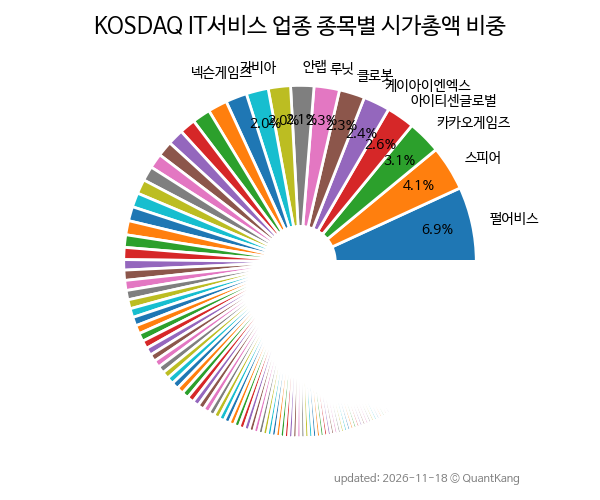

{: .align-center}

> **종목 목록 (229)**

| **종목** | **PER** | **PBR** | **DIV** | **비중** |
| :------- | ------: | ------: | ------: | -------: |
| [펄어비스](/263750/) | - | 2.1 | - | 6.9<small>%</small> |
| 스피어 | 2930.0 | 9.9 | - | 4.1<small>%</small> |
| [카카오게임즈](/293490/) | - | 0.9 | - | 3.1<small>%</small> |
| [아이티센글로벌](/124500/) | 8.9 | 3.3 | - | 2.6<small>%</small> |
| 케이아이엔엑스 | 49.2 | 4.1 | 0.3<small>%</small> | 2.4<small>%</small> |
| [클로봇](/466100/) | - | 7.2 | - | 2.3<small>%</small> |
| [루닛](/328130/) | - | 6.7 | - | 2.3<small>%</small> |
| [안랩](/053800/) | 18.5 | 2.5 | 1.3<small>%</small> | 2.1<small>%</small> |
| 가비아 | 39.9 | 3.6 | 0.2<small>%</small> | 2.0<small>%</small> |
| [넥슨게임즈](/225570/) | - | 1.8 | - | 2.0<small>%</small> |
| [코나아이](/052400/) | 5.3 | 1.5 | 6.5<small>%</small> | 1.9<small>%</small> |
| [위메이드](/112040/) | - | 1.1 | 2.1<small>%</small> | 1.8<small>%</small> |
| 마키나락스 | - | 13.3 | - | 1.7<small>%</small> |
| [SOOP](/067160/) | 3.7 | 0.8 | 9.6<small>%</small> | 1.5<small>%</small> |
| [디어유](/376300/) | 26.2 | 2.3 | 1.5<small>%</small> | 1.5<small>%</small> |
| [한컴](/030520/) | 9.6 | 0.9 | 2.9<small>%</small> | 1.4<small>%</small> |
| 노타 | - | 10.2 | - | 1.4<small>%</small> |
| [카페24](/042000/) | 8.7 | 1.3 | - | 1.3<small>%</small> |
| 다날 | - | 0.9 | - | 1.3<small>%</small> |
| [네오위즈](/095660/) | 6.5 | 0.6 | 1.9<small>%</small> | 1.3<small>%</small> |
| [컴투스](/078340/) | 8.7 | 0.3 | 4.7<small>%</small> | 1.3<small>%</small> |
| [위메이드맥스](/101730/) | - | 0.6 | - | 1.3<small>%</small> |
| [웹젠](/069080/) | 14.6 | 0.5 | 5.8<small>%</small> | 1.1<small>%</small> |
| 엑스게이트 | 91.8 | 7.4 | - | 1.1<small>%</small> |
| 리파인 | 24.9 | 1.1 | 1.9<small>%</small> | 1.0<small>%</small> |
| KG이니시스 | 5.1 | 0.5 | 6.6<small>%</small> | 0.9<small>%</small> |
| 쿠콘 | 9.4 | 1.2 | 1.5<small>%</small> | 0.9<small>%</small> |
| 셀바스AI | - | 1.7 | - | 0.9<small>%</small> |
| 아이스크림미디어 | 4.2 | 1.0 | 9.4<small>%</small> | 0.8<small>%</small> |
| 갤럭시아머니트리 | 19.7 | 1.4 | 1.1<small>%</small> | 0.8<small>%</small> |
| 오픈엣지테크놀로지 | - | 10.6 | - | 0.8<small>%</small> |
| 인피니트헬스케어 | 9.8 | 1.4 | 0.9<small>%</small> | 0.8<small>%</small> |
| 슈어소프트테크 | 20.6 | 1.7 | - | 0.8<small>%</small> |
| 골프존 | 8.1 | 0.5 | 11.5<small>%</small> | 0.7<small>%</small> |
| 드림시큐리티 | 22.9 | 1.6 | - | 0.7<small>%</small> |
| 솔트룩스 | - | 2.0 | - | 0.7<small>%</small> |
| 엠로 | 53.0 | 1.6 | - | 0.7<small>%</small> |
| 네오위즈홀딩스 | 3.3 | 0.3 | 2.7<small>%</small> | 0.6<small>%</small> |
| 한국정보인증 | 8.4 | 1.1 | 3.6<small>%</small> | 0.6<small>%</small> |
| [데브시스터즈](/194480/) | 10.7 | 0.7 | - | 0.6<small>%</small> |
| 에프앤가이드 | 14.0 | 2.0 | 2.1<small>%</small> | 0.6<small>%</small> |
| 헥토이노베이션 | 5.5 | 0.8 | 3.7<small>%</small> | 0.6<small>%</small> |
| 티쓰리 | 8.5 | 1.4 | 5.3<small>%</small> | 0.6<small>%</small> |
| 사람인 | 1.7 | 0.6 | 4.7<small>%</small> | 0.6<small>%</small> |
| 이크레더블 | 12.7 | 3.8 | 6.3<small>%</small> | 0.6<small>%</small> |
| 스트라드비젼 | - | 3.9 | - | 0.6<small>%</small> |
| 코난테크놀로지 | - | 5.1 | - | 0.6<small>%</small> |
| GC메디아이 | 3.9 | 1.0 | 1.7<small>%</small> | 0.5<small>%</small> |
| 씨이랩 | - | 2.5 | - | 0.5<small>%</small> |
| KG파이낸셜 | 6.1 | 0.4 | 6.4<small>%</small> | 0.5<small>%</small> |
| 지어소프트 | 15.5 | 1.3 | - | 0.5<small>%</small> |
| 폴라리스오피스 | 25.9 | 1.4 | - | 0.5<small>%</small> |
| 넥써쓰 | - | 3.2 | - | 0.5<small>%</small> |
| 플리토 | 18.8 | 7.1 | - | 0.5<small>%</small> |
| 크레오에스지 | - | 0.9 | - | 0.5<small>%</small> |
| 지니언스 | 39.7 | 4.8 | 0.9<small>%</small> | 0.4<small>%</small> |
| 윈스테크넷 | 7.0 | 0.7 | 6.7<small>%</small> | 0.4<small>%</small> |
| 아크릴 | - | 2.0 | - | 0.4<small>%</small> |
| 제이엘케이 | - | 2.3 | - | 0.4<small>%</small> |
| 탑코미디어 | - | 2.4 | - | 0.4<small>%</small> |
| 핑거 | 320.6 | 2.1 | 1.0<small>%</small> | 0.4<small>%</small> |
| 넵튠 | - | 0.3 | - | 0.4<small>%</small> |
| 컨텍 | - | 2.0 | - | 0.4<small>%</small> |
| 나무에이엑스 | - | 2.1 | - | 0.4<small>%</small> |
| 현대이지웰 | 3.9 | 0.8 | 5.4<small>%</small> | 0.4<small>%</small> |
| 고스트스튜디오 | - | - | - | 0.4<small>%</small> |
| 상상인 | - | 0.3 | - | 0.4<small>%</small> |
| 아톤 | 65.1 | 1.1 | 1.2<small>%</small> | 0.4<small>%</small> |
| 에스투더블유 | - | 4.0 | - | 0.4<small>%</small> |
| 아이크래프트 | 6.5 | 1.4 | 1.8<small>%</small> | 0.4<small>%</small> |
| 케이씨에스 | 36.6 | 4.7 | 2.3<small>%</small> | 0.3<small>%</small> |
| 뷰노 | - | 2.0 | - | 0.3<small>%</small> |
| 한컴위드 | 10.8 | 0.6 | - | 0.3<small>%</small> |
| SKAI | - | 5.2 | - | 0.3<small>%</small> |
| 링네트 | 7.6 | 0.7 | 7.0<small>%</small> | 0.3<small>%</small> |
| 뉴로핏 | - | 2.9 | - | 0.3<small>%</small> |
| 웹케시 | 6.2 | 0.7 | 3.3<small>%</small> | 0.3<small>%</small> |
| 이지케어텍 | 13.9 | 1.9 | - | 0.3<small>%</small> |
| 엑셈 | 11.4 | 0.6 | 4.0<small>%</small> | 0.3<small>%</small> |
| 이스트소프트 | - | 1.3 | - | 0.3<small>%</small> |
| THE E&M | - | 2.8 | - | 0.3<small>%</small> |
| 모비스 | - | 2.4 | - | 0.3<small>%</small> |
| LS티라유텍 | - | 1.1 | - | 0.3<small>%</small> |
| 라온시큐어 | 45.3 | 2.9 | - | 0.3<small>%</small> |
| 젝시믹스 | 4.6 | 0.5 | 10.9<small>%</small> | 0.3<small>%</small> |
| 폴라리스AI | - | 0.7 | - | 0.3<small>%</small> |
| MDS테크 | 9.3 | 0.6 | - | 0.3<small>%</small> |
| 컴투스홀딩스 | 6.0 | 0.3 | - | 0.3<small>%</small> |
| 이니텍 | 35.6 | 0.8 | - | 0.3<small>%</small> |
| 에스넷 | 12.7 | 0.6 | 3.1<small>%</small> | 0.3<small>%</small> |
| KT밀리의서재 | 4.6 | 0.8 | 6.5<small>%</small> | 0.3<small>%</small> |
| 뉴엔AI | - | 0.8 | - | 0.3<small>%</small> |
| 조이시티 | - | 0.8 | - | 0.3<small>%</small> |
| 알서포트 | 38.8 | 0.7 | 0.8<small>%</small> | 0.3<small>%</small> |
| 엠게임 | 4.6 | 0.6 | 5.6<small>%</small> | 0.3<small>%</small> |
| 미투온 | 101.4 | 0.6 | - | 0.3<small>%</small> |
| 누리플렉스 | - | 0.6 | - | 0.3<small>%</small> |
| 퀀텀레일 | 14.6 | 0.2 | - | 0.3<small>%</small> |
| 비투엔 | - | 1.9 | - | 0.2<small>%</small> |
| 에스트래픽 | 15.2 | 0.7 | 5.1<small>%</small> | 0.2<small>%</small> |
| 마음AI | - | 2.2 | - | 0.2<small>%</small> |
| 아이티센엔텍 | 3.3 | 0.8 | - | 0.2<small>%</small> |
| 오파스넷 | 7.5 | 1.5 | 3.4<small>%</small> | 0.2<small>%</small> |
| 디지틀조선 | 11.5 | 0.7 | 2.4<small>%</small> | 0.2<small>%</small> |
| 레몬헬스케어 | - | 11.7 | - | 0.2<small>%</small> |
| 와이즈넛 | 38.4 | 1.0 | 1.6<small>%</small> | 0.2<small>%</small> |
| 에스피소프트 | 32.7 | 1.8 | - | 0.2<small>%</small> |
| 네오리진 | - | 1.3 | - | 0.2<small>%</small> |
| 비트컴퓨터 | 8.2 | 0.8 | 1.7<small>%</small> | 0.2<small>%</small> |
| 위메이드플레이 | 2.9 | 0.2 | - | 0.2<small>%</small> |
| 인지소프트 | 2.4 | 0.7 | 5.8<small>%</small> | 0.2<small>%</small> |
| 한국전자인증 | 12.2 | 0.9 | 3.1<small>%</small> | 0.2<small>%</small> |
| 유비벨록스 | - | 0.4 | - | 0.2<small>%</small> |
| 인성정보 | - | 0.6 | - | 0.2<small>%</small> |
| 샌즈랩 | - | 1.6 | 2.7<small>%</small> | 0.2<small>%</small> |
| 수산아이앤티 | 9.8 | 0.6 | 4.1<small>%</small> | 0.2<small>%</small> |
| FSN | - | 0.8 | - | 0.2<small>%</small> |
| 이글루 | - | 0.8 | 3.5<small>%</small> | 0.2<small>%</small> |
| 오픈베이스 | 6.5 | 0.6 | 1.4<small>%</small> | 0.2<small>%</small> |
| 아우토크립트 | - | 1.6 | - | 0.2<small>%</small> |
| 알체라 | - | 2.0 | - | 0.2<small>%</small> |
| 토탈소프트 | 6.2 | 1.4 | 1.6<small>%</small> | 0.2<small>%</small> |
| 서울평가정보 | 8.1 | 1.8 | 4.8<small>%</small> | 0.2<small>%</small> |
| 비트플래닛 | - | 0.7 | - | 0.2<small>%</small> |
| 케이사인 | 20.0 | 0.6 | 2.7<small>%</small> | 0.2<small>%</small> |
| 시선AI | - | 2.8 | - | 0.2<small>%</small> |
| 딥노이드 | - | 1.6 | - | 0.2<small>%</small> |
| 시큐레터 | - | 13.1 | - | 0.2<small>%</small> |
| 코어라인소프트 | - | 2.1 | - | 0.2<small>%</small> |
| 오상자이엘 | 4.1 | 0.4 | 6.7<small>%</small> | 0.2<small>%</small> |
| 아시아경제 | 11.4 | 0.4 | - | 0.2<small>%</small> |
| 사이냅소프트 | 6.6 | 0.5 | - | 0.1<small>%</small> |
| 포시에스 | 8.0 | 0.5 | 3.5<small>%</small> | 0.1<small>%</small> |
| 오비고 | - | 1.5 | - | 0.1<small>%</small> |
| 파수AI | 20.0 | 1.4 | 2.1<small>%</small> | 0.1<small>%</small> |
| 이지스 | - | 1.0 | - | 0.1<small>%</small> |
| 액토즈소프트 | 1.8 | 0.2 | - | 0.1<small>%</small> |
| 비아이매트릭스 | 15.7 | 1.2 | - | 0.1<small>%</small> |
| 네이블 | 11.0 | 0.8 | - | 0.1<small>%</small> |
| 다산디엠씨 | - | 0.5 | - | 0.1<small>%</small> |
| 영림원소프트랩 | 4.5 | 0.5 | 3.3<small>%</small> | 0.1<small>%</small> |
| 링크제니시스 | 10.3 | 0.6 | - | 0.1<small>%</small> |
| NHN벅스 | - | 0.6 | - | 0.1<small>%</small> |
| 이루온 | 19.2 | 0.6 | - | 0.1<small>%</small> |
| 토마토시스템 | - | 1.7 | - | 0.1<small>%</small> |
| 멤레이비티 | - | 0.5 | - | 0.1<small>%</small> |
| 뱅크웨어글로벌 | - | 1.8 | - | 0.1<small>%</small> |
| 브리지텍 | 50.1 | 0.6 | 5.4<small>%</small> | 0.1<small>%</small> |
| SGA솔루션즈 | 2.3 | 1.4 | - | 0.1<small>%</small> |
| 폴라리스AI핸디 | 36.8 | 0.4 | - | 0.1<small>%</small> |
| 인포뱅크 | - | 0.4 | - | 0.1<small>%</small> |
| 미트박스 | 17.7 | 0.8 | 5.4<small>%</small> | 0.1<small>%</small> |
| 원티드랩 | 19.0 | 0.6 | - | 0.1<small>%</small> |
| 산돌 | 10.7 | 0.7 | 3.8<small>%</small> | 0.1<small>%</small> |
| 인스피언 | 11.3 | 0.5 | 3.3<small>%</small> | 0.1<small>%</small> |
| 이노에이엑스 | 13.8 | 1.0 | 3.1<small>%</small> | 0.1<small>%</small> |
| 플랜티넷 | 11.7 | 0.4 | 5.9<small>%</small> | 0.1<small>%</small> |
| 대신정보통신 | 2.1 | 0.5 | 7.1<small>%</small> | 0.1<small>%</small> |
| 미스터블루 | - | 0.6 | - | 0.1<small>%</small> |
| 오브젠 | - | 2.7 | - | 0.1<small>%</small> |
| 시큐브 | 6.9 | 0.7 | 3.5<small>%</small> | 0.1<small>%</small> |
| 모니터랩 | 48.5 | 0.9 | - | 0.1<small>%</small> |
| 브레인즈컴퍼니 | 4.4 | 0.4 | 5.9<small>%</small> | 0.1<small>%</small> |
| 트윔 | - | 0.4 | - | 0.1<small>%</small> |
| 케이씨티 | 9.2 | 0.7 | 5.3<small>%</small> | 0.1<small>%</small> |
| 파라택시스이더리움 | 4.4 | 0.6 | - | 0.1<small>%</small> |
| 신테카바이오 | - | 0.8 | - | 0.1<small>%</small> |
| 모비릭스 | - | 0.9 | - | 0.1<small>%</small> |
| 디지캡 | - | 0.6 | - | 0.1<small>%</small> |
| 이삭엔지니어링 | - | 0.6 | - | 0.1<small>%</small> |
| 유라클 | - | 1.0 | - | 0.1<small>%</small> |
| 아이티센피엔에스 | - | 2.0 | - | 0.1<small>%</small> |
| 아이퀘스트 | 5.2 | 0.6 | 4.9<small>%</small> | 0.1<small>%</small> |
| 인스웨이브 | - | 0.6 | - | 0.1<small>%</small> |
| 엔텔스 | 6.4 | 0.4 | - | 0.1<small>%</small> |
| 플래티어 | - | 0.8 | - | 0.1<small>%</small> |
| 심플랫폼 | - | 1.3 | - | 0.1<small>%</small> |
| 웨이버스 | 11.3 | 0.7 | - | 0.1<small>%</small> |
| 키네마스터 | 7.3 | 1.0 | - | 0.1<small>%</small> |
| 인티큐브 | 44.1 | 2.7 | - | 0.1<small>%</small> |
| 휴네시온 | 3.7 | 0.4 | 2.2<small>%</small> | 0.1<small>%</small> |
| 싸이버원 | - | 0.7 | 1.5<small>%</small> | 0.1<small>%</small> |
| 아이지넷 | 9.4 | 1.1 | - | 0.1<small>%</small> |
| 엠아이큐브솔루션 | 12.7 | 0.9 | 14.6<small>%</small> | 0.1<small>%</small> |
| 바이브컴퍼니 | - | 0.8 | - | 0.1<small>%</small> |
| 이씨에스 | 15.7 | 0.5 | 4.2<small>%</small> | 0.1<small>%</small> |
| 세중 | - | 0.2 | - | 0.1<small>%</small> |
| 한싹 | - | 1.3 | - | 0.1<small>%</small> |
| 솔트웨어 | 27.3 | 1.0 | - | 0.1<small>%</small> |
| 크라우드웍스 | - | 1.0 | - | 0.1<small>%</small> |
| 밸로프 | 9.0 | 0.5 | - | 0.1<small>%</small> |
| 알티캐스트 | - | 0.3 | - | 0.1<small>%</small> |
| 이노테나 | 12.4 | 1.2 | 2.1<small>%</small> | 0.1<small>%</small> |
| 비트맥스 | - | 1.7 | - | 0.1<small>%</small> |
| 티사이언티픽 | - | 0.1 | - | 0.1<small>%</small> |
| 비큐AI | - | 1.9 | - | 0.1<small>%</small> |
| 오픈놀 | - | 0.6 | - | 0.1<small>%</small> |
| 한빛소프트 | 4.5 | 1.4 | - | 0.1<small>%</small> |
| 지란지교시큐리티 | 11.3 | 0.4 | - | 0.1<small>%</small> |
| 소프트캠프 | 8.5 | 2.1 | - | 0.1<small>%</small> |
| 에스에스알 | - | 0.6 | - | 0.1<small>%</small> |
| 로지시스 | 6.0 | 0.9 | 7.4<small>%</small> | 0.1<small>%</small> |
| 라온피플 | - | 0.5 | - | 0.1<small>%</small> |
| 소프트센 | - | 0.4 | - | 0.1<small>%</small> |
| 유비온 | 14.3 | 2.5 | - | 0.1<small>%</small> |
| 플레이위드 | - | 0.9 | - | 0.1<small>%</small> |
| 케이쓰리아이 | - | 0.5 | - | 0.1<small>%</small> |
| 이노시뮬레이션 | - | 0.6 | - | 0.1<small>%</small> |
| 아이티아이즈 | - | 1.9 | - | 0.1<small>%</small> |
| 이노뎁 | - | 0.6 | - | 0.1<small>%</small> |
| 벨로크 | 8.3 | 0.7 | - | 0.1<small>%</small> |
| 카티스 | - | 0.6 | - | 0.1<small>%</small> |
| 버넥트 | - | 0.5 | - | 0.1<small>%</small> |
| 위세아이텍 | 12.3 | 0.6 | 5.8<small>%</small> | 0.1<small>%</small> |
| 미디어젠 | - | 1.2 | - | 0.1<small>%</small> |
| 핑거스토리 | 4.1 | 0.5 | - | 0.1<small>%</small> |
| 드래곤플라이 | - | 2.7 | - | 0.1<small>%</small> |
| 이스트에이드 | - | 0.7 | - | 0.1<small>%</small> |
| 핀텔 | - | 0.3 | - | 0.1<small>%</small> |
| 모아데이타 | - | 0.2 | - | 0.0<small>%</small> |
| 휴맥스홀딩스 | - | - | - | 0.0<small>%</small> |
| E8 | - | 0.5 | - | 0.0<small>%</small> |
| 썸에이지 | - | 0.9 | - | 0.0<small>%</small> |
| 유디엠텍 | - | 2.3 | - | 0.0<small>%</small> |
| 모바일어플라이언스 | - | 0.2 | - | 0.0<small>%</small> |
| 투비소프트 | 6.8 | 0.3 | - | 0.0<small>%</small> |
| 스코넥 | - | 0.5 | - | 0.0<small>%</small> |
| 아이톡시 | - | 1.0 | - | 0.0<small>%</small> |
| 소프트센우 | - | - | - | 0.0<small>%</small> |

