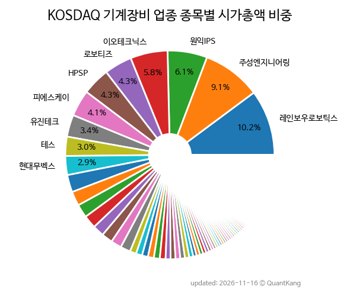

{: .align-center}

> **종목 목록 (183)**

| **종목** | **PER** | **PBR** | **DIV** | **비중** |
| :------- | ------: | ------: | ------: | -------: |
| [레인보우로보틱스](/277810/) | 6349.3 | 67.2 | - | 10.2<small>%</small> |
| [주성엔지니어링](/036930/) | 169.9 | 10.3 | 0.0<small>%</small> | 9.1<small>%</small> |
| [원익IPS](/240810/) | 36.9 | 3.2 | 0.3<small>%</small> | 6.1<small>%</small> |
| [이오테크닉스](/039030/) | 60.1 | 5.0 | 0.4<small>%</small> | 5.8<small>%</small> |
| [로보티즈](/108490/) | 749.4 | 13.3 | - | 4.3<small>%</small> |
| [HPSP](/403870/) | 43.1 | 10.2 | 1.3<small>%</small> | 4.3<small>%</small> |
| [피에스케이](/319660/) | 28.2 | 4.1 | 0.9<small>%</small> | 4.1<small>%</small> |
| [유진테크](/084370/) | 36.7 | 3.4 | 0.3<small>%</small> | 3.4<small>%</small> |
| [테스](/095610/) | 23.7 | 3.5 | 1.1<small>%</small> | 3.0<small>%</small> |
| [현대무벡스](/319400/) | 160.9 | 11.4 | 0.3<small>%</small> | 2.9<small>%</small> |
| [피에스케이홀딩스](/031980/) | 27.8 | 5.0 | 0.9<small>%</small> | 2.7<small>%</small> |
| [고영](/098460/) | 97.8 | 4.3 | 0.6<small>%</small> | 2.2<small>%</small> |
| [테크윙](/089030/) | 119.6 | 5.2 | 0.4<small>%</small> | 2.1<small>%</small> |
| [비에이치아이](/083650/) | 15.4 | 5.7 | - | 2.0<small>%</small> |
| [브이엠](/089970/) | 30.0 | 5.0 | - | 1.8<small>%</small> |
| [태성](/323280/) | - | 10.0 | - | 1.7<small>%</small> |
| [코미코](/183300/) | 14.8 | 2.7 | 3.8<small>%</small> | 1.6<small>%</small> |
| [기가비스](/420770/) | 56.0 | 4.1 | 1.2<small>%</small> | 1.5<small>%</small> |
| [SFA](/056190/) | 12.6 | 0.8 | 3.9<small>%</small> | 1.0<small>%</small> |
| [와이씨](/232140/) | 61.3 | 3.3 | - | 0.9<small>%</small> |
| [유일로보틱스](/388720/) | - | 8.0 | - | 0.9<small>%</small> |
| [휴림로봇](/090710/) | - | 7.0 | - | 0.9<small>%</small> |
| GST | 16.2 | 2.4 | 1.6<small>%</small> | 0.9<small>%</small> |
| [로보스타](/090360/) | - | 6.9 | - | 0.9<small>%</small> |
| [피엔티](/137400/) | 7.2 | 0.8 | 0.9<small>%</small> | 0.8<small>%</small> |
| [선익시스템](/171090/) | 5.9 | 3.9 | 1.6<small>%</small> | 0.8<small>%</small> |
| 예스티 | - | 3.8 | - | 0.7<small>%</small> |
| [필옵틱스](/161580/) | - | 4.5 | - | 0.7<small>%</small> |
| [SFA넥셀](/222080/) | 17.3 | 1.0 | - | 0.7<small>%</small> |
| 프로텍 | 12.0 | 1.6 | 0.6<small>%</small> | 0.6<small>%</small> |
| [네오셈](/253590/) | 86.5 | 3.9 | 0.9<small>%</small> | 0.5<small>%</small> |
| [유진로봇](/056080/) | - | 11.6 | - | 0.5<small>%</small> |
| [젬백스](/082270/) | - | 6.7 | - | 0.5<small>%</small> |
| 뉴파워프라즈마 | 46.3 | 1.4 | 0.5<small>%</small> | 0.5<small>%</small> |
| 인텍플러스 | - | 9.3 | - | 0.5<small>%</small> |
| 코세스 | 39.7 | 7.1 | - | 0.4<small>%</small> |
| [넥스틴](/348210/) | - | 1.4 | 2.4<small>%</small> | 0.4<small>%</small> |
| 한솔아이원스 | 7.6 | 1.0 | - | 0.4<small>%</small> |
| 엔젤로보틱스 | - | 8.8 | - | 0.4<small>%</small> |
| 에스티아이 | 17.9 | 1.0 | 0.8<small>%</small> | 0.4<small>%</small> |
| 뉴로메카 | - | 19.4 | - | 0.4<small>%</small> |
| 제우스 | - | 0.8 | 0.6<small>%</small> | 0.4<small>%</small> |
| 디아이티 | 6.8 | 0.9 | 3.7<small>%</small> | 0.3<small>%</small> |
| 티로보틱스 | - | 5.2 | - | 0.3<small>%</small> |
| 아스플로 | - | 6.9 | - | 0.3<small>%</small> |
| AP시스템 | 8.8 | 0.6 | 2.4<small>%</small> | 0.3<small>%</small> |
| 제이브이엠 | 10.9 | 1.3 | 2.4<small>%</small> | 0.3<small>%</small> |
| 싸이맥스 | 11.3 | 0.9 | 2.5<small>%</small> | 0.3<small>%</small> |
| 엑시콘 | 68.2 | 3.2 | 0.2<small>%</small> | 0.3<small>%</small> |
| 유니셈 | 25.3 | 0.9 | 1.0<small>%</small> | 0.3<small>%</small> |
| 펨트론 | - | 5.0 | 0.8<small>%</small> | 0.3<small>%</small> |
| 저스템 | 54.8 | 3.6 | - | 0.3<small>%</small> |
| 스맥 | - | 2.1 | - | 0.3<small>%</small> |
| 진성티이씨 | 5.1 | 0.6 | 4.0<small>%</small> | 0.3<small>%</small> |
| 유니슨 | - | 1.9 | - | 0.3<small>%</small> |
| 에스비비테크 | - | 19.1 | - | 0.3<small>%</small> |
| 씨메스로보틱스 | - | 3.4 | - | 0.3<small>%</small> |
| 티엑스알로보틱스 | - | 2.2 | - | 0.3<small>%</small> |
| 필에너지 | - | 1.4 | - | 0.2<small>%</small> |
| 오리엔탈정공 | 7.1 | 1.1 | - | 0.2<small>%</small> |
| 유니테스트 | - | 1.8 | - | 0.2<small>%</small> |
| 나우로보틱스 | - | 8.4 | - | 0.2<small>%</small> |
| KZ정밀 | 17.1 | 0.3 | 7.9<small>%</small> | 0.2<small>%</small> |
| HB테크놀러지 | 5.3 | 0.5 | 1.2<small>%</small> | 0.2<small>%</small> |
| DMS | 1.0 | 0.3 | 4.3<small>%</small> | 0.2<small>%</small> |
| 엘오티베큠 | - | 0.5 | - | 0.2<small>%</small> |
| 지앤비에스 에코 | 19.8 | 1.1 | 3.0<small>%</small> | 0.2<small>%</small> |
| 아바코 | 4.7 | 0.6 | 5.3<small>%</small> | 0.2<small>%</small> |
| 윤성에프앤씨 | - | 0.6 | 0.6<small>%</small> | 0.2<small>%</small> |
| 앤로보틱스 | 8.6 | 1.1 | - | 0.2<small>%</small> |
| 비엠티 | 6.9 | 0.9 | 4.2<small>%</small> | 0.2<small>%</small> |
| 디바이스 | 6.4 | 0.7 | 7.8<small>%</small> | 0.2<small>%</small> |
| 이노테크 | 8.6 | 1.4 | - | 0.2<small>%</small> |
| 링크솔루션 | - | 2.2 | - | 0.2<small>%</small> |
| 씨앤지하이테크 | 5.7 | 0.8 | 4.6<small>%</small> | 0.1<small>%</small> |
| 오로스테크놀로지 | - | 1.2 | - | 0.1<small>%</small> |
| 라온로보틱스 | 41.0 | 4.2 | 1.6<small>%</small> | 0.1<small>%</small> |
| HB솔루션 | 3.6 | 0.4 | 2.3<small>%</small> | 0.1<small>%</small> |
| 나인테크 | - | 1.1 | - | 0.1<small>%</small> |
| 케이엔솔 | - | 0.7 | - | 0.1<small>%</small> |
| 피아이이 | - | 2.5 | - | 0.1<small>%</small> |
| 디에스케이 | - | 0.7 | - | 0.1<small>%</small> |
| 케이에스피 | 13.0 | 1.0 | 0.9<small>%</small> | 0.1<small>%</small> |
| 코윈테크 | 56.9 | 0.6 | 2.4<small>%</small> | 0.1<small>%</small> |
| 엠플러스 | 4.0 | 0.8 | 2.9<small>%</small> | 0.1<small>%</small> |
| 현대에버다임 | 19.5 | 0.5 | 1.4<small>%</small> | 0.1<small>%</small> |
| 우림피티에스 | 41.0 | 1.2 | 0.7<small>%</small> | 0.1<small>%</small> |
| 톱텍 | - | 0.2 | 4.3<small>%</small> | 0.1<small>%</small> |
| 워트 | 24.0 | 1.3 | 1.3<small>%</small> | 0.1<small>%</small> |
| 하나기술 | - | 0.7 | - | 0.1<small>%</small> |
| 비아트론 | 8.8 | 0.5 | 1.1<small>%</small> | 0.1<small>%</small> |
| 씨에스베어링 | 9.1 | 1.0 | - | 0.1<small>%</small> |
| 로체시스템즈 | 9.4 | 0.9 | 0.7<small>%</small> | 0.1<small>%</small> |
| 나노팀 | 99.0 | 2.0 | - | 0.1<small>%</small> |
| 미래컴퍼니 | - | 0.8 | - | 0.1<small>%</small> |
| 대성하이텍 | - | 1.4 | - | 0.1<small>%</small> |
| 야스 | - | 0.6 | - | 0.1<small>%</small> |
| 에프엔에스테크 | 10.6 | 1.1 | 2.9<small>%</small> | 0.1<small>%</small> |
| 동아엘텍 | 1.6 | 0.5 | 3.2<small>%</small> | 0.1<small>%</small> |
| 와이제이링크 | - | 1.2 | - | 0.1<small>%</small> |
| 원익피앤이 | 36.4 | 0.7 | - | 0.1<small>%</small> |
| 엠엑스로보틱스 | - | 1.0 | - | 0.1<small>%</small> |
| 지에프아이 | - | 1.0 | - | 0.1<small>%</small> |
| 대동기어 | - | 0.9 | 0.8<small>%</small> | 0.1<small>%</small> |
| 지아이에스 | - | 1.2 | - | 0.1<small>%</small> |
| 제너셈 | 66.9 | 1.2 | 1.1<small>%</small> | 0.1<small>%</small> |
| 엠오티 | 16.4 | 0.9 | 2.0<small>%</small> | 0.1<small>%</small> |
| 세미티에스 | - | - | - | 0.1<small>%</small> |
| 한빛레이저 | 34.7 | 2.8 | - | 0.1<small>%</small> |
| 케이엔에스 | - | 1.1 | - | 0.1<small>%</small> |
| 제일엠앤에스 | - | - | - | 0.1<small>%</small> |
| 아이씨디 | - | 0.6 | - | 0.1<small>%</small> |
| 제닉스로보틱스 | - | 1.7 | - | 0.1<small>%</small> |
| 디와이피엔에프 | 2.6 | 0.5 | 9.9<small>%</small> | 0.1<small>%</small> |
| 에이텍 | 133.8 | 0.6 | 4.2<small>%</small> | 0.1<small>%</small> |
| 제이스로보틱스 | - | 0.5 | 1.4<small>%</small> | 0.1<small>%</small> |
| 나래나노텍 | 1.9 | 0.7 | - | 0.1<small>%</small> |
| 디케이락 | 11.9 | 0.6 | 3.7<small>%</small> | 0.1<small>%</small> |
| 원준 | - | 0.5 | - | 0.1<small>%</small> |
| 디에이테크놀로지 | - | - | - | 0.1<small>%</small> |
| 한울반도체 | - | 0.9 | - | 0.1<small>%</small> |
| 아이엠티 | 47.3 | 1.5 | - | 0.1<small>%</small> |
| 티에스아이 | 39.5 | 0.5 | - | 0.1<small>%</small> |
| 엔젯 | - | 1.2 | - | 0.1<small>%</small> |
| 모델솔루션 | 7.2 | 0.7 | 3.6<small>%</small> | 0.1<small>%</small> |
| 이노메트리 | - | 0.8 | - | 0.1<small>%</small> |
| 지아이텍 | 71.4 | 0.6 | 0.9<small>%</small> | 0.1<small>%</small> |
| 팬스타엔터프라이즈 | - | 0.5 | - | 0.1<small>%</small> |
| 흥국 | 4.3 | 0.5 | 5.9<small>%</small> | 0.1<small>%</small> |
| 다원넥스뷰 | 32.8 | 6.0 | - | 0.1<small>%</small> |
| 원일티엔아이 | - | 1.0 | - | 0.1<small>%</small> |
| 위지트 | 5.3 | 0.3 | - | 0.1<small>%</small> |
| 제이엔케이글로벌 | 21.1 | 0.4 | 1.9<small>%</small> | 0.1<small>%</small> |
| 레이저쎌 | - | 2.2 | - | 0.1<small>%</small> |
| 브이원텍 | - | 0.5 | 3.3<small>%</small> | 0.1<small>%</small> |
| 티이엠씨씨엔에스 | 11.7 | 0.4 | 1.4<small>%</small> | 0.1<small>%</small> |
| 성원에너텍 | - | 1.1 | - | 0.1<small>%</small> |
| 화성밸브 | - | 0.6 | - | 0.1<small>%</small> |
| 러셀 | - | 0.6 | 2.7<small>%</small> | 0.1<small>%</small> |
| 에스피시스템스 | - | 0.7 | - | 0.1<small>%</small> |
| 영우디에스피 | 7.5 | 1.4 | - | 0.1<small>%</small> |
| 엔투텍 | 2.1 | 0.4 | - | 0.1<small>%</small> |
| 에이테크솔루션 | 84.3 | 0.4 | - | 0.1<small>%</small> |
| 포스뱅크 | 11.1 | 0.5 | - | 0.1<small>%</small> |
| 코닉오토메이션 | - | 1.7 | - | 0.1<small>%</small> |
| 탑엔지니어링 | - | 0.2 | - | 0.1<small>%</small> |
| 에너토크 | - | 0.9 | 2.8<small>%</small> | 0.1<small>%</small> |
| TPC로보틱스 | - | 1.9 | 0.2<small>%</small> | 0.1<small>%</small> |
| 쎄크 | - | 1.1 | - | 0.1<small>%</small> |
| 일신바이오 | 8.6 | 0.6 | 1.0<small>%</small> | 0.1<small>%</small> |
| 에어레인 | 17.3 | 0.7 | - | 0.0<small>%</small> |
| 제이티 | - | 0.5 | - | 0.0<small>%</small> |
| 대모 | 21.6 | 0.8 | 1.2<small>%</small> | 0.0<small>%</small> |
| 에쎈테크 | 49.4 | 0.7 | - | 0.0<small>%</small> |
| 한독크린텍 | 13.2 | 0.6 | 5.3<small>%</small> | 0.0<small>%</small> |
| 서연탑메탈 | 3.7 | 0.3 | 2.2<small>%</small> | 0.0<small>%</small> |
| 나라엠앤디 | 5.0 | 0.2 | 4.5<small>%</small> | 0.0<small>%</small> |
| 서암기계공업 | 28.2 | 0.5 | 0.4<small>%</small> | 0.0<small>%</small> |
| 아세아텍 | 10.8 | 0.2 | 3.2<small>%</small> | 0.0<small>%</small> |
| 넥사다이내믹스 | - | 6.3 | - | 0.0<small>%</small> |
| 파라텍 | - | 0.3 | - | 0.0<small>%</small> |
| 아이비젼웍스 | - | 0.5 | - | 0.0<small>%</small> |
| 팸텍 | - | 0.4 | - | 0.0<small>%</small> |
| 넥스턴앤롤코리아 | - | 0.2 | - | 0.0<small>%</small> |
| 제이엔비 | - | 0.7 | 3.5<small>%</small> | 0.0<small>%</small> |
| 자비스 | - | 0.9 | - | 0.0<small>%</small> |
| 티에스넥스젠 | - | 1.6 | - | 0.0<small>%</small> |
| 케이웨더 | - | 1.8 | - | 0.0<small>%</small> |
| 에이아이코리아 | - | 0.5 | - | 0.0<small>%</small> |
| 힘스 | - | 0.3 | - | 0.0<small>%</small> |
| 피엔티엠에스 | - | 0.8 | - | 0.0<small>%</small> |
| 신도기연 | 10.5 | 0.3 | - | 0.0<small>%</small> |
| 에이치케이 | 4.6 | 0.3 | - | 0.0<small>%</small> |
| 한국정밀기계 | - | 0.6 | - | 0.0<small>%</small> |
| 스페코 | - | 0.4 | - | 0.0<small>%</small> |
| 루트K | - | 0.3 | - | 0.0<small>%</small> |
| 케이지에이 | - | 0.2 | - | 0.0<small>%</small> |
| 에스앤더블류 | 2.7 | 0.2 | - | 0.0<small>%</small> |
| 크린앤사이언스 | - | 0.6 | - | 0.0<small>%</small> |
| 파인텍 | - | 0.2 | - | 0.0<small>%</small> |
| 인베니아 | - | 0.6 | - | 0.0<small>%</small> |
| 수성웹툰 | - | - | - | 0.0<small>%</small> |
| KS인더스트리 | - | 0.2 | - | 0.0<small>%</small> |

