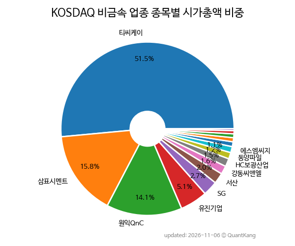

{: .align-center}

> **종목 목록 (15)**

| **종목** | **PER** | **PBR** | **DIV** | **비중** |
| :------- | ------: | ------: | ------: | -------: |
| [티씨케이](/064760/) | 25.3 | 3.3 | 0.9<small>%</small> | 51.5<small>%</small> |
| [삼표시멘트](/038500/) | 14.1 | 0.7 | 2.2<small>%</small> | 15.8<small>%</small> |
| [원익QnC](/074600/) | 26.3 | 1.2 | 0.6<small>%</small> | 14.1<small>%</small> |
| 유진기업 | - | 0.2 | 5.5<small>%</small> | 5.1<small>%</small> |
| SG | - | 1.0 | - | 2.7<small>%</small> |
| 서산 | - | 1.7 | - | 2.0<small>%</small> |
| 강동씨앤엘 | 106.9 | 0.5 | - | 1.6<small>%</small> |
| HC보광산업 | - | 0.9 | 2.2<small>%</small> | 1.5<small>%</small> |
| 동양파일 | - | 0.4 | - | 1.2<small>%</small> |
| 에스엠씨지 | 36.1 | 1.2 | - | 1.1<small>%</small> |
| 쎄노텍 | 31.0 | 1.1 | - | 0.9<small>%</small> |
| 자연과환경 | - | 0.4 | - | 0.8<small>%</small> |
| 모헨즈 | - | 0.9 | - | 0.7<small>%</small> |
| 동국알앤에스 | 45.6 | 0.3 | 5.7<small>%</small> | 0.6<small>%</small> |
| 국영지앤엠 | 4.9 | 0.2 | - | 0.3<small>%</small> |

