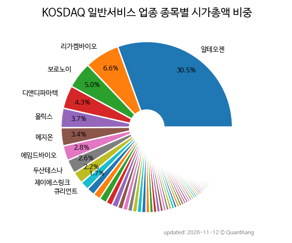

{: .align-center}

> **종목 목록 (147)**

| **종목** | **PER** | **PBR** | **DIV** | **비중** |
| :------- | ------: | ------: | ------: | -------: |
| [알테오젠](/196170/) | 86.9 | 27.9 | 0.2<small>%</small> | 30.5<small>%</small> |
| [리가켐바이오](/141080/) | - | 4.5 | - | 6.6<small>%</small> |
| [보로노이](/310210/) | - | 19.3 | - | 5.0<small>%</small> |
| [디앤디파마텍](/347850/) | - | 22.9 | - | 4.3<small>%</small> |
| [올릭스](/226950/) | - | 11.9 | - | 3.7<small>%</small> |
| 메지온 | - | 120.1 | - | 3.4<small>%</small> |
| [에임드바이오](/0009K0/) | 177.9 | 6.4 | - | 2.8<small>%</small> |
| [두산테스나](/131970/) | 946.1 | 3.2 | 0.2<small>%</small> | 2.6<small>%</small> |
| 제이에스링크 | - | 8.4 | - | 2.2<small>%</small> |
| 큐리언트 | - | 19.1 | - | 1.7<small>%</small> |
| 알지노믹스 | - | 9.9 | - | 1.5<small>%</small> |
| 인제니아테라퓨틱스(Reg.S) | - | - | - | 1.4<small>%</small> |
| [솔브레인홀딩스](/036830/) | 1.6 | 0.5 | 1.3<small>%</small> | 1.4<small>%</small> |
| 온코닉테라퓨틱스 | 34.3 | 7.6 | - | 1.2<small>%</small> |
| [서부T&D](/006730/) | 8.2 | 0.6 | 1.0<small>%</small> | 1.2<small>%</small> |
| 에이프릴바이오 | - | 2.9 | - | 1.0<small>%</small> |
| [아난티](/025980/) | - | 0.5 | - | 1.0<small>%</small> |
| 한양이엔지 | 10.0 | 0.7 | - | 0.9<small>%</small> |
| [지아이이노베이션](/358570/) | - | 4.0 | - | 0.9<small>%</small> |
| 세미파이브 | - | 1.9 | - | 0.9<small>%</small> |
| 한국기업평가 | 17.7 | 3.4 | 8.0<small>%</small> | 0.8<small>%</small> |
| 프로티나 | - | 22.2 | - | 0.7<small>%</small> |
| 인벤티지랩 | - | 4.0 | - | 0.7<small>%</small> |
| [메가스터디교육](/215200/) | 5.1 | 0.8 | 7.3<small>%</small> | 0.7<small>%</small> |
| 큐로셀 | - | 65.4 | - | 0.6<small>%</small> |
| 툴젠 | - | 4.8 | - | 0.6<small>%</small> |
| 신라젠 | - | 2.4 | - | 0.5<small>%</small> |
| 네패스아크 | 73.0 | 1.5 | - | 0.5<small>%</small> |
| 지노믹트리 | - | 1.9 | - | 0.5<small>%</small> |
| 인투셀 | - | 8.1 | - | 0.5<small>%</small> |
| HEM파마 | - | 31.1 | - | 0.5<small>%</small> |
| 이뮨온시아 | - | 6.8 | - | 0.5<small>%</small> |
| 에코아이 | 150.0 | 2.1 | 0.8<small>%</small> | 0.5<small>%</small> |
| HLB제약 | 56.1 | 2.1 | - | 0.5<small>%</small> |
| 큐에이드 | 19.8 | 4.5 | - | 0.5<small>%</small> |
| DXVX | - | 2.2 | - | 0.4<small>%</small> |
| 큐라클 | - | 4.6 | - | 0.4<small>%</small> |
| 디지털대성 | 12.2 | 1.8 | 5.3<small>%</small> | 0.4<small>%</small> |
| 아이엠바이오로직스 | 97.5 | 2.2 | - | 0.4<small>%</small> |
| 지씨셀 | - | 0.8 | - | 0.4<small>%</small> |
| 심텍홀딩스 | - | 11.7 | 0.2<small>%</small> | 0.4<small>%</small> |
| 오로라 | 5.9 | 0.8 | 4.5<small>%</small> | 0.3<small>%</small> |
| 압타바이오 | - | 2.8 | - | 0.3<small>%</small> |
| 페니트리움바이오 | - | 16.3 | - | 0.3<small>%</small> |
| 아이텍 | - | 0.9 | - | 0.3<small>%</small> |
| 카나프테라퓨틱스 | - | 8.0 | - | 0.3<small>%</small> |
| 쓰리빌리언 | - | 8.9 | - | 0.3<small>%</small> |
| EDGC | 2.0 | - | - | 0.3<small>%</small> |
| 레드캡투어 | 7.0 | 0.8 | 8.0<small>%</small> | 0.3<small>%</small> |
| 모두투어 | 12.2 | 2.0 | 3.4<small>%</small> | 0.3<small>%</small> |
| 아이디스홀딩스 | 2.8 | 0.3 | 2.1<small>%</small> | 0.3<small>%</small> |
| 제넥신 | - | 0.4 | - | 0.3<small>%</small> |
| 매드업 | 10.9 | 3.3 | - | 0.3<small>%</small> |
| 오르비텍 | 106.2 | 1.4 | - | 0.3<small>%</small> |
| KT나스미디어 | 21.2 | 0.7 | 5.5<small>%</small> | 0.3<small>%</small> |
| 와이바이오로직스 | - | 5.1 | - | 0.2<small>%</small> |
| 멀티캠퍼스 | 6.2 | 0.7 | 5.0<small>%</small> | 0.2<small>%</small> |
| 헬릭스미스 | - | 1.1 | - | 0.2<small>%</small> |
| 인선이엔티 | - | 0.4 | - | 0.2<small>%</small> |
| 마크로젠 | 62.0 | 0.8 | 4.3<small>%</small> | 0.2<small>%</small> |
| 메쎄이상 | 7.2 | 1.4 | 4.6<small>%</small> | 0.2<small>%</small> |
| 제이오 | - | 0.7 | - | 0.2<small>%</small> |
| 고려신용정보 | 9.1 | 2.0 | 5.8<small>%</small> | 0.2<small>%</small> |
| 솔본 | 6.1 | 0.6 | - | 0.2<small>%</small> |
| 지씨지놈 | 45.4 | 2.5 | - | 0.2<small>%</small> |
| SM C&C | - | 0.9 | - | 0.2<small>%</small> |
| 티움바이오 | - | 2.8 | - | 0.2<small>%</small> |
| 큐알티 | 63.4 | 2.0 | 3.1<small>%</small> | 0.2<small>%</small> |
| 우진엔텍 | 11.9 | 1.2 | 2.2<small>%</small> | 0.2<small>%</small> |
| NICE인프라 | 12.5 | 0.5 | 4.8<small>%</small> | 0.2<small>%</small> |
| 바이젠셀 | - | 2.2 | - | 0.2<small>%</small> |
| 성도이엔지 | 3.0 | 0.3 | 4.2<small>%</small> | 0.2<small>%</small> |
| 아이비김영 | 4.6 | 1.3 | 13.5<small>%</small> | 0.2<small>%</small> |
| 그리드위즈 | 37.0 | 0.6 | - | 0.2<small>%</small> |
| 와이엔텍 | 3.4 | 0.3 | 1.8<small>%</small> | 0.2<small>%</small> |
| 네오이뮨텍 | - | - | - | 0.2<small>%</small> |
| 박셀바이오 | - | 1.5 | - | 0.2<small>%</small> |
| 정상제이엘에스 | 12.9 | 1.0 | 9.2<small>%</small> | 0.2<small>%</small> |
| 앱튼 | - | 0.1 | - | 0.2<small>%</small> |
| 메드팩토 | - | 3.2 | - | 0.2<small>%</small> |
| 크레버스 | 11.8 | 1.5 | 9.7<small>%</small> | 0.2<small>%</small> |
| 나이스디앤비 | 8.2 | 0.9 | 3.3<small>%</small> | 0.2<small>%</small> |
| 한성크린텍 | 552.5 | 0.9 | - | 0.2<small>%</small> |
| 아이진 | - | 1.3 | - | 0.1<small>%</small> |
| 드림씨아이에스 | 12.8 | 1.2 | - | 0.1<small>%</small> |
| 지니너스 | - | 5.0 | - | 0.1<small>%</small> |
| 소마젠 | - | - | - | 0.1<small>%</small> |
| 싸이토젠 | - | 1.5 | - | 0.1<small>%</small> |
| 아리바이오랩 | - | 9.7 | - | 0.1<small>%</small> |
| 페스카로 | 18.3 | 0.9 | - | 0.1<small>%</small> |
| 시공테크 | 2.0 | 0.3 | 10.7<small>%</small> | 0.1<small>%</small> |
| 내츄럴엔도텍 | - | 2.8 | - | 0.1<small>%</small> |
| 파로스아이바이오 | - | 5.8 | - | 0.1<small>%</small> |
| 레뷰코퍼레이션 | 10.5 | 1.2 | 5.3<small>%</small> | 0.1<small>%</small> |
| 인크로스 | 5.3 | 0.5 | 5.6<small>%</small> | 0.1<small>%</small> |
| CG인바이츠 | - | 0.7 | - | 0.1<small>%</small> |
| 지구홀딩스 | - | 1.0 | 3.1<small>%</small> | 0.1<small>%</small> |
| 에이비온 | - | 0.9 | - | 0.1<small>%</small> |
| 츌립앤사이언스 | - | 1.6 | - | 0.1<small>%</small> |
| 참좋은여행 | 5.0 | 0.6 | 3.7<small>%</small> | 0.1<small>%</small> |
| 고바이오랩 | - | 1.6 | - | 0.1<small>%</small> |
| 인벤테라 | - | 3.6 | - | 0.1<small>%</small> |
| 피엔케이피부임상연구센타 | 11.2 | 0.7 | 2.8<small>%</small> | 0.1<small>%</small> |
| 오리콤 | 7.0 | 0.4 | 5.8<small>%</small> | 0.1<small>%</small> |
| 컴투스엔 | - | 0.7 | - | 0.1<small>%</small> |
| 희림 | 6.1 | 0.5 | 2.6<small>%</small> | 0.1<small>%</small> |
| 유신 | 4.9 | 0.3 | 5.3<small>%</small> | 0.1<small>%</small> |
| 노랑풍선 | - | 1.3 | - | 0.1<small>%</small> |
| 셀리드 | - | 0.7 | - | 0.1<small>%</small> |
| CJ 바이오사이언스 | - | 0.8 | - | 0.1<small>%</small> |
| 오가노이드사이언스 | - | 1.3 | - | 0.1<small>%</small> |
| 에이치시티 | 6.7 | 0.5 | 1.5<small>%</small> | 0.1<small>%</small> |
| 파라택시스코리아 | - | 1.0 | - | 0.1<small>%</small> |
| 온코크로스 | - | 2.7 | - | 0.1<small>%</small> |
| 랩지노믹스 | - | 0.2 | - | 0.1<small>%</small> |
| 아이엠비디엑스 | - | 1.3 | - | 0.1<small>%</small> |
| 와이즈버즈 | 17.7 | 0.7 | - | 0.1<small>%</small> |
| HLB바이오스텝 | - | 0.7 | - | 0.1<small>%</small> |
| 데이원컴퍼니 | 7.2 | 0.8 | - | 0.1<small>%</small> |
| 애드포러스 | - | 0.7 | 4.0<small>%</small> | 0.1<small>%</small> |
| 바이오톡스텍 | 31.6 | 0.9 | - | 0.1<small>%</small> |
| 케어랩스 | 2.1 | 0.6 | - | 0.1<small>%</small> |
| 이엠넷 | 15.6 | 0.3 | 4.2<small>%</small> | 0.1<small>%</small> |
| 카이노스메드 | - | 31.1 | - | 0.1<small>%</small> |
| YBM넷 | 14.6 | 0.5 | 6.9<small>%</small> | 0.1<small>%</small> |
| 큐라티스 | - | 0.7 | - | 0.1<small>%</small> |
| 콜마바이오텍 | - | 1.3 | - | 0.1<small>%</small> |
| 메가엠디 | 11.8 | 0.5 | 4.0<small>%</small> | 0.1<small>%</small> |
| 에스팀 | 8.0 | 1.1 | - | 0.1<small>%</small> |
| 에스엘에스바이오 | - | 3.9 | - | 0.1<small>%</small> |
| 모비데이즈 | 6.5 | 0.5 | 6.5<small>%</small> | 0.1<small>%</small> |
| 진매트릭스 | - | 1.5 | - | 0.1<small>%</small> |
| 플레이디 | 4.3 | 0.3 | 9.6<small>%</small> | 0.1<small>%</small> |
| 더라미 | - | 0.5 | - | 0.0<small>%</small> |
| 엔비티 | - | 1.1 | - | 0.0<small>%</small> |
| 에코심플렉스 | - | 0.4 | - | 0.0<small>%</small> |
| 엠브레인 | - | 1.2 | 4.5<small>%</small> | 0.0<small>%</small> |
| 차이커뮤니케이션 | 17.7 | 0.4 | - | 0.0<small>%</small> |
| 디티앤씨 | 9.2 | 0.2 | 6.0<small>%</small> | 0.0<small>%</small> |
| 씨엔알리서치 | 8.7 | 0.5 | 2.6<small>%</small> | 0.0<small>%</small> |
| 디티앤씨알오 | - | 1.1 | - | 0.0<small>%</small> |
| 드림인사이트 | - | 0.6 | 1.7<small>%</small> | 0.0<small>%</small> |
| 비케이홀딩스 | - | 1.1 | - | 0.0<small>%</small> |
| 엔젠바이오 | - | 0.4 | - | 0.0<small>%</small> |
| 모아라이프플러스 | - | 0.1 | - | 0.0<small>%</small> |
| 셀레스트라 | - | - | - | 0.0<small>%</small> |
| 바이오인프라 | - | 0.5 | 18.5<small>%</small> | 0.0<small>%</small> |

