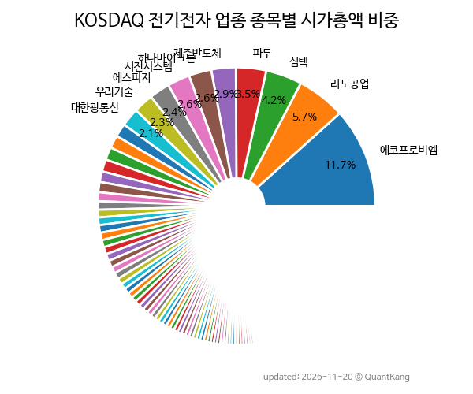

{: .align-center}

> **종목 목록 (316)**

| **종목** | **PER** | **PBR** | **DIV** | **비중** |
| :------- | ------: | ------: | ------: | -------: |
| [에코프로비엠](/247540/) | 208.3 | 4.8 | 0.1<small>%</small> | 11.7<small>%</small> |
| [리노공업](/058470/) | 22.6 | 4.7 | 1.8<small>%</small> | 5.7<small>%</small> |
| [심텍](/222800/) | - | 6.5 | 0.1<small>%</small> | 4.2<small>%</small> |
| 파두 | - | 71.0 | - | 3.5<small>%</small> |
| [제주반도체](/080220/) | 40.9 | 7.1 | - | 2.9<small>%</small> |
| [하나마이크론](/067310/) | 34.4 | 3.6 | 0.3<small>%</small> | 2.6<small>%</small> |
| [서진시스템](/178320/) | - | 2.2 | - | 2.6<small>%</small> |
| [에스피지](/058610/) | 178.2 | 6.3 | 0.3<small>%</small> | 2.4<small>%</small> |
| [우리기술](/032820/) | 1618.0 | 10.7 | - | 2.3<small>%</small> |
| 대한광통신 | - | 28.9 | - | 2.1<small>%</small> |
| [비츠로셀](/082920/) | 15.0 | 2.6 | 1.4<small>%</small> | 1.6<small>%</small> |
| [성호전자](/043260/) | 18.3 | 6.9 | - | 1.5<small>%</small> |
| [대주전자재료](/078600/) | 55.3 | 4.5 | 0.1<small>%</small> | 1.5<small>%</small> |
| [RFHIC](/218410/) | 46.1 | 3.9 | 0.8<small>%</small> | 1.4<small>%</small> |
| [제이앤티씨](/204270/) | - | 3.7 | - | 1.2<small>%</small> |
| [하나머티리얼즈](/166090/) | 21.4 | 1.8 | 0.7<small>%</small> | 1.2<small>%</small> |
| [SFA반도체](/036540/) | - | 2.8 | - | 1.0<small>%</small> |
| [에스앤에스텍](/101490/) | 11.6 | 2.2 | 0.6<small>%</small> | 1.0<small>%</small> |
| 지엔씨에너지 | 11.7 | 2.2 | 0.5<small>%</small> | 0.9<small>%</small> |
| [덕산네오룩스](/213420/) | 8.8 | 1.0 | - | 0.9<small>%</small> |
| 샘씨엔에스 | 53.0 | 4.9 | - | 0.9<small>%</small> |
| [신성델타테크](/065350/) | 35.4 | 3.1 | 0.4<small>%</small> | 0.9<small>%</small> |
| [제룡전기](/033100/) | 9.9 | 2.4 | 3.0<small>%</small> | 0.8<small>%</small> |
| 티엘비 | 45.6 | 6.9 | 1.1<small>%</small> | 0.8<small>%</small> |
| [LS머트리얼즈](/417200/) | 1446.7 | 3.2 | 0.2<small>%</small> | 0.8<small>%</small> |
| 동운아나텍 | 326.4 | 5.0 | 1.0<small>%</small> | 0.8<small>%</small> |
| [인텔리안테크](/189300/) | 56.7 | 1.6 | 0.5<small>%</small> | 0.8<small>%</small> |
| 씨엠티엑스 | - | 1.8 | - | 0.8<small>%</small> |
| [케이엠더블유](/032500/) | - | 6.0 | - | 0.7<small>%</small> |
| RF머트리얼즈 | 61.4 | 8.4 | - | 0.7<small>%</small> |
| 미코 | 19.3 | 5.0 | - | 0.7<small>%</small> |
| 하이젠알앤엠 | - | 3.7 | - | 0.6<small>%</small> |
| [쏠리드](/050890/) | 12.6 | 1.3 | 0.7<small>%</small> | 0.6<small>%</small> |
| 서울반도체 | - | 0.7 | - | 0.6<small>%</small> |
| [가온칩스](/399720/) | - | 7.0 | - | 0.6<small>%</small> |
| 삼지전자 | 4.7 | 0.7 | 2.3<small>%</small> | 0.6<small>%</small> |
| 티에프이 | 41.5 | 7.0 | - | 0.6<small>%</small> |
| [에프에스티](/036810/) | - | 1.7 | - | 0.6<small>%</small> |
| 피노 | - | 4.5 | - | 0.5<small>%</small> |
| 월덱스 | 9.8 | 1.2 | 0.4<small>%</small> | 0.5<small>%</small> |
| 비나텍 | - | 7.3 | - | 0.5<small>%</small> |
| HLB이노베이션 | - | 1.9 | - | 0.5<small>%</small> |
| [아이쓰리시스템](/214430/) | 20.3 | 2.8 | 0.8<small>%</small> | 0.5<small>%</small> |
| 덕산하이메탈 | - | 1.4 | - | 0.5<small>%</small> |
| 네패스 | 23.6 | 3.2 | - | 0.5<small>%</small> |
| PS일렉트로닉스 | 12.7 | 2.2 | - | 0.5<small>%</small> |
| 타이거일렉 | 105.4 | 9.5 | - | 0.5<small>%</small> |
| [이녹스첨단소재](/272290/) | 4.7 | 0.7 | 2.4<small>%</small> | 0.4<small>%</small> |
| 슈프리마 | 11.7 | 1.4 | - | 0.4<small>%</small> |
| 서울바이오시스 | - | 3.2 | - | 0.4<small>%</small> |
| 메카로 | 23.5 | 1.5 | 1.2<small>%</small> | 0.4<small>%</small> |
| [시노펙스](/025320/) | 39.5 | 1.7 | - | 0.4<small>%</small> |
| 오킨스전자 | 33.2 | 5.6 | - | 0.4<small>%</small> |
| 에이디테크놀로지 | 54.9 | 1.5 | - | 0.4<small>%</small> |
| 엠케이전자 | 156.5 | 0.6 | 1.2<small>%</small> | 0.4<small>%</small> |
| 마이크로컨텍솔 | 16.8 | 3.5 | 0.3<small>%</small> | 0.4<small>%</small> |
| 한양디지텍 | 22.1 | 1.9 | - | 0.4<small>%</small> |
| 디케이티 | 25.4 | 2.9 | - | 0.4<small>%</small> |
| 한중엔시에스 | 71.4 | 3.1 | - | 0.3<small>%</small> |
| 더블유씨피 | - | 0.2 | - | 0.3<small>%</small> |
| 오이솔루션 | - | 3.7 | - | 0.3<small>%</small> |
| 파인엠텍 | - | 1.3 | - | 0.3<small>%</small> |
| 빛과전자 | - | 3.4 | - | 0.3<small>%</small> |
| LB세미콘 | - | 0.5 | - | 0.3<small>%</small> |
| 파트론 | 5.2 | 0.3 | 8.9<small>%</small> | 0.3<small>%</small> |
| 인탑스 | 13.0 | 0.3 | 1.5<small>%</small> | 0.3<small>%</small> |
| 에이팩트 | 49.5 | 3.7 | - | 0.3<small>%</small> |
| 비덴트 | 29.1 | 0.4 | - | 0.3<small>%</small> |
| 아이씨티케이 | - | 4.9 | - | 0.3<small>%</small> |
| KH바텍 | 10.4 | 0.8 | 3.8<small>%</small> | 0.3<small>%</small> |
| LIG아큐버 | - | 1.5 | 0.3<small>%</small> | 0.3<small>%</small> |
| 대아티아이 | 7.2 | 1.0 | - | 0.3<small>%</small> |
| 상신이디피 | 117.9 | 1.5 | 0.6<small>%</small> | 0.3<small>%</small> |
| 세나테크놀로지 | 7.2 | 0.8 | - | 0.3<small>%</small> |
| 서호전기 | 8.7 | 2.2 | 15.0<small>%</small> | 0.3<small>%</small> |
| 에이직랜드 | - | 2.7 | - | 0.3<small>%</small> |
| 아이엘 | - | 6.2 | - | 0.3<small>%</small> |
| 채비 | - | 1.8 | - | 0.2<small>%</small> |
| 칩스앤미디어 | 34.0 | 2.4 | 1.2<small>%</small> | 0.2<small>%</small> |
| 강원에너지 | - | 4.9 | - | 0.2<small>%</small> |
| 도우인시스 | 271.2 | 0.9 | - | 0.2<small>%</small> |
| 아리바이오홀딩스 | - | 1.5 | - | 0.2<small>%</small> |
| 에스엔시스 | 7.8 | 0.9 | 2.8<small>%</small> | 0.2<small>%</small> |
| 우주일렉트로 | 5.5 | 0.5 | 2.4<small>%</small> | 0.2<small>%</small> |
| 옵티코어 | - | 8.9 | - | 0.2<small>%</small> |
| 사피엔반도체 | - | 13.5 | - | 0.2<small>%</small> |
| 코텍 | 3.8 | 0.3 | 3.6<small>%</small> | 0.2<small>%</small> |
| 메가터치 | - | 1.9 | - | 0.2<small>%</small> |
| 케이엔제이 | 6.5 | 1.7 | - | 0.2<small>%</small> |
| 아이티엠반도체 | - | 1.0 | - | 0.2<small>%</small> |
| 신흥에스이씨 | - | 0.5 | - | 0.2<small>%</small> |
| 나무가 | 8.9 | 1.3 | 4.7<small>%</small> | 0.2<small>%</small> |
| 티씨머티리얼즈 | 67.2 | 1.5 | - | 0.2<small>%</small> |
| 이랜시스 | 31.8 | 2.5 | 1.1<small>%</small> | 0.2<small>%</small> |
| 에치에프알 | - | 0.8 | - | 0.2<small>%</small> |
| 아이디스 | 7.8 | 0.6 | 2.9<small>%</small> | 0.2<small>%</small> |
| 이랜텍 | 4.5 | 0.5 | 2.1<small>%</small> | 0.2<small>%</small> |
| 에브리봇 | - | 2.3 | - | 0.2<small>%</small> |
| 아나패스 | 44.3 | 1.6 | 2.5<small>%</small> | 0.2<small>%</small> |
| 아모텍 | 21.9 | 1.1 | - | 0.2<small>%</small> |
| 지투파워 | 20.5 | 2.7 | 1.6<small>%</small> | 0.2<small>%</small> |
| 코칩 | 41.0 | 2.1 | 2.7<small>%</small> | 0.2<small>%</small> |
| 제일일렉트릭 | 17.9 | 0.8 | 1.9<small>%</small> | 0.2<small>%</small> |
| 져스텍 | - | 5.2 | - | 0.2<small>%</small> |
| 빅솔론 | 5.7 | 0.5 | 4.5<small>%</small> | 0.2<small>%</small> |
| 와이솔 | - | 0.6 | 8.1<small>%</small> | 0.2<small>%</small> |
| 유비쿼스 | 5.8 | 0.7 | 5.0<small>%</small> | 0.2<small>%</small> |
| 코스텍시스 | - | 3.2 | - | 0.2<small>%</small> |
| 에이치엠넥스 | 11.1 | 0.9 | - | 0.2<small>%</small> |
| 자람테크놀로지 | - | 1.6 | - | 0.2<small>%</small> |
| 동양이엔피 | 1.9 | 0.2 | 3.5<small>%</small> | 0.2<small>%</small> |
| 범한퓨얼셀 | 72.3 | 0.7 | - | 0.2<small>%</small> |
| 텔레칩스 | - | 0.8 | - | 0.2<small>%</small> |
| 에스텍 | 4.8 | 0.9 | 3.5<small>%</small> | 0.2<small>%</small> |
| 새로닉스 | - | 1.1 | - | 0.2<small>%</small> |
| 에이스테크 | - | 1.7 | - | 0.2<small>%</small> |
| 케이알엠 | - | 1.7 | - | 0.2<small>%</small> |
| 인터플렉스 | 3.5 | 0.4 | - | 0.2<small>%</small> |
| 에코앤드림 | - | 0.6 | - | 0.1<small>%</small> |
| 피델릭스 | - | 5.0 | - | 0.1<small>%</small> |
| 오늘이엔엠 | - | 23.4 | - | 0.1<small>%</small> |
| 슈프리마에이치큐 | 9.4 | 0.5 | - | 0.1<small>%</small> |
| 어보브반도체 | 9.6 | 0.8 | 3.4<small>%</small> | 0.1<small>%</small> |
| 코맥스 | - | 4.6 | - | 0.1<small>%</small> |
| 엠디바이스 | 7.1 | 1.7 | - | 0.1<small>%</small> |
| 알에스오토메이션 | - | 1.6 | - | 0.1<small>%</small> |
| 비씨엔씨 | 87.2 | 1.3 | - | 0.1<small>%</small> |
| 퀄리타스반도체 | - | 3.1 | - | 0.1<small>%</small> |
| 세경하이테크 | 2.0 | 0.6 | 3.5<small>%</small> | 0.1<small>%</small> |
| 라이콤 | 375.0 | 4.2 | - | 0.1<small>%</small> |
| 아진엑스텍 | 125.2 | 2.6 | - | 0.1<small>%</small> |
| 아바텍 | 16.1 | 0.7 | 2.5<small>%</small> | 0.1<small>%</small> |
| AP위성 | - | 1.2 | - | 0.1<small>%</small> |
| 제노코 | - | 1.3 | - | 0.1<small>%</small> |
| 라온텍 | - | 4.7 | - | 0.1<small>%</small> |
| 유아이엘 | 4.7 | 0.5 | 11.8<small>%</small> | 0.1<small>%</small> |
| 성우 | 17.2 | 0.4 | 5.5<small>%</small> | 0.1<small>%</small> |
| 그린리소스 | 6.4 | 0.9 | - | 0.1<small>%</small> |
| 중앙첨단소재 | - | 0.4 | - | 0.1<small>%</small> |
| 파워로직스 | - | 0.5 | - | 0.1<small>%</small> |
| 파세코 | 37.8 | 1.6 | 2.1<small>%</small> | 0.1<small>%</small> |
| 한울소재과학 | - | 1.4 | - | 0.1<small>%</small> |
| 토비스 | 3.3 | 0.5 | 3.3<small>%</small> | 0.1<small>%</small> |
| 지오엘리먼트 | 12.0 | 1.1 | 1.2<small>%</small> | 0.1<small>%</small> |
| 케이앤에스아이앤씨 | - | 1.7 | - | 0.1<small>%</small> |
| 탑런토탈솔루션 | 15.2 | 0.6 | 2.9<small>%</small> | 0.1<small>%</small> |
| 다산네트웍스 | - | 0.3 | 0.9<small>%</small> | 0.1<small>%</small> |
| 다원시스 | - | - | - | 0.1<small>%</small> |
| 아이앤씨 | 17.8 | 2.3 | - | 0.1<small>%</small> |
| 에이엘티 | - | 0.6 | - | 0.1<small>%</small> |
| 엑스페릭스 | - | 0.8 | - | 0.1<small>%</small> |
| 서원인텍 | 12.4 | 0.4 | 8.0<small>%</small> | 0.1<small>%</small> |
| 아비코전자 | 7.4 | 0.6 | 0.6<small>%</small> | 0.1<small>%</small> |
| 아모그린텍 | 13.3 | 1.0 | - | 0.1<small>%</small> |
| 에이치엔에스하이텍 | 7.2 | 0.6 | 2.8<small>%</small> | 0.1<small>%</small> |
| 광무 | - | 0.4 | - | 0.1<small>%</small> |
| 웨이비스 | 40.9 | 1.4 | - | 0.1<small>%</small> |
| 폴레드 | 5.9 | 1.4 | - | 0.1<small>%</small> |
| 로보로보 | - | 2.0 | - | 0.1<small>%</small> |
| 파워넷 | 3.7 | 0.4 | - | 0.1<small>%</small> |
| 풍원정밀 | - | 3.8 | - | 0.1<small>%</small> |
| 액스비스 | 10.2 | 1.9 | - | 0.1<small>%</small> |
| 키스트론 | 6.3 | 0.3 | 1.4<small>%</small> | 0.1<small>%</small> |
| 코아시아 | - | 1.2 | - | 0.1<small>%</small> |
| 가온그룹 | 8.0 | 0.4 | 2.2<small>%</small> | 0.1<small>%</small> |
| 모베이스 | 5.8 | 0.2 | 4.6<small>%</small> | 0.1<small>%</small> |
| 액트로 | 8.7 | 0.9 | 1.4<small>%</small> | 0.1<small>%</small> |
| 우리넷 | 18.2 | 0.7 | 0.8<small>%</small> | 0.1<small>%</small> |
| 네오뷰 | - | - | - | 0.1<small>%</small> |
| 아이에스티이 | - | 1.6 | - | 0.1<small>%</small> |
| 블루콤 | 5.8 | 0.5 | - | 0.1<small>%</small> |
| 포커스에이아이 | - | 2.7 | - | 0.1<small>%</small> |
| 한국컴퓨터 | 2.3 | 0.3 | 8.5<small>%</small> | 0.1<small>%</small> |
| 자이글 | - | 3.7 | - | 0.1<small>%</small> |
| 싸이닉솔루션 | 27.9 | 1.4 | - | 0.1<small>%</small> |
| 유라테크 | 5.1 | 0.4 | 4.1<small>%</small> | 0.1<small>%</small> |
| 팅크웨어 | - | 0.3 | - | 0.1<small>%</small> |
| 아이디피 | 5.2 | 0.8 | 3.8<small>%</small> | 0.1<small>%</small> |
| 트루엔 | 5.8 | 0.6 | 3.0<small>%</small> | 0.1<small>%</small> |
| 빛샘전자 | 10.4 | 0.9 | 0.7<small>%</small> | 0.1<small>%</small> |
| 이엠텍 | - | 0.4 | - | 0.1<small>%</small> |
| 뉴프렉스 | 7.4 | 0.6 | 3.8<small>%</small> | 0.1<small>%</small> |
| 서남 | - | 4.8 | - | 0.1<small>%</small> |
| 센서뷰 | - | 4.2 | - | 0.1<small>%</small> |
| 벡트 | - | 1.2 | - | 0.1<small>%</small> |
| 한국첨단소재 | - | 2.9 | - | 0.1<small>%</small> |
| 바이오스마트 | 6.0 | 0.4 | - | 0.1<small>%</small> |
| APS이노베이션 | 722.5 | 0.4 | - | 0.1<small>%</small> |
| 기가레인 | - | 1.1 | - | 0.1<small>%</small> |
| 넥스트칩 | - | 2.4 | - | 0.1<small>%</small> |
| 큐에스아이 | 24.9 | 0.7 | 1.4<small>%</small> | 0.1<small>%</small> |
| TJ미디어 | 18.4 | 0.9 | 9.1<small>%</small> | 0.1<small>%</small> |
| 탑머티리얼 | - | 0.5 | - | 0.1<small>%</small> |
| 위닉스 | - | 0.3 | 4.1<small>%</small> | 0.1<small>%</small> |
| 현대에이치티 | 5.4 | 0.5 | 6.1<small>%</small> | 0.1<small>%</small> |
| 아모센스 | 103.3 | 1.2 | - | 0.1<small>%</small> |
| 머큐리 | - | 0.4 | - | 0.1<small>%</small> |
| 알트 | 5.2 | 0.6 | - | 0.1<small>%</small> |
| 엔시스 | - | 0.7 | 1.2<small>%</small> | 0.1<small>%</small> |
| 아고스 | - | 1.3 | - | 0.1<small>%</small> |
| 코츠테크놀로지 | 5.1 | 0.7 | 1.8<small>%</small> | 0.1<small>%</small> |
| DGI | - | 1.8 | - | 0.1<small>%</small> |
| 위츠 | 23.2 | 1.1 | 8.5<small>%</small> | 0.1<small>%</small> |
| 와이엠씨 | 42.3 | 0.5 | 2.4<small>%</small> | 0.1<small>%</small> |
| 덕우전자 | 7.2 | 0.5 | - | 0.1<small>%</small> |
| 알에프텍 | - | 0.2 | - | 0.1<small>%</small> |
| 푸른로보틱스 | - | 1.0 | - | 0.1<small>%</small> |
| 프리엠스 | 43.9 | 0.6 | 1.8<small>%</small> | 0.1<small>%</small> |
| 와이엠텍 | 14.9 | 0.8 | 2.1<small>%</small> | 0.1<small>%</small> |
| 엠투엔 | - | 0.3 | - | 0.1<small>%</small> |
| 유티아이 | - | 0.6 | - | 0.1<small>%</small> |
| 윈팩 | - | 0.8 | - | 0.1<small>%</small> |
| 현우산업 | 6.6 | 0.4 | 2.6<small>%</small> | 0.1<small>%</small> |
| 파이오링크 | 9.1 | 0.8 | 3.4<small>%</small> | 0.1<small>%</small> |
| 씨유테크 | 30.7 | 0.4 | 1.0<small>%</small> | 0.1<small>%</small> |
| 알파칩스 | - | 1.4 | - | 0.1<small>%</small> |
| 알에프세미 | - | - | - | 0.1<small>%</small> |
| 코위버 | 12.2 | 0.3 | 1.1<small>%</small> | 0.1<small>%</small> |
| 코콤 | 7.3 | 0.3 | 6.0<small>%</small> | 0.1<small>%</small> |
| 에스씨디 | 7.4 | 0.3 | 5.1<small>%</small> | 0.1<small>%</small> |
| 엘컴텍 | 21.9 | 0.7 | - | 0.1<small>%</small> |
| 모티브링크 | - | 0.9 | - | 0.1<small>%</small> |
| 다보링크 | - | 0.8 | - | 0.1<small>%</small> |
| 옵티시스 | 7.7 | 0.6 | 3.5<small>%</small> | 0.1<small>%</small> |
| 앱코 | 5.9 | 0.6 | 20.9<small>%</small> | 0.1<small>%</small> |
| 이브이첨단소재 | - | 0.3 | - | 0.1<small>%</small> |
| 에이프로 | - | 0.5 | 2.3<small>%</small> | 0.1<small>%</small> |
| 캐프 | 1.7 | 0.2 | - | 0.1<small>%</small> |
| 에이텀 | - | 11.6 | - | 0.1<small>%</small> |
| 에이텍모빌리티 | 51.8 | 0.5 | 4.3<small>%</small> | 0.1<small>%</small> |
| 제이엠티 | 2.6 | 0.3 | 2.7<small>%</small> | 0.1<small>%</small> |
| 프로이천 | 7.7 | 0.7 | 5.4<small>%</small> | 0.1<small>%</small> |
| 아이컴포넌트 | 4.8 | 0.6 | 3.4<small>%</small> | 0.0<small>%</small> |
| 위너스일렉 | 7.1 | 0.8 | 10.0<small>%</small> | 0.0<small>%</small> |
| 하츠 | 3.7 | 0.3 | 5.0<small>%</small> | 0.0<small>%</small> |
| 엘엠에스 | - | 0.5 | 4.9<small>%</small> | 0.0<small>%</small> |
| 마이크로투나노 | - | 1.4 | - | 0.0<small>%</small> |
| 상신전자 | 23.2 | 0.8 | - | 0.0<small>%</small> |
| 루멘스 | - | 0.1 | - | 0.0<small>%</small> |
| 쏘닉스 | - | 1.4 | - | 0.0<small>%</small> |
| 알엔티엑스 | - | 1.6 | - | 0.0<small>%</small> |
| 서전기전 | 4.9 | 0.9 | - | 0.0<small>%</small> |
| 백금T&A | 9.4 | 0.6 | 4.0<small>%</small> | 0.0<small>%</small> |
| 디에이피 | - | 5.4 | - | 0.0<small>%</small> |
| 대보마그네틱 | - | 1.6 | - | 0.0<small>%</small> |
| 포톤 | - | 0.6 | - | 0.0<small>%</small> |
| 쓰리에이로직스 | - | 0.6 | - | 0.0<small>%</small> |
| 동일기연 | 7.8 | 0.7 | 3.8<small>%</small> | 0.0<small>%</small> |
| 유니온바이오메트릭스 | 15.1 | 0.7 | 3.6<small>%</small> | 0.0<small>%</small> |
| 셀피글로벌 | - | 3.4 | - | 0.0<small>%</small> |
| DH오토웨어 | - | 0.5 | - | 0.0<small>%</small> |
| 성우전자 | 2.6 | 0.3 | 2.3<small>%</small> | 0.0<small>%</small> |
| 화인써키트 | - | 0.7 | 8.0<small>%</small> | 0.0<small>%</small> |
| 인지디스플레 | 3.5 | 0.1 | 7.0<small>%</small> | 0.0<small>%</small> |
| 엣지파운드리 | 1.0 | 0.1 | - | 0.0<small>%</small> |
| 포인트모바일 | 9.5 | 0.5 | 4.5<small>%</small> | 0.0<small>%</small> |
| 기산텔레콤 | 6.0 | 0.5 | - | 0.0<small>%</small> |
| 오디텍 | 28.5 | 0.2 | 4.1<small>%</small> | 0.0<small>%</small> |
| 테크엘 | - | 0.3 | - | 0.0<small>%</small> |
| 에스디시스템 | 25.4 | 2.7 | - | 0.0<small>%</small> |
| 파인디지털 | - | 0.2 | 1.9<small>%</small> | 0.0<small>%</small> |
| 신화콘텍 | 9.3 | 0.4 | 1.6<small>%</small> | 0.0<small>%</small> |
| 픽셀플러스 | - | 0.2 | - | 0.0<small>%</small> |
| 에스코넥 | 0.6 | 0.2 | - | 0.0<small>%</small> |
| 아틀라스링크 | 5.5 | 0.6 | - | 0.0<small>%</small> |
| 캠시스 | - | 0.5 | - | 0.0<small>%</small> |
| 파인테크닉스 | - | 0.3 | - | 0.0<small>%</small> |
| 링크드 | - | 0.4 | - | 0.0<small>%</small> |
| 시그네틱스 | - | 0.7 | - | 0.0<small>%</small> |
| 하이딥 | - | 8.5 | - | 0.0<small>%</small> |
| 파인디앤씨 | - | 0.4 | - | 0.0<small>%</small> |
| 이노인스트루먼트 | - | 0.4 | - | 0.0<small>%</small> |
| 에이루트 | - | 0.2 | - | 0.0<small>%</small> |
| 에스프리즘 | - | 0.4 | - | 0.0<small>%</small> |
| 에프알텍 | 10.4 | 0.4 | 3.9<small>%</small> | 0.0<small>%</small> |
| 서울전자통신 | - | 2.8 | - | 0.0<small>%</small> |
| 성우테크론 | 5.7 | 0.4 | 0.8<small>%</small> | 0.0<small>%</small> |
| 파버나인 | - | 0.3 | 3.6<small>%</small> | 0.0<small>%</small> |
| 삼진 | 6.0 | 0.2 | 3.5<small>%</small> | 0.0<small>%</small> |
| S&K폴리텍 | 7.5 | 0.3 | - | 0.0<small>%</small> |
| 아이언디바이스 | - | 0.7 | - | 0.0<small>%</small> |
| 아이에이 | - | 0.3 | - | 0.0<small>%</small> |
| 씨엔플러스 | - | 2.0 | - | 0.0<small>%</small> |
| 에스에너지 | - | 0.3 | - | 0.0<small>%</small> |
| 모아텍 | - | 0.3 | - | 0.0<small>%</small> |
| 피앤씨테크 | - | 0.4 | 3.5<small>%</small> | 0.0<small>%</small> |
| 엔시트론 | - | 0.4 | - | 0.0<small>%</small> |
| 다산솔루에타 | 1.4 | 0.3 | - | 0.0<small>%</small> |
| 세진티에스 | 12.0 | 0.2 | - | 0.0<small>%</small> |
| 딜리 | 10.2 | 0.3 | 13.2<small>%</small> | 0.0<small>%</small> |
| 파루 | - | 0.9 | - | 0.0<small>%</small> |
| 인터엠 | 10.0 | 0.5 | - | 0.0<small>%</small> |
| 시지트로닉스 | - | 0.6 | - | 0.0<small>%</small> |
| 이지트로닉스 | - | 0.5 | - | 0.0<small>%</small> |
| 라닉스 | - | 0.8 | - | 0.0<small>%</small> |
| 핌스 | - | 0.4 | - | 0.0<small>%</small> |
| 삼영에스앤씨 | - | 1.2 | - | 0.0<small>%</small> |
| 비츠로시스 | 6.2 | 0.5 | - | 0.0<small>%</small> |
| 엘디티 | 14.6 | 0.9 | - | 0.0<small>%</small> |
| 디지아이 | - | 0.5 | - | 0.0<small>%</small> |
| 웰킵스하이텍 | - | 0.6 | - | 0.0<small>%</small> |
| 알엔투테크놀로지 | - | 0.4 | - | 0.0<small>%</small> |
| 유아이디 | 11.5 | 0.8 | - | 0.0<small>%</small> |
| 우리이앤엘하루틴 | - | 0.3 | 3.3<small>%</small> | 0.0<small>%</small> |
| 지니틱스 | - | 0.7 | - | 0.0<small>%</small> |
| 아이씨에이치 | - | 0.4 | - | 0.0<small>%</small> |
| 이미지스 | - | 1.2 | - | 0.0<small>%</small> |
| CS | - | 0.4 | - | 0.0<small>%</small> |
| 더코디 | 0.3 | 0.1 | - | 0.0<small>%</small> |
| 육일씨엔에쓰 | 14.8 | 1.2 | - | 0.0<small>%</small> |
| 삼영이엔씨 | 14.7 | 0.7 | - | 0.0<small>%</small> |
| 케스피온 | - | 0.9 | - | 0.0<small>%</small> |
| 나노씨엠에스 | - | 1.1 | - | 0.0<small>%</small> |
| 케이이엠텍 | - | 0.3 | - | 0.0<small>%</small> |
| 앤씨앤 | 0.6 | 0.2 | - | 0.0<small>%</small> |
| 캐리 | - | 0.2 | - | 0.0<small>%</small> |

