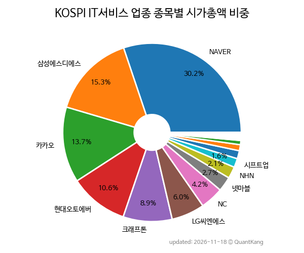

{: .align-center}

> **종목 목록 (25)**

| **종목** | **PER** | **PBR** | **DIV** | **비중** |
| :------- | ------: | ------: | ------: | -------: |
| [NAVER](/035420/) | 13.1 | 0.9 | 1.5<small>%</small> | 30.2<small>%</small> |
| [삼성에스디에스](/018260/) | 23.5 | 1.8 | 1.4<small>%</small> | 15.3<small>%</small> |
| [카카오](/035720/) | 28.4 | 1.2 | 0.2<small>%</small> | 13.7<small>%</small> |
| [현대오토에버](/307950/) | 45.5 | 4.5 | 0.6<small>%</small> | 10.6<small>%</small> |
| [크래프톤](/259960/) | 11.9 | 1.2 | 1.1<small>%</small> | 8.9<small>%</small> |
| [LG씨엔에스](/064400/) | 16.9 | 2.5 | 2.4<small>%</small> | 6.0<small>%</small> |
| [NC](/036570/) | 10.3 | 1.1 | 0.6<small>%</small> | 4.2<small>%</small> |
| [넷마블](/251270/) | 11.4 | 0.5 | 2.8<small>%</small> | 2.7<small>%</small> |
| NHN | 70.5 | 1.5 | 0.7<small>%</small> | 2.1<small>%</small> |
| 시프트업 | 7.4 | 1.5 | - | 1.6<small>%</small> |
| 다우기술 | 2.5 | 0.4 | 6.1<small>%</small> | 1.5<small>%</small> |
| [더블유게임즈](/192080/) | 8.6 | 0.9 | 2.1<small>%</small> | 1.1<small>%</small> |
| NICE평가정보 | 12.7 | 2.1 | 3.1<small>%</small> | 0.8<small>%</small> |
| DB | 9.5 | 1.1 | - | 0.3<small>%</small> |
| 롯데이노베이트 | 24.9 | 0.6 | 4.3<small>%</small> | 0.2<small>%</small> |
| YG PLUS | 8.6 | 1.0 | 1.0<small>%</small> | 0.2<small>%</small> |
| 신세계 I&C | 6.2 | 0.4 | 4.2<small>%</small> | 0.2<small>%</small> |
| 키다리스튜디오 | 17.9 | 0.6 | - | 0.1<small>%</small> |
| 텔코웨어 | 11.2 | 0.6 | 4.8<small>%</small> | 0.1<small>%</small> |
| 아시아나IDT | 10.6 | 0.8 | 4.2<small>%</small> | 0.1<small>%</small> |
| KTcs | 3.7 | 0.4 | 4.4<small>%</small> | 0.1<small>%</small> |
| KTis | 2.2 | 0.3 | 5.3<small>%</small> | 0.1<small>%</small> |
| 아이티센씨티에스 | 1.2 | 0.3 | - | 0.1<small>%</small> |
| 유엔젤 | 10.8 | 0.7 | 2.6<small>%</small> | 0.1<small>%</small> |
| 미래아이앤지 | - | 0.5 | - | 0.0<small>%</small> |

