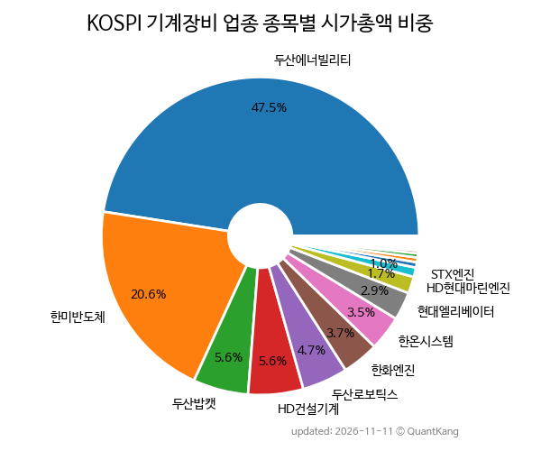

{: .align-center}

> **종목 목록 (33)**

| **종목** | **PER** | **PBR** | **DIV** | **비중** |
| :------- | ------: | ------: | ------: | -------: |
| [두산에너빌리티](/034020/) | 358.7 | 3.9 | - | 47.5<small>%</small> |
| [한미반도체](/042700/) | 81.6 | 25.3 | 0.4<small>%</small> | 20.6<small>%</small> |
| [두산밥캣](/241560/) | 12.6 | 0.7 | 3.2<small>%</small> | 5.6<small>%</small> |
| [HD건설기계](/267270/) | 16.2 | 0.9 | 0.6<small>%</small> | 5.6<small>%</small> |
| [두산로보틱스](/454910/) | - | 9.9 | - | 4.7<small>%</small> |
| [한화엔진](/082740/) | 13.3 | 4.1 | - | 3.7<small>%</small> |
| [한온시스템](/018880/) | - | 0.8 | - | 3.5<small>%</small> |
| [현대엘리베이터](/017800/) | 9.3 | 1.8 | 20.8<small>%</small> | 2.9<small>%</small> |
| [HD현대마린엔진](/071970/) | 8.1 | 2.7 | - | 1.7<small>%</small> |
| STX엔진 | 8.7 | 1.8 | - | 1.0<small>%</small> |
| SNT에너지 | 6.3 | 1.4 | 4.3<small>%</small> | 0.5<small>%</small> |
| 전진건설로봇 | 20.5 | 4.2 | 3.1<small>%</small> | 0.5<small>%</small> |
| 엠앤씨솔루션 | 7.1 | 1.7 | 21.0<small>%</small> | 0.4<small>%</small> |
| TYM | 7.6 | 0.7 | 3.9<small>%</small> | 0.3<small>%</small> |
| 대동 | - | 0.4 | 1.5<small>%</small> | 0.2<small>%</small> |
| 삼익THK | - | 0.9 | 0.7<small>%</small> | 0.2<small>%</small> |
| 디와이파워 | 4.7 | 0.4 | 4.7<small>%</small> | 0.1<small>%</small> |
| 수산세보틱스 | 7.0 | 0.6 | 0.6<small>%</small> | 0.1<small>%</small> |
| 계양전기 | - | 3.6 | - | 0.1<small>%</small> |
| KC코트렐 | - | 2.0 | - | 0.1<small>%</small> |
| DKME | - | 0.8 | - | 0.1<small>%</small> |
| 화천기공 | 6.9 | 0.2 | 3.6<small>%</small> | 0.1<small>%</small> |
| 한신기계 | - | 0.7 | 1.1<small>%</small> | 0.1<small>%</small> |
| 우신시스템 | 3.5 | 0.3 | 0.9<small>%</small> | 0.1<small>%</small> |
| 화천기계 | 28.0 | 0.6 | 0.6<small>%</small> | 0.1<small>%</small> |
| 기신정기 | - | 0.2 | 3.4<small>%</small> | 0.1<small>%</small> |
| 이엔플러스 | 46.0 | 2.6 | - | 0.0<small>%</small> |
| 씨케이솔루션 | - | 0.9 | - | 0.0<small>%</small> |
| 우진플라임 | 15.9 | 0.3 | 2.8<small>%</small> | 0.0<small>%</small> |
| 한국주강 | - | 0.9 | - | 0.0<small>%</small> |
| 참엔지니어링 | - | 0.3 | - | 0.0<small>%</small> |
| 다이나믹디자인 | - | 0.2 | - | 0.0<small>%</small> |
| 계양전기우 | - | - | - | 0.0<small>%</small> |

