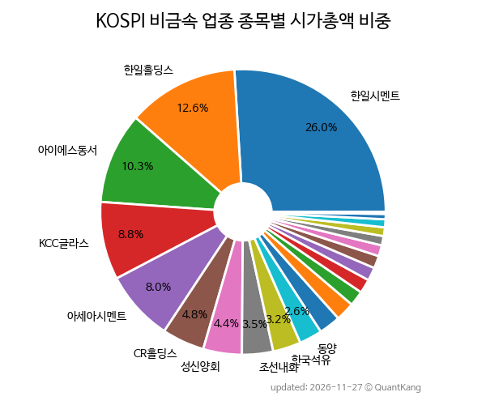

{: .align-center}

> **종목 목록 (24)**

| **종목** | **PER** | **PBR** | **DIV** | **비중** |
| :------- | ------: | ------: | ------: | -------: |
| [한일시멘트](/300720/) | 14.3 | 0.6 | 6.6<small>%</small> | 26.0<small>%</small> |
| 한일홀딩스 | 16.2 | 0.3 | 6.0<small>%</small> | 12.6<small>%</small> |
| 아이에스동서 | - | 0.3 | 3.6<small>%</small> | 10.3<small>%</small> |
| KCC글라스 | - | 0.2 | 7.4<small>%</small> | 8.8<small>%</small> |
| 아세아시멘트 | 17.8 | 0.3 | 3.0<small>%</small> | 8.0<small>%</small> |
| CR홀딩스 | - | 0.3 | 10.4<small>%</small> | 4.8<small>%</small> |
| 성신양회 | 6.7 | 0.3 | 5.0<small>%</small> | 4.4<small>%</small> |
| 조선내화 | 55.9 | 0.6 | 9.5<small>%</small> | 3.5<small>%</small> |
| 한국석유 | 23.3 | 0.6 | 1.2<small>%</small> | 3.2<small>%</small> |
| 동양 | 4.7 | 0.1 | - | 2.6<small>%</small> |
| 태경비케이 | 3.9 | 0.4 | 4.4<small>%</small> | 2.4<small>%</small> |
| 벽산 | 2.7 | 0.2 | 2.7<small>%</small> | 2.1<small>%</small> |
| 대림바스 | 5.0 | 0.4 | 4.4<small>%</small> | 1.7<small>%</small> |
| 제일연마 | 4.2 | 0.5 | 8.5<small>%</small> | 1.6<small>%</small> |
| 한국내화 | - | 0.3 | - | 1.5<small>%</small> |
| 삼일씨엔에스 | 35.6 | 0.2 | - | 1.4<small>%</small> |
| 부산산업 | - | 0.3 | 0.7<small>%</small> | 1.2<small>%</small> |
| 유니온 | 1.4 | 0.3 | 5.8<small>%</small> | 1.1<small>%</small> |
| 유니온머티리얼 | 8.2 | 1.0 | - | 1.0<small>%</small> |
| 금비 | 14.3 | 0.4 | 3.2<small>%</small> | 0.9<small>%</small> |
| 티웨이홀딩스 | - | 0.2 | - | 0.6<small>%</small> |
| 성신양회우 | - | - | 4.8<small>%</small> | 0.1<small>%</small> |
| 동양우 | - | - | - | 0.1<small>%</small> |
| 동양2우B | - | - | - | 0.0<small>%</small> |

