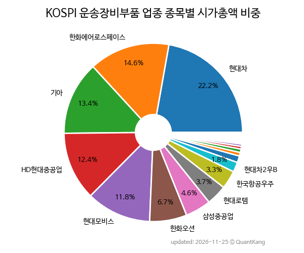

{: .align-center}

> **종목 목록 (65)**

| **종목** | **PER** | **PBR** | **DIV** | **비중** |
| :------- | ------: | ------: | ------: | -------: |
| [현대차](/005380/) | 7.4 | 0.6 | 3.8<small>%</small> | 22.2<small>%</small> |
| [한화에어로스페이스](/012450/) | 22.8 | 3.5 | 1.1<small>%</small> | 14.6<small>%</small> |
| [기아](/000270/) | 4.9 | 0.6 | 7.2<small>%</small> | 13.4<small>%</small> |
| [HD현대중공업](/329180/) | 17.2 | 3.0 | 2.1<small>%</small> | 12.4<small>%</small> |
| [현대모비스](/012330/) | 8.7 | 0.7 | 1.8<small>%</small> | 11.8<small>%</small> |
| [한화오션](/042660/) | 11.7 | 2.3 | - | 6.7<small>%</small> |
| [삼성중공업](/010140/) | 26.1 | 3.4 | - | 4.6<small>%</small> |
| [현대로템](/064350/) | 9.9 | 2.5 | 0.9<small>%</small> | 3.7<small>%</small> |
| [한국항공우주](/047810/) | 56.3 | 5.7 | 0.5<small>%</small> | 3.3<small>%</small> |
| 현대차2우B | - | - | 6.9<small>%</small> | 1.8<small>%</small> |
| 현대차우 | - | - | 7.0<small>%</small> | 1.2<small>%</small> |
| [에스엘](/005850/) | 7.0 | 0.8 | 5.9<small>%</small> | 0.6<small>%</small> |
| [HL만도](/204320/) | 15.9 | 0.6 | 2.2<small>%</small> | 0.6<small>%</small> |
| 대한조선 | 4.7 | 1.2 | 0.7<small>%</small> | 0.5<small>%</small> |
| [현대위아](/011210/) | 13.4 | 0.4 | 2.4<small>%</small> | 0.4<small>%</small> |
| SNT다이내믹스 | 11.3 | 0.8 | 5.9<small>%</small> | 0.3<small>%</small> |
| SNT모티브 | 9.2 | 0.6 | 6.3<small>%</small> | 0.2<small>%</small> |
| 세진중공업 | 7.6 | 1.7 | 3.3<small>%</small> | 0.2<small>%</small> |
| KG모빌리티 | 8.9 | 0.3 | - | 0.1<small>%</small> |
| 현대차3우B | - | - | 7.0<small>%</small> | 0.1<small>%</small> |
| 명신산업 | 5.3 | 0.5 | 1.4<small>%</small> | 0.1<small>%</small> |
| 일진하이솔루스 | - | 1.1 | - | 0.1<small>%</small> |
| 서연이화 | 4.4 | 0.2 | 2.6<small>%</small> | 0.1<small>%</small> |
| 화신 | 3.2 | 0.4 | 2.8<small>%</small> | 0.1<small>%</small> |
| 대원강업 | 7.0 | 0.5 | 2.7<small>%</small> | 0.1<small>%</small> |
| 디아이씨 | - | 1.1 | - | 0.1<small>%</small> |
| 모토닉 | 8.0 | 0.5 | 7.9<small>%</small> | 0.1<small>%</small> |
| SJG세종 | 2.2 | 0.3 | 3.5<small>%</small> | 0.0<small>%</small> |
| DH오토넥스 | 41.6 | 4.8 | - | 0.0<small>%</small> |
| 에스엠벡셀 | 165.3 | 3.9 | - | 0.0<small>%</small> |
| 대창단조 | 4.8 | 0.4 | 3.3<small>%</small> | 0.0<small>%</small> |
| 화승코퍼레이션 | 1.3 | 0.4 | 3.5<small>%</small> | 0.0<small>%</small> |
| 삼성공조 | 11.0 | 0.3 | 0.8<small>%</small> | 0.0<small>%</small> |
| 한국무브넥스 | 4.5 | 0.2 | 3.3<small>%</small> | 0.0<small>%</small> |
| 세원정공 | 2.3 | 0.2 | 1.9<small>%</small> | 0.0<small>%</small> |
| 두올 | 4.3 | 0.4 | 2.8<small>%</small> | 0.0<small>%</small> |
| 삼원강재 | 7.5 | 0.3 | 5.4<small>%</small> | 0.0<small>%</small> |
| 태양금속 | 33.4 | 0.8 | 0.3<small>%</small> | 0.0<small>%</small> |
| 인지컨트롤스 | 4.4 | 0.3 | 5.8<small>%</small> | 0.0<small>%</small> |
| 지엠비코리아 | 4.7 | 0.2 | 6.9<small>%</small> | 0.0<small>%</small> |
| 금호에이치티 | - | 0.2 | - | 0.0<small>%</small> |
| 동원모빌리티 | 1.5 | 0.3 | 3.9<small>%</small> | 0.0<small>%</small> |
| 평화산업 | 2.8 | 0.7 | - | 0.0<small>%</small> |
| 화승알앤에이 | 2.6 | 0.3 | 3.0<small>%</small> | 0.0<small>%</small> |
| 새론오토모티브 | - | 0.2 | 5.0<small>%</small> | 0.0<small>%</small> |
| 디와이덕양 | 49.9 | 0.5 | 3.2<small>%</small> | 0.0<small>%</small> |
| 인팩 | 4.1 | 0.4 | 3.7<small>%</small> | 0.0<small>%</small> |
| 평화홀딩스 | 1.3 | 0.3 | 4.8<small>%</small> | 0.0<small>%</small> |
| SJM | 4.0 | 0.2 | 6.6<small>%</small> | 0.0<small>%</small> |
| 유니켐 | - | 0.4 | - | 0.0<small>%</small> |
| 아진전자부품 | 10.8 | 1.4 | - | 0.0<small>%</small> |
| 상신브레이크 | - | 0.2 | 2.8<small>%</small> | 0.0<small>%</small> |
| 케이비아이동국실업 | 1.4 | 0.2 | - | 0.0<small>%</small> |
| 유성기업 | - | 0.2 | - | 0.0<small>%</small> |
| 부산주공 | - | - | - | 0.0<small>%</small> |
| DYP | 4.8 | 0.3 | 2.7<small>%</small> | 0.0<small>%</small> |
| 영화금속 | 3.1 | 0.5 | 4.5<small>%</small> | 0.0<small>%</small> |
| 디와이에이 | - | 0.7 | - | 0.0<small>%</small> |
| 핸즈코퍼레이션 | - | 0.3 | - | 0.0<small>%</small> |
| 씨티알모빌리티 | - | 0.3 | - | 0.0<small>%</small> |
| SG글로벌 | 6.0 | 0.1 | - | 0.0<small>%</small> |
| 체시스 | 4.2 | 0.6 | - | 0.0<small>%</small> |
| KR모터스 | - | 0.5 | - | 0.0<small>%</small> |
| 태원물산 | - | 0.4 | 9.5<small>%</small> | 0.0<small>%</small> |
| 태양금속우 | - | - | 0.3<small>%</small> | 0.0<small>%</small> |

