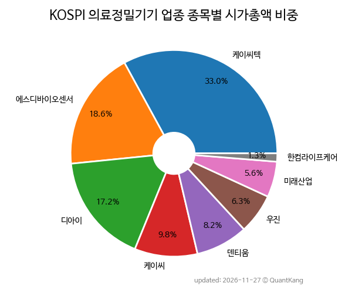

{: .align-center}

> **종목 목록 (8)**

| **종목** | **PER** | **PBR** | **DIV** | **비중** |
| :------- | ------: | ------: | ------: | -------: |
| 케이씨텍 | 30.9 | 3.1 | 0.5<small>%</small> | 33.0<small>%</small> |
| [에스디바이오센서](/137310/) | - | 0.4 | 2.7<small>%</small> | 18.6<small>%</small> |
| 디아이 | 124.5 | 3.9 | 1.0<small>%</small> | 17.2<small>%</small> |
| 케이씨 | 12.6 | 0.6 | 0.9<small>%</small> | 9.8<small>%</small> |
| 덴티움 | 22.7 | 0.7 | 1.4<small>%</small> | 8.2<small>%</small> |
| 우진 | 19.6 | 0.9 | 3.5<small>%</small> | 6.3<small>%</small> |
| 미래산업 | 10.3 | 0.9 | - | 5.6<small>%</small> |
| 한컴라이프케어 | - | 0.3 | - | 1.3<small>%</small> |

