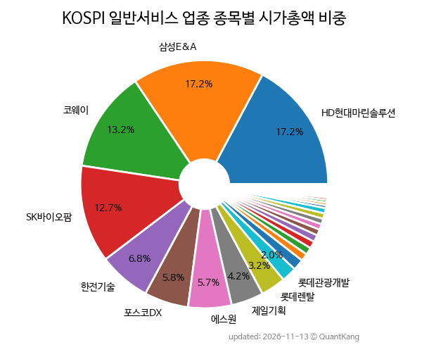

{: .align-center}

> **종목 목록 (35)**

| **종목** | **PER** | **PBR** | **DIV** | **비중** |
| :------- | ------: | ------: | ------: | -------: |
| [HD현대마린솔루션](/443060/) | 29.1 | 9.5 | 2.3<small>%</small> | 17.2<small>%</small> |
| [삼성E&A](/028050/) | 21.8 | 2.8 | 1.1<small>%</small> | 17.2<small>%</small> |
| [코웨이](/021240/) | 11.9 | 2.0 | 1.9<small>%</small> | 13.2<small>%</small> |
| [SK바이오팜](/326030/) | 25.8 | 8.5 | - | 12.7<small>%</small> |
| [한전기술](/052690/) | 32.3 | 4.4 | 1.9<small>%</small> | 6.8<small>%</small> |
| [포스코DX](/022100/) | 62.0 | 5.7 | 0.6<small>%</small> | 5.8<small>%</small> |
| [에스원](/012750/) | 19.2 | 1.9 | 3.2<small>%</small> | 5.7<small>%</small> |
| [제일기획](/030000/) | 9.3 | 1.2 | 6.5<small>%</small> | 4.2<small>%</small> |
| 롯데렌탈 | 16.6 | 1.4 | 2.0<small>%</small> | 3.2<small>%</small> |
| 롯데관광개발 | 28.1 | 2.1 | - | 2.0<small>%</small> |
| 이노션 | 7.6 | 0.7 | 6.8<small>%</small> | 1.5<small>%</small> |
| 쿠쿠홈시스 | 4.4 | 0.5 | 5.2<small>%</small> | 1.0<small>%</small> |
| NICE | 11.3 | 0.6 | 4.6<small>%</small> | 0.9<small>%</small> |
| 하나투어 | 14.7 | 3.1 | 4.0<small>%</small> | 0.9<small>%</small> |
| 녹십자홀딩스 | - | 0.5 | 3.1<small>%</small> | 0.9<small>%</small> |
| 쏘카 | - | 2.0 | 0.9<small>%</small> | 0.8<small>%</small> |
| INVENI | 3.3 | 0.5 | 8.2<small>%</small> | 0.7<small>%</small> |
| [아세아](/002030/) | 9.9 | 0.3 | 3.0<small>%</small> | 0.7<small>%</small> |
| 프레스티지바이오파마 | - | - | - | 0.7<small>%</small> |
| 한전산업 | 76.0 | 3.0 | 4.0<small>%</small> | 0.7<small>%</small> |
| AJ네트웍스 | 6.5 | 0.4 | 8.0<small>%</small> | 0.4<small>%</small> |
| 한미글로벌 | 9.2 | 0.8 | 2.4<small>%</small> | 0.4<small>%</small> |
| 도화엔지니어링 | 23.6 | 0.7 | 5.8<small>%</small> | 0.3<small>%</small> |
| 유수홀딩스 | 9.9 | 0.5 | 5.5<small>%</small> | 0.3<small>%</small> |
| 효성ITX | 8.8 | 1.8 | 6.5<small>%</small> | 0.3<small>%</small> |
| 제일파마홀딩스 | 7.3 | 0.3 | 1.0<small>%</small> | 0.2<small>%</small> |
| 대성홀딩스 | 6.3 | 0.2 | 3.7<small>%</small> | 0.2<small>%</small> |
| HS애드 | 5.8 | 0.5 | 8.8<small>%</small> | 0.2<small>%</small> |
| 모나용평 | - | 0.2 | - | 0.2<small>%</small> |
| 대교 | - | 0.2 | 8.2<small>%</small> | 0.2<small>%</small> |
| 성창기업지주 | - | 0.1 | - | 0.1<small>%</small> |
| 웅진씽크빅 | - | 0.2 | 14.8<small>%</small> | 0.1<small>%</small> |
| 한국종합기술 | 4.2 | 0.2 | 4.3<small>%</small> | 0.1<small>%</small> |
| 녹십자홀딩스2우 | - | - | 1.7<small>%</small> | 0.0<small>%</small> |
| 대교우B | - | - | 12.3<small>%</small> | 0.0<small>%</small> |

