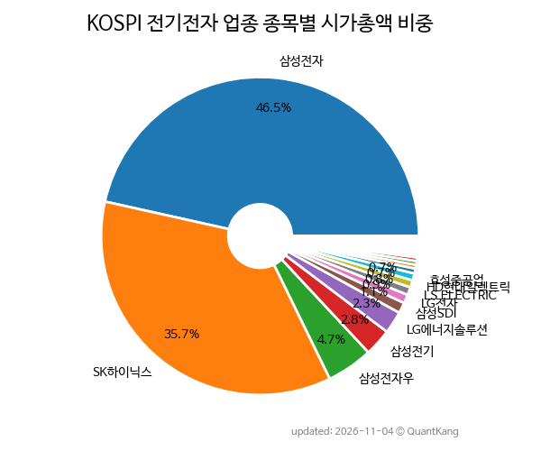

{: .align-center}

> **종목 목록 (84)**

| **종목** | **PER** | **PBR** | **DIV** | **비중** |
| :------- | ------: | ------: | ------: | -------: |
| [삼성전자](/005930/) | 30.5 | 3.1 | 0.8<small>%</small> | 46.5<small>%</small> |
| [SK하이닉스](/000660/) | 20.4 | 7.4 | 0.2<small>%</small> | 35.7<small>%</small> |
| 삼성전자우 | - | - | 1.0<small>%</small> | 4.7<small>%</small> |
| [삼성전기](/009150/) | 101.0 | 7.5 | 0.2<small>%</small> | 2.8<small>%</small> |
| [LG에너지솔루션](/373220/) | - | 4.0 | - | 2.3<small>%</small> |
| [삼성SDI](/006400/) | - | 1.9 | - | 1.1<small>%</small> |
| [LG전자](/066570/) | 26.8 | 1.1 | 0.9<small>%</small> | 0.9<small>%</small> |
| [LS ELECTRIC](/010120/) | 67.3 | 9.3 | 0.5<small>%</small> | 0.8<small>%</small> |
| [HD현대일렉트릭](/267260/) | 19.7 | 7.1 | 1.8<small>%</small> | 0.7<small>%</small> |
| [효성중공업](/298040/) | 32.1 | 7.1 | 0.4<small>%</small> | 0.7<small>%</small> |
| [두산](/000150/) | 170.0 | 8.2 | 0.6<small>%</small> | 0.5<small>%</small> |
| [포스코퓨처엠](/003670/) | 3425.5 | 3.8 | 0.1<small>%</small> | 0.4<small>%</small> |
| [한화시스템](/272210/) | 41.8 | 2.1 | 0.9<small>%</small> | 0.4<small>%</small> |
| [LG이노텍](/011070/) | 19.8 | 1.2 | 0.7<small>%</small> | 0.4<small>%</small> |
| [이수페타시스](/007660/) | 30.6 | 6.8 | 0.3<small>%</small> | 0.2<small>%</small> |
| [대한전선](/001440/) | 39.9 | 2.1 | - | 0.1<small>%</small> |
| 대덕전자 | 86.4 | 4.6 | 0.6<small>%</small> | 0.1<small>%</small> |
| [산일전기](/062040/) | 26.2 | 6.7 | 1.0<small>%</small> | 0.1<small>%</small> |
| [LG디스플레이](/034220/) | 16.4 | 0.6 | - | 0.1<small>%</small> |
| 가온전선 | 117.8 | 12.5 | 0.1<small>%</small> | 0.1<small>%</small> |
| [엘앤에프](/066970/) | - | 4.9 | - | 0.1<small>%</small> |
| [DB하이텍](/000990/) | 13.5 | 1.7 | 1.0<small>%</small> | 0.1<small>%</small> |
| 일진전기 | 22.5 | 4.0 | 1.0<small>%</small> | 0.1<small>%</small> |
| [DN오토모티브](/007340/) | 7.2 | 1.0 | 2.5<small>%</small> | 0.1<small>%</small> |
| 한화비전 | 44.6 | 2.3 | - | 0.1<small>%</small> |
| [에코프로머티](/450080/) | 81.9 | 1.9 | - | 0.1<small>%</small> |
| 두산퓨얼셀 | - | 6.3 | - | 0.1<small>%</small> |
| 두산우 | - | - | 1.5<small>%</small> | 0.0<small>%</small> |
| 롯데에너지머티리얼즈 | - | 1.1 | - | 0.0<small>%</small> |
| HD현대에너지솔루션 | 24.2 | 2.4 | - | 0.0<small>%</small> |
| 삼성전기우 | - | - | 0.7<small>%</small> | 0.0<small>%</small> |
| 코리아써키트 | 38.6 | 4.2 | 0.1<small>%</small> | 0.0<small>%</small> |
| LG전자우 | - | - | 2.6<small>%</small> | 0.0<small>%</small> |
| [SK아이이테크놀로지](/361610/) | - | 0.4 | - | 0.0<small>%</small> |
| 대원전선 | 72.9 | 5.4 | - | 0.0<small>%</small> |
| 삼화콘덴서 | 69.8 | 3.2 | 0.6<small>%</small> | 0.0<small>%</small> |
| 경동나비엔 | 10.0 | 1.2 | 1.2<small>%</small> | 0.0<small>%</small> |
| 해성디에스 | 26.7 | 1.1 | 2.4<small>%</small> | 0.0<small>%</small> |
| 세방전지 | 5.1 | 0.5 | 4.9<small>%</small> | 0.0<small>%</small> |
| 파미셀 | 13.0 | 4.2 | 0.6<small>%</small> | 0.0<small>%</small> |
| 자화전자 | 7.2 | 0.8 | - | 0.0<small>%</small> |
| 솔루엠 | 45.0 | 1.3 | 0.6<small>%</small> | 0.0<small>%</small> |
| LX세미콘 | 4.7 | 0.3 | 6.2<small>%</small> | 0.0<small>%</small> |
| 한국단자 | 4.9 | 0.4 | 6.3<small>%</small> | 0.0<small>%</small> |
| 비에이치 | 14.2 | 0.6 | 1.8<small>%</small> | 0.0<small>%</small> |
| 솔루스첨단소재 | - | 0.9 | 0.1<small>%</small> | 0.0<small>%</small> |
| 광전자 | 90.1 | 1.6 | 0.7<small>%</small> | 0.0<small>%</small> |
| 신도리코 | 15.4 | 0.3 | 2.8<small>%</small> | 0.0<small>%</small> |
| 한솔테크닉스 | - | 0.8 | 1.4<small>%</small> | 0.0<small>%</small> |
| 엠씨넥스 | 5.2 | 0.7 | 6.2<small>%</small> | 0.0<small>%</small> |
| 삼성SDI우 | - | - | - | 0.0<small>%</small> |
| 신성이엔지 | - | 1.1 | - | 0.0<small>%</small> |
| 드림텍 | 5520.0 | 1.0 | 4.1<small>%</small> | 0.0<small>%</small> |
| 두산2우B | - | - | 1.8<small>%</small> | 0.0<small>%</small> |
| 티엠씨 | - | 2.0 | 0.6<small>%</small> | 0.0<small>%</small> |
| 삼영전자 | 41.6 | 0.4 | 2.7<small>%</small> | 0.0<small>%</small> |
| 삼화전기 | 20.9 | 2.1 | 2.0<small>%</small> | 0.0<small>%</small> |
| 와이투솔루션 | - | 1.0 | - | 0.0<small>%</small> |
| 금호전기 | - | 3.3 | - | 0.0<small>%</small> |
| KEC | - | 0.3 | - | 0.0<small>%</small> |
| 티에이치엔 | 1.1 | 0.3 | 2.7<small>%</small> | 0.0<small>%</small> |
| 아남전자 | 16.4 | 0.7 | - | 0.0<small>%</small> |
| 주성코퍼레이션 | 27.9 | 2.0 | - | 0.0<small>%</small> |
| 선도전기 | 9.9 | 1.5 | - | 0.0<small>%</small> |
| 두산퓨얼셀1우 | - | - | - | 0.0<small>%</small> |
| 휴니드 | - | 0.3 | - | 0.0<small>%</small> |
| 써니전자 | 14.6 | 0.6 | 2.4<small>%</small> | 0.0<small>%</small> |
| 일진디스플 | - | 1.6 | - | 0.0<small>%</small> |
| 삼화전자 | - | 1.9 | - | 0.0<small>%</small> |
| 코리아써우 | - | - | 0.6<small>%</small> | 0.0<small>%</small> |
| 씨아이테크 | 2.3 | 0.5 | - | 0.0<small>%</small> |
| 대덕전자1우 | - | - | 2.7<small>%</small> | 0.0<small>%</small> |
| 성문전자 | 14.8 | 0.7 | 0.3<small>%</small> | 0.0<small>%</small> |
| 엑시큐어하이트론 | - | 3.3 | - | 0.0<small>%</small> |
| 광명전기 | - | 6.5 | - | 0.0<small>%</small> |
| 경인전자 | 6.6 | 0.3 | 5.2<small>%</small> | 0.0<small>%</small> |
| 대원전선우 | - | - | - | 0.0<small>%</small> |
| 솔루스첨단소재1우 | - | - | 0.8<small>%</small> | 0.0<small>%</small> |
| 두산퓨얼셀2우B | - | - | - | 0.0<small>%</small> |
| 에이엔피 | - | 0.4 | - | 0.0<small>%</small> |
| 주연테크 | - | 0.1 | - | 0.0<small>%</small> |
| 코리아써키트2우B | - | - | 0.8<small>%</small> | 0.0<small>%</small> |
| 솔루스첨단소재2우B | - | - | 0.5<small>%</small> | 0.0<small>%</small> |
| 성문전자우 | - | - | 0.2<small>%</small> | 0.0<small>%</small> |

